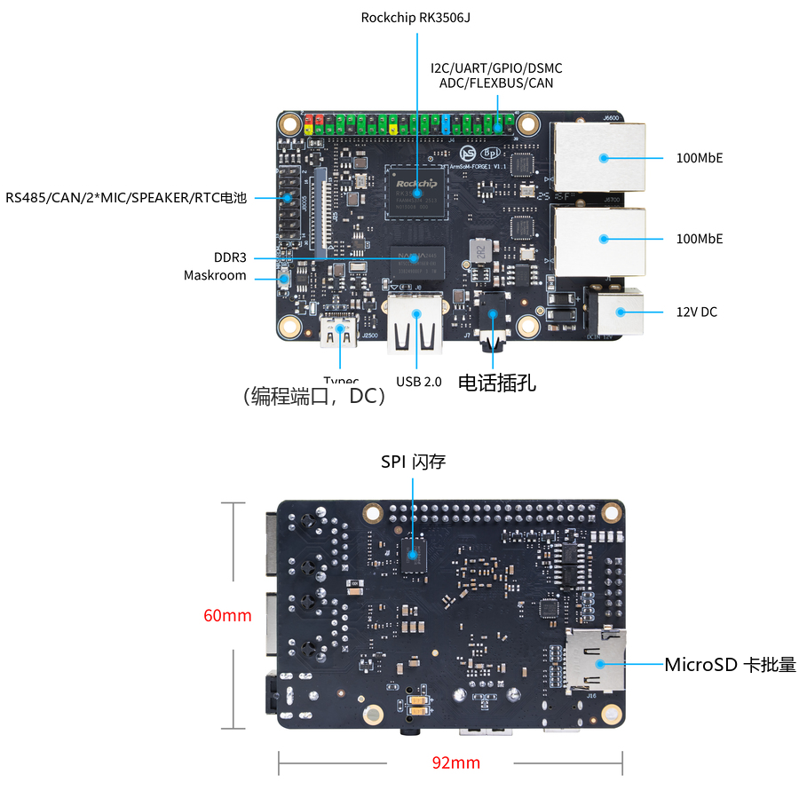
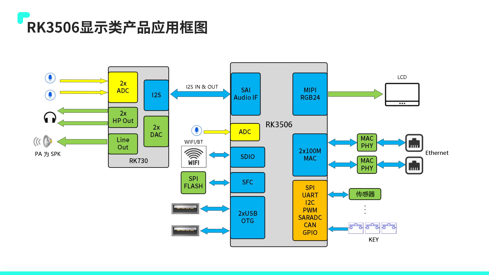
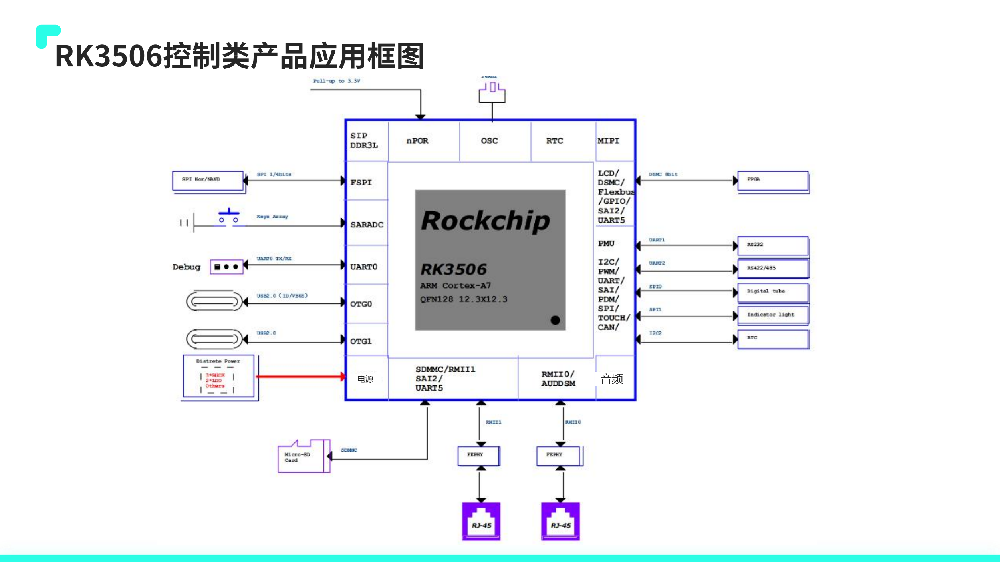
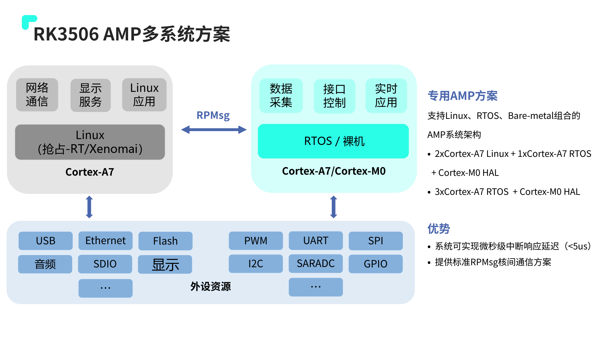
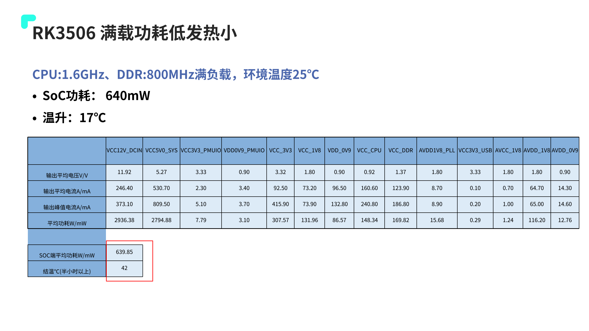

工业应用的第一步通常是让屏幕、设备通信和业务软件一起稳定运行。ArmSoM Forge1 将 RK3506J 与常用板级接口集成，适合开发 HMI、工业网关及采集终端，再根据项目需求决定是否转向 CM1 定制设计。

## 开发板能提供什么

Forge1 官方规格列出 512MB DDR3L、512MB NAND、双百兆以太网、MIPI DSI、USB2.0 Host，以及 RS485/CAN 接口资源；板尺寸为 92×62mm。供电可选择 DC 12V/1A 或 Type-C 5V/2A，具体接法以板卡手册为准。

官方软件说明列出 Buildroot、Linux 6.1、RT-Thread 4.1、AMP、Preempt-RT/Xenomai 与 LVGL。这里是官方资源说明，不表示每一个下载镜像都同时启用了全部功能；上机前应确认镜像、内核配置和样例。

## HMI：让操作界面服务于设备

可以设计运行状态页、参数页、报警记录和维护入口。先以真实设备数据驱动界面，再测量通信繁忙时的触控响应。将采集任务和界面刷新解耦，限制每次刷新量，减少大图解码和频繁写盘对交互的影响。

显示接口需要对应屏幕时序、驱动和触摸方案。2D 加速不等于任意界面库自动获得硬件加速，必须确认渲染后端与驱动路径。

## 网关：把现场协议接入网络

用 RS485 或 CAN 与设备通信，两路以太网连接现场网络和上层系统。Modbus、MQTT 等可以作为软件方案评估，但本文章不宣称出厂镜像已集成全部协议。

设计时列出轮询周期、超时重试、缓存上限和数据去重规则；同时检查终端电阻、共地、隔离、防浪涌及现场线缆。接口名称不能代替整机 EMC 验证。

## 采集：从信号到可追溯记录

为设备状态、计数和报警加上时间戳，设置离线缓存和定期上报。明确网络校时失败时的行为，保留重要配置版本，测试意外掉电后的恢复。需要模拟量、热电偶或高电压输入时，应外接适当的采集与隔离电路。

## 实时性如何评估

Linux、实时补丁和 AMP 提供不同设计路径，但“支持实时方案”不是某个最坏响应时间的保证。测试要覆盖网络、显示、存储同时繁忙的情况，记录延迟分布与最大值。关键闭环任务是否交给独立控制器，应由系统时序和故障需求决定。

## 适合怎样的项目

Forge1 适合尽早验证板级接口与应用的项目；CM1 适合后续自定义载板。不要将板卡文档标注的 −40～85°C 自动等同于带屏幕整机的温度能力。官方页面还同时出现 NAND 规格和 eMMC 启动说明，本系列按规格表写 NAND，实际启动介质需按交付版本核对。

官方接口图标注 92×60mm，规格表写 92×62mm，本文保留该差异。设计外壳与安装孔时应使用交付版本的机械图，不直接采用宣传图尺寸。

## 用 RK3506 应用方案进一步规划项目

本次补充依据 `RK3506 产品应用方案介绍_V1.2.2_20240903(1).pdf`，共 34 页；封面日期为 2024.08.29，与文件名日期不同，作为同一份资料保留。以下是专题解读与开发建议，不是原厂性能的 ArmSoM 复测。

原稿第 12 页区分 RK3506G2、RK3506B 和 RK3506J：G2 为内嵌 128MB DDR3L 的方案，B/J 使用外部 DDR，J 对应工业温度定位。Forge1 和 CM1 的官方产品资料使用 RK3506J，不能把 G2 内存或 EVB 接线直接套到它们上面。

*RK3506 显示类应用框图 — 中文原图；本批未找到对应英文图. `RK3506 产品应用方案介绍_V1.2.2_20240903(1).pdf`, PDF p. 5.*

## 六种应用如何转化为开发任务

| 原稿应用方向 | 建议的首个可验证目标 | 仍需补齐的条件 |
| --- | --- | --- |
| 家电中控 | 参数设置、告警、断电后配置恢复 | 屏幕驱动、认证、待机和唤醒策略 |
| 手持 POS | 扫码输入与业务界面并行 | 摄像头／扫码模块适配、电池管理和安全要求 |
| 楼宇对讲 | 音视频通话、回声路径和断线重连 | 音频算法资源、摄像头、网络及扬声器设计 |
| PLC 控制 | 先建立可重复的周期／抖动测量 | 实时驱动、任务隔离、故障处理与现场总线 |
| 工业 HMI | 触摸、画面刷新和设备采集同步 | 面板时序、背光、抗干扰和 UI 资源预算 |
| 工业网关 | 本地缓存、转发和远程维护 | 协议实现、隔离防护、日志及更新回滚 |

这些是开发路线，不表示 Forge1 默认镜像已经交付全部应用。Forge1 可用于板级验证；定制连接器、尺寸或行业接口的产品可以进一步评估 CM1 载板。

*RK3506 控制类应用框图 — 中文原图；本批未找到对应英文图. `RK3506 产品应用方案介绍_V1.2.2_20240903(1).pdf`, PDF p. 6.*

## 视频软解与 UI 共存：不要忽略 CPU 开销

第 19 页列出 H.264、MJPEG 软件解码，参考能力为 720P 30FPS 或 480P 60FPS，并明确写出双核 Cortex-A7 占用 90%。这不是专用视频解码硬件的低开销承诺。对讲或视频 HMI 项目应把解码、缩放、UI、通信和音频同时加压，记录帧率和触摸延迟。

原稿的软件路线包括 Linux Kernel 6.1、RT-Thread 4.1、LVGL 和 RGA 加速，也介绍差分 OTA、A/B 分区及快速启动。是否可用要按具体 SDK、镜像和配置验证；“3 秒内开机”属于原稿演示目标，不能直接作为用户应用启动时间。

## 实时控制要选对比较条件

*RK3506 AMP 系统分工示例 — 中文原图；本批未找到对应英文图. `RK3506 产品应用方案介绍_V1.2.2_20240903(1).pdf`, PDF p. 22.*

第 22 页给出 `2× Cortex-A7 Linux + 1× Cortex-A7 RTOS + Cortex-M0 HAL` 等 AMP 分工，以及 RPMsg 通信。它适合把网络/UI与及时响应任务分离，但共享内存、外设归属和故障恢复仍需设计。

第 23 页的 Preempt-RT 加压延迟约 62µs，条件包括隔离核心运行 cyclictest、stress-ng 加压、CPU 1300MHz 和 DDR3 800MHz。第 24 页另给 EtherCAT 参考指标 90µs 抖动、1ms 周期。第 22 页的 `<5us` 中断响应与这些测试不是同一口径，不能拼成一个“保证实时性”的数值。

## 功耗应区分 SoC、整板和外设

*原厂负载功耗条件与测量边界 — 中文原图；本批未找到对应英文图. `RK3506 产品应用方案介绍_V1.2.2_20240903(1).pdf`, PDF p. 29.*

第 29 页在 CPU 1.6GHz、DDR 800MHz、环境 25℃的原厂条件下写出 SoC 约 640mW、温升 17℃；同页 12V 输入端表格约 2936.38mW。两者测量边界不同，不能把 640mW 写成 Forge1 整板功耗。

同理，第 28 页 IDLE 109mW、静态桌面 200mW、待机 30mW／8mW 都带有显示、Wi-Fi 和 Logic 掉电条件。实际选电源、散热和电池时，应测量包括屏幕、网络、USB 与转接板的整机峰值和平均值。

## 从演示进入可交付产品

建议为每个候选项目建立同一张验收表：板卡与镜像版本、启动时间、峰值内存、通信丢包、界面响应、温度、掉电恢复和升级回滚。先在 Forge1 验证软件与接口，再决定是否使用 CM1 定制载板；对尚未确认的功能保留待验证状态。

## 产品与开发资料

- **Forge1** — [产品页](https://www.armsom.org/forge1) · [官方文档](https://docs.armsom.org/armsom-forge1)
- **CM1** — [产品页](https://www.armsom.org/cm1) · [官方文档](https://docs.armsom.org/armsom-cm1)

## 延伸阅读

- [RK3506G EVB 接口与调试参考](/zh/articles/rk3506g-evb-interface-debugging/)
- [RK730 音频设计](/zh/articles/rk730-audio-codec-design/)

## 系列文章与官方资料

- [RK3506J 芯片详解：从三核处理器到工业 HMI 与设备联网](/zh/articles/rk3506j-chip-guide/)
- [ArmSoM CM1：用 RK3506J 核心板开发自己的工业终端](/zh/articles/cm1-rk3506j-industrial-module/)
- [RK3506B Datasheet V1.0：下载、架构、引脚与电气设计导读](/zh/articles/rk3506b-datasheet-v10/)
- [Rockchip RK3506](https://www.rock-chips.com/a/cn/product/RK35xilie/2025/1208/2125.html)
- [ArmSoM CM1](https://docs.armsom.org/armsom-cm1)
- [ArmSoM Forge1](https://docs.armsom.org/armsom-forge1)
- [ArmSoM](https://www.armsom.org/)
