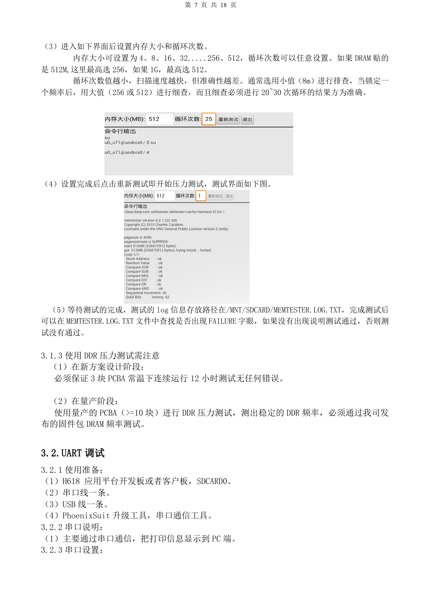
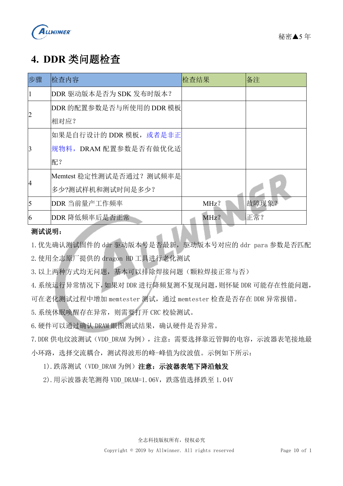

# H618 上电与稳定性验证：烧录、DDR 和故障定位

本文是依据所列原稿重组的硬件设计专题，属于平台参考，未确认对应 ArmSoM 板卡。参数是原稿参考，不是 ArmSoM 实测；实施前核对芯片版本、PCB、所用 SDK/BSP、内核、固件及外设规格。

**Debug V1.1 PDF 4–17; stability checklist F01 PDF 5–12**

## 先定位停在哪个阶段

断电检查 DCIN、CPU、GPU、SYS、DRAM、PLL 对地是否短路；检查 PCBA 漏焊、虚焊。原稿初次供电示例为 5V、限流 500mA，不是整机满载电源额定值。电源无输出时，断电后通过电感前后侧区分 PMU 与负载短路。再测复位是否释放、24MHz 是否起振、USB0 是否枚举。电源正确只能说明这个检查点通过，不能照抄原稿推断整个系统工作正常。

## 烧录与串口

原稿使用 PhoenixSuit，不能与 PhoenixUSB Pro 同时运行；无固件时通过 USB0，已有固件时断电后按 UBOOT 键再接 USB。原稿另列 Flash CLK 对地进入 FEL 的维修方法，这需要核对目标板测试点，不能在未知通电状态下随意短接。反复自动烧录时检查 BOOT_Select 和串口中的 `need secure img`。SDCARD0 复用串口时 D3 为板端 TX、CLK 为板端 RX；按实际 IO 电平连接，不能把适配器 VCC 直接当成通用供电。

## DDR 与动态负载

DDRTest1_2.apk 示例：512M 内存选最大 256，1G 选最大 512；先小范围排查，再 256/512 做 20–30 次细查。日志路径保持原稿 `/MNT/SDCARD/MEMTESTER.LOG.TXT`，检查 `FAILURE`；实际系统路径大小写需要核对。设计阶段原稿要求 3 块 PCBA 常温连续 12h，量产阶段 ≥10 块评估稳定频点。不能将这些要求写成 ArmSoM 已通过。休眠问题增加 CRC，频率降低后恢复正常只能提示时序/电源裕量问题，不能证明器件合格。

## 测量记录与原稿疑点

使用靠近引脚的电容测电源，示波器地回路尽量小，纹波用 AC 耦合，跌落用下降沿触发。Checklist 的频压输出表将 1200000/1320000 两行写成 `1.05/1.1`，表头却为 mV；下一页明确写 1.05V/1.1V，不能直接把前页当成写入参数。Wi-Fi 调试页的“反射大于 -20dB/-10dB”方向也待厂家确认。对 HDMI、USB、音频、SD、以太网逐一检查供电、使能、连通性、波形和焊接，再记录重启、休眠、高低温样本数量和时长。


## 原稿命令示例

仅适用于具备对应 cpufreq/debugfs 节点的原稿 SDK；先记录当前 governor 与频点，测试后恢复。示例不会在本次整理中执行。

```sh
echo userspace > /sys/devices/system/cpu/cpu0/cpufreq/scaling_governor
echo 1008000> /sys/devices/system/cpu/cpu0/cpufreq/scaling_setspeed
cat /sys/devices/system/cpu/cpu0/cpufreq/cpuinfo_cur_freq
cat /sys/kernel/debug/cpufreq_table
```

## 参考原图

以下为中文原稿参考页截图，保留原图标注；本批未找到对应英文稿，四语共用中文原图。正文参数与步骤可复制，截图用于核对。页码均为 PDF 物理页码。

[](/assets/allwinner-hardware-series/h618-18-p8.png)

[](/assets/allwinner-hardware-series/h618-12-p10.png)

## ArmSoM 平台选择

如果项目考虑采用 ArmSoM，可从官方产品与开发文档选择平台，并重新核对处理器、接口与软件支持；本文不将 A733/H618 电路套用到其他 SoC。

- [ArmSoM](https://www.armsom.org/)
- [ArmSoM Docs](https://docs.armsom.org/)

## 系列阅读

- [H618 最小系统设计：AXP313A、24MHz 时钟与启动选择](/zh/articles/h618-power-clock-boot-design/)
- [H618 DDR 与 eMMC：模板、阻抗和 PCB 检查](/zh/articles/h618-dram-emmc-pcb-design/)
- [H618 外围接口：USB、HDMI、网络与 ESD 布局](/zh/articles/h618-interfaces-esd-layout/)
- [H618 · 系列导航](/zh/articles/h618-hardware-design-series/)

<!-- editable-source-tables -->

## 附录：原稿动态测试频压表

Stability checklist F01 · PDF 9

仅为原稿测试固件的预期值，不是全部 H618 的通用 OPP。对照自己的固件频压表，不手动照抄电压；前页单位冲突已在正文注明。

| 频率 kHz | 示例电压 V |
| --- | --- |
| 480000 | 0.9 |
| 720000 | 0.9 |
| 936000 | 0.9 |
| 1008000 | 0.95 |
| 1104000 | 1.0 |
| 1200000 | 1.05 |
| 1320000 | 1.1 |
| 1416000 | 1.15 |
