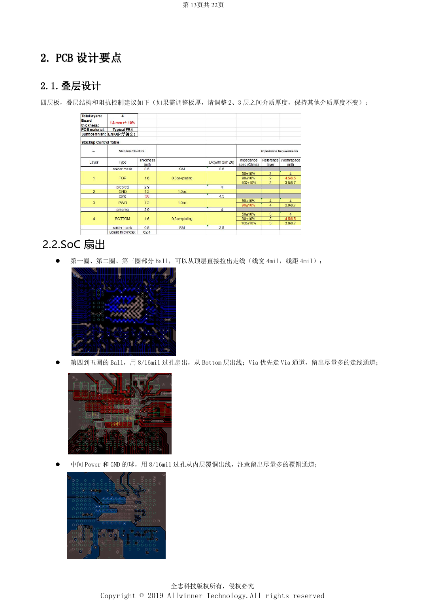
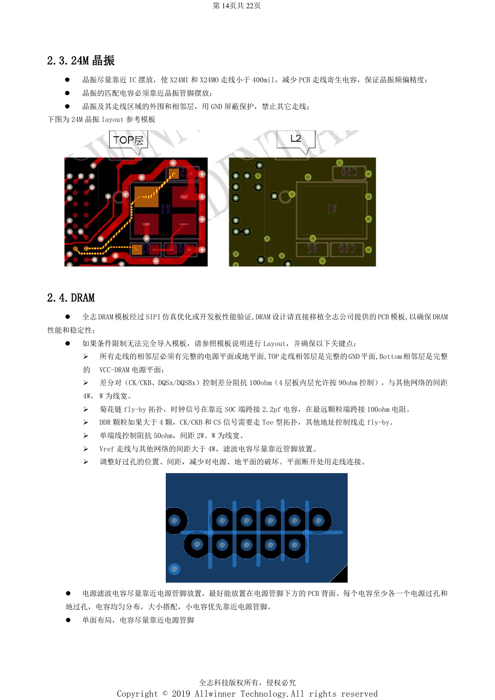

# H618 DDR 与 eMMC：模板、阻抗和 PCB 检查

本文是依据所列原稿重组的硬件设计专题，属于平台参考，未确认对应 ArmSoM 板卡。参数是原稿参考，不是 ArmSoM 实测；实施前核对芯片版本、PCB、所用 SDK/BSP、内核、固件及外设规格。

**Design V1.0 §1.5–1.6, §2.1–2.5; PDF 9–10, 14–16; PCB checklist V1.0**

## 先固定存储方案

指南列出 DDR4、DDR3/3L、LPDDR3、LPDDR4，单通道 32-bit、双片选、最大 4GB。这只是平台规格，必须按所选颗粒和固件匹配模板。SoC 与 DRAM 的 ZQ 引脚按原稿接 240Ω、1% 下拉。数据按 8-bit 分组交换时，相应 DQM 与 DQS 差分对要一起交换。四层参考板顶层出线 4/4mil，内圈用 8/16mil 过孔；板厚变化时按模板调整中间介质，而不是随意改变参考层距离。

## DDR 走线与电源回路

顶层信号参考完整 GND，底层参考完整 VCC-DRAM。差分 CK/DQS 为 100Ω，指南允许四层板内层按 90Ω；自查表另写 100Ω±10%，两者应按具体模板确认。差分对与其他网间隔 4W，单端 50Ω、间隔 2W，Vref 间隔大于 4W。fly-by 示例在 SoC 时钟端跨接 2.2pF，在最远颗粒端跨接 100Ω；超过四颗时 CK/CS 使用 Tee，其余地址控制仍 fly-by。每个去耦电容至少各一个电源与地过孔，小电容优先靠近引脚。

## eMMC 不能只看等长

CLK 串 33Ω、CMD 经 10kΩ 上拉到 VCC-PC，SoC 所在 GPIO 域与 eMMC VCCQ 使用同路供电。NC/RFU 不可为了布线接地或并到其他信号。原稿提到 eMMC5.0 的特定脚接地但未在文字中给完整脚号，实施前查颗粒手册。走线 ≤2000mil，D0–D7/DS 相对 CLK 差 ≤300mil，50Ω，间隔 ≥2W，CLK/DS 包地或至少 3W。VCC/VCCQ 宽度 ≥12mil且换层至少两个过孔。高频优先点对点；双 Layout 使用链式连接并让 eMMC 在末端，控制支路。

## 参考原图

以下为中文原稿参考页截图，保留原图标注；本批未找到对应英文稿，四语共用中文原图。正文参数与步骤可复制，截图用于核对。页码均为 PDF 物理页码。

## ArmSoM 平台选择

如果项目考虑采用 ArmSoM，可从官方产品与开发文档选择平台，并重新核对处理器、接口与软件支持；本文不将 A733/H618 电路套用到其他 SoC。

- [ArmSoM](https://www.armsom.org/)
- [ArmSoM Docs](https://docs.armsom.org/)

## 系列阅读

- [H618 最小系统设计：AXP313A、24MHz 时钟与启动选择](/zh/articles/h618-power-clock-boot-design/)
- [H618 外围接口：USB、HDMI、网络与 ESD 布局](/zh/articles/h618-interfaces-esd-layout/)
- [H618 上电与稳定性验证：烧录、DDR 和故障定位](/zh/articles/h618-bringup-stability-validation/)
- [H618 · 系列导航](/zh/articles/h618-hardware-design-series/)
