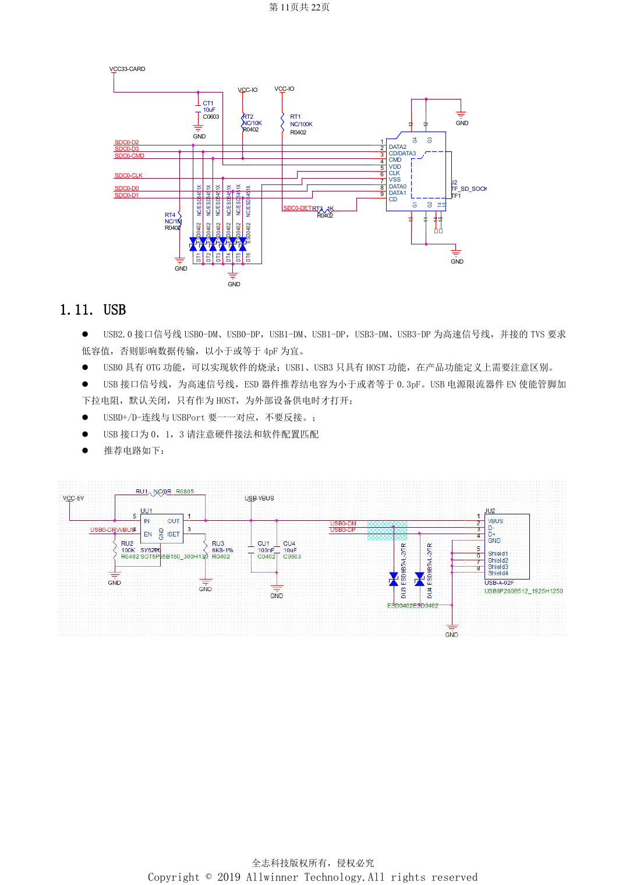
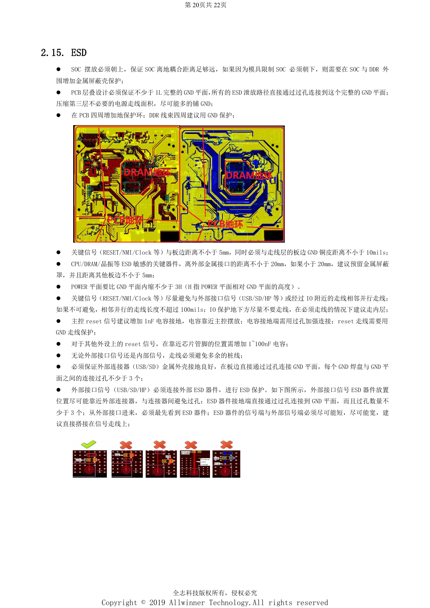

# H618 外围接口：USB、HDMI、网络与 ESD 布局

本文是依据所列原稿重组的硬件设计专题，属于平台参考，未确认对应 ArmSoM 板卡。参数是原稿参考，不是 ArmSoM 实测；实施前核对芯片版本、PCB、所用 SDK/BSP、内核、固件及外设规格。

**Design V1.0 §1.7–1.13, §2.6–2.15; PDF 10–13, 17–21; PCB checklist V1.0**

## USB 与显示接口

USB0 支持 OTG/烧录，USB1、USB3 为 HOST，端口编号不能与 USB3.0 协议混淆。限流开关 EN 默认下拉，只在 HOST 供电时开启。原稿同页给 TVS ≤4pF 和 ≤0.3pF 两种说法，应向方案方核实具体线路，不能任意选一个作为统一上限。HDMI 内置 IIC/CEC 电平转换；5V 需用低压降肖特基防反灌，避免低于 4.75V。CVBS 为电流型输出，75Ω 对地电阻使用 0805，走线全程包地。

## 网络、Wi-Fi 与音频

以太网高压电容至少 1206、耐压至少 2kV，75Ω 电阻用 0805，变压器下方禁走线并禁铜。指南要求高压与低压部分距离 >50mil，自查表写至少 2mm，保留更严格检查项并核对结构。Wi-Fi IO 与 PG 电源匹配，SDIO CLK 参考 33Ω 与 5.6pF；蓝牙唤醒需确认独立常供电。RF 为 50Ω，长度建议 <6cm，距板边 >3mm，不分叉不换层，地过孔间隔 0.5–1mm。音频 AVCC ≥25mil、VRA1/2 ≥10mil且 ≤300mil；LINEOUT 与 DDR 等噪声源分开。

## ESD 与散热要一起审查

至少保留一层完整 GND，保护器件在连接器旁、信号先过保护器件再进入系统，其地端至少三个过孔。RESET/NMI/Clock 距板边 ≥5mm，距边缘地铜 ≥10mil；CPU/DDR/晶体距外露金属接口 ≥20mm，不足时考虑屏蔽罩。SoC reset 参考 1nF，其他外设 reset 为 1–100nF，不能混用。电源平面相对地内缩至少 3H。中心散热过孔参考孔径 10–12mil、孔距 30–40mil；热源分散、PMU 与 SoC 间距参考 >2cm，仍需整机温升及 EMC 实测。

## 参数速查

| 项目 | 原稿参考 |
| --- | --- |
| USB 布线 | 90Ω; length <4000mil; vias ≤2; clearance >10mil |
| HDMI 布线 | 90–100Ω; intra-pair <10mil; inter-pair <100mil; length <3000mil |
| SD Card 布线 | 50Ω; data-to-CLK <500mil; CLK resistor within 300mil of SoC |

## 参考原图

以下为中文原稿参考页截图，保留原图标注；本批未找到对应英文稿，四语共用中文原图。正文参数与步骤可复制，截图用于核对。页码均为 PDF 物理页码。

## ArmSoM 平台选择

如果项目考虑采用 ArmSoM，可从官方产品与开发文档选择平台，并重新核对处理器、接口与软件支持；本文不将 A733/H618 电路套用到其他 SoC。

- [ArmSoM](https://www.armsom.org/)
- [ArmSoM Docs](https://docs.armsom.org/)

## 系列阅读

- [H618 最小系统设计：AXP313A、24MHz 时钟与启动选择](/zh/articles/h618-power-clock-boot-design/)
- [H618 DDR 与 eMMC：模板、阻抗和 PCB 检查](/zh/articles/h618-dram-emmc-pcb-design/)
- [H618 上电与稳定性验证：烧录、DDR 和故障定位](/zh/articles/h618-bringup-stability-validation/)
- [H618 · 系列导航](/zh/articles/h618-hardware-design-series/)
