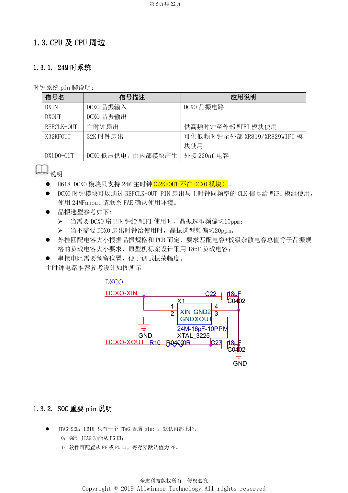
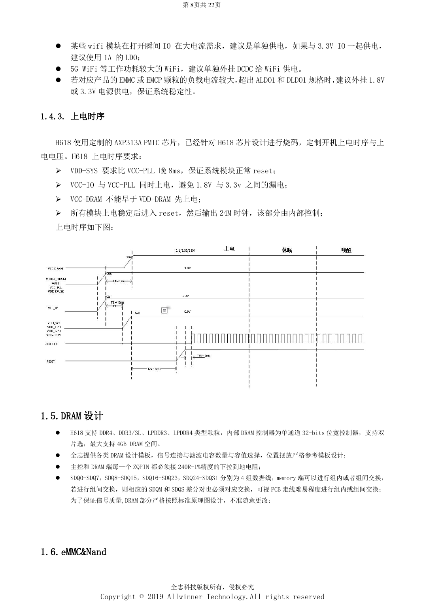

# H618 最小系统设计：AXP313A、24MHz 时钟与启动选择

本文是依据所列原稿重组的硬件设计专题，属于平台参考，未确认对应 ArmSoM 板卡。参数是原稿参考，不是 ArmSoM 实测；实施前核对芯片版本、PCB、所用 SDK/BSP、内核、固件及外设规格。

**Design V1.0 §1.1–1.4, §2.1–2.3, §2.11; PDF 5–9, 14–15, 19**

## 从 BROM 到系统

复位释放后先执行 BROM，初始化电源、时钟、总线、复位与存储接口，再把串口和 DRAM 等初始化信息读入 SRAM，执行 Boot0、U-Boot，最后加载操作系统及外设。把串口可达、启动配置和恢复路径作为最小系统的一部分，不要等外壳完成后再补测试点。JTAG-SEL 内部上拉：低电平强制 PG，高电平由软件选择 PF/PG，默认 PF。AP-RESET 上拉到 VCC-PLL，保留 RC 与 ESD 器件。

## 电源与上电顺序

参考方案为定制烧码 AXP313A。VDD-SYS 比 VCC-PLL 晚 8ms，VCC-IO 与 VCC-PLL 同时上电；VCC-DRAM 不能早于 VDD-DRAM。所有模块稳定后才进入内部控制的复位和 24MHz 时钟流程。CPU 独立供电用于 DVFS；GPU 与 SYS 合并，不应独立动态调压。CPU 两端有 22µF 电容，SYS/GPU 近端两颗 22µF，VCC-DRAM 近端至少 10µF。高功耗 Wi-Fi 或超出 LDO 额定能力的 eMMC 应单独评估供电。

## 时钟与原稿矛盾

DCXO 仅支持 24MHz；给 Wi-Fi 扇出时晶体频差 ≤10ppm，否则 ≤20ppm。DXLDO-OUT 外接 220nF。18pF 是原型匹配电容示例，不是所有晶体通用值；DXIN/DXOUT 走线小于 400mil并完整包地。电源表的 SYS+GPU 场景电流 1.6A 却配 1.5A PMU 能力，属于待核对项，不能据此宣称有余量。目录写 V2.1，但封面和修订记录为 V1.0，本系列按 V1.0 标识。

## 参数速查

| 项目 | 原稿参考 |
| --- | --- |
| 启动介质；PC3/4/5/6 | MLC NAND / SLC NAND: 1/1/1/1; eMMC USER: 0/1/1/1; eMMC BOOT: 1/0/1/1; SPI_NOR: 1/1/0/1; SPI_NAND: 1/1/1/0 |
| 模块电源下限 | >=1.78V; nominal 1.8V ±1% |

## 参考原图

以下为中文原稿参考页截图，保留原图标注；本批未找到对应英文稿，四语共用中文原图。正文参数与步骤可复制，截图用于核对。页码均为 PDF 物理页码。

## ArmSoM 平台选择

如果项目考虑采用 ArmSoM，可从官方产品与开发文档选择平台，并重新核对处理器、接口与软件支持；本文不将 A733/H618 电路套用到其他 SoC。

- [ArmSoM](https://www.armsom.org/)
- [ArmSoM Docs](https://docs.armsom.org/)

## 系列阅读

- [H618 DDR 与 eMMC：模板、阻抗和 PCB 检查](/zh/articles/h618-dram-emmc-pcb-design/)
- [H618 外围接口：USB、HDMI、网络与 ESD 布局](/zh/articles/h618-interfaces-esd-layout/)
- [H618 上电与稳定性验证：烧录、DDR 和故障定位](/zh/articles/h618-bringup-stability-validation/)
- [H618 · 系列导航](/zh/articles/h618-hardware-design-series/)

<!-- editable-source-tables -->

## 附录：AXP313A 原稿供电表

Design V1.0 · PDF 8

CPU/SYS 原稿写“+5%”而非“±5%”，这里不擅自改符号；SYS+GPU 电流矛盾见正文。DRAM 此处为 DDR3 示例，不能套到其他类型。

| 电源 | 电压 | 精度（原文） | 纹波噪声 | 场景最大电流 | PMU能力 |
| --- | --- | --- | --- | --- | --- |
| CPU | 0.9V | 0.9V+5% | <90mV | 1.8A | 3A |
| SYS+GPU | 0.94V | 0.94V+5% | <90mV | 1.6A | 1.5A |
| DRAM | 1.5V | 1.5V±10% | <125mV | 1A | 2A |
| Module | 1.8V | 1.8V±1% | <30mV | 100mA | 300mA |
| IO normal | 3.3V | 3.3V±10% | <125mV | 200mA | 500mA |
