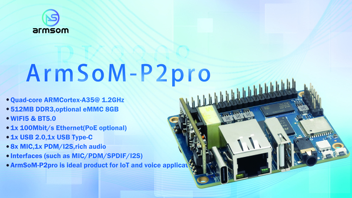

P2 Pro 的小尺寸、Linux 环境和有线/无线连接，使它适合轻量数据采集与联网原型。它的价值在于把设备侧数据接入应用，而不是用来替代高吞吐网络设备。先明确采集速率、缓存与协议，再决定软件部署方式。

## 选择正确配置

| 项目 | 官方公开信息 | 开发时核对 |
|---|---|---|
| 处理器 | RK3308B-S 四核 Cortex-A35 | 实际频率与镜像架构 |
| 内存 | 产品常见配置512MB DDR3；文档也列256/512MB | 以购买和交付版本为准 |
| 存储 | MicroSD；8GB eMMC可选 | 不把eMMC当作全系标配 |
| 网络 | 一个百兆网口、AP6256无线模块 | 驱动、天线、频段及实际覆盖 |
| 供电 | Type-C 5V/2A；PoE模块可选 | 不能直接假定已装PoE |
| 尺寸/温度 | 65×52.5mm；文档标注0～70°C | 外壳与整机测试另做 |

官方页面对蓝牙版本也有4.2与5.0不同写法，本系列只确认无线模块标识和接口存在，版本及可用功能按实际模块、固件和镜像核对。

## 方案一：传感器采集与状态看板

通过合适的 I2C、SPI 或串口器件读取环境与设备状态，在本地做范围检查和时间戳，再上传到服务端。电压、电平转换、隔离和传感器供电必须先确认。GPIO UART 不是 RS232/RS485，连接现场总线需要对应收发器。

## 方案二：轻量消息网关

以 MQTT 等消息协议作为应用方案，将采集、队列和上报分离。明确重试间隔、最大队列和消息有效期。设备离线后恢复连接，不应无限补发陈旧数据。TLS、认证、升级和日志策略需要一并设计，不能因是内网设备而忽略。

## 方案三：联网音频与设备通知

接收业务事件后播放提示音，或者将设备状态转换成语音反馈。先验证网络服务与音频播放并发时的资源占用。若业务依赖外部语音服务，明确无网时的降级行为。

## 网关边界与软件维护

一个百兆网口不等于双网口路由器。可以评估无线与有线之间的应用级通信，但桥接、路由、VPN等性能要分别实测，不承诺吞吐量。

官方资料列出 Debian 11、Buildroot 和第三方 OpenWrt/istoreos；它们是文档中的系统选项，不表示都是当前最新版本，也不意味着所有外设功能完全相同。采用第三方镜像前核对来源、板型、驱动和维护状态。

## 建议的验收顺序

1. 核对硬件配置，验证供电、启动、存储与网络。
2. 接入一个真实传感器，记录时间戳、异常值和通信错误。
3. 加入容量受限的本地队列，测试掉线、重启与断电。
4. 测量CPU、内存、存储写入及长期温度，减少不必要服务。
5. 测试升级与回退，记录镜像及应用版本。

这些是产品开发路线，不是量产认证或稳定性实测结论。P2 Pro 可帮助把轻量联网想法转为原型；生产交付仍需按最终设备验证。

## 系列文章与官方资料

- [RK3308B-S 芯片详解：为语音、音频与轻量联网设备而设计](/zh/articles/rk3308bs-chip-guide/)
- [ArmSoM P2 Pro：从麦克风采集到语音交互与网络音频](/zh/articles/p2pro-voice-audio-applications/)
- [RK3308B-S Datasheet V1.0：原文下载、音频架构与电气参数导读](/zh/articles/rk3308bs-datasheet-v10/)
- [Rockchip Audio](/zh/articles/023-rockchip-audio/)
- [Rockchip RK3308](https://www.rock-chips.com/a/cn/product/RK33xilie/2018/0614/908.html)
- [P2 Pro — Docs](https://docs.armsom.org/armsom-p2pro)
- [P2 Pro — ArmSoM](https://www.armsom.org/product-page/p2pro)
- [P2 Pro — BSP](https://github.com/ArmSoM/armsom-p2pro-bsp)
