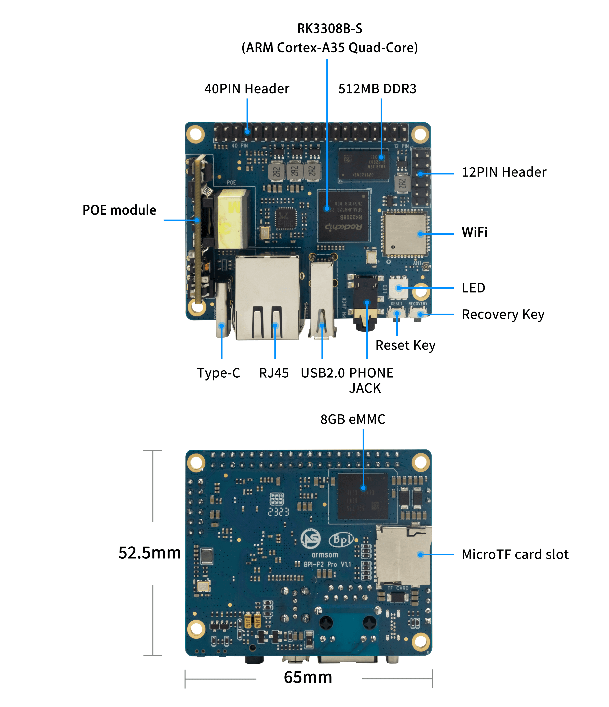

一块语音开发板的价值，是把麦克风、音频输出、网络和 Linux 软件接起来。ArmSoM P2 Pro 基于 RK3308B-S，适合搭建语音交互原型、网络音频节点及多通道采集实验。开始时先让信号链稳定，再加入算法，比直接追求复杂演示更有效。

## 从板上接口理解能力

P2 Pro 官方文档列出40-pin上的8路 MIC、PDM/I2S、两路线性输出和 SPDIF 输出，并提供音频插孔。这里的 MIC 是接口资源，不代表开发板已配好完整麦克风阵列。阵列结构、麦克风、连接线和采集配置仍需选配。

这组40-pin主要面向音频，不能按针数判断它与树莓派40-pin兼容。连接前核对原理图、电压、MICBIAS及差分输入；线路输出也不能直接当作扬声器功率输出。

## 场景一：语音命令终端

建议按采集、预处理、事件检测、识别、动作及反馈拆分模块。VAD 提供语音活动信息，唤醒词与识别模型另行选择。可以评估本地有限词汇识别，或将音频发送给明确选定的远程服务，但前者需测CPU/内存与准确率，后者需考虑网络、延迟及数据处理方式。

验收要覆盖静音、背景音乐、多人说话、设备自身播放声以及断网。记录误触发、漏检和端到端延迟，而不是只演示一次成功唤醒。本文章不承诺某种识别距离或开箱即用的算法授权。

## 场景二：网络音频播放与提示节点

把网络接收、缓冲、解码和播放拆开，测试缓冲不足、断流恢复与音量变化。需要外接功放时核对线路电平和接地，避免把耳机/线路输出规格当作成品扬声器输出功率。

公共区域提示终端、桌面播放器、设备语音反馈都可作为原型方向。多设备同步播放还需要时间同步、时钟漂移与缓冲策略，不能仅凭 Wi-Fi 接口保证同步。

## 场景三：多通道音频采集

先用单麦克风确认极性、增益和采样格式，再逐通道检查映射，最后同时采集。B-S 手册区分外部音频IO和内部Codec连接；不要把所有I2S控制器数量当作独立外接端口。高采样率与多通道组合应按具体接口限制核对。

以下为安装 ALSA 工具后的只读枚举命令，不会录音；设备号应从输出中确认，而不是硬编码：

```sh
cat /proc/asound/cards
arecord -l
aplay -l
```

## 从样机到稳定运行

固定板卡版本、镜像、内核、声卡配置、麦克风与供电。检查采样中断、丢帧、时钟偏差、播放回灌和温升；长时间录音需要存储容量与写入寿命预算。官方页的主频存在差异，不能按最高宣传频率推导算法性能。可从官方 BSP 和本站 Audio 开发指南继续深入，但文档命令不等于本批已做硬件实测。

## 系列文章与官方资料

- [RK3308B-S 芯片详解：为语音、音频与轻量联网设备而设计](/zh/articles/rk3308bs-chip-guide/)
- [ArmSoM P2 Pro：物联网数据采集与轻量网关开发方案](/zh/articles/p2pro-iot-lightweight-gateway/)
- [RK3308B-S Datasheet V1.0：原文下载、音频架构与电气参数导读](/zh/articles/rk3308bs-datasheet-v10/)
- [Rockchip Audio](/zh/articles/023-rockchip-audio/)
- [Rockchip RK3308](https://www.rock-chips.com/a/cn/product/RK33xilie/2018/0614/908.html)
- [P2 Pro — Docs](https://docs.armsom.org/armsom-p2pro)
- [P2 Pro — ArmSoM](https://www.armsom.org/product-page/p2pro)
- [P2 Pro — BSP](https://github.com/ArmSoM/armsom-p2pro-bsp)
