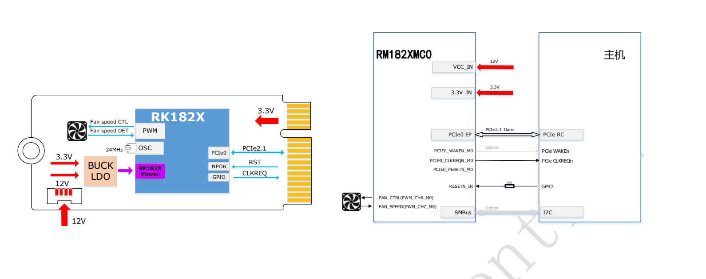
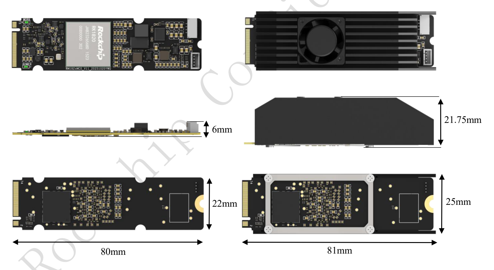

RM182XMC0 是 RK182X 的 M.2 Key M 算力协处理器模组系列，包括 RM1820MC0 和 RM1828MC0。本文完整整理用户提供的两页 Rev1.0 简介中的规格、性能表、供电、图示和订购信息，供 ArmSoM 平台方案评估；原文测试数据不是 ArmSoM 实测。

[下载原始M.2简介PDF（2页）](/assets/rk182x/RK182X-M2-Brief-V1.0.pdf)

## 1. 两个型号与计算能力

| 订购型号 | 芯片 | 内置DRAM | 原文模型定位 | 接口 |
|---|---|---|---|---|
| RM1820MC0 | RK1820 | 2.5GB | 3B | M.2 Key M，PCIe2.1 |
| RM1828MC0 | RK1828 | 5GB | 7B | M.2 Key M，PCIe2.1 |

算力标注20TOPS@INT8，支持INT4/INT8/INT16/FP8/FP16/BF16。简介称内置DRAM具有“数百GB高带宽”，但该句没有明确每秒单位、具体数值或测量条件，本文不补造一个GB/s指标。模型参数规模也不能替代量化格式、上下文长度和运行内存的验证。

## 2. 简介列出的模型与软件

原稿列出Qwen 2.5 0.5B/1.5B/3B、Qwen 3 0.6B/1.7B、FastVLM、MobilnetV1、MobilnetV2、Resnet50V2、yolov5s、yolov6s、yolov8s。`Mobilnet`为原稿写法，保留以便追溯。下面性能表另包含Qwen2.5 7B；它未出现在前述清单，不因此删除或补改原表。

软件组成包括开发机端RKNN3 Toolkit、板端RKNN3 Runtime以及RKNN3 Model Zoo转换部署示例。两页简介没有给出具体版本、安装命令、主机系统矩阵和模型量化配置，实际部署需取得匹配的软件包与说明。

## 3. 原文性能与功耗表

两种模式均标注 **Input tokens:128**。TTFT为首token延迟，TPS为生成速率；下表按原文数值转写。

| 模型 | 模式 | TTFT (ms) | TPS (tokens/s) | 平均功耗 (W) | 峰值功耗 (W) |
|---|---|---|---|---|---|
| Qwen2.5 3B | 节能 | 144.455 | 54.537 | 5.35 | 15.14 |
| Qwen2.5 3B | 标准 | 96.05 | 77.945 | 7.2 | 24.86 |
| Qwen2.5 7B | 节能 | 288.255 | 35.044 | 7.02 | 16.11 |
| Qwen2.5 7B | 标准 | 186.435 | 51.476 | 10.4 | 27.28 |

简介未完整交代主机、固件、量化、输出长度、采样策略、散热和功耗测量边界，不能据此承诺任意3B/7B模型的速度，也不能把平均功耗当峰值供电需求。

## 4. 供电与HOST连接

**除了M.2接口的3.3V，还需要额外12V供电。** 图中为PCIe0 EP连接主机PCIe RC，PCIe2.1 x1；同时标出CLKREQ、可选WAKE、RESETN_IN与0Ω连接、可选SMBus/I2C、风扇PWM控制和测速。Key M外形不等于普通NVMe SSD，不能假定任意M.2槽供电和软件即插即用。

## 5. 尺寸与安装空间

裸模组22×80mm，侧视标注6mm；带散热器图标注长81mm、宽25mm、高21.75mm。不能只按2280裸板尺寸检查机箱空间，还要留出额外电源线、固定结构和风道。图示不是完整制造公差图。

## 6. 与SO-DIMM版本怎样区分

M.2版为RM1820MC0/RM1828MC0，SO-DIMM版为RM1820SA0/RM1828SA0。相同芯片系列不代表接口、供电、结构和固件配置相同。SO-DIMM的8–14.4V输入范围、260针定义及热限制不可未经核对直接套用到M.2版。

## 7. ArmSoM集成评估顺序

确认具体主机的PCIe RC与槽位接线 → 核对3.3V和额外12V及峰值余量 → 确认散热空间 → 匹配驱动、固件和RKNN3 → 验证模型精度、TTFT/TPS与长时稳定性。当前两份资料不足以确认某块ArmSoM板卡无需适配直接支持；应按具体硬件版本验证。

## 相关文档

- [RK182X SO-DIMM 算力模组：架构、260针引脚、供电与集成指南](/zh/articles/rk182x-sodimm-module-datasheet/)
- [ArmSoM Docs](https://docs.armsom.org/)
