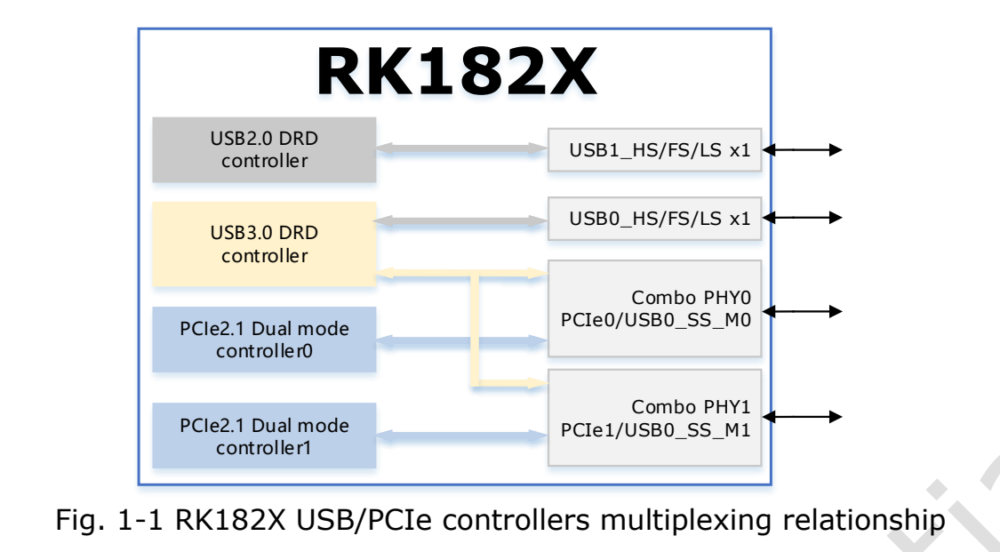
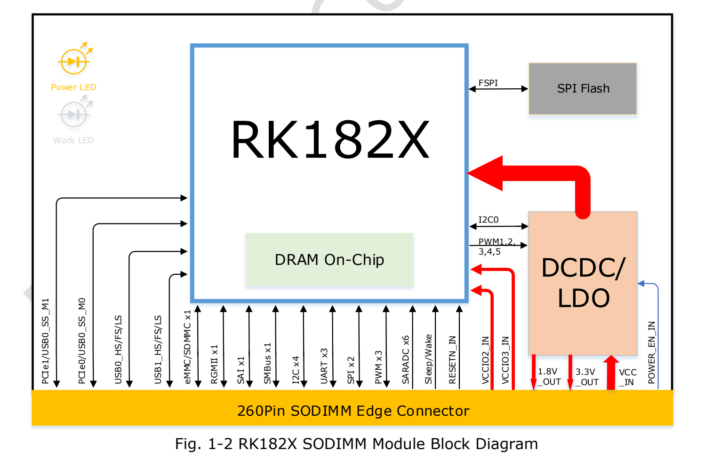
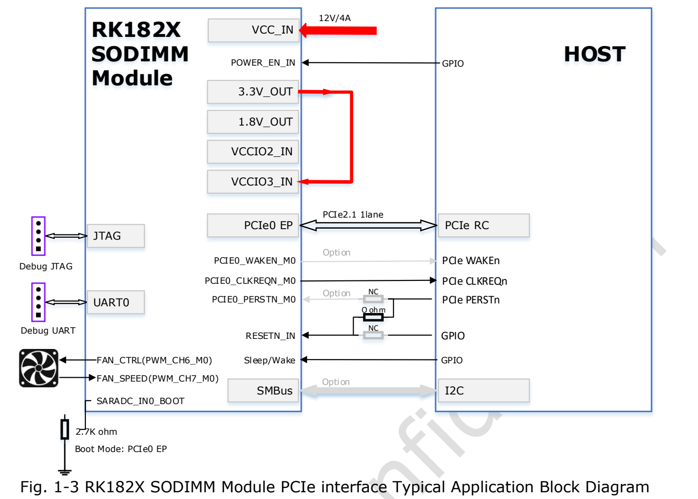
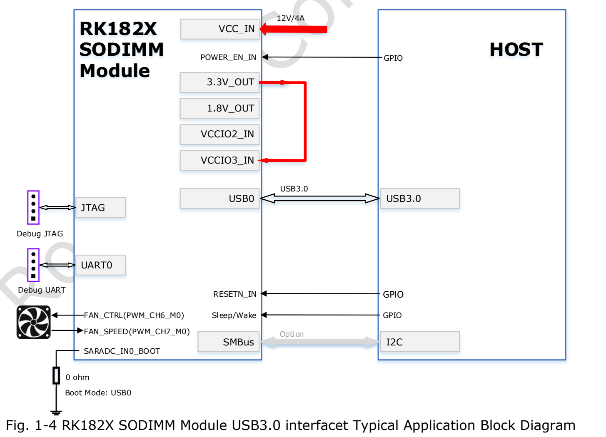
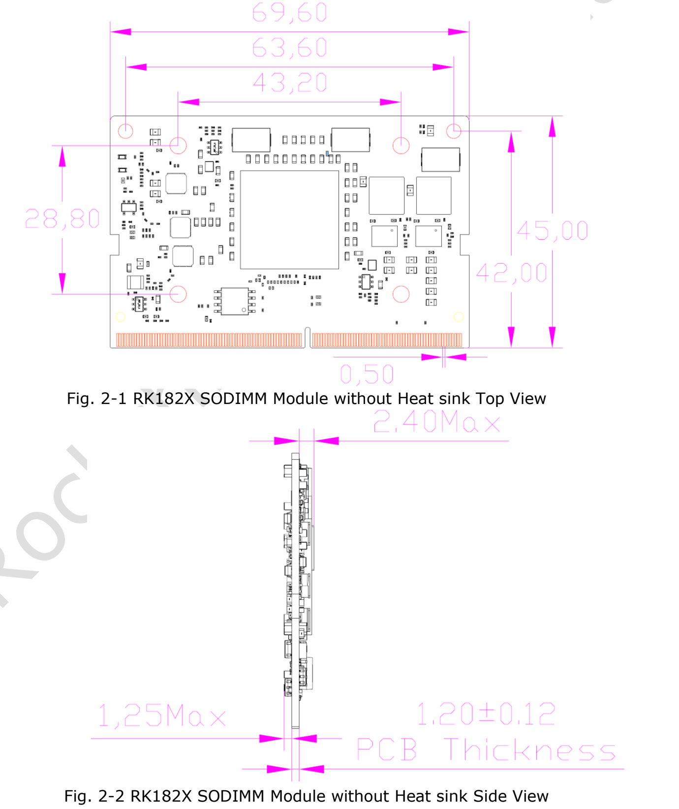
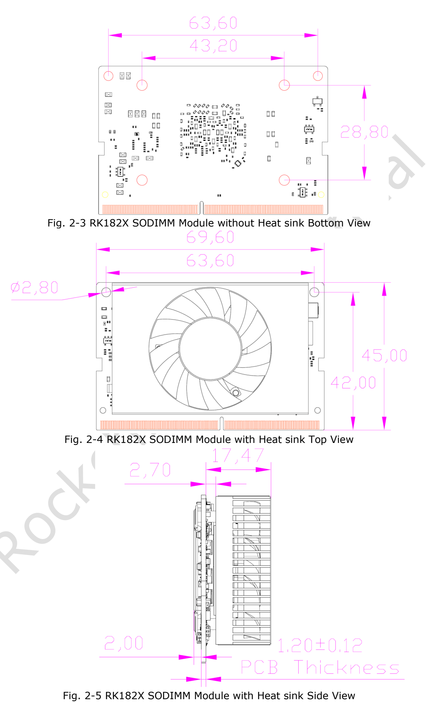
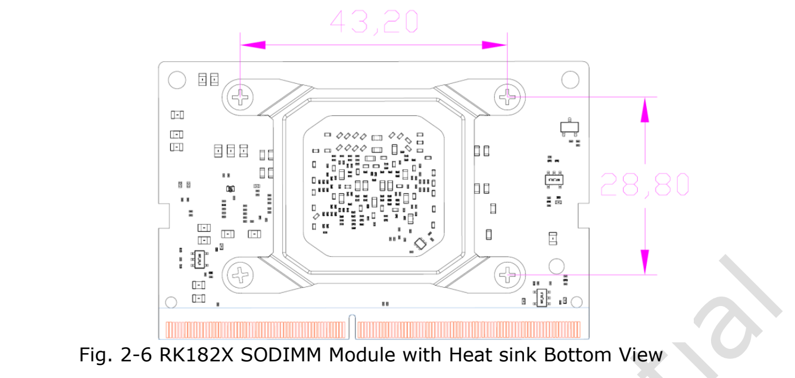

RK182X 是用于 AI 推理和机器视觉的**算力协处理器**。本文依据用户提供的《RK182X SODIMM Module Datasheet》Rev 1.1 整理，面向 ArmSoM 主机或自定义底板的方案评估。它不是独立替代主机的通用计算板，也不能因为同为 260-pin SO-DIMM 就与 AIM7、Jetson 或内存插槽互换。

[下载完整原始 PDF（24 页）](/assets/rk182x/RK182X-SODIMM-Datasheet-V1.1.pdf)

本页为工程阅读指南，附完整 260 针信号表及主要电气参数；完整功能细目、接口电气测试条件仍以原始 PDF 为准。没有进行 ArmSoM 硬件兼容或模型性能实测。

## 1. 型号、计算架构与存储

| 模组型号 | 芯片 | 内置 DRAM | 原文模型定位 |
|---|---|---|---|
| RM1820SA0 | RK1820 | 2.5GB | 3B 大模型 |
| RM1828SA0 | RK1828 | 5GB | 7B 大模型 |

三个独立 64-bit RISC-V 核分别为 SRV、VRV0、VRV1。SRV 使用 RV64GCB，向量核使用 RV64GCBV；每核有 FPU（H/F/D）、32KB 指令缓存、32KB 数据缓存和 128KB L2。VRV0/VRV1 配备 128-bit 向量单元。原文一处写 VR0，本文结合上下文使用 VRV0，并在校对记录保留该差异。

NPU 标注最高 **20 TOPS INT8**，支持 INT4/INT8/INT16/FP8/FP16/BF16。原文列出 TensorFlow、MXNet、PyTorch、Caffe、Tflite、Onnx NN、Android NN 等框架或接口；这不是任意版本、算子或模型都可直接运行的保证。

BootROM 支持 FSPI、eMMC、SD/MMC 启动，以及 USB0、UART0、PCIe0 下载。系统 SRAM 为 512KB，模组带 SPI Flash。SDMMC 组合接口的模式互斥：eMMC 4.51 支持 HS200、1/4/8-bit，不支持 CMD Queue；SD3.0/MMC4.51 支持 1/4-bit。

## 2. 系统与图像处理能力

时钟单元包含 4 个 PLL 和 24MHz 输入，支持分模块门控、全局及局部软复位；PMU 涉及 VDD_TOP、VDD_LOGIC、VDD_PMU 三个电压域。另有 6 个64-bit定时器、3个32-bit看门狗、12个核间邮箱。DMA 为2个物理通道、24个逻辑通道和22组外设请求，支持内存/外设传输、链表和多块传输。

中断控制器列出 SRV 160路、VRV 64路源，各有 M/S 模式软件中断，高电平敏感且优先级可编程。加密引擎列出 AES-128/192/256、SM4、SHA-1、SHA-256/224、MD5、SM3、相关HMAC、RSA至4096-bit、ECC至256-bit、SM2与多级Key-ladder；算法出现不等于建议新系统采用所有旧算法。

JPEG 编码为 Baseline/JFIF1.02，尺寸16×16至65520×65520；解码为48×48至65520×65520。原稿解码格式中出现 `RG888`，未擅自改成 `RGB888`。

RGA 支持格式转换（BT.601/709）、抖动、源8192×8192/目标4096×4096、1/16至16缩放、0/90/180/270度旋转、XY镜像、BitBLT、Alpha混合、YUV2YUV CSC及OSD反色。放大使用双三次滤波，但原文写 source>1992 时改用双线性；该阈值保留，具体限制需核对SDK。10-bit输入中的若干格式会截为8-bit，不能据此宣传全链路10-bit输出。

## 3. 接口与复用关系

两组 Combo PHY 对应两组 PCIe2.1 控制器和一组 USB3.0 DRD，USB3.0 超高速部分复用到其中一组 PHY。每路 PCIe 为 x1，支持 RC/EP，单方向2.5/5.0Gbps；不要把它们理解为无条件同时可用的独立USB与PCIe口。

| 接口 | 原文主要能力 |
|---|---|
| Ethernet | 单MAC、RGMII、10/100/1000Mbps、全/半双工、TSO/USO、IEEE1588-2002/2008 |
| USB2.0 DRD | 480/12/1.5Mbps，EHCI1.0、OHCI1.0a |
| USB3.0 DRD | 静态Device或静态xHCI Host |
| SPI | 2控制器、2片选、主/从可配置 |
| I2C | 4主接口、7/10-bit地址、100k/400k/1M bit/s |
| SMBus | 1从接口，字节/字/32-bit/块读写，PEC、Alert、UDID、时钟拉伸 |
| UART | 3路，TX/RX各64-byte FIFO，5/6/7/8-bit，最高4Mbps；UART2自动流控、RS485 |
| PWM | 3通道，捕获、连续/单次、两级分频、电源键捕获、频率计、计数器 |
| SAI | 1组，4 TX+4 RX，I2S/PCM/TDM，最多128槽，槽长及有效位长8–32bit |
| GPIO | 电平/上升/下降/双边沿中断、极性、弱上下拉与驱动强度可配 |
| OTP | 8K bits，其中6.5K bits用于安全应用；Program/Read/Idle |

## 4. 典型主机连接

PCIe示例采用主机RC、模组PCIe0 EP和12V/4A电源；启动选择图示为2.7kΩ。USB示例使用USB0启动，图示0Ω配置。复位、CLKREQ、WAKE/PERST选配、SMBus、调试UART/JTAG、风扇PWM与测速均应按原图及最终参考设计核对。不要单独依靠文字描述给未确认底板上电。

## 5. 机械结构与260针引脚

模组69.6×45mm，260-pin SO-DIMM，触点间距0.5mm。裸板图标注PCB厚1.20±0.12mm、两侧器件高度上限2.40mm和1.25mm；安装空间还必须考虑散热器和插座。尺寸单位为mm。

完整260针表；保留复用名称、RSVD、NC及原稿195针中的双斜线。

| 引脚 | 原始信号名称 |
|---|---|
| 1 | `GND` |
| 2 | `GND` |
| 3 | `RSVD` |
| 4 | `RSVD` |
| 5 | `RSVD` |
| 6 | `RSVD` |
| 7 | `GND` |
| 8 | `GND` |
| 9 | `RSVD` |
| 10 | `RSVD` |
| 11 | `RSVD` |
| 12 | `RSVD` |
| 13 | `GND` |
| 14 | `GND` |
| 15 | `RSVD` |
| 16 | `RSVD` |
| 17 | `RSVD` |
| 18 | `RSVD` |
| 19 | `GND` |
| 20 | `GND` |
| 21 | `3.3V OUT` |
| 22 | `RSVD` |
| 23 | `3.3V OUT` |
| 24 | `RSVD` |
| 25 | `GND` |
| 26 | `GND` |
| 27 | `1.8V OUT` |
| 28 | `RSVD` |
| 29 | `1.8V OUT` |
| 30 | `RSVD` |
| 31 | `GND` |
| 32 | `GND` |
| 33 | `VCCIO2_IN` |
| 34 | `RSVD` |
| 35 | `VCCIO3_IN` |
| 36 | `RSVD` |
| 37 | `GND` |
| 38 | `GND` |
| 39 | `RSVD` |
| 40 | `RSVD` |
| 41 | `RSVD` |
| 42 | `RSVD` |
| 43 | `GND` |
| 44 | `GND` |
| 45 | `RSVD` |
| 46 | `RSVD` |
| 47 | `RSVD` |
| 48 | `RSVD` |
| 49 | `GND` |
| 50 | `GND` |
| 51 | `RSVD` |
| 52 | `RSVD` |
| 53 | `RSVD` |
| 54 | `RSVD` |
| 55 | `GND` |
| 56 | `GND` |
| 57 | `RSVD` |
| 58 | `RSVD` |
| 59 | `RSVD` |
| 60 | `RSVD` |
| 61 | `GND` |
| 62 | `GND` |
| 63 | `RSVD` |
| 64 | `RSVD` |
| 65 | `RSVD` |
| 66 | `RSVD` |
| 67 | `GND` |
| 68 | `GND` |
| 69 | `RSVD` |
| 70 | `RSVD` |
| 71 | `RSVD` |
| 72 | `RSVD` |
| 73 | `GND` |
| 74 | `GND` |
| 75 | `RSVD` |
| 76 | `RSVD` |
| 77 | `RSVD` |
| 78 | `RSVD` |
| 79 | `GND` |
| 80 | `GND` |
| 81 | `RSVD` |
| 82 | `RSVD` |
| 83 | `RSVD` |
| 84 | `RSVD` |
| 85 | `GND` |
| 86 | `GND` |
| 87 | `USB0_DRD_VBUSDET` |
| 88 | `RSVD` |
| 89 | `ETH_TXD0/PCIE1_WAKEN_M2/PWM_CH0_M1/SPI0_MOSI_M2/GPIO1_A6_d` |
| 90 | `RSVD` |
| 91 | `ETH_TXCTL/PCIE1_CLKREQN_M2/SPI0_CLK_M2/GPIO1_B2_d` |
| 92 | `RSVD` |
| 93 | `ETH_TXD1/PCIE1_PERSTN_M2/SPI0_MISO_M2/GPIO1_A7_d` |
| 94 | `RSVD` |
| 95 | `ETH_RXD0/SPI0_CS0N_M2/GPIO1_B4_d` |
| 96 | `RSVD` |
| 97 | `ETH_RXD1/SPI0_CS1N_M2/GPIO1_B5_d` |
| 98 | `RSVD` |
| 99 | `SARADC_IN6/PCIE0_PERSTN_M1/I2C4_SCL_M0/SAI_SDI2_M2/UART2_TX_M0/PWM_CH6_M2/GPIO1_D6_d` |
| 100 | `RSVD` |
| 101 | `SARADC_IN7/PCIE0_WAKEN_M1/I2C4_SDA_M0/SAI_SDI3_M2/UART2_RX_M0/PWM_CH7_M2/GPIO1_D7_d` |
| 102 | `GND` |
| 103 | `RSVD` |
| 104 | `ETH_TXD2/SPI1_MOSI_M2/GPIO1_B0_d` |
| 105 | `RSVD` |
| 106 | `ETH_TXCLK/I2C1_SCL_M1/SPI1_CLK_M2/GPIO1_B3_d` |
| 107 | `GND` |
| 108 | `ETH_TXD3/SPI1_MISO_M2/GPIO1_B1_d` |
| 109 | `USB0_DRD_DM` |
| 110 | `ETH_RXD2/I2C1_SDA_M1/SPI1_CS0N_M2/GPIO1_B6_d` |
| 111 | `USB0_DRD_DP` |
| 112 | `ETH_RXD3/I2C4_SCL_M1/SPI1_CS1N_M2/GPIO1_B7_d` |
| 113 | `GND` |
| 114 | `RSVD` |
| 115 | `USB1_DRD_DM` |
| 116 | `RSVD` |
| 117 | `USB1_DRD_DP` |
| 118 | `SARADC_IN5/PCIE0_CLKREQN_M1/SAI_SDI1_M2/SPI0_CS1N_M1/GPIO1_D5_d` |
| 119 | `GND` |
| 120 | `RSVD` |
| 121 | `RSVD` |
| 122 | `RSVD` |
| 123 | `RSVD` |
| 124 | `ETH_RXCTL/PCIE0_WAKEN_M2/GPIO1_C0_d` |
| 125 | `GND` |
| 126 | `ETH_RXCLK/I2C4_SDA_M1/GPIO1_C1_d` |
| 127 | `USB0_DRD_ID` |
| 128 | `ETH_MDC/PCIE0_PERSTN_M2/GPIO1_C2_d` |
| 129 | `GND` |
| 130 | `ETH_MDIO/PCIE0_CLKREQN_M2/GPIO1_C3_d` |
| 131 | `PCIE0_RXN/USB0_DRD_SSRXN_M0` |
| 132 | `GND` |
| 133 | `PCIE0_RXP/USB0_DRD_SSRXP_M0` |
| 134 | `PCIE0_TXN/USB0_DRD_SSTXN_M0` |
| 135 | `GND` |
| 136 | `PCIE0_TXP/USB0_DRD_SSTXP_M0` |
| 137 | `RSVD` |
| 138 | `GND` |
| 139 | `RSVD` |
| 140 | `RSVD` |
| 141 | `GND` |
| 142 | `RSVD` |
| 143 | `RSVD` |
| 144 | `GND` |
| 145 | `RSVD` |
| 146 | `GND` |
| 147 | `GND` |
| 148 | `RSVD` |
| 149 | `RSVD` |
| 150 | `RSVD` |
| 151 | `RSVD` |
| 152 | `GND` |
| 153 | `GND` |
| 154 | `RSVD` |
| 155 | `RSVD` |
| 156 | `RSVD` |
| 157 | `RSVD` |
| 158 | `GND` |
| 159 | `GND` |
| 160 | `PCIE0_REFCLKN` |
| 161 | `PCIE1_RXN/USB0_DRD_SSRXN_M1` |
| 162 | `PCIE0_REFCLKP` |
| 163 | `PCIE1_RXP/USB0_DRD_SSRXP_M1` |
| 164 | `GND` |
| 165 | `GND` |
| 166 | `PCIE1_TXN/USB0_DRD_SSTXN_M1` |
| 167 | `RSVD` |
| 168 | `PCIE1_TXP/USB0_DRD_SSTXP_M1` |
| 169 | `RSVD` |
| 170 | `GND` |
| 171 | `GND` |
| 172 | `RSVD` |
| 173 | `PCIE1_REFCLKN` |
| 174 | `RSVD` |
| 175 | `PCIE1_REFCLKP` |
| 176 | `GND` |
| 177 | `GND` |
| 178 | `RSVD` |
| 179 | `I2C2_SCL_M0/UART1_CTSN_M0/PCIE0_WAKEN_M0/SMBUS_ALERT_M0/SAI_SDI0_M0/SAI_SDO3_M0/GPIO0_B5_d` |
| 180 | `PCIE0_CLKREQN_M0/SAI_LRCK_M0/GPIO0_B7_d` |
| 181 | `I2C2_SDA_M0/UART1_RTSN_M0/PCIE0_PERSTN_M0/SAI_SCLK_M0/GPIO0_B6_d` |
| 182 | `RSVD` |
| 183 | `RSVD` |
| 184 | `RSVD` |
| 185 | `ETH_CLK_25M_OUT/I2C2_SCL_M1/SAI_SDO2_M2/UART2_CTSN_M0/SPI1_CS1N_M1/GPIO1_C4_d` |
| 186 | `RSVD` |
| 187 | `ETH_MCLK/I2C2_SDA_M1/SAI_SDO1_M2/UART2_RTSN_M0/PWM_CH0_M2/SPI1_MOSI_M1/GPIO1_C5_d` |
| 188 | `RSVD` |
| 189 | `SARADC_IN2/SMBUS_SCL_M1/I2C3_SCL_M1/SAI_SDO3_M2/UART1_TX_M1/PWM_CH6_M1/SPI0_MOSI_M1/GPIO1_D2_d` |
| 190 | `RSVD` |
| 191 | `SARADC_IN3/SMBUS_SDA_M1/I2C3_SDA_M1/UART1_RX_M1/PWM_CH7_M1/SPI0_MISO_M1/GPIO1_D3_d` |
| 192 | `RSVD` |
| 193 | `SARADC_IN4/SMBUS_ALERT_M1/SAI_SDO0_M2/UART1_CTSN_M1/SPI0_CS0N_M1/GPIO1_D4_d` |
| 194 | `RSVD` |
| 195 | `PCIE1_CLKREQN_M0/SAI_SDI0_M2/UART1_RTSN_M1//SPI0_CLK_M1/GPIO1_D1_d` |
| 196 | `RSVD` |
| 197 | `ETH_PPSTRIG/PCIE1_PERSTN_M0/SAI_LRCK_M2/SPI1_CLK_M1/GPIO1_D0_d` |
| 198 | `RSVD` |
| 199 | `ETH_PPSCLK/PCIE1_WAKEN_M0/SAI_SCLK_M2/SPI1_CS0N_M1/GPIO1_C7_d` |
| 200 | `GND` |
| 201 | `GND` |
| 202 | `RSVD` |
| 203 | `JTAG_TCK_M0/UART1_TX_M0_d` |
| 204 | `RSVD` |
| 205 | `JTAG_TMS_M0/UART1_RX_M0_d` |
| 206 | `I2C3_SCL_M0/PWM_CH6_M0/SPI1_CLK_M0/SMBUS_SCL_M0/SAI_SDI2_M0/SAI_SDO1_M0/GPIO0_B3_d` |
| 207 | `RSVD` |
| 208 | `I2C3_SDA_M0/PWM_CH7_M0/SPI1_MOSI_M0/SMBUS_SDA_M0/SAI_SDI1_M0/SAI_SDO2_M0/GPIO0_B4_d` |
| 209 | `RSVD` |
| 210 | `RSVD` |
| 211 | `ETH_PTP_REFCLK/SAI_MCLK_M2/SPI1_MISO_M1/GPIO1_C6_d` |
| 212 | `RSVD` |
| 213 | `RSVD` |
| 214 | `SARADC_IN0_BOOT` |
| 215 | `RSVD` |
| 216 | `RSVD` |
| 217 | `NC(MODULE_ID)` |
| 218 | `PWR_CTRL1/PWM_CH0_M0/SPI1_CS1N_M0/GPIO0_A3_d` |
| 219 | `SDMMC_D0/SAI_SDO2_M1/UART1_CTSN_M2/GPIO0_D2_u` |
| 220 | `SDMMC_D7/I2C2_SDA_M2/SAI_SDO0_M1/UART2_RTSN_M2/PCIE1_WAKEN_M1/GPIO1_A1_u` |
| 221 | `SDMMC_D1/SAI_SDO3_M1/UART1_RTSN_M2/GPIO0_D3_u` |
| 222 | `SDMMC_D6/I2C2_SCL_M2/SAI_SDI0_M1/UART2_CTSN_M2/SMBUS_ALERT_M2/GPIO1_A0_u` |
| 223 | `SDMMC_D2/SAI_SDI2_M1/UART1_TX_M2/GPIO0_D4_u` |
| 224 | `SDMMC_D5/I2C4_SDA_M2/SAI_LRCK_M1/UART2_RX_M2/SMBUS_SDA_M2/GPIO0_D7_u` |
| 225 | `SDMMC_D3/SAI_SDI3_M1/UART1_RX_M2/GPIO0_D5_u` |
| 226 | `SDMMC_D4/I2C4_SCL_M2/SAI_SCLK_M1/UART2_TX_M2/SMBUS_SCL_M2/GPIO0_D6_u` |
| 227 | `SDMMC_CMD/GPIO1_A2_u` |
| 228 | `RSVD` |
| 229 | `SDMMC_CLK_OUT/SAI_SDO1_M1/GPIO1_A3_d` |
| 230 | `RSVD` |
| 231 | `GND` |
| 232 | `SDMMC_RSTN/I2C3_SCL_M2/SAI_SDI1_M1/PCIE1_PERSTN_M1/GPIO1_A4_u` |
| 233 | `RSVD` |
| 234 | `SDMMC_DETN/I2C3_SDA_M2/SAI_MCLK_M1/PCIE1_CLKREQN_M1/GPIO1_A5_u` |
| 235 | `RSVD` |
| 236 | `JTAG_TCK_M1/UART0_TX_u` |
| 237 | `POWER_EN_IN` |
| 238 | `JTAG_TMS_M1/UART0_RX_u` |
| 239 | `RESETN_IN_u` |
| 240 | `Sleep/Wake(GPIO0_A0)_d` |
| 241 | `GND` |
| 242 | `GND` |
| 243 | `GND` |
| 244 | `GND` |
| 245 | `GND` |
| 246 | `GND` |
| 247 | `GND` |
| 248 | `GND` |
| 249 | `GND` |
| 250 | `GND` |
| 251 | `VCC_IN` |
| 252 | `VCC_IN` |
| 253 | `VCC_IN` |
| 254 | `VCC_IN` |
| 255 | `VCC_IN` |
| 256 | `VCC_IN` |
| 257 | `VCC_IN` |
| 258 | `VCC_IN` |
| 259 | `VCC_IN` |
| 260 | `VCC_IN` |

## 6. 电源、控制和工作条件

VCC_IN 为251–260针。237针POWER_EN_IN高开低关，模组有100kΩ下拉，输入类型标为1.5V至VCC_IN。239针RESETN_IN低有效，模组有1kΩ上拉至3.3V；240针Sleep/Wake为可选3.3V域GPIO。214针SARADC_IN0_BOOT有10kΩ上拉至1.8V。217针MODULE_ID保留未用。

21/23针输出3.3V，27/29针输出1.8V，默认供VCCIO2/VCCIO3及相关外设；33/35针分别为这两个域的输入。额外外设会增加VCC_IN输入功率需求。GPIO0相关引脚为固定3.3V域，GPIO0_D2至GPIO1_A5的SDMMC组属VCCIO2，GPIO1_A6至GPIO1_D7相关组属VCCIO3；完整分组按原稿表2-4核对。

| 参数/条件 | 最小 | 典型 | 最大 | 单位 |
|---|---|---|---|---|
| 工作输入电压 | 8.0 | 12.0 | 14.4 | V |
| 供电电流 | 4.0 | - | 5.0 | A |
| 3.3V输出峰值电流 | - | - | 0.8 | A |
| 1.8V输出峰值电流 | - | - | 0.3 | A |
| VCCIO 1.8V域 | 1.62 | 1.8 | 1.98 | V |
| VCCIO 3.3V域 | 2.97 | 3.3 | 3.63 | V |
| 存储温度 | -20 | - | 70 | °C |
| 存储湿度（无凝露） | 30 | - | 70 | % |
| 环境工作温度 | TBD | 25 | TBD | °C |
| 推荐结温 | - | - | 95 | °C |
| 绝对额定VCC_IN | -0.3 | - | 18 | V |
| 绝对额定VCCIO | -0.3 | - | 3.8 | V |
| 绝对额定结温 | NA | - | 105 | °C |
| 输出电压精度 | -3 | - | 3 | % |

表中供电电流4–5A是原稿规格条目，不能当作所有模式持续耗电。原文考虑插座单触点通常0.5A而推荐12V，并要求供电能力超过40W时每触点仍不得超过0.5A。不能按平均推理功耗选择过小电源。

## 7. 版本疑点、SARADC与散热

- 文件名日期20251016，封面Rev1.1/August2025，修订表只有2025-08-20 Rev1.0；不推断正式发布日期或完整版本历史。
- SARADC功能说明为7通道（含1个启动选择）、13-bit、最高2MS/s；框图写SARADC×6；表3-6又写8通道、典型1MS/s，ENOB典型11.2/最大13bit。上述口径均保留，不猜测可用通道。
- SARADC量程0–1.8V，另列最大输入3.3V；最大值不等于保证精度的测量量程。表中DNL为±1/±3LSB，INL±2/±6LSB（典型/最大），SINAD69.2dB、THD77.3dB；测试条件fS=1MS/s、fclk=24MHz，SINAD另列fOUT=1.17KHz。
- 表3-7把`Tx de-emphasis level ratio`与80–120ohm并列，名称与量纲待确认。AC耦合电容75–200nF、UI399.88–400.12ps等条目必须结合对应工作模式使用，不能当作所有速率的共同参数。
- 推荐结温上限95°C，绝对额定105°C，环境工作温度上下限为TBD；存储温度不是工作温度。
- 第4章只引用另册《RK182X SODIMM Module Thermal Design Guide》，这次输入未包含该文件，无法补出散热器选型和完整功耗模式。

## 8. 与ArmSoM主机集成前

先确认主机RC/USB Host、具体连接器和信号电平，再核对驱动、固件、RKNN3版本、模型转换和散热。不要把RKNN-Toolkit2/RK3588板载NPU的部署路径直接等同于RK182X。AIM7/Sige7/LM7只能作为待评估主机方向，本文不宣称已验证直连兼容。

## 相关文档

- [RK182X M.2 算力模组：20 TOPS、3B/7B 模型与双路供电说明](/zh/articles/rk182x-m2-module-guide/)
- [ArmSoM Docs](https://docs.armsom.org/)
