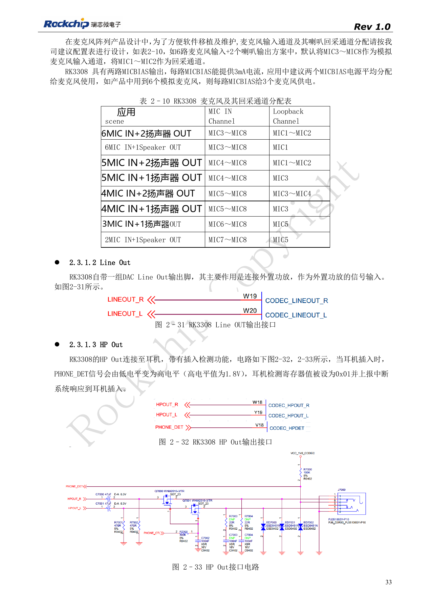
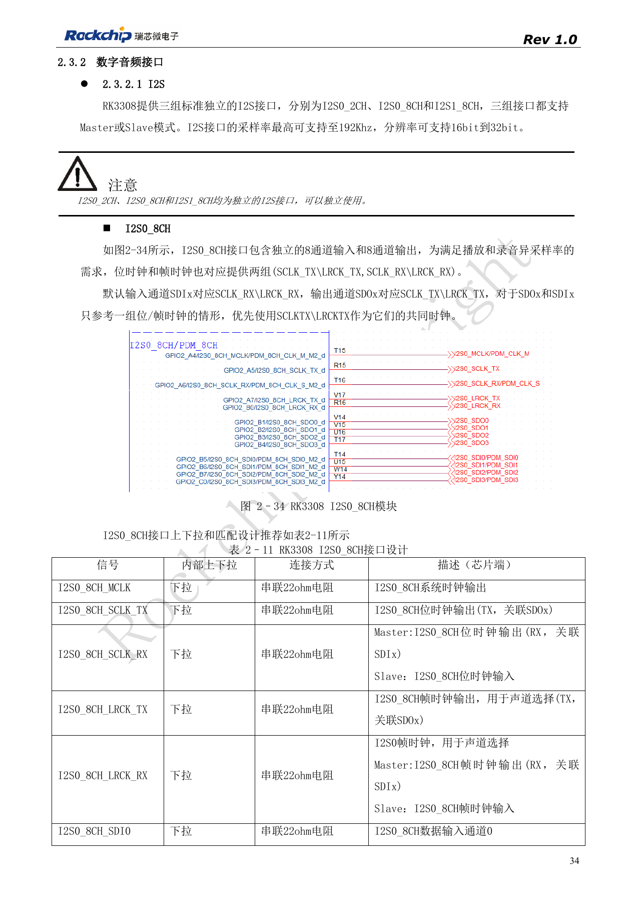
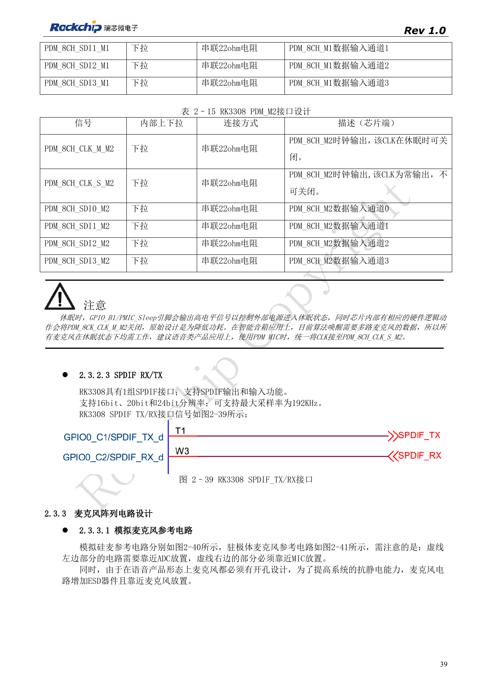
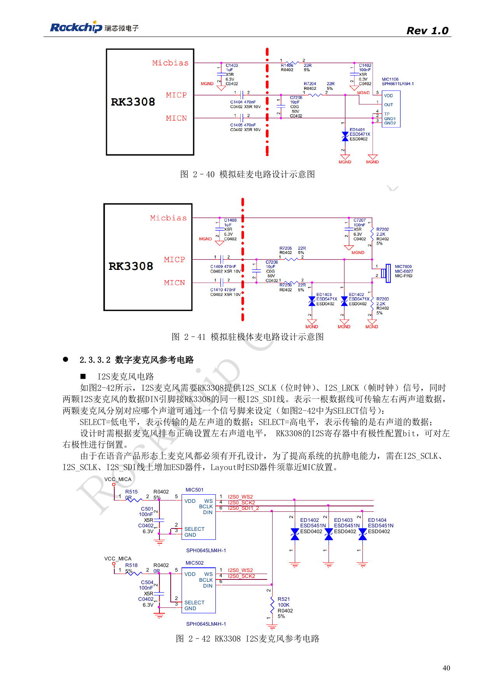
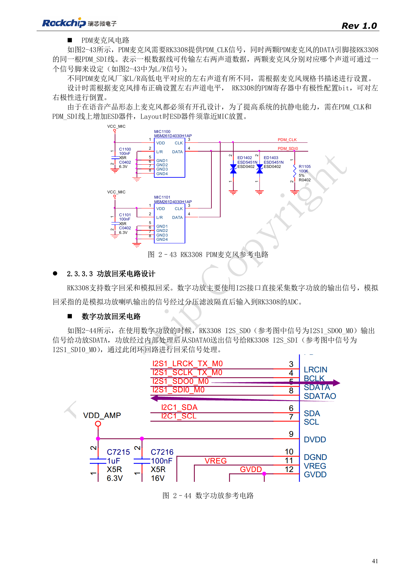
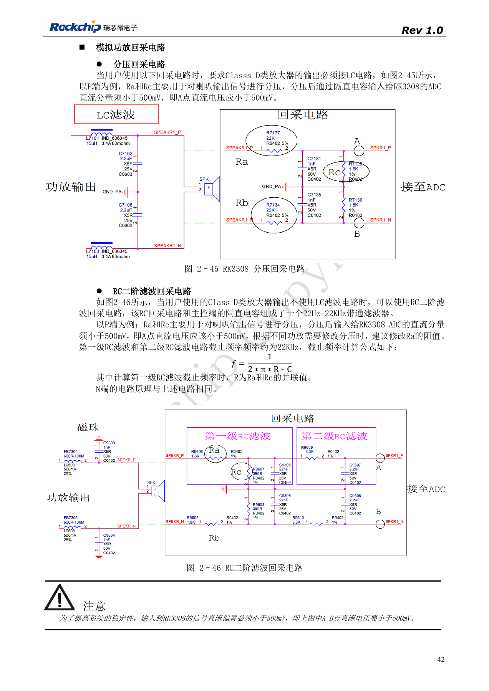

# RK3308 麦克风阵列：模拟输入、I2S、PDM 与回采

依据 RK3308 硬件设计指南 V1.0（2018-09-14），并结合 2023 年 V1.1 芯片兼容说明识别版本边界。P2 Pro 使用 RK3308B-S，旧参考不能直接替代该板卡设计。本文为按工程问题拆分的技术文章，不是完整逐页译本；数值来自原稿，未经 ArmSoM 实测。实际接口、SDK/BSP、内核及固件需按板卡版本核对。

**RK3308硬件设计指南_V1.0_20180914.pdf** · §2.3

## 模拟通道要与算法约定一致

原版 RK3308 提供八路 ADC 与两路 DAC，六麦双扬声器示例使用 MIC3–MIC8 采集、MIC1–MIC2 回采。两路 MICBIAS 每路可提供 3mA，六麦参考按每路三个麦克风分配，仍需核对实际麦克风电流。Line Out 用于外置功放输入，不能当作直接驱动扬声器的接口。HP Out 插入检测 PHONE_DET 高电平为 1.8V。P2 Pro 是否引出相应通道和连接器，以其实际原理图为准。

## I2S 与 PDM 的资源不能重复计算

I2S0_2CH、I2S0_8CH、I2S1_8CH 是三个独立接口，支持主从模式，原稿列最高 192kHz、16–32bit。I2S1_8CH 的 M0/M1 是同一接口的复用选择，不是两组硬件。PDM 则只有一组，M0/M1/M2 同样只能选一组；每条 SDI 可承载两个麦克风，L/R 高低对应关系必须看麦克风规格。语音待机需要持续采样时，指南建议使用 PDM_8CH_CLK_S_M2，而不是会在休眠关闭的 CLK_M_M2。不能把时钟持续输出等同于 SDK 已启用完整唤醒算法。

## 回采电路需按功放输出形式选

数字功放可经 I2S 输出与返回路径构成闭环。模拟回采需要分压、滤波、隔直；Class D 输出有 LC 滤波时可用原稿分压方案，没有 LC 时采用二阶 RC 参考。原稿要求 A/B 点直流电压小于 500mV，不能把扬声器功率输出直接接 ADC。二阶 RC 参考与主控隔直电容形成约 22Hz–22kHz 带通，参数需随具体功放核对。麦克风开孔附近布置 ESD，先逐路录音确认物理顺序、左右极性和幅度，再做并发播放、回声消除和休眠唤醒测试。

## 原稿麦克风与回采分配

| 应用 | 麦克风输入 | 回采 |
| --- | --- | --- |
| 6 MIC + 2 Speaker | MIC3–MIC8 | MIC1–MIC2 |
| 6 MIC + 1 Speaker | MIC3–MIC8 | MIC1 |
| 5 MIC + 2 Speaker | MIC4–MIC8 | MIC1–MIC2 |
| 5 MIC + 1 Speaker | MIC4–MIC8 | MIC3 |
| 4 MIC + 2 Speaker | MIC5–MIC8 | MIC3–MIC4 |
| 4 MIC + 1 Speaker | MIC5–MIC8 | MIC3 |
| 3 MIC + 1 Speaker | MIC6–MIC8 | MIC5 |
| 2 MIC + 1 Speaker | MIC7–MIC8 | MIC5 |

来源：表 2-10，PDF33。保留原稿各场景不同的回采分配，不统一改成 MIC1/2。此表描述芯片参考，不代表 P2 Pro 已引出或验证所有组合。

## 参考图与核对页

本批只有中文原稿，四语使用相同中文原图。以下为保留图表上下文的原稿截图，图片未翻译；正文可复制。页码为 PDF 物理页码。

PDF 33

PDF 34

PDF 39

PDF 40

PDF 41

PDF 42

## ArmSoM 产品与文档

- [ArmSoM P2 Pro](https://www.armsom.org/product-page/p2pro) · [P2 Pro Docs](https://docs.armsom.org/armsom-p2pro)

## 继续阅读

- [本系列目录](/zh/articles/rk3308-hardware-design-series/)
- [RK3308 启动与存储：时钟、FLASH_SEL 和恢复调试](/zh/articles/rk3308-clock-boot-storage-design/)
- [RK3308 电源与 DDR：独立供电、待机和 S 版本差异](/zh/articles/rk3308-power-ddr-hardware-design/)
- [RK3308 外设设计：USB、RMII、显示与调试接口](/zh/articles/rk3308-usb-network-peripheral-design/)
- [RK3308 热设计、ESD 与生产存储检查](/zh/articles/rk3308-thermal-esd-production-design/)
