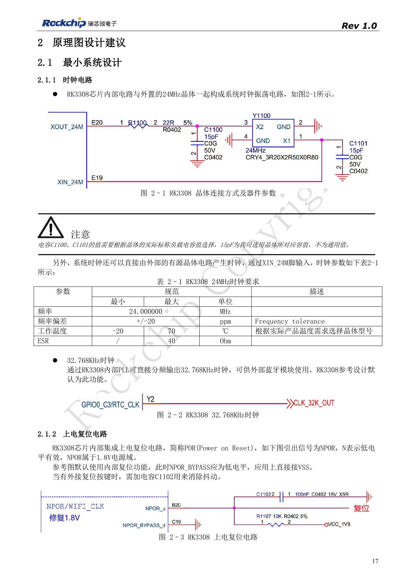
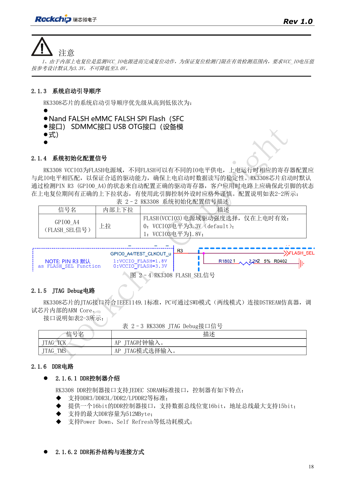
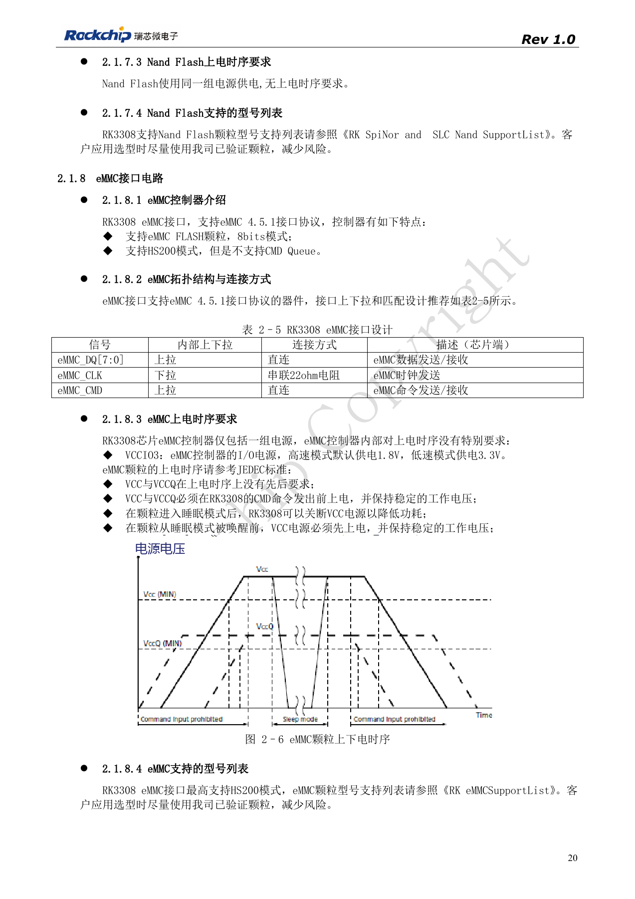
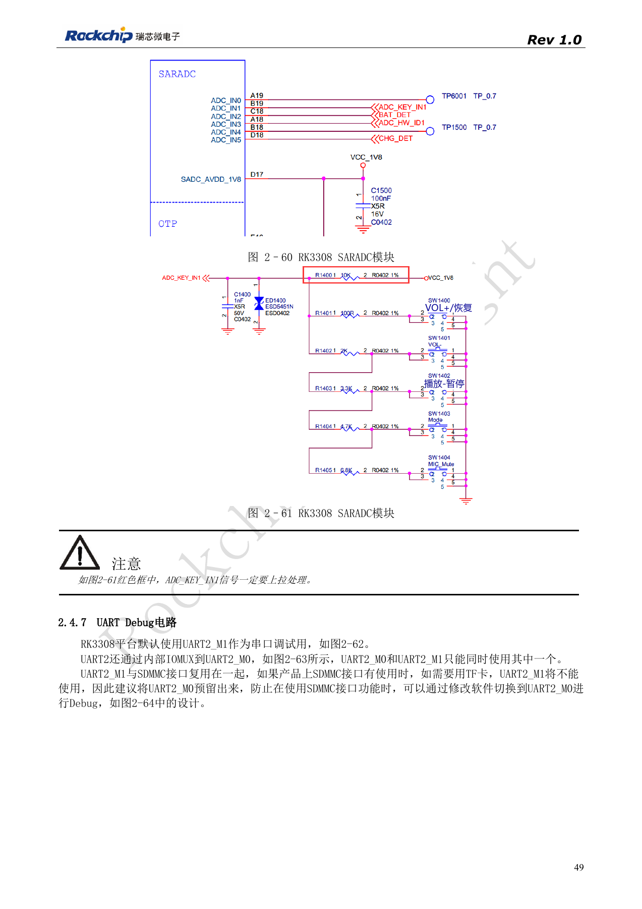
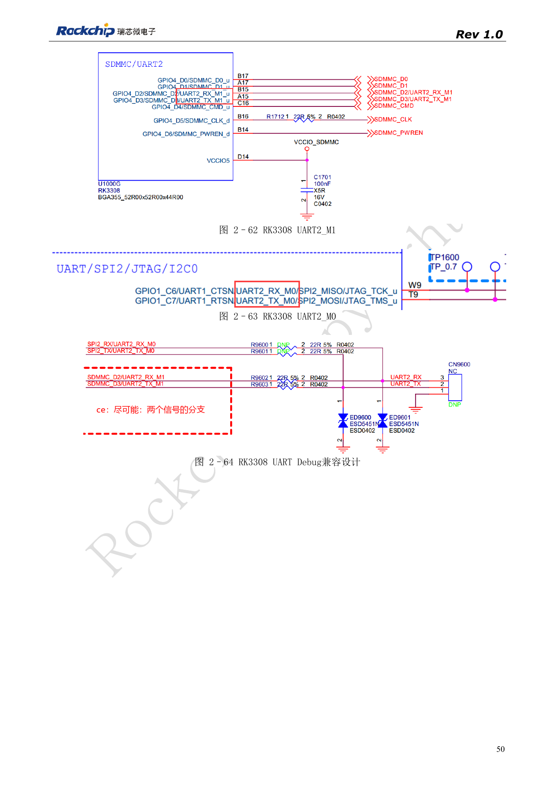

# RK3308 启动与存储：时钟、FLASH_SEL 和恢复调试

依据 RK3308 硬件设计指南 V1.0（2018-09-14），并结合 2023 年 V1.1 芯片兼容说明识别版本边界。P2 Pro 使用 RK3308B-S，旧参考不能直接替代该板卡设计。本文为按工程问题拆分的技术文章，不是完整逐页译本；数值来自原稿，未经 ArmSoM 实测。实际接口、SDK/BSP、内核及固件需按板卡版本核对。

**RK3308硬件设计指南_V1.0_20180914.pdf** · §2.1; §2.4.1; §2.4.6–2.4.7

## 保留旧版适用边界

2018 年 V1.0 指南描述 RK3308/RK3308G，不能直接当成 P2 Pro 所用 RK3308B-S 的完整设计要求。其时钟参考为 24MHz、±20ppm、ESR≤40Ω，15pF 是所用晶体的负载示例，不是通用值。NPOR 低有效且属于 1.8V 域，参考设计 NPOR_BYPASS 接地启用内部复位；文中要求用于内部复位检测的 VCC_IO 保持参考 3.3V，不能降到 3.0V。针对 S 型号应同时核对新版兼容说明。

## 启动介质与电平要一起检查

原稿启动优先级为 NAND、eMMC、SPI Flash/SFC、SDMMC、USB OTG Device。FLASH_SEL 为 GPIO0_A4（R3），只在上电时采样：0 对应 VCCIO3=3.3V、1 对应 1.8V，外设不能破坏复位期间的电平。eMMC 为 8bit、4.5.1、HS200，不支持 CMD Queue；CLK 串 22Ω，CMD 和数据直连。SFC 支持 NOR/NAND 启动，CLK 同样串 22Ω。选择颗粒必须结合 Bootloader、DDR 初始化和支持列表，接口标准相同不能保证已适配。

## SD 卡与 UART 调试的复用冲突

默认 UART2_M1 与 SDMMC 共脚，使用 TF 卡后不能继续假定原调试口可用，应预留 UART2_M0，并在软件中切换。SARADC_IN1 同时承担 Recovery：在已有固件条件下启动时拉到 0V（最高不超过 100mV），PC 识别 Rockusb 后松开，使其恢复到 1.8V。上拉必须保留，按键 ADC 值间隔建议大于 35。首次上电记录失败发生在 ROM、DDR、存储还是内核阶段，比盲目更换存储颗粒更有效。

## 参考图与核对页

本批只有中文原稿，四语使用相同中文原图。以下为保留图表上下文的原稿截图，图片未翻译；正文可复制。页码为 PDF 物理页码。

PDF 17

PDF 18

PDF 20

PDF 49

PDF 50

## ArmSoM 产品与文档

- [ArmSoM P2 Pro](https://www.armsom.org/product-page/p2pro) · [P2 Pro Docs](https://docs.armsom.org/armsom-p2pro)

## 继续阅读

- [本系列目录](/zh/articles/rk3308-hardware-design-series/)
- [RK3308 电源与 DDR：独立供电、待机和 S 版本差异](/zh/articles/rk3308-power-ddr-hardware-design/)
- [RK3308 麦克风阵列：模拟输入、I2S、PDM 与回采](/zh/articles/rk3308-audio-array-hardware-design/)
- [RK3308 外设设计：USB、RMII、显示与调试接口](/zh/articles/rk3308-usb-network-peripheral-design/)
- [RK3308 热设计、ESD 与生产存储检查](/zh/articles/rk3308-thermal-esd-production-design/)
