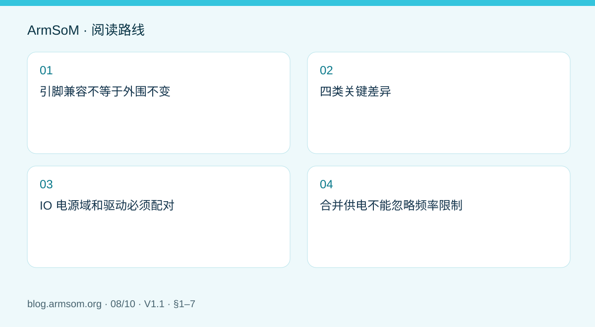
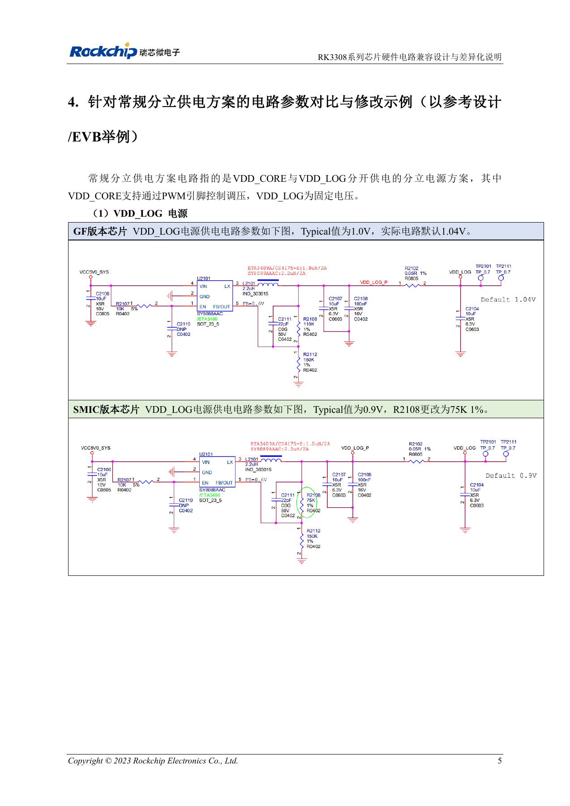

# RK3308 系列芯片差异与兼容检查：P2 Pro 音频项目参考

## 适用范围与资料

本篇为围绕工程问题编写的专题导读，不是整本 PDF 的逐页翻译。原文示例不代表 ArmSoM 实测；具体电压、引脚、SDK/BSP 和内核应按实际板卡版本核对。

**Rockchip:** `RK3308系列芯片硬件电路兼容设计与差异化说明_V1.1_20230728_CN.pdf` · V1.1 · §1–7

## 引脚兼容不等于外围不变

原稿将 RK3308B、RK3308H 归入 GF 版本，将 RK3308B-S、RK3308H-S 归入 SMIC 版本。球位兼容设计仍须调整相关外围及软件配置。P2 Pro 使用 RK3308B-S；本文用于理解平台差异，不是要求修改已完成设计的 P2 Pro。

## 四类关键差异

| 项目 | 原稿说明 | 设计动作 |
| --- | --- | --- |
| 电源典型值 | §1 列 VDD_LOG、VDD_CORE 等从 1.0V 到 0.9V 的差异 | 核对具体拓扑、BOM 和频率—电压表，不能只改一个数值 |
| IO 驱动 | GF 为 4 档，SMIC 为 7 档 | 同名 mA 档位不代表跨版本相同驱动能力，重新测量带载波形 |
| PMIC | RK816B-3 对应 GF；RK816B-6 对应 S 版本参考方案 | 完整后缀、默认电压与时序一起核对 |
| USB_EXTR | GF 的 C15 外接 133R 1%；SMIC 的 C15 为 NC | 原稿例子中相应 R1400 不装；不能对任意板卡直接套用位号 |

表中的电压为原文典型值，不是完整工作范围。§4 又按具体参考电路列出默认值和器件调整；实际生产应将原理图、实装 BOM 和软件配置三者对齐。

## IO 电源域和驱动必须配对

先确认硬件实际接到哪个电源，再核对软件域配置。预留选择电阻不代表所有分支都实际装配。驱动过弱可能出现慢沿和电平问题，驱动过强可能出现过冲、振铃；应在真实负载下测试。更换外设、线长或芯片版本后需要复测。

## 合并供电不能忽略频率限制

§6 对 VDD_CORE/VDD_LOG 合并的特定分立方案列出：GF 为最高 1.1V、912MHz；SMIC 为最高 1.0V、816MHz。这些是该合并拓扑的限制，不是所有 RK3308 芯片或 P2 Pro 的统一最高频率。不要把它们与独立供电方案或板卡标称频率混为一谈。

## 音频项目的验证闭环

在 P2 Pro 上先验证采集、播放、存储和网络软件链路，再设计自定义硬件。切换芯片或外围后，加入音频底噪、并发传输、USB 稳定性、冷启动与待机恢复测试。保存芯片丝印、BOM、固件和波形，以便定位版本相关问题。

## 原文配图

中文稿原图。 参考设计，不是 ArmSoM 板卡原理图。

`RK3308系列芯片硬件电路兼容设计与差异化说明_V1.1_20230728_CN.pdf` · PDF p. 11.

## 相关产品与开发资料

- **P2 Pro** — [产品页面](https://www.armsom.org/product-page/p2pro) · [开发文档](https://docs.armsom.org/armsom-p2pro)

## 继续阅读本系列

- [RK3576 硬件设计入门：最小系统与首次上电检查](/zh/articles/rk3576-hardware-bringup/)
- [ArmSoM CM5 载板设计检查表：供电、启动与接口规划](/zh/articles/019-cm5-carrier-production/)
- [RK3576 高速接口设计：原理图与 PCB 如何配合检查](/zh/articles/rk3576-high-speed-interface-design/)
- [RK3588S 硬件设计指南：从芯片参考设计到 CM7s 载板](/zh/articles/rk3588s-cm7s-carrier-design/)
- [RK3588 边缘 AI 设备设计：供电、散热与扩展接口规划](/zh/articles/rk3588-edge-ai-hardware-design/)
- [RK3588 高速 PCB 设计：叠层、阻抗与布线检查](/zh/articles/rk3588-high-speed-pcb-review/)
- [RK3506 工业 HMI 硬件设计：结合 CM1 与 Forge1 选择开发路径](/zh/articles/rk3506-industrial-hmi-hardware/)
- [RK3588S 与 RK3588S2 有什么区别？改版前需要核对什么](/zh/articles/rk3588s-rk3588s2-hardware-differences/)
- [Rockchip 设备从样机到量产：工艺要求与测试清单](/zh/articles/rockchip-hardware-production-checklist/)

## 继续阅读

- [RK3308 硬件设计系列](/zh/articles/rk3308-hardware-design-series/)
