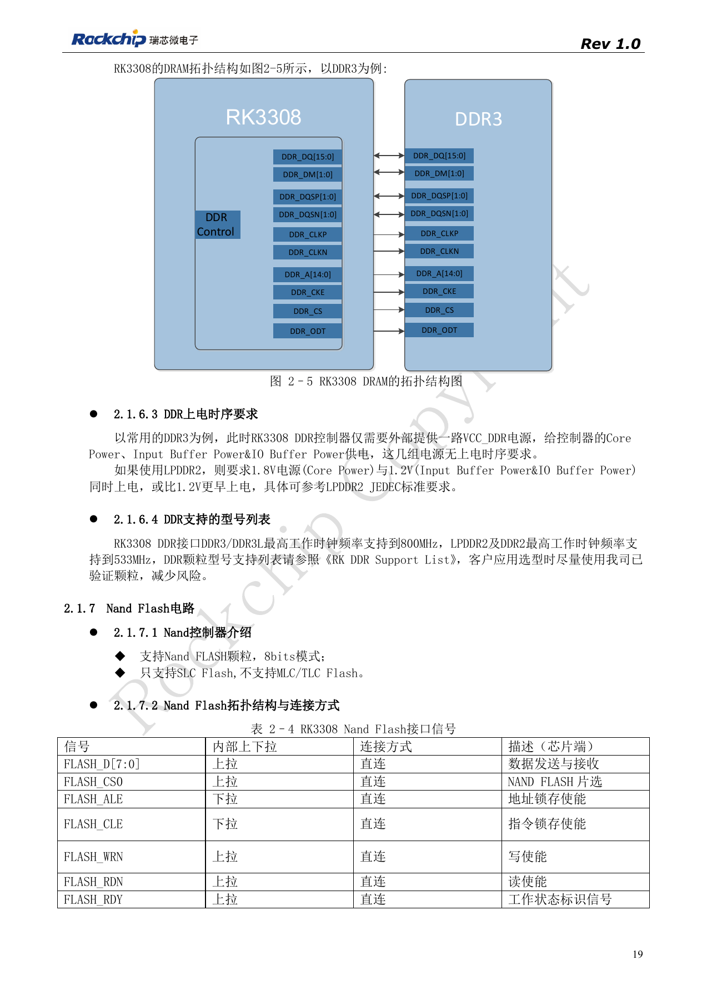
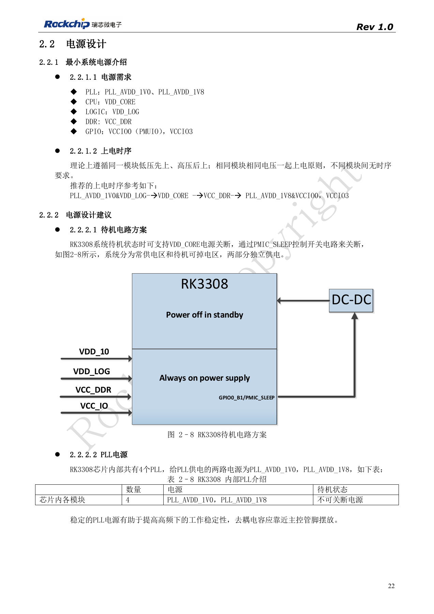
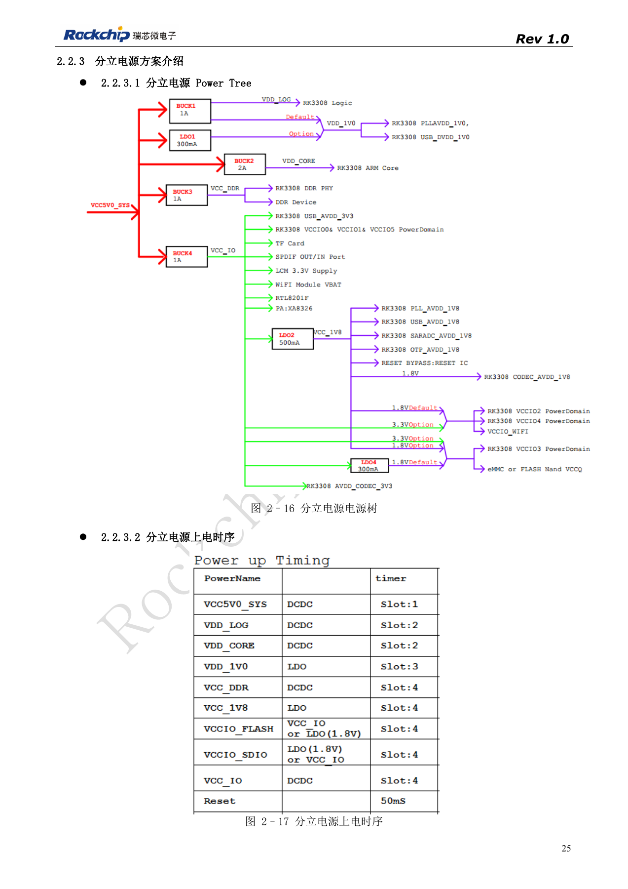
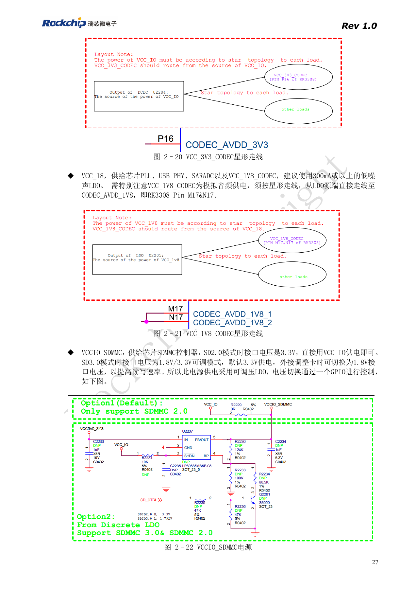
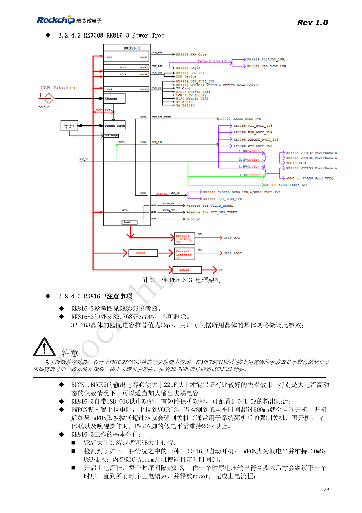

# RK3308 电源与 DDR：独立供电、待机和 S 版本差异

依据 RK3308 硬件设计指南 V1.0（2018-09-14），并结合 2023 年 V1.1 芯片兼容说明识别版本边界。P2 Pro 使用 RK3308B-S，旧参考不能直接替代该板卡设计。本文为按工程问题拆分的技术文章，不是完整逐页译本；数值来自原稿，未经 ArmSoM 实测。实际接口、SDK/BSP、内核及固件需按板卡版本核对。

**RK3308硬件设计指南_V1.0_20180914.pdf** · §2.1.6; §2.2; compatibility V1.1

## DDR 与电源不能脱离型号

原版 RK3308 支持 DDR3/DDR3L/DDR2/LPDDR2，16bit 通道、最大 512MB；RK3308G 内置 64MB DDR2。LPDDR2 要求 1.8V 与 1.2V 同时或先于 1.2V 上电。指南给 DDR3/3L 最高 800MHz、DDR2/LPDDR2 最高 533MHz，这是旧版平台参考，不能据此描述 P2 Pro 的实际内存或 DDR 频率。

## 保留独立 CPU 电源及模拟星形回路

旧参考分立方案为四路 BUCK 加一路 LDO。CPU VDD_CORE 支持 DVFS，指南建议替换 BUCK 时能力 1.5–2A，反馈参考保持 0.6V，不能随意改 PWM 调压网络。VDD_LOG 与 VDD_1V0 经磁珠关联，但这不等于 CPU 可以直接并上去。音频 3.3V 从 BUCK 源端星形送往 CODEC，1.8V 从低噪 LDO 源端星形送往 CODEC，避免 Wi-Fi 的负载电流串入模拟路径。待机通过 PMIC_SLEEP 区分常供电与可掉电区，PLL 电源不应随 CPU 一起关断。

## 用新版差异说明审查旧参考

2018 稿的 RK816-3 方案要求外接 32.768kHz，探测应看 CLK32K，普通探头直接碰晶体可能停振。2023 年兼容说明进一步区分 GF 的 RK816B-3 和 SMIC S 的 RK816B-6、供电典型值及驱动档位，必须按完整后缀选型。旧 EVB 的电流表是 CPU 1.3GHz、DDR 589MHz、20MHz 示波器带宽及指定音频/Wi-Fi 负载下的数据，不能当作 P2 Pro 功耗。设计验证应测启动、电压跳变、音频噪声及待机恢复，保存实测环境与板版。

## RK3308 EVB 峰值电流与测试条件

| 网络 | 电压 / V | 峰值电流 / mA |
| --- | --- | --- |
| VDD_CORE | 0.95–1.34 | 1055 |
| VDD_LOG | 1.04 | 204 |
| VDD_1V0 | 1.04 | 9.8 |
| VCC_DDR | 1.5 | 289 |
| VCC_1V8 | 1.8 | 83.8 |
| VCC_IO（含 WiFi） | 3.3 | 709 |

来源：表 2–9，PDF31。原厂 RK3308 EVB，CPU 最高 1.3GHz，DDR 固定 589MHz，示波器开启 20MHz 带宽限制；测试包括内存压力 stresstest、六路麦克风监听算法，同时 WiFi 在线播放音乐。原文说仅供参考。不能把旧 EVB 的数值、DDR 电压或最高频率直接套用到 P2 Pro 的 RK3308B-S；必须先核对具体物料、供电方案、软件和负载。

## 参考图与核对页

本批只有中文原稿，四语使用相同中文原图。以下为保留图表上下文的原稿截图，图片未翻译；正文可复制。页码为 PDF 物理页码。

PDF 19

PDF 22

PDF 25

PDF 27

PDF 29

## ArmSoM 产品与文档

- [ArmSoM P2 Pro](https://www.armsom.org/product-page/p2pro) · [P2 Pro Docs](https://docs.armsom.org/armsom-p2pro)

## 继续阅读

- [本系列目录](/zh/articles/rk3308-hardware-design-series/)
- [RK3308 启动与存储：时钟、FLASH_SEL 和恢复调试](/zh/articles/rk3308-clock-boot-storage-design/)
- [RK3308 麦克风阵列：模拟输入、I2S、PDM 与回采](/zh/articles/rk3308-audio-array-hardware-design/)
- [RK3308 外设设计：USB、RMII、显示与调试接口](/zh/articles/rk3308-usb-network-peripheral-design/)
- [RK3308 热设计、ESD 与生产存储检查](/zh/articles/rk3308-thermal-esd-production-design/)
