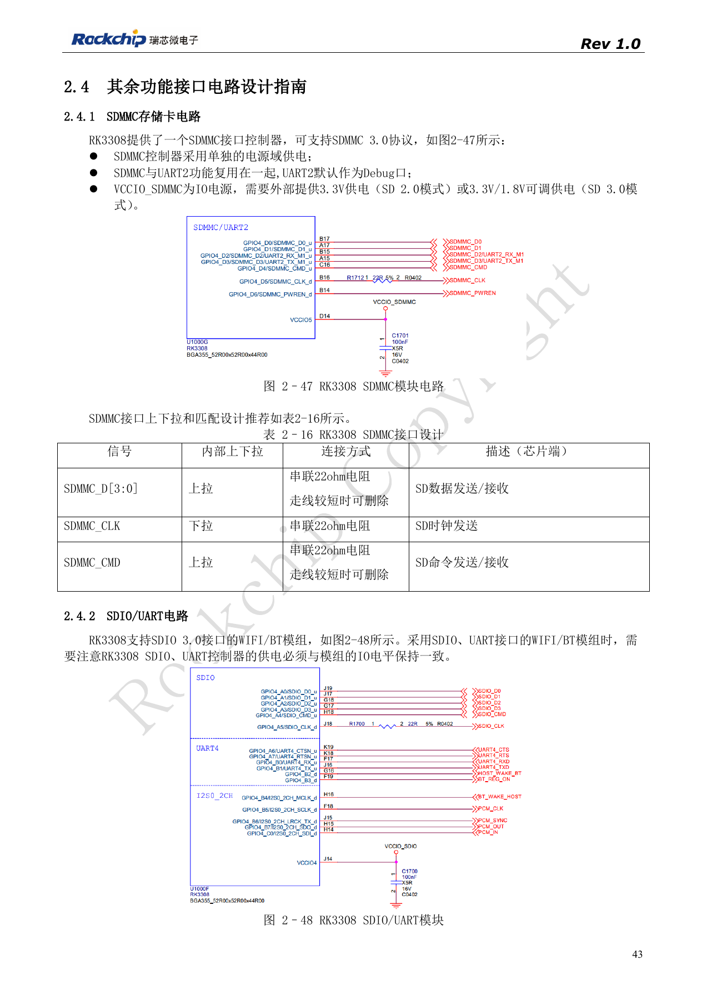
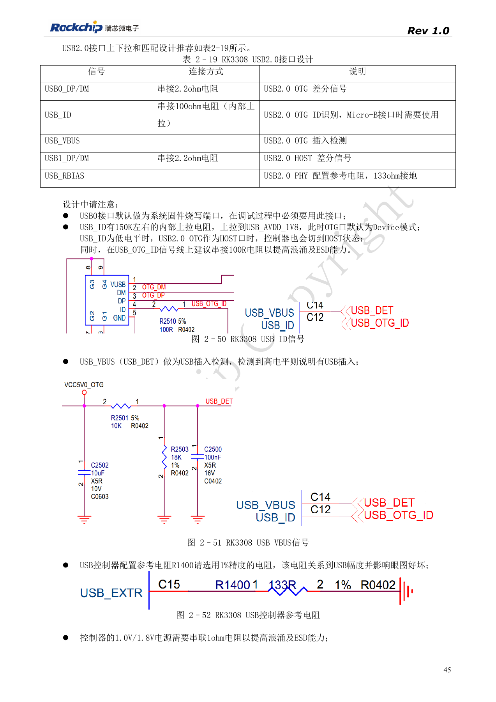
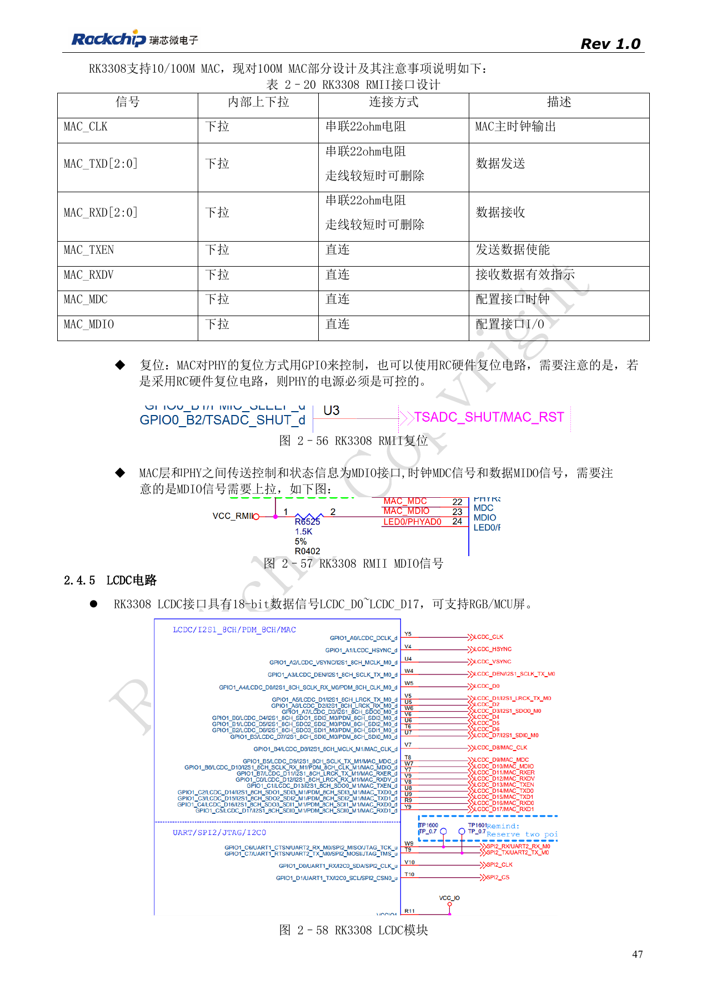
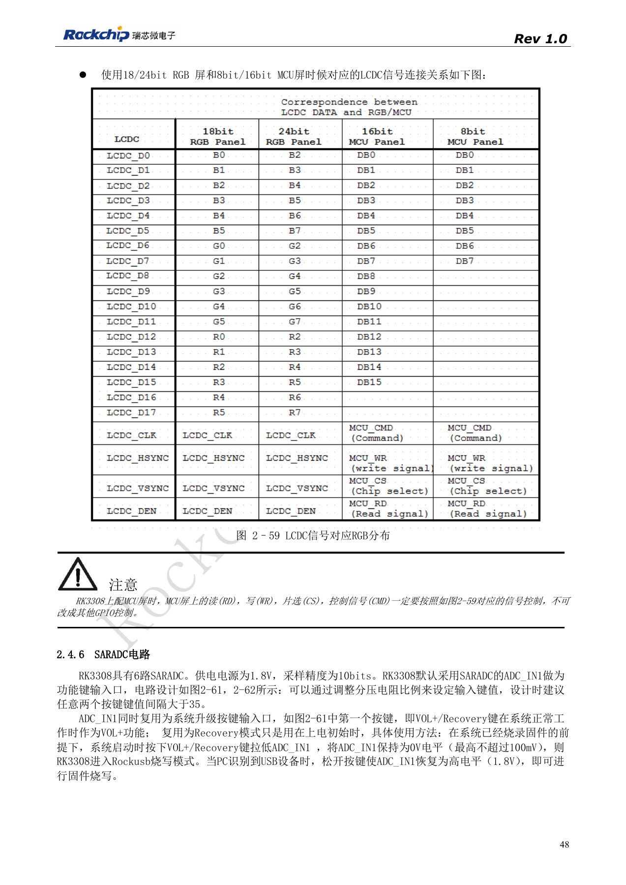

# RK3308 外设设计：USB、RMII、显示与调试接口

依据 RK3308 硬件设计指南 V1.0（2018-09-14），并结合 2023 年 V1.1 芯片兼容说明识别版本边界。P2 Pro 使用 RK3308B-S，旧参考不能直接替代该板卡设计。本文为按工程问题拆分的技术文章，不是完整逐页译本；数值来自原稿，未经 ArmSoM 实测。实际接口、SDK/BSP、内核及固件需按板卡版本核对。

**RK3308硬件设计指南_V1.0_20180914.pdf** · §2.4; compatibility V1.1 §7

## USB 先检查芯片后缀

原版 RK3308 的 USB0 为 OTG/烧录，USB1 为 HOST。参考 DP/DM 串 2.2Ω，ID 串 100Ω。2018 指南的 USB_RBIAS 外接 133Ω 1% 是旧芯片要求，不能套到所有后缀：2023 兼容说明明确 SMIC S 版本 C15 为 NC，原 GF 的外接电阻应按对应电路调整。P2 Pro 使用 B-S，必须先看板卡原理图，再判断元件是否存在，而不是根据旧图补焊电阻。

## 网络与无线连接的系统检查

百兆 RMII 需外部 PHY，PHY 时钟可以来自外置晶体或 MAC_CLK；只能按选定参考确定方向。PHY 复位若采用 RC，指南要求 PHY 电源可控；MDIO 仍需上拉。SDIO 3.0 Wi-Fi/BT 模组必须与 SoC 的 SDIO/UART IO 电平一致，并核对 CTS/RTS 方向与 PCM 通路。原稿表 2-20 把 RMII 数据标成 MAC_TXD[2:0]/RXD[2:0]，属于待核对项，不据此发明第三根 RMII 数据线，应以 PinOut/TRM 为准。

## 显示和调试要留下维护通道

LCDC 提供 18 根数据信号，RGB/MCU 的映射按原图选择；MCU 屏的 RD、WR、CS、CMD 必须使用指定功能映射，不应随意换成普通 GPIO。SDMMC 与 UART2_M1 冲突时预留 M0 调试。外部连接器还需串联保护、ESD 回流和未供电状态验证；最终测试应包括长时间网络传输、USB 热插拔、屏幕刷新和音频并发，避免单接口通过而整机不稳定。

## 参考图与核对页

本批只有中文原稿，四语使用相同中文原图。以下为保留图表上下文的原稿截图，图片未翻译；正文可复制。页码为 PDF 物理页码。

PDF 43

PDF 45

PDF 47

PDF 48

## ArmSoM 产品与文档

- [ArmSoM P2 Pro](https://www.armsom.org/product-page/p2pro) · [P2 Pro Docs](https://docs.armsom.org/armsom-p2pro)

## 继续阅读

- [本系列目录](/zh/articles/rk3308-hardware-design-series/)
- [RK3308 启动与存储：时钟、FLASH_SEL 和恢复调试](/zh/articles/rk3308-clock-boot-storage-design/)
- [RK3308 电源与 DDR：独立供电、待机和 S 版本差异](/zh/articles/rk3308-power-ddr-hardware-design/)
- [RK3308 麦克风阵列：模拟输入、I2S、PDM 与回采](/zh/articles/rk3308-audio-array-hardware-design/)
- [RK3308 热设计、ESD 与生产存储检查](/zh/articles/rk3308-thermal-esd-production-design/)
