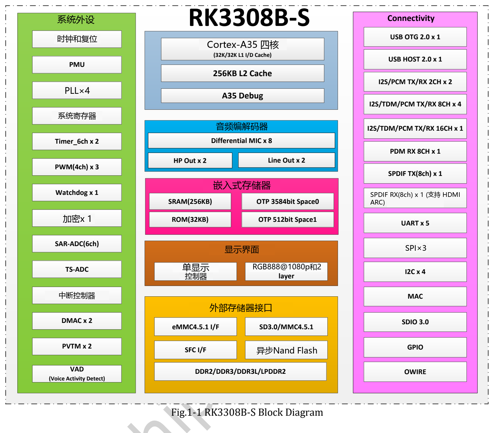

RK3308B-S 的优势集中在音频采集、播放和嵌入式连接。它把四核 Cortex-A35、音频 Codec 与多种数字音频接口结合起来，适合语音终端、网络音频节点和设备数据网关。ArmSoM P2 Pro 提供实际板级接口与 Linux 开发资源，方便从芯片能力走向应用原型。

## 核心规格与产品定位

| 模块 | RK3308B-S V1.0 所列能力 | 应用意义 |
|---|---|---|
| CPU | 四核 Cortex-A35、Armv8-A、NEON | 应用、协议与音频处理任务 |
| 缓存 | 32KB L1 指令、32KB L1 数据、256KB L2 | 与实际软件负载共同决定表现 |
| 内存 | 16-bit DDR2/DDR3/DDR3L/LPDDR2，最大寻址512MB | 适合控制内存占用的嵌入式软件 |
| Codec | 最多8路麦克风ADC、立体声DAC | 多通道采集及耳机/线路输出 |
| 数字音频 | I2S/PCM/TDM、PDM、SPDIF，含内部连接 | 外部端口数量必须按板级引出核对 |
| VAD | 语音活动检测与相关数据存储 | 为后续识别链路提供事件入口 |
| 网络与USB | 10/100M MAC、USB2.0 | 外部PHY、无线模块和驱动构成完整连接 |

RK3308B-S 不应套用 RK3506J 或 RK3588 的 CPU、NPU、视频与扩展参数。64位 CPU 也不等于所有发行镜像都采用64位用户空间。P2 Pro 的 Wi-Fi/蓝牙来自板上无线模块，不是这颗 SoC 内置无线射频。

## 为什么音频接口比主频更值得先看

多麦克风项目首先要解决同步采样、通道顺序、时钟、增益和噪声。B-S 手册描述最多8路模拟麦克风输入，也列出 PDM 数字麦克风能力；它们不是可以不加区分地叠加使用的即插即用资源。外接器件、引脚复用、驱动与内存带宽共同决定可用配置。

VAD 判断的是声音活动，不负责理解指令。唤醒词、语音识别、回声消除、波束形成和语音合成需要独立算法及软件集成。没有本地测试时，不能给出识别距离、准确率或整机待机功耗承诺。

## 三条可落地的开发路线

**语音操作终端：** 麦克风采集 → 音频预处理 → 活动/唤醒判断 → 指令处理 → 语音反馈。先验证单通道，再扩展阵列；使用真实外壳和环境噪声做测试。

**网络音频节点：** 网络流 → 缓冲/解码 → 音频输出。适合提示音终端、桌面播放器或原型广播节点。编解码格式、网络抖动、音量控制和功放电路都需要单独验证。

**轻量物联网网关：** 传感器/串口 → 数据校验与缓存 → 网络上报。控制服务数量和日志增长，让有限内存用于关键任务。百兆网口不意味着适合千兆路由或高速存储用途。

## 主频和显示资料存在版本差异

本次 B-S V1.0 第67页把 A35 最大频率列为 **1.1GHz**；P2 Pro 文档同时出现 **1.2GHz、1.3GHz**。这些来源不能静默统一为最高值，实际频率应按芯片批次、BSP和工作条件确认。

瑞芯微通用 RK3308 网页写 RGB/MCU 最高720P，而 B-S 手册写1080p。这里保留来源差异，也不把芯片显示控制器当成 P2 Pro 自带 HDMI 输出。选型时优先确认你需要的接口是否真正引出。

## 用 P2 Pro 开始验证

先以匹配硬件版本的官方镜像确认音频、网络和存储，再固定软件版本开展应用。P2 Pro 的可选 eMMC 与 PoE 需按购买配置核对。下列文章分别展开音频、网关与手册阅读；所有场景均为开发建议，并非已完成的客户部署或测试结果。

## 系列文章与官方资料

- [ArmSoM P2 Pro：从麦克风采集到语音交互与网络音频](/zh/articles/p2pro-voice-audio-applications/)
- [ArmSoM P2 Pro：物联网数据采集与轻量网关开发方案](/zh/articles/p2pro-iot-lightweight-gateway/)
- [RK3308B-S Datasheet V1.0：原文下载、音频架构与电气参数导读](/zh/articles/rk3308bs-datasheet-v10/)
- [Rockchip Audio](/zh/articles/023-rockchip-audio/)
- [Rockchip RK3308](https://www.rock-chips.com/a/cn/product/RK33xilie/2018/0614/908.html)
- [P2 Pro — Docs](https://docs.armsom.org/armsom-p2pro)
- [P2 Pro — ArmSoM](https://www.armsom.org/product-page/p2pro)
- [P2 Pro — BSP](https://github.com/ArmSoM/armsom-p2pro-bsp)
