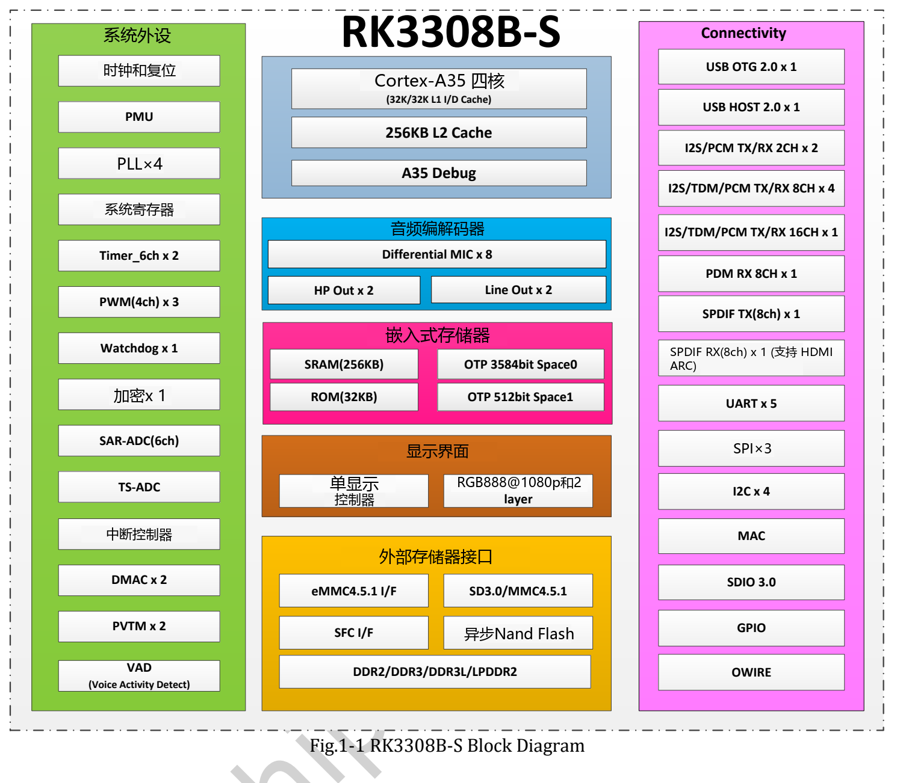
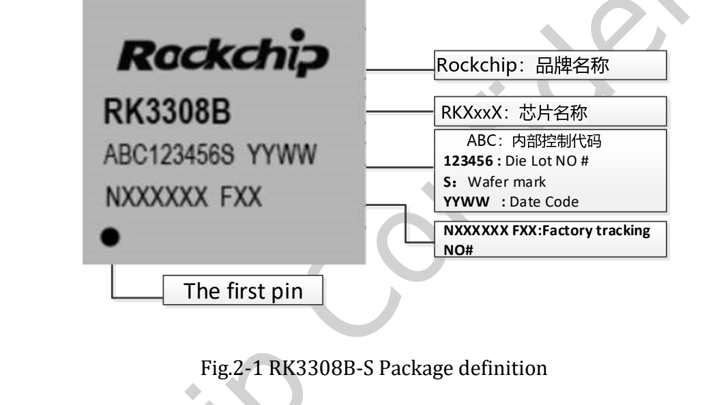
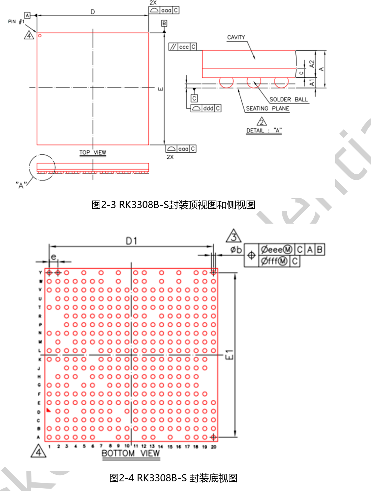

本篇提供 **RK3308B-S Datasheet V1.0，2021-10-10，72页** 的原文件下载，并按设计工作顺序介绍架构、音频、封装、电气与热参数。它是工程导读，不是72页逐行译本；完整球位、引脚复用、接口电气表均保留在原PDF中。

## 下载与型号范围

[下载原始 RK3308B-S Datasheet V1.0](/assets/rk3308bs/Rockchip-RK3308B-S-Datasheet-V1.0-20211010.pdf)

同一份文档同时描述 **RK3308B-S 和 RK3308H-S**。H-S的64MB内置DDR2不是B-S的参数；阅读封装、球位与热表时必须看清型号标题。P2 Pro 使用B-S，板上DDR与可选存储需按产品配置确认。

| 页码 | 阅读内容 |
|---|---|
| 7–14 | CPU、存储、显示、音频与连接功能 |
| 15 / 16 | B-S / H-S框图 |
| 17–20 | 两种型号的标识、封装与尺寸 |
| 21–28 | 分型号Ball Map |
| 29–33 | B-S引脚编号表 |
| 34–65 | 电源、功能IO、复用与IO类型 |
| 66–71 | 极限值、推荐条件、接口及音频电气参数 |
| 72 | 两种型号的热阻参考 |

## 计算、内存和存储

四核Cortex-A35采用Armv8-A，支持NEON；手册列出32KB L1指令缓存、32KB L1数据缓存、256KB L2及256KB SRAM。外部内存为16-bit DDR2/DDR3/DDR3L/LPDDR2，最大寻址512MB。

eMMC支持4.41/4.51/5.0/5.1、1/4/8-bit和最高HS200，但原文明确不支持CMD Queue。还列出异步NAND、SPI NOR/NAND与SD接口，不能由此推断某块开发板全部装配。

## 音频能力应按连接路径阅读

| 功能 | V1.0描述与限制 |
|---|---|
| Codec | 24-bit ADC最多8路麦克风，24-bit立体声DAC |
| PDM | 最多8个单声道或4个立体声麦克风 |
| I2S_8CH | 四个组件，其中0/1连接外部IO、2/3连接内部Codec |
| TDM | 与对应I2S控制器共享，原文列192kHz@2CH、48kHz@8CH |
| VAD | 单麦语音活动检测，可涉及多麦事件前后数据存储 |
| SPDIF | TX/RX及HDMI ARC相关能力，不等于板上HDMI视频口 |

外部控制器、内部连接与板上接口是不同层级。最大通道数、采样率和输出组合不能简单相乘或叠加。VAD也不等于唤醒词或完整识别算法。

## 封装与原始图

原稿标注TFBGA355。原图用于阅读方向，PCB封装库应根据正式尺寸与公差文件建立，不能从网页图量取尺寸。H-S封装图在相邻页面，不可混用。

## 电气与热设计：保留条件

| 参数 | B-S V1.0原文 |
|---|---|
| A35最大频率，第67页 | 1.1GHz |
| CPU推荐电压 | 最小TBD，典型0.90V，最大TBD |
| 推荐环境温度Ta | 0 / 25 / 85°C（最小/典型/最大） |
| 最大结温 | 125°C，热章节要求低于此值 |
| θJA / θJB / θJC | 45 / 35 / 15°C/W，原厂参考值 |

热表条件为四层测试板、101.6×114.3mm、厚1.6mm、环境25°C。这些不是P2 Pro整板热测试结果，也不能直接预测封闭外壳温度。Codec小节的电流只对应指定Codec电源域和模式，不能写成整板功耗。

## 与公开网页的差异

P2 Pro网页写1.2GHz/1.3GHz，附件电气表写1.1GHz；通用RK3308网页显示上限720P，B-S手册写1080p。保留各来源，不擅自认定哪个适用于交付板卡。P2 Pro文档环境温度为0～70°C，也不能直接替换为芯片的0～85°C。

原文件未改动，图内水印保留。使用前核对芯片批次、正式版本、BSP、电源、原理图与实测；本批未做硬件测试。

## 系列文章与官方资料

- [RK3308B-S 芯片详解：为语音、音频与轻量联网设备而设计](/zh/articles/rk3308bs-chip-guide/)
- [ArmSoM P2 Pro：从麦克风采集到语音交互与网络音频](/zh/articles/p2pro-voice-audio-applications/)
- [ArmSoM P2 Pro：物联网数据采集与轻量网关开发方案](/zh/articles/p2pro-iot-lightweight-gateway/)
- [Rockchip Audio](/zh/articles/023-rockchip-audio/)
- [Rockchip RK3308](https://www.rock-chips.com/a/cn/product/RK33xilie/2018/0614/908.html)
- [P2 Pro — Docs](https://docs.armsom.org/armsom-p2pro)
- [P2 Pro — ArmSoM](https://www.armsom.org/product-page/p2pro)
- [P2 Pro — BSP](https://github.com/ArmSoM/armsom-p2pro-bsp)
