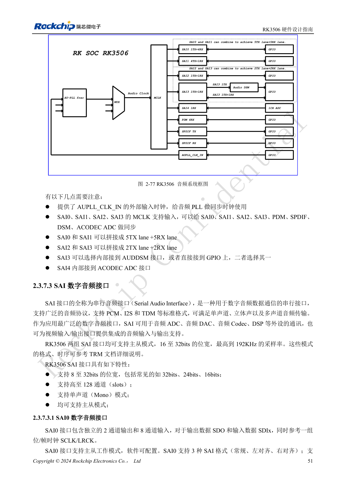
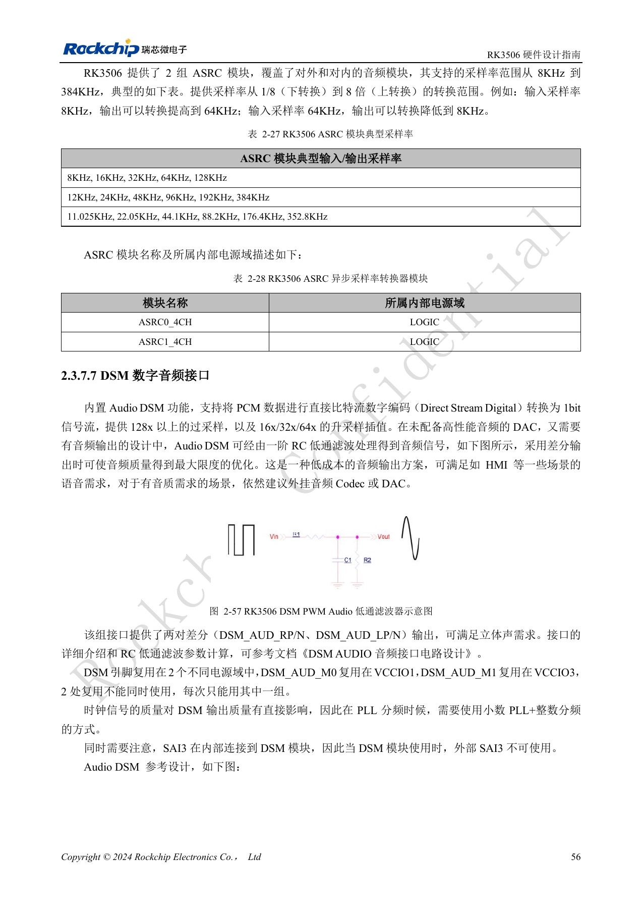
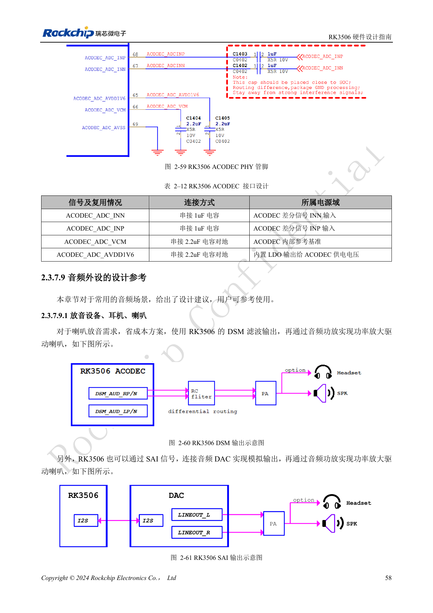
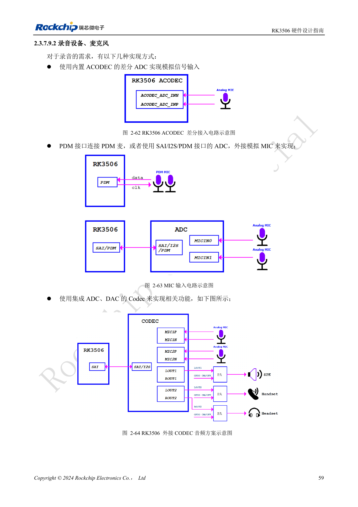

# RK3506 音频设计：SAI、PDM、ASRC 与 DSM

依据 RK3506 硬件设计指南 V1.0（2024-09）编写。本指南覆盖 G2 与 B/J，但芯片封装、内存、电源和引脚必须按型号核对。CM1、Forge1 的实际接口以板卡资料为准。本文为按工程问题拆分的技术文章，不是完整逐页译本；数值来自原稿，未经 ArmSoM 硬件实测。SDK/BSP、内核及固件版本需按实际产品验证。

**RK3506 Hardware Design Guide_V1.0_20240904_CN.pdf** · §2.3.7; §3.3.13

## 先画时钟和数据路径

五组 SAI 中只有 SAI0–3 对外，SAI4 内接 ACODEC ADC。SAI0/1 可拼接成 5TX lane+5RX lane，SAI2/3 可拼接成 2TX lane+2RX lane，但不能把这些模式当作额外控制器。SAI2 的 M0/M1 属同一接口，只能选一组。SAI3 可接内部 DSM 或外部 IO，使用 DSM 时不能同时使用外部 SAI3。原稿对 SAI 位宽先写 16–32bit，后又列 8–32bit，具体模式需按 TRM 和所用 SDK 确认。

## 数字麦克风与异步时钟

PDM 是主接收模式，四条数据线每条承载两个声道，最多八声道；它们可以是八个麦克风，也可以是六麦加两路回采。PDM_CLK 推荐串 33Ω，SAI 的 MCLK/SCLK/LRCK 通常推荐 22Ω；不能把不同接口的阻值混成统一规则。两组 ASRC 的范围为 8–384kHz、转换比 1/8–8，用于采样率不同或同标称采样率但时钟不同步的数据流。ASRC 是内部处理资源，不是另一个外部端口。

## 按音质和布局选择模拟路径

低成本 HMI 提示音可由 DSM 经 RC 滤波和功放实现；高音质需求宜外接 Codec/DAC。ACODEC 提供一对差分 MIC 输入，VCM 与 AVDD1V6 的 2.2µF 对地电容不可任意改值，输入参考串 1µF。SAI/PDM 多设备的时钟按菊花链规划，音频时钟分别包地，地孔间距不超过 300mil，远离 LCD、DDR、开关电源与 RF。验证顺序应包含静音底噪、声道映射、并发收放、长时间同步和唤醒，而不是只播放一段声音。

## 参考图与核对页

本批只有中文原稿，四语使用相同中文原图。以下为保留图表上下文的原稿截图，图片未翻译；正文可复制。页码为 PDF 物理页码。

PDF 66

PDF 71

PDF 73

PDF 74

## ArmSoM 产品与文档

- [ArmSoM CM1](https://www.armsom.org/product-page/cm1) · [CM1 Docs](https://docs.armsom.org/armsom-cm1)
- [ArmSoM Forge1](https://www.armsom.org/armsom-forge1) · [Forge1 Docs](https://docs.armsom.org/armsom-forge1)

## 继续阅读

- [本系列目录](/zh/articles/rk3506-hardware-design-series/)
- [RK3506 最小系统：时钟、复位与恢复入口](/zh/articles/rk3506-clock-boot-reset-design/)
- [RK3506 电源域：G2、B/J 与载板供电边界](/zh/articles/rk3506-power-domains-design/)
- [RK3506 DDR、eMMC 与 FSPI：电路和布线约束](/zh/articles/rk3506-ddr-storage-hardware-design/)
- [RK3506 显示、USB 与 RM_IO：接口分配检查](/zh/articles/rk3506-display-usb-io-design/)
- [RK3506 工业接口：RMII、FlexBus、DSMC 与控制信号](/zh/articles/rk3506-industrial-bus-hardware-design/)
- [RK3506 热设计、ESD 与生产存储检查](/zh/articles/rk3506-thermal-esd-production-design/)
