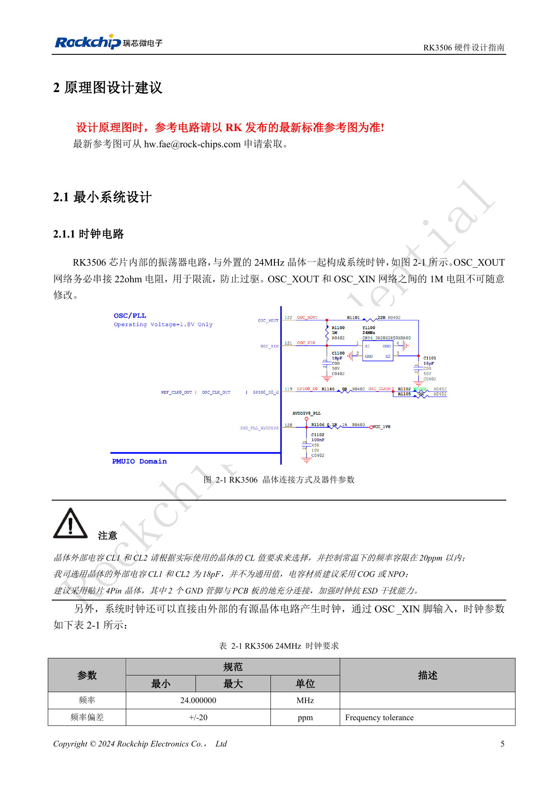
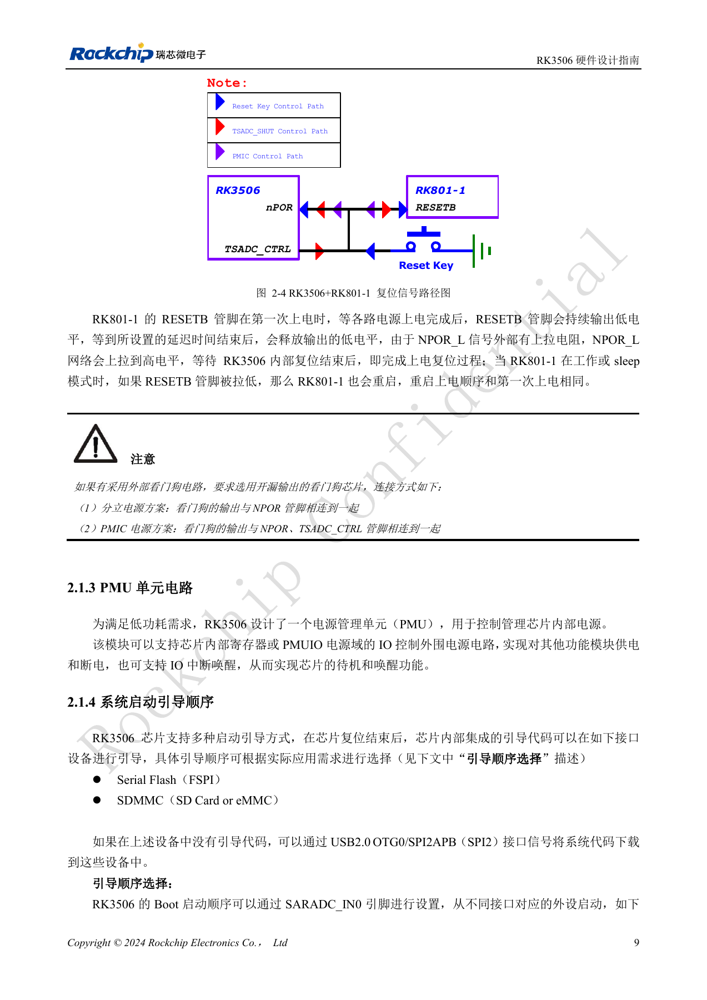
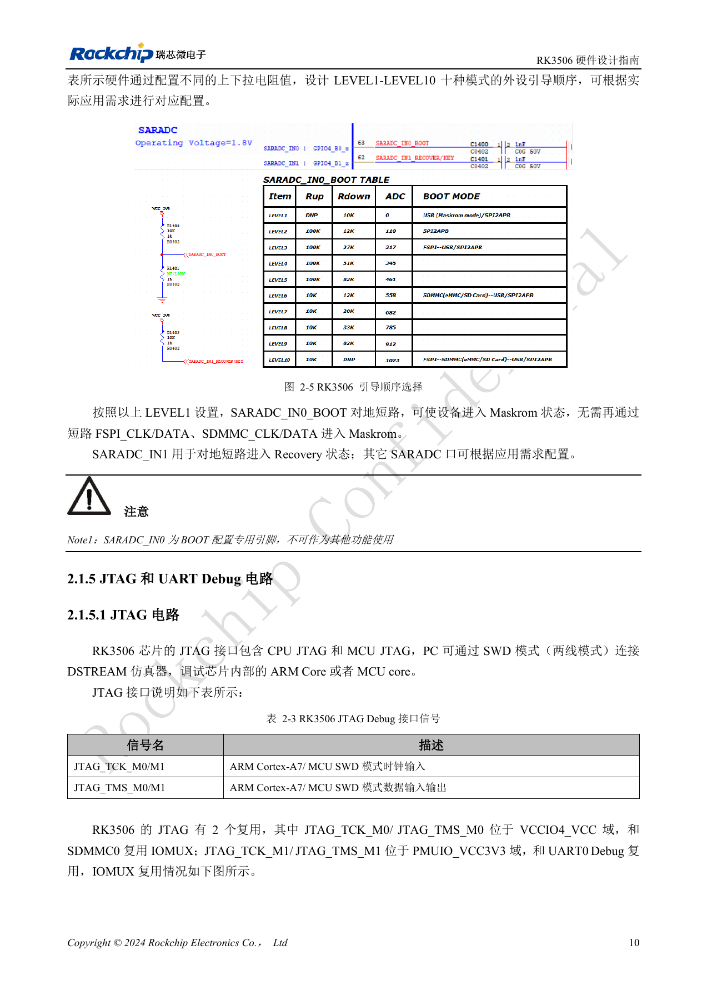
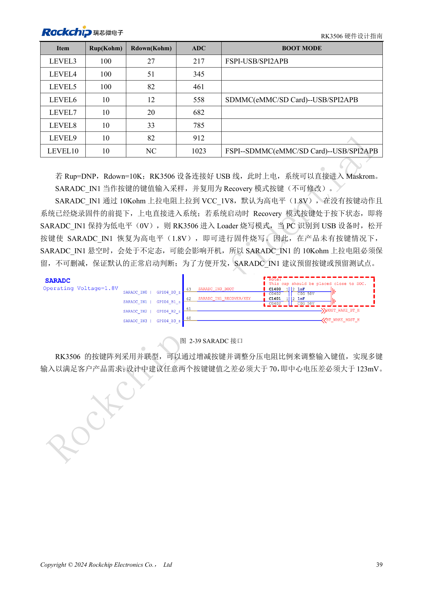
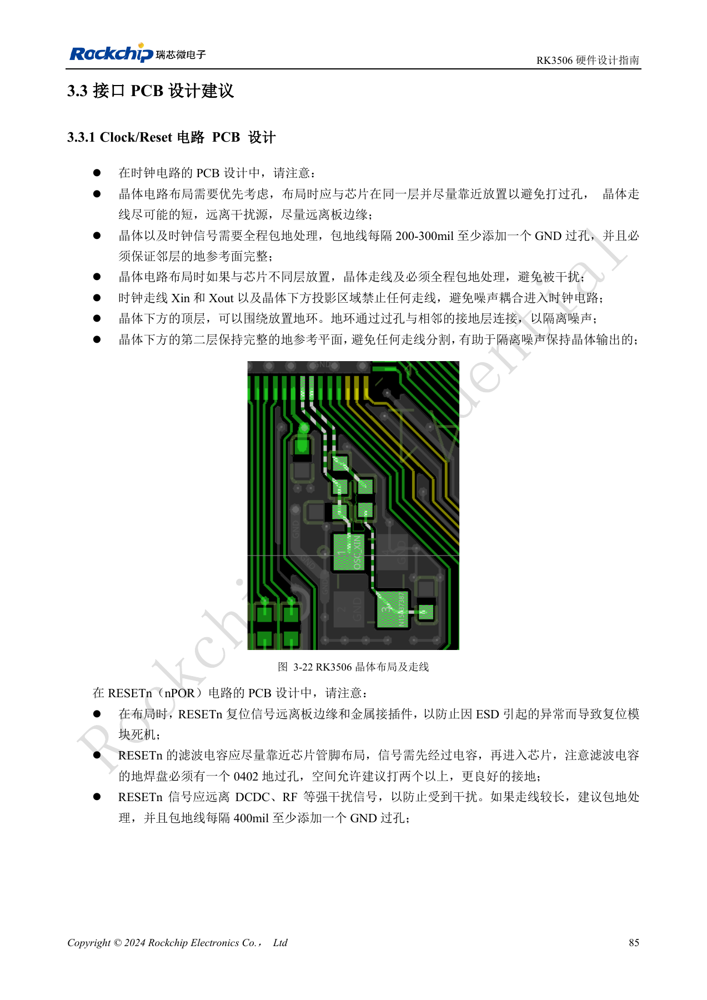

# RK3506 最小系统：时钟、复位与恢复入口

依据 RK3506 硬件设计指南 V1.0（2024-09）编写。本指南覆盖 G2 与 B/J，但芯片封装、内存、电源和引脚必须按型号核对。CM1、Forge1 的实际接口以板卡资料为准。本文为按工程问题拆分的技术文章，不是完整逐页译本；数值来自原稿，未经 ArmSoM 硬件实测。SDK/BSP、内核及固件版本需按实际产品验证。

**RK3506 Hardware Design Guide_V1.0_20240904_CN.pdf** · §2.1.1–2.1.5; §2.3.2; §3.3.1

## 24MHz 与待机时钟

OSC_XOUT 必须串接 22Ω，XOUT/XIN 之间的 1MΩ 不应随意修改。参考图的 18pF 负载电容只对应原稿所用晶体，实际选值要按晶体 CL 与寄生计算；常温频偏控制在 ±20ppm，建议 C0G/NP0 和四脚晶体。晶体同面靠近芯片，XIN/XOUT 及晶体投影区域不布其他信号，邻层地连续，包地每 200–300mil 加地孔。

## 复位路径必须与电源方案对应

NPOR 为低有效，10nF 滤波电容靠近引脚，不能只在远端按键处滤波。分立电源方案的外部开漏看门狗接 NPOR；RK801-1 方案需按参考图同时关联 NPOR 与 TSADC_CTRL。TSADC_CTRL 固定在 RM_IO21，指南明确不能移到其他引脚。外设时钟与 IO 电源域电平必须匹配。停掉 24MHz 前，确认唤醒源不依赖它；外部 32.768kHz 输入要求 ±30ppm、45–55% 占空比及 0.7×VDD 至 VDD 幅度。

## 把恢复入口留在产品上

SARADC_IN0 专用于启动顺序，不能复用为普通功能；按 LEVEL1 接地可进入 Maskrom。SARADC_IN1 是 Recovery 输入，10kΩ 上拉到 1.8V 必须保留，建议保留按键或测试点。ADC 使用引脚靠近 SoC 加 1nF，按键侧先经过 ESD 再经过 100Ω。USB OTG0 是该版本指南已支持的下载口，SPI2APB 虽出现在启动表中，但文中注明软件尚未开发，不应以它代替 USB 烧录口。首次上电逐项记录电源、24MHz、NPOR、串口和 PC 枚举结果。

## 参考图与核对页

本批只有中文原稿，四语使用相同中文原图。以下为保留图表上下文的原稿截图，图片未翻译；正文可复制。页码为 PDF 物理页码。

PDF 20

PDF 24

PDF 25

PDF 54

PDF 100

## ArmSoM 产品与文档

- [ArmSoM CM1](https://www.armsom.org/product-page/cm1) · [CM1 Docs](https://docs.armsom.org/armsom-cm1)
- [ArmSoM Forge1](https://www.armsom.org/armsom-forge1) · [Forge1 Docs](https://docs.armsom.org/armsom-forge1)

## 继续阅读

- [本系列目录](/zh/articles/rk3506-hardware-design-series/)
- [RK3506 电源域：G2、B/J 与载板供电边界](/zh/articles/rk3506-power-domains-design/)
- [RK3506 DDR、eMMC 与 FSPI：电路和布线约束](/zh/articles/rk3506-ddr-storage-hardware-design/)
- [RK3506 显示、USB 与 RM_IO：接口分配检查](/zh/articles/rk3506-display-usb-io-design/)
- [RK3506 音频设计：SAI、PDM、ASRC 与 DSM](/zh/articles/rk3506-audio-hardware-design/)
- [RK3506 工业接口：RMII、FlexBus、DSMC 与控制信号](/zh/articles/rk3506-industrial-bus-hardware-design/)
- [RK3506 热设计、ESD 与生产存储检查](/zh/articles/rk3506-thermal-esd-production-design/)
