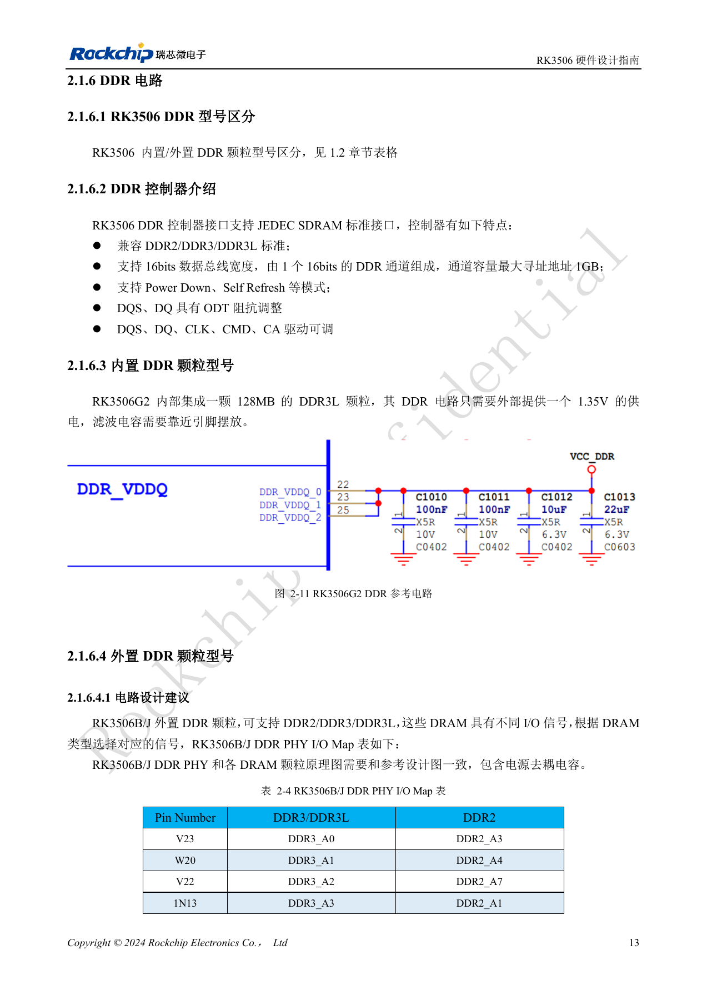
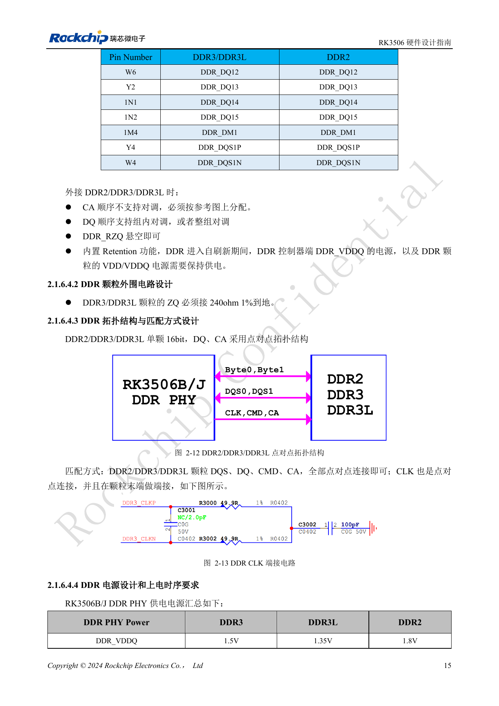
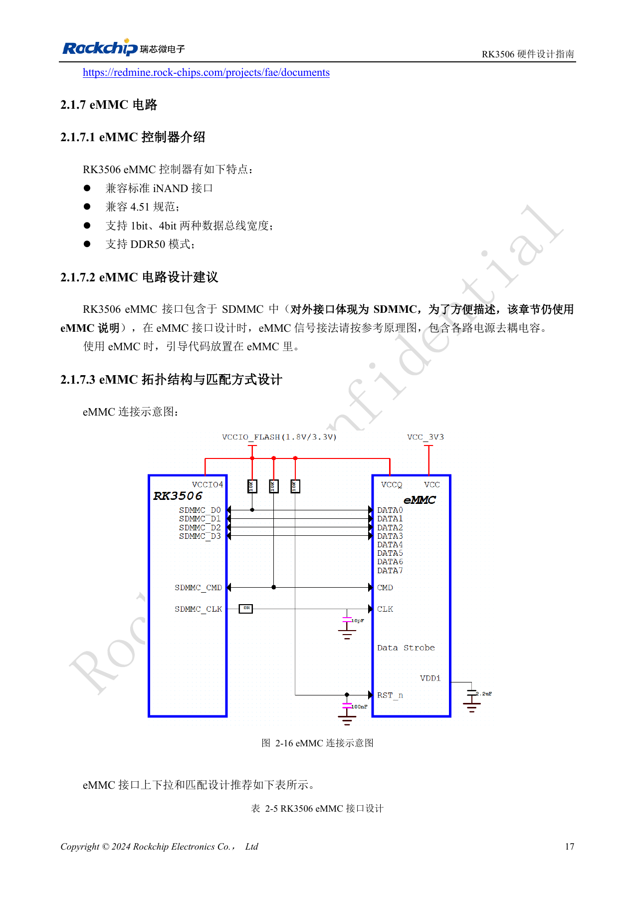
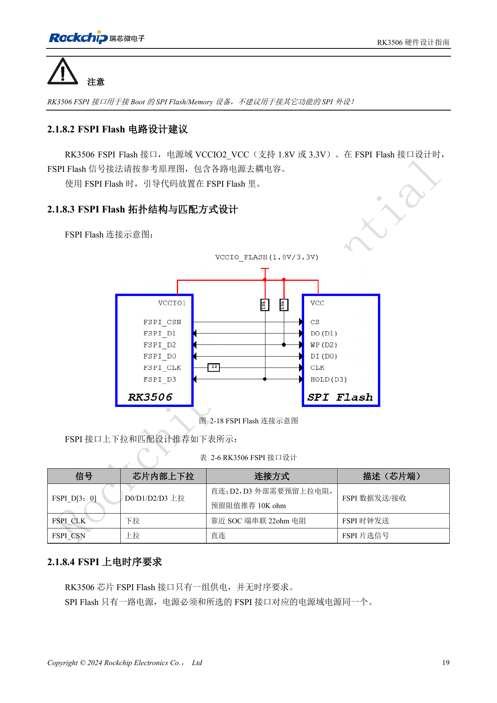
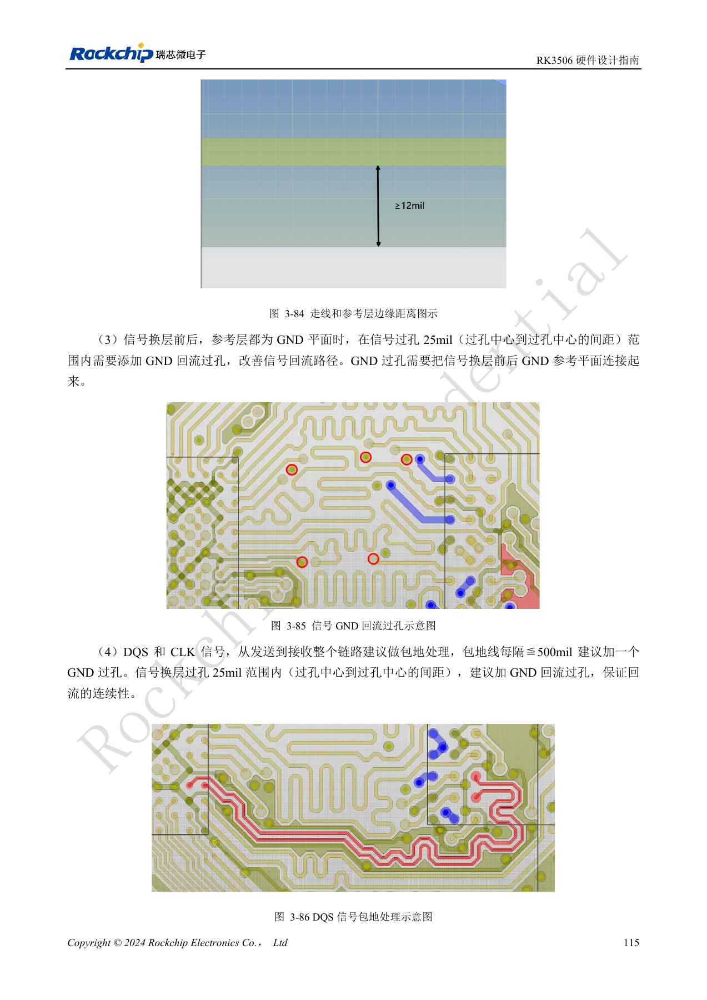

# RK3506 DDR、eMMC 与 FSPI：电路和布线约束

依据 RK3506 硬件设计指南 V1.0（2024-09）编写。本指南覆盖 G2 与 B/J，但芯片封装、内存、电源和引脚必须按型号核对。CM1、Forge1 的实际接口以板卡资料为准。本文为按工程问题拆分的技术文章，不是完整逐页译本；数值来自原稿，未经 ArmSoM 硬件实测。SDK/BSP、内核及固件版本需按实际产品验证。

**RK3506 Hardware Design Guide_V1.0_20240904_CN.pdf** · §2.1.6–2.1.8; §3.3.9–3.3.12

## 先区分内置和外置 DDR

G2 集成 128MB DDR3L，外部供 1.35V 并就近去耦。B/J 外置 DDR2/DDR3/DDR3L，16bit 单通道，指南列最大寻址 1GB；这是控制器能力，不是 CM1 或 Forge1 的实装内存。DDR3、DDR3L、DDR2 的 DDR_VDDQ 典型值分别为 1.5V、1.35V、1.8V。CA 顺序不能对调；DQ 允许组内或整组交换，但不能跨规则随意重排。控制器 DDR_RZQ 悬空，DDR3/3L 颗粒 ZQ 则接 240Ω 1% 到地，二者不能混淆。自刷新期间必须保持控制器 DDR_VDDQ 和颗粒 VDD/VDDQ。

## 把 DDR 约束写进 PCB 规则

原稿 DDR2/3/3L 表要求单端 50Ω±10%、差分 100Ω±10%；同 Byte 的 DQ/DM 对 DQS 长度差 ≤50mil，CA/控制对 CLK ≤100mil，DQS 和 CLK 各自对内 ≤12mil，DQS 对 CLK ≤450mil。换层时在信号过孔中心 25mil 范围内加回流地孔，参考地必须连续；绕线间距建议 ≥3W。复用厂商模板还须匹配 DDR 固件和颗粒，不能把模板验证当作自制板通过测试。

## eMMC 不要误写成八位 HS400

本指南的 eMMC 使用 SDMMC 接口，规范 4.51、1/4bit、DDR50。D0 与 CMD 外接推荐 10kΩ 上拉，CLK 在 SoC 侧串 22Ω；其余数据使用内部上拉。FSPI 用于启动 NOR/NAND，支持 SDR 及 1/2/4 线，位于 VCCIO2，D2/D3 预留 10kΩ 上拉，CLK 近 SoC 串 22Ω，Flash 与该域同源供电。PCB 参考：eMMC <3in、FSPI <4in，均单端 50Ω±10%、时钟数据差 <100mil。首次验证包括冷启动、恢复、读写压力和掉电恢复，芯片选型需对照匹配 SDK 的支持列表。

## DDR2 / DDR3 / DDR3L 布线参数

| 检查项 | 原稿要求 |
| --- | --- |
| 单端阻抗 | 50Ω ±10% |
| 差分阻抗 | 100Ω ±10% |
| 同 Byte：DQ / DM 对 DQS 长度差 | ≤50mil |
| CS / ODT / CKE 对 CLK 长度差 | ≤100mil |
| 其余地址/控制对 CLK 长度差 | ≤100mil |
| DQS_P / DQS_N；CLK_P / CLK_N 对内差 | ≤12mil |
| DQS 对 CLK 长度差 | ≤450mil |
| 不同 Byte 间距；同 Byte DQ 间距 | ≥2W |
| DQ 对 DQS、CLK 对其他信号 | 建议≥3W，至少2W |

来源：表 3-17、3-18，PDF132–133；W 为走线宽度。原稿把部分长度差称为“时延差”，但单位为 mil，本表按原单位保留，不能解释为时间单位。

## RK3506B/J DDR PHY 完整信号映射

| 封装引脚 | DDR3 / DDR3L | DDR2 |
| --- | --- | --- |
| V23 | DDR3_A0 | DDR2_A3 |
| W20 | DDR3_A1 | DDR2_A4 |
| V22 | DDR3_A2 | DDR2_A7 |
| 1N13 | DDR3_A3 | DDR2_A1 |
| W18 | DDR3_A4 | DDR2_A2 |
| 1N14 | DDR3_A5 | DDR2_A5 |
| Y20 | DDR3_A6 | DDR2_A6 |
| T22 | DDR3_A7 | DDR2_A9 |
| Y21 | DDR3_A8 | DDR2_A8 |
| U22 | DDR3_A9 | DDR2_A12 |
| W17 | DDR3_A10 | DDR2_RASN |
| W22 | DDR3_A11 | DDR2_A11 |
| W23 | DDR3_A12 | DDR2_A0 |
| T23 | DDR3_A13 | DDR2_A13 |
| Y22 | DDR3_A14 | DDR2_A14 |
| Y17 | DDR3_A15 | DDR2_A15 |
| 1M9 | DDR3_WEN | DDR2_BA1 |
| 1N8 | DDR3_CASN | DDR2_BA0 |
| 1M8 | DDR3_RASN | DDR2_WEN |
| 1N12 | DDR3_BA0 | DDR2_A10 |
| Y18 | DDR3_BA1 | DDR2_CASN |
| 1N9 | DDR3_BA2 | DDR2_BA2 |
| W15 | DDR_CKE | DDR_CKE |
| 1M11 | DDR_CSN | DDR_CSN |
| 1N10 | DDR_ODT | DDR_ODT |
| 1M13 | DDR3_RESET | -- |
| Y14 | DDR_CLKP | DDR_CLKP |
| W14 | DDR_CLKN | DDR_CLKN |
| Y13 | DDR_DQ0 | DDR_DQ0 |
| Y12 | DDR_DQ1 | DDR_DQ1 |
| Y11 | DDR_DQ2 | DDR_DQ2 |
| 1M6 | DDR_DQ3 | DDR_DQ3 |
| 1M5 | DDR_DQ4 | DDR_DQ4 |
| 1N6 | DDR_DQ5 | DDR_DQ5 |
| W9 | DDR_DQ6 | DDR_DQ6 |
| 1N5 | DDR_DQ7 | DDR_DQ7 |
| 1N4 | DDR_DM0 | DDR_DM0 |
| Y10 | DDR_DQS0P | DDR_DQS0P |
| W10 | DDR_DQS0N | DDR_DQS0N |
| Y7 | DDR_DQ8 | DDR_DQ8 |
| W7 | DDR_DQ9 | DDR_DQ9 |
| Y6 | DDR_DQ10 | DDR_DQ10 |
| Y3 | DDR_DQ11 | DDR_DQ11 |
| W6 | DDR_DQ12 | DDR_DQ12 |
| Y2 | DDR_DQ13 | DDR_DQ13 |
| 1N1 | DDR_DQ14 | DDR_DQ14 |
| 1N2 | DDR_DQ15 | DDR_DQ15 |
| 1M4 | DDR_DM1 | DDR_DM1 |
| Y4 | DDR_DQS1P | DDR_DQS1P |
| W4 | DDR_DQS1N | DDR_DQS1N |

来源：表 2-4，PDF28–30。`1N13`、`1M9` 等引脚写法按原稿保留；在制板前应与对应 B/J 封装的正式 PinOut 核对，不能自行删去前导字符。地址/命令 CA 不支持对调；DQ 支持组内或整组对调，但必须按参考设计及实际初始化配置审查。`DDR_RZQ` 悬空；DDR3/DDR3L 颗粒 ZQ 接 240Ω、1% 电阻到地。自刷新保留模式下，控制器 `DDR_VDDQ` 和颗粒 `VDD/VDDQ` 都要保持供电。此表不适用于 G2 内置 DDR 的外部引脚设计，也不代表 CM1、Forge1 已引出这些信号。

## 参考图与核对页

本批只有中文原稿，四语使用相同中文原图。以下为保留图表上下文的原稿截图，图片未翻译；正文可复制。页码为 PDF 物理页码。

PDF 28

PDF 30

PDF 32

PDF 34

PDF 130

## ArmSoM 产品与文档

- [ArmSoM CM1](https://www.armsom.org/product-page/cm1) · [CM1 Docs](https://docs.armsom.org/armsom-cm1)
- [ArmSoM Forge1](https://www.armsom.org/armsom-forge1) · [Forge1 Docs](https://docs.armsom.org/armsom-forge1)

## 继续阅读

- [本系列目录](/zh/articles/rk3506-hardware-design-series/)
- [RK3506 最小系统：时钟、复位与恢复入口](/zh/articles/rk3506-clock-boot-reset-design/)
- [RK3506 电源域：G2、B/J 与载板供电边界](/zh/articles/rk3506-power-domains-design/)
- [RK3506 显示、USB 与 RM_IO：接口分配检查](/zh/articles/rk3506-display-usb-io-design/)
- [RK3506 音频设计：SAI、PDM、ASRC 与 DSM](/zh/articles/rk3506-audio-hardware-design/)
- [RK3506 工业接口：RMII、FlexBus、DSMC 与控制信号](/zh/articles/rk3506-industrial-bus-hardware-design/)
- [RK3506 热设计、ESD 与生产存储检查](/zh/articles/rk3506-thermal-esd-production-design/)
