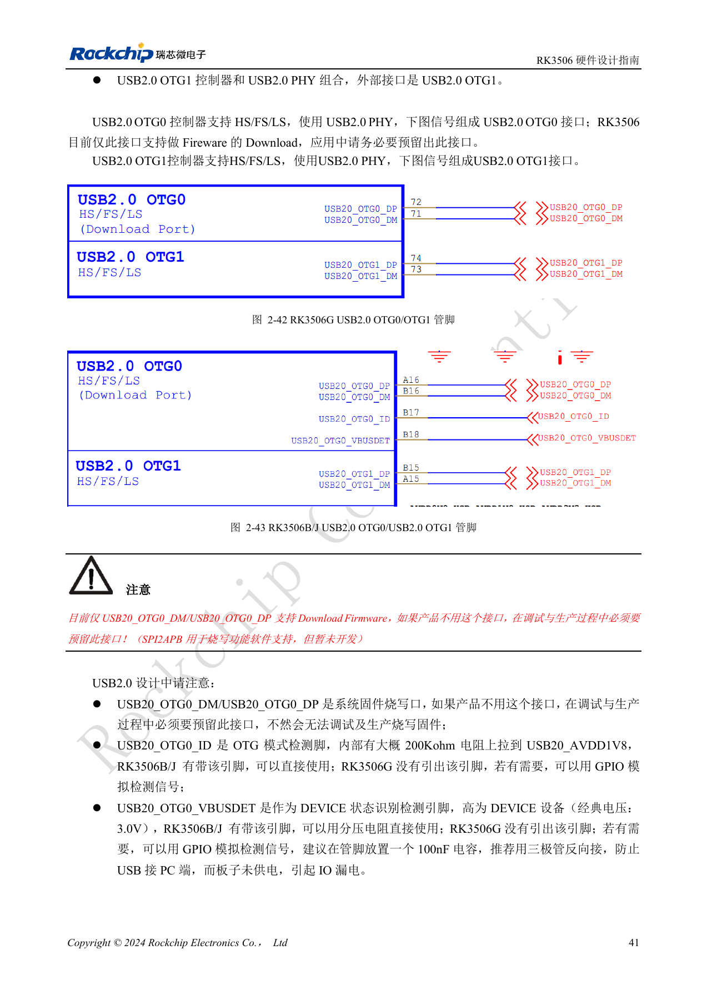
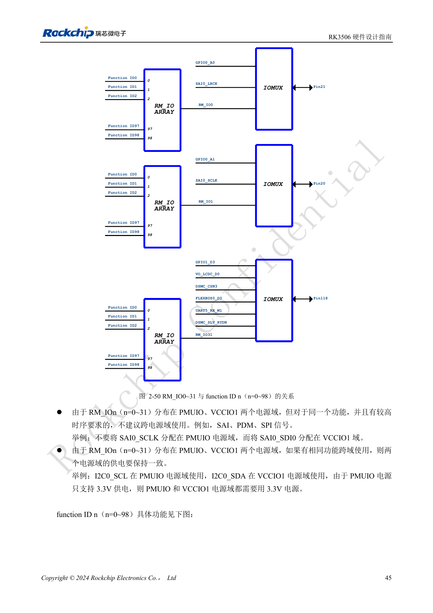
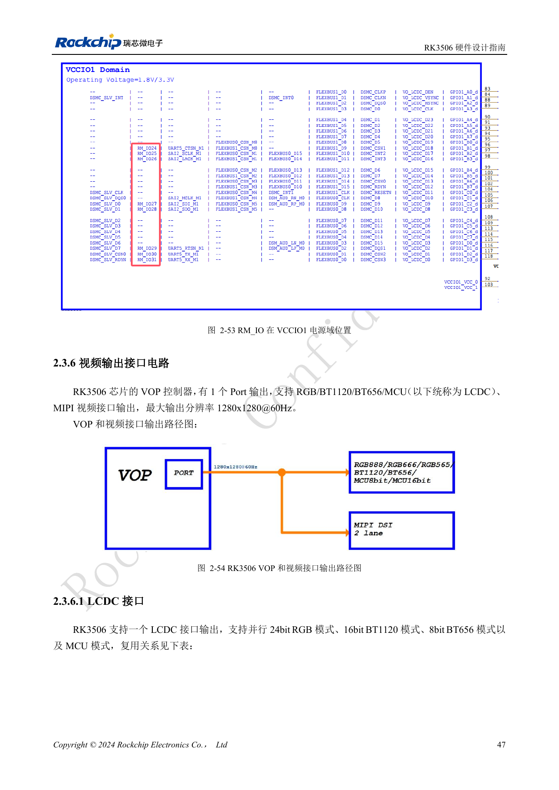
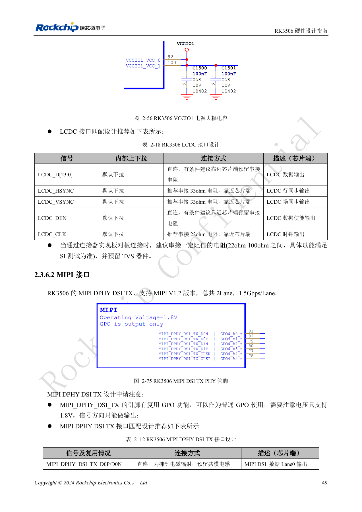
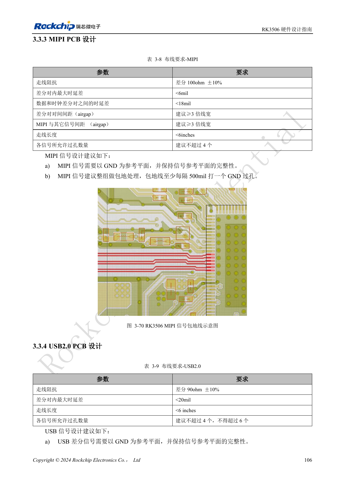
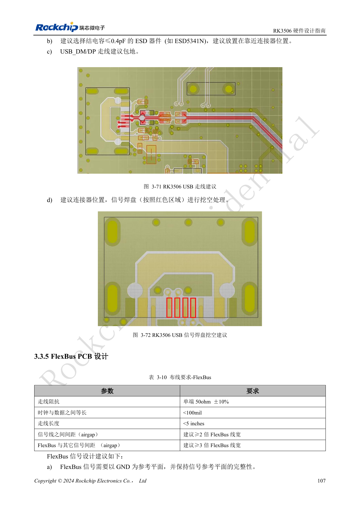

# RK3506 显示、USB 与 RM_IO：接口分配检查

依据 RK3506 硬件设计指南 V1.0（2024-09）编写。本指南覆盖 G2 与 B/J，但芯片封装、内存、电源和引脚必须按型号核对。CM1、Forge1 的实际接口以板卡资料为准。本文为按工程问题拆分的技术文章，不是完整逐页译本；数值来自原稿，未经 ArmSoM 硬件实测。SDK/BSP、内核及固件版本需按实际产品验证。

**RK3506 Hardware Design Guide_V1.0_20240904_CN.pdf** · §2.3.4–2.3.6; §3.3.3–3.3.4; §3.3.11

## 先确定一个显示输出路径

VOP 只有一个 Port，支持 RGB/BT1120/BT656/MCU 或 MIPI，指南给最大 1280×1280@60Hz，不能把不同接口名称累加成同时多屏。LCDC 位于 VCCIO1，需与面板电平一致；HSYNC/VSYNC 推荐源端 33Ω，CLK 推荐源端 22Ω。MIPI DSI TX 为两条数据 Lane、1.5Gbps/Lane。MIPI 引脚复用 GPO 时仅输出且为 1.8V，不是任意双向 GPIO。

## USB 端口与保护条件

两个 USB2.0 OTG 中，OTG0 必须用于保留烧录通路。G2 没有引出 OTG0 的 ID/VBUSDET，B/J 有对应引脚；GPIO 模拟检测必须避免 PC 插入但板未供电时回灌。DP/DM 的 2.2Ω 与 ID 的 100Ω 不应删减；HOST 5V 用限流开关。原理图章节 ESD 寄生电容写不超过 3pF，PCB 章节建议 ≤0.4pF，两个条件需并列保留，选型按更严格预算并验证眼图。USB 走线 90Ω±10%、对内差 <20mil、长度 <6in，建议最多四个过孔且不得超过六个。

## RM_IO 的自由分配也有边界

RM_IO0–31 可以映射 function ID0–98，但同一功能只能映射一个 RM_IO 引脚。矩阵分布在 PMUIO 和 VCCIO1，SAI/PDM/SPI 等时序敏感信号不宜跨域；若 I2C 跨域，两域必须同电平，而 PMUIO 固定 3.3V。MIPI PCB 参考为差分 100Ω±10%、对内差 <6mil、数据对与时钟对差 <18mil、长度 <6in、过孔建议≤4。应先做信号—功能—电源域表，再画连接器；最后以全通道实测确认，不只检查裸板长度。

## 参考图与核对页

本批只有中文原稿，四语使用相同中文原图。以下为保留图表上下文的原稿截图，图片未翻译；正文可复制。页码为 PDF 物理页码。

PDF 56

PDF 60

PDF 62

PDF 64

PDF 121

PDF 122

## ArmSoM 产品与文档

- [ArmSoM CM1](https://www.armsom.org/product-page/cm1) · [CM1 Docs](https://docs.armsom.org/armsom-cm1)
- [ArmSoM Forge1](https://www.armsom.org/armsom-forge1) · [Forge1 Docs](https://docs.armsom.org/armsom-forge1)

## 继续阅读

- [本系列目录](/zh/articles/rk3506-hardware-design-series/)
- [RK3506 最小系统：时钟、复位与恢复入口](/zh/articles/rk3506-clock-boot-reset-design/)
- [RK3506 电源域：G2、B/J 与载板供电边界](/zh/articles/rk3506-power-domains-design/)
- [RK3506 DDR、eMMC 与 FSPI：电路和布线约束](/zh/articles/rk3506-ddr-storage-hardware-design/)
- [RK3506 音频设计：SAI、PDM、ASRC 与 DSM](/zh/articles/rk3506-audio-hardware-design/)
- [RK3506 工业接口：RMII、FlexBus、DSMC 与控制信号](/zh/articles/rk3506-industrial-bus-hardware-design/)
- [RK3506 热设计、ESD 与生产存储检查](/zh/articles/rk3506-thermal-esd-production-design/)
