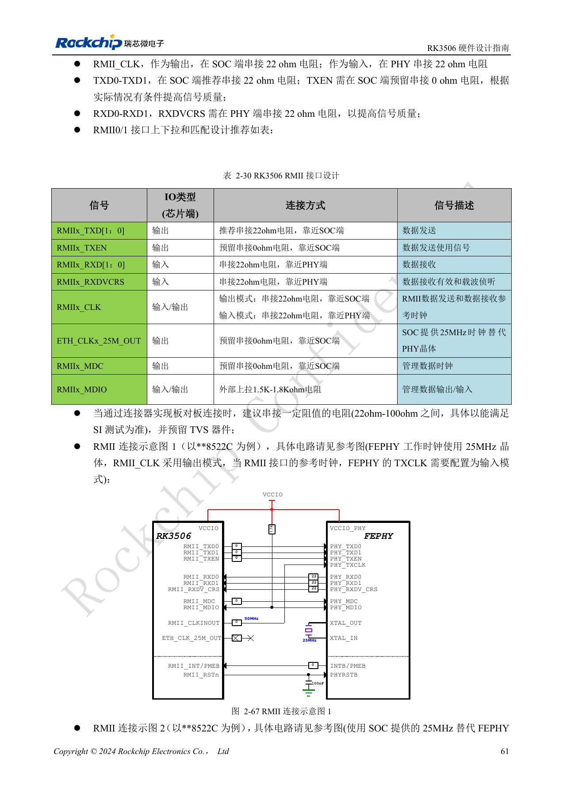
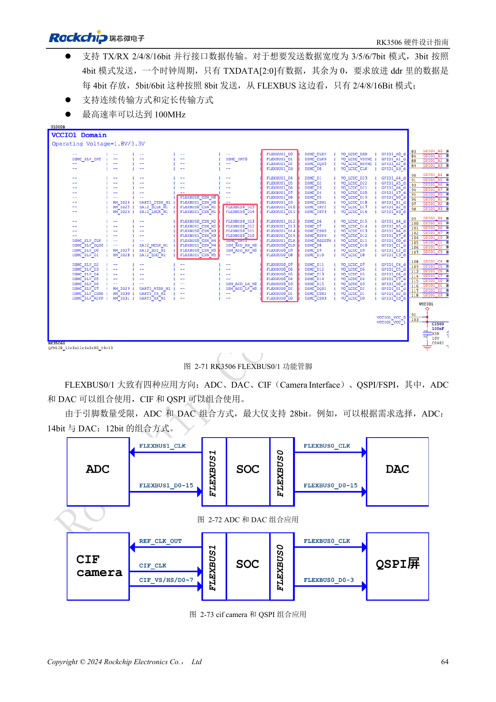
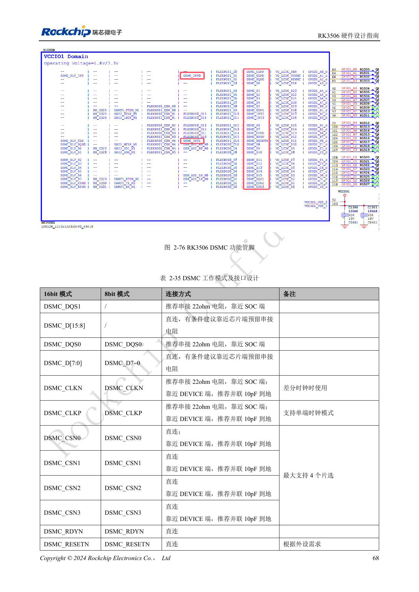
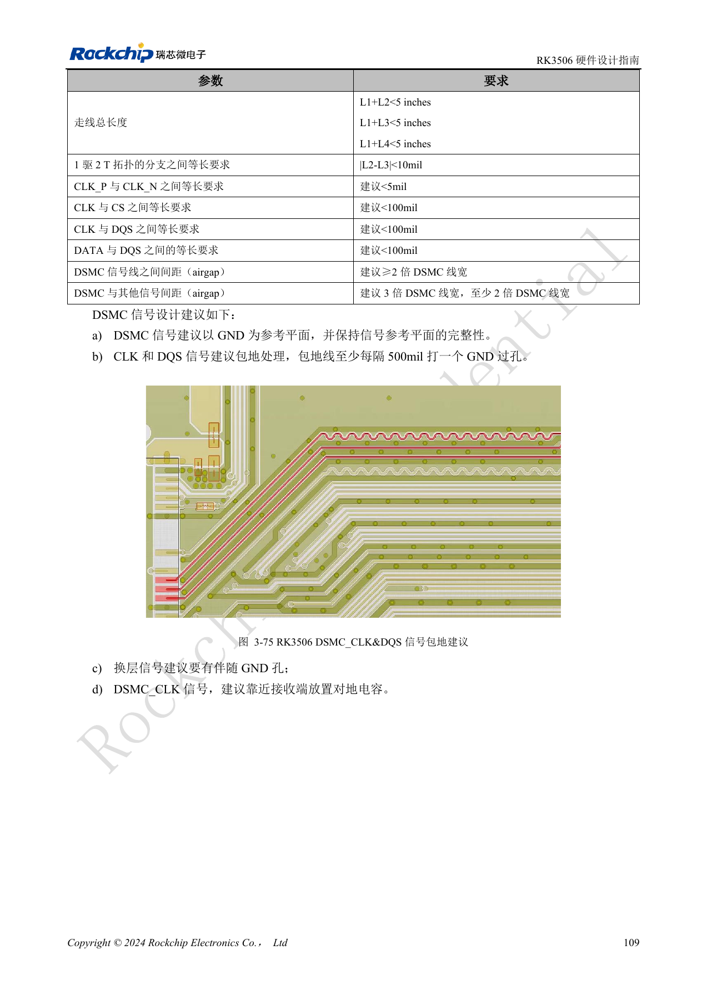
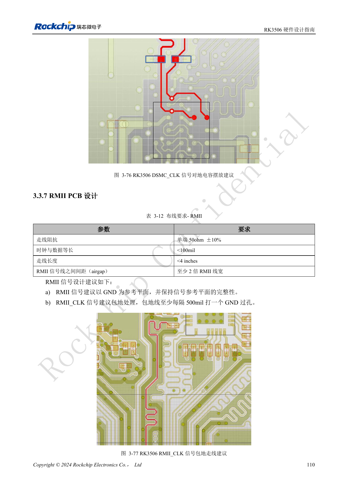

# RK3506 工业接口：RMII、FlexBus、DSMC 与控制信号

依据 RK3506 硬件设计指南 V1.0（2024-09）编写。本指南覆盖 G2 与 B/J，但芯片封装、内存、电源和引脚必须按型号核对。CM1、Forge1 的实际接口以板卡资料为准。本文为按工程问题拆分的技术文章，不是完整逐页译本；数值来自原稿，未经 ArmSoM 硬件实测。SDK/BSP、内核及固件版本需按实际产品验证。

**RK3506 Hardware Design Guide_V1.0_20240904_CN.pdf** · §2.3.8–2.3.17; §3.3.5–3.3.7

## 双 MAC 不等于两路现成网口

RK3506 集成两个 10/100Mbps EMAC，RMII0 在 VCCIO3、RMII1 在 VCCIO4。PHY、变压器、RJ45、复位和保护仍需外接或由板卡提供。50MHz 参考时钟必须确定唯一方向：SoC 输出时 22Ω 在 SoC 侧，PHY 输出时放 PHY 侧。MDIO 外接 1.5–1.8kΩ 上拉到对应 IO 电源。PHY 的 25MHz 晶体与 RMII 的 50MHz 是不同信号，不能混接。更换 PHY 时同时核对中心抽头、上电配置和 RJ45 Tab-up/Tab-down 引脚方向。

## 并行总线先核对方向与带宽

FlexBus0 数据可输入输出、CLK 只输出；FlexBus1 数据只输入、CLK 可输入输出。支持 2/4/8/16bit 传输，3bit 数据按 4bit、5/6/7bit 按 8bit 打包，不能把“只接几根线”等同于支持任意数据宽度。最高 100MHz 是原稿接口能力，ADC/DAC 组合又受引脚数限制，最大合计 28bit。DSMC 走线必须按所选拓扑核对分支：1驱2 T 形分支差 <10mil、CLK P/N 建议 <5mil、CLK 与 CS/DQS 以及 DATA 与 DQS 建议 <100mil；完整路径 <5in。

## 把载板连接纳入验证

RMII 原稿要求单端 50Ω±10%、时钟数据差 <100mil、长度 <4in；FlexBus 为 50Ω±10%、差 <100mil、长度 <5in。串口、SPI、I2C、PWM、触摸与 CAN 还要逐个核对复用、电平和外接器件，CAN 控制器信号不能直接接现场总线。CM1 载板必须从模块连接器实际引出的功能出发，Forge1 应从实际接口评估。首轮先独立验证各总线，再验证显示刷新、网络传输和现场数据同时运行；记录错误计数和恢复过程，而不是仅凭单次通信成功判定完成。

## DSMC 主接口连接检查表

| 信号 | 连接与用途 |
| --- | --- |
| DSMC_DQS1 | 仅 16bit；SoC 端建议串 22Ω |
| DSMC_D[15:8] | 仅 16bit；直连并预留串联电阻位 |
| DSMC_DQS0 | 8/16bit；SoC 端建议串 22Ω |
| DSMC_D[7:0] | 直连并预留串联电阻位 |
| DSMC_CLKN | 仅差分模式；SoC 端 22Ω，外设端 10pF 到地 |
| DSMC_CLKP | 支持单端；SoC 端 22Ω，外设端 10pF 到地 |
| DSMC_CSN0–3 | 最多四个片选；直连，外设端预留 10pF 到地 |
| DSMC_RDYN / DSMC_RESETN | 直连，按外设需求使用 |
| DSMC_INT0/1 | 硬件中断；直连 |
| DSMC_INT2/3 | 软件中断、速度较低；直连 |

来源：§2.3.8、表 2-35，PDF82–84。主接口支持 x8/x16 DDR、最高 150MHz 时钟，可连接 Xccela/Hyperbus PSRAM 或 FPGA；从接口为 x8 DDR、最高 100MHz，按 HOST 的 DQS0、D[7:0]、CLKP、CSN0、RDYN、INT 要求连接。上述阻容为参考电路建议，必须结合实际器件及时序验证，不将最高时钟解释为所有板卡保证工作频率。

## 低速总线和复用边界

| 接口 | 原稿约束 |
| --- | --- |
| UART0–5 | UART0 在 PMUIO，作调试口；UART1–4 经 RM_IO；UART5 选择 M0/VCCIO4 或 M1/VCCIO1。UART3/4/5 支持相应流控复用。64-byte 收发 FIFO，5–8bit 数据。 |
| SPI0/1 | 主/从，全/半双工，4/8/16bit，经 PMUIO/VCCIO1 的 RM_IO；时钟源端串 22Ω，数据/片选直连。 |
| SPI2APB | 仅从模式、半双工，8/16bit，VCCIO3，专有协议；不要等同通用 SPI 主控。 |
| I2C0–2 | 主模式、7/10bit 地址、最高 1Mbit/s；RM_IO，建议 2.2kΩ 上拉，按总线负载核算。表 2-42 漏列 n=2，正文及表 2-43 为 0/1/2。 |
| CAN0/1 | CAN 2.0B 标准/扩展帧，经 RM_IO；CANn_TX 必须外接 4.7kΩ 上拉，RX 直连收发器。 |

来源：PDF85–90。复用信号必须同时审查 PinMux、I/O 域电压和软件 DTS；同一物理脚不能同时提供所有候选功能。UART 列出的速率包括 115.2kbps、460.8kbps、921.6kbps、1.5Mbps、3Mbps、4Mbps，应按时钟和对端能力选择。未供电模拟 PHY 应在 DTS 中关闭对应功能，避免软件使能未接电源的模块。

## 参考图与核对页

本批只有中文原稿，四语使用相同中文原图。以下为保留图表上下文的原稿截图，图片未翻译；正文可复制。页码为 PDF 物理页码。

PDF 76

PDF 79

PDF 83

PDF 124

PDF 125

## ArmSoM 产品与文档

- [ArmSoM CM1](https://www.armsom.org/product-page/cm1) · [CM1 Docs](https://docs.armsom.org/armsom-cm1)
- [ArmSoM Forge1](https://www.armsom.org/armsom-forge1) · [Forge1 Docs](https://docs.armsom.org/armsom-forge1)

## 继续阅读

- [本系列目录](/zh/articles/rk3506-hardware-design-series/)
- [RK3506 最小系统：时钟、复位与恢复入口](/zh/articles/rk3506-clock-boot-reset-design/)
- [RK3506 电源域：G2、B/J 与载板供电边界](/zh/articles/rk3506-power-domains-design/)
- [RK3506 DDR、eMMC 与 FSPI：电路和布线约束](/zh/articles/rk3506-ddr-storage-hardware-design/)
- [RK3506 显示、USB 与 RM_IO：接口分配检查](/zh/articles/rk3506-display-usb-io-design/)
- [RK3506 音频设计：SAI、PDM、ASRC 与 DSM](/zh/articles/rk3506-audio-hardware-design/)
- [RK3506 热设计、ESD 与生产存储检查](/zh/articles/rk3506-thermal-esd-production-design/)
