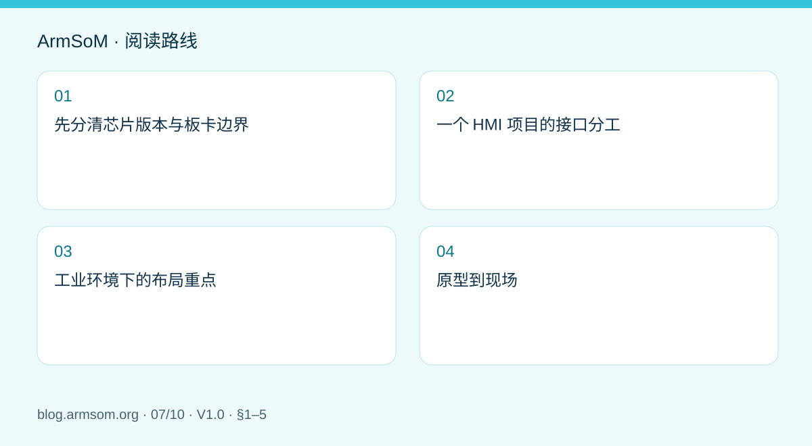
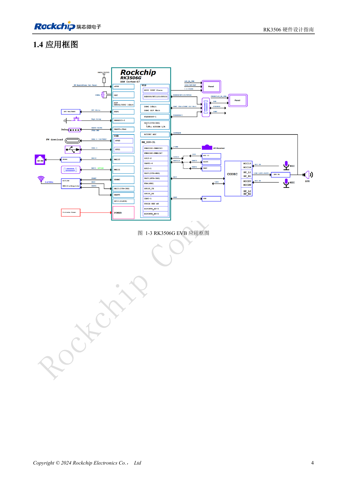

# RK3506 工业 HMI 硬件设计：结合 CM1 与 Forge1 选择开发路径

## 适用范围与资料

本篇为围绕工程问题编写的专题导读，不是整本 PDF 的逐页翻译。原文示例不代表 ArmSoM 实测；具体电压、引脚、SDK/BSP 和内核应按实际板卡版本核对。

**Rockchip:** `RK3506 Hardware Design Guide_V1.0_20240904_CN.pdf` · V1.0 · §1–5

## 先分清芯片版本与板卡边界

V1.0 原稿 PDF 第 3 页明确列出 RK3506G2、RK3506B/J，因此指南也包括 J 型号。不能仅凭文件存放在 B/G 文件夹，就将整份指南限定为 B/G。各封装的引脚、电源、DDR 和具体板卡连接仍需分别核对。

CM1 适合需要自定义接口与结构的模块化项目；Forge1 可作为工业应用开发平台。先列出屏幕、触摸、网络、现场通信、音频和结构要求，再选择开发路线。

## 一个 HMI 项目的接口分工

| 功能 | 需要一起核对的部分 |
| --- | --- |
| 显示与触摸 | 显示接口、时序、背光、触摸控制和驱动 |
| 以太网 | MAC/PHY 时钟、供电、复位、连接器与隔离方案 |
| 现场接口 | 收发器、隔离、终端和接地，而不只是控制器引脚 |
| 音频 | 输入输出电平、地回路与模拟/数字噪声耦合 |
| 恢复与维护 | 串口、烧录、版本识别和装壳后的可达性 |

原稿第 3 章分别讨论 MIPI、USB2.0、FlexBus、DSMC、RMII、存储和音频的 PCB；这些是不同接口的设计章节，不代表每款板卡都引出了全部功能。

## 工业环境下的布局重点

将外部接口、保护器件和敏感电路的路径一起考虑。ESD 器件需要合适的回流路径；显示排线、开关电源和音频走线也需要按信号性质安排位置。第 4、5 章的热设计与 ESD/EMI 建议可转化为检查清单，但不能代替整机测试或认证。

## 原型到现场

先单独验证显示、触摸、网络与通信，再运行同时刷屏、网络传输和现场数据采集的实际负载。记录启动时间、界面响应、通信错误和温升；在规定供电范围内验证启动与恢复。现场负载不应被无依据的“工业级”标签替代。

使用 CM1 时先在配套 IO 板确认软件与外设，用 Forge1 时核对板卡已有接口。自定义载板仍需验证自己的保护、供电与连接器。

## 原文配图

中文稿原图。 RK3506G EVB ≠ RK3506J / CM1 / Forge1. 参考设计，不是 ArmSoM 板卡原理图。

`RK3506 Hardware Design Guide_V1.0_20240904_CN.pdf` · PDF p. 19.

## 相关产品与开发资料

- **CM1** — [产品页面](https://www.armsom.org/product-page/cm1) · [开发文档](https://docs.armsom.org/armsom-cm1)
- **Forge1** — [产品页面](https://www.armsom.org/armsom-forge1) · [开发文档](https://docs.armsom.org/armsom-forge1)

## 继续阅读本系列

- [RK3576 硬件设计入门：最小系统与首次上电检查](/zh/articles/rk3576-hardware-bringup/)
- [ArmSoM CM5 载板设计检查表：供电、启动与接口规划](/zh/articles/019-cm5-carrier-production/)
- [RK3576 高速接口设计：原理图与 PCB 如何配合检查](/zh/articles/rk3576-high-speed-interface-design/)
- [RK3588S 硬件设计指南：从芯片参考设计到 CM7s 载板](/zh/articles/rk3588s-cm7s-carrier-design/)
- [RK3588 边缘 AI 设备设计：供电、散热与扩展接口规划](/zh/articles/rk3588-edge-ai-hardware-design/)
- [RK3588 高速 PCB 设计：叠层、阻抗与布线检查](/zh/articles/rk3588-high-speed-pcb-review/)
- [RK3308 系列芯片差异与兼容检查：P2 Pro 音频项目参考](/zh/articles/rk3308-hardware-variant-compatibility/)
- [RK3588S 与 RK3588S2 有什么区别？改版前需要核对什么](/zh/articles/rk3588s-rk3588s2-hardware-differences/)
- [Rockchip 设备从样机到量产：工艺要求与测试清单](/zh/articles/rockchip-hardware-production-checklist/)

## 继续阅读

- [RK3506 硬件设计系列](/zh/articles/rk3506-hardware-design-series/)
