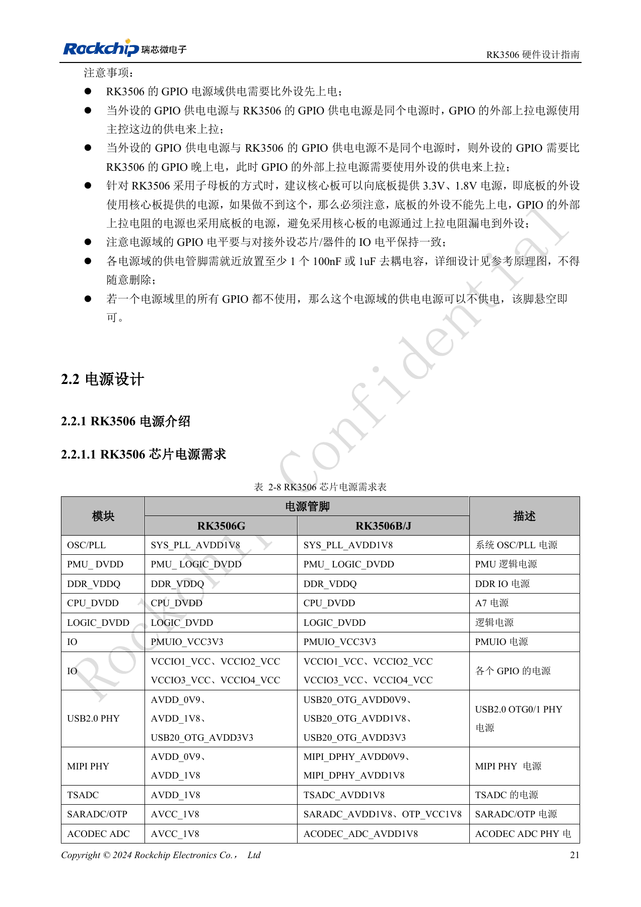
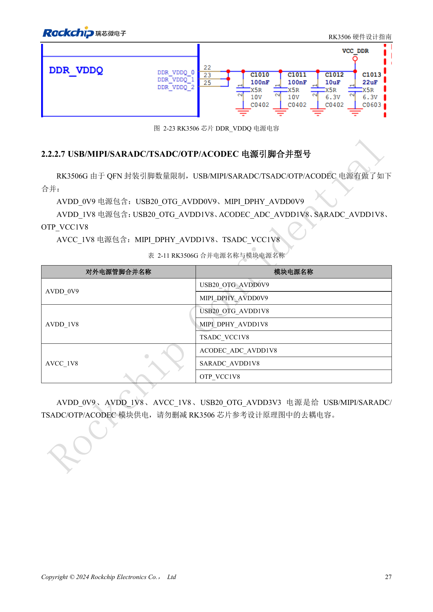
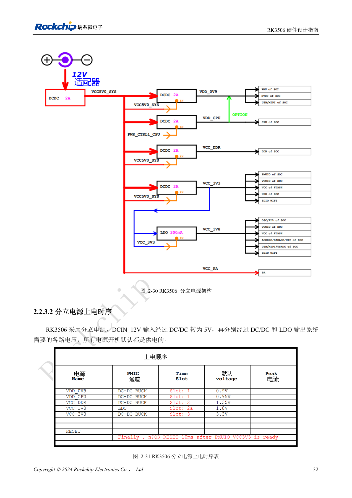
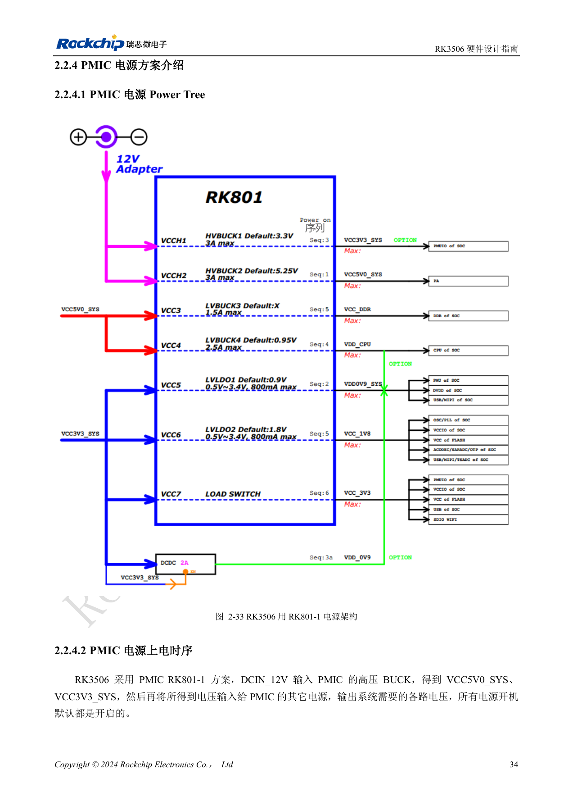

# RK3506 电源域：G2、B/J 与载板供电边界

依据 RK3506 硬件设计指南 V1.0（2024-09）编写。本指南覆盖 G2 与 B/J，但芯片封装、内存、电源和引脚必须按型号核对。CM1、Forge1 的实际接口以板卡资料为准。本文为按工程问题拆分的技术文章，不是完整逐页译本；数值来自原稿，未经 ArmSoM 硬件实测。SDK/BSP、内核及固件版本需按实际产品验证。

**RK3506 Hardware Design Guide_V1.0_20240904_CN.pdf** · §1.2; §2.1.9; §2.2; §3.3.2

## 先按封装分清电源引脚

原稿明确覆盖 RK3506G2 与 RK3506B/J。G2 为 QFN128L、内置 128MB DDR3L；B/J 为 FBGA333L、使用外置 DDR。G2 的部分模拟电源合并，B/J 的 USB、MIPI、SARADC、OTP、ACODEC 等电源引脚独立。因此不能因为逻辑模块同名就复制另一封装的供电网表。CM1 与 Forge1 的 J 型号开发可以参考本指南，但必须使用产品实际原理图与连接器定义。

## 检查顺序和回灌

指南原则是同一模块低压先上、高压后上，相同模块相同电压一起上；不能把不同模块间的宽松条件理解为任意外设可提前供电。GPIO 电源先于外设，外设独立供电时上拉接外设电源，避免通过上拉回灌。PMUIO 固定 3.3V；VCCIO1–4 为 1.8V/3.3V，文中说明硬件电压可自动识别。仍须逐项检查外设电平、上下电和未供电状态，不能据此省略电平转换。每个电源域引脚就近至少保留一个 100nF 或 1µF 去耦。

## 电源树不能只看静态电压

分立方案与 RK801-1 PMIC 方案各有时序和复位路径，应整套采用对应参考。LOGIC_DVDD 与 DDR_VDDQ 的总电容各要求大于 30µF；DDR BUCK 示例要求至少 1000mA、±1.5% 精度，10%→80% 最大负载、1A/µs 跳变下纹波在 ±5% 内。USB B/J 电源参考交流限制为 0.9V <25mV、1.8V <50mV、3.3V <200mV。它们是原稿条件，不是产品测试结果。第 27 页的 G2 合并电源文字与表 2-11 存在归属冲突，应按实际 PinOut、参考图确认，不能在文章中猜测修正。

## 七组 PDN 目标阻抗

| 原稿表/对象 | 100kHz–1MHz / Ω | 1–30MHz / Ω | 30–100MHz / Ω |
| --- | --- | --- | --- |
| 3-1 RK3506B VDD_CPU | ≤0.045 | ≤0.08 | ≤0.25 |
| 3-2 RK3506G VDD_CPU | ≤0.045 | ≤0.08 | ≤0.25 |
| 3-3 RK3506B VDD_0V9 | ≤0.05 | ≤0.06 | ≤0.15 |
| 3-4 RK3506G VDD_0V9 | ≤0.05 | ≤0.1 | ≤0.35 |
| 3-5 RK3562B VCC_DDR * | ≤0.045 | ≤0.1 | ≤0.3 |
| 3-6 RK3562G VCC_DDR * | ≤0.06 | ≤0.09 | ≤0.25 |
| 3-7 DDR 颗粒 VCC_DDR | ≤0.04 | ≤0.04 | ≤0.08 |

来源：PDF107–108、113、118–119。* 表 3-5/3-6 的标题和前导文字确实写 RK3562B/G，但相邻曲线图 3-65/3-66 写 RK3506B/G。这是原稿型号冲突；保留原始数值及标题，不能把它当作已确认的 RK3506 DDR 验收限值。其他表的 RK3506G 写法也保持原稿，没有静默替换成 G2。目标阻抗是电源网络的设计建议，需要连同叠层、封装、去耦和负载频谱验证，不是整板功耗或处理器性能指标。

## 电源铜皮与去耦距离

| 电源 | DCDC 到 SoC 宽度 | SoC 下有效宽度 | DCR |
| --- | --- | --- | --- |
| VDD_CPU | ≥160mil | ≥55mil | ≤30mΩ |
| VDD_0V9 | ≥100mil | ≥30mil | ≤30mΩ |
| VCC_DDR | ≥80mil | ≥30mil | ≤30mΩ |

来源：§3.3.2。DCDC 输出处换层 0503 过孔至少 4 个，建议 ≥6 个；每个电源引脚应有对应电源过孔。100nF 去耦电容到电源过孔的距离（过孔中心到焊盘边缘）≤12mil，1µF 为 ≤50mil；去耦地焊盘应有对应地过孔。靠近 B 型芯片电源脚的关键电容放到对应引脚背面，不随意删减参考去耦。注意原稿正文要求部分电源引脚 40mil 内配置 GND 过孔，而图 3-44、3-58 标题写 50mil；在版图审查记录中保留这一冲突，按确认后的模板执行。

## 原厂研发板峰值电流记录

| 网络 | 电压 / V | 峰值电流 / A | 原稿峰值功率 / W | 频率 |
| --- | --- | --- | --- | --- |
| VDD_CPU | 0.95 | 0.7 | 0.76 | 1.5GHz |
| VDD_0V9 | 0.9 | 0.5 | 0.54 | — |
| VCC_DDR | 1.35 | 0.6 | 0.945 | 800MHz |

来源：表 2-12，PDF51。测试对象 RK3506G2，结温 100°C，裸板无散热片，稳定运行后 15 分钟记录；各模块分别运行自己的极限场景，不能把各行直接相加当作同时运行的整板功耗。`VCC_DDR` 包含 `DDR_VDDQ` 和内置 DDR 供电。原稿功率列不等于本表电压×电流，未解释统计口径；本表保留数值并列为待核对项，不自行算出“修正”功率。数据不是 ArmSoM 实测，也不是芯片最终保证值。

## 参考图与核对页

本批只有中文原稿，四语使用相同中文原图。以下为保留图表上下文的原稿截图，图片未翻译；正文可复制。页码为 PDF 物理页码。

PDF 36

PDF 42

PDF 47

PDF 49

## ArmSoM 产品与文档

- [ArmSoM CM1](https://www.armsom.org/product-page/cm1) · [CM1 Docs](https://docs.armsom.org/armsom-cm1)
- [ArmSoM Forge1](https://www.armsom.org/armsom-forge1) · [Forge1 Docs](https://docs.armsom.org/armsom-forge1)

## 继续阅读

- [本系列目录](/zh/articles/rk3506-hardware-design-series/)
- [RK3506 最小系统：时钟、复位与恢复入口](/zh/articles/rk3506-clock-boot-reset-design/)
- [RK3506 DDR、eMMC 与 FSPI：电路和布线约束](/zh/articles/rk3506-ddr-storage-hardware-design/)
- [RK3506 显示、USB 与 RM_IO：接口分配检查](/zh/articles/rk3506-display-usb-io-design/)
- [RK3506 音频设计：SAI、PDM、ASRC 与 DSM](/zh/articles/rk3506-audio-hardware-design/)
- [RK3506 工业接口：RMII、FlexBus、DSMC 与控制信号](/zh/articles/rk3506-industrial-bus-hardware-design/)
- [RK3506 热设计、ESD 与生产存储检查](/zh/articles/rk3506-thermal-esd-production-design/)
