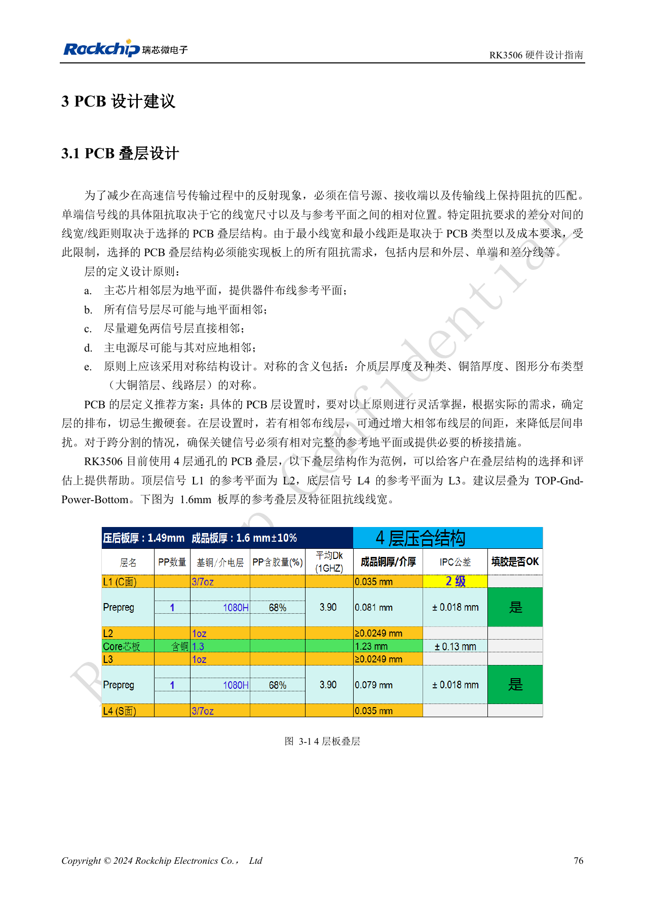
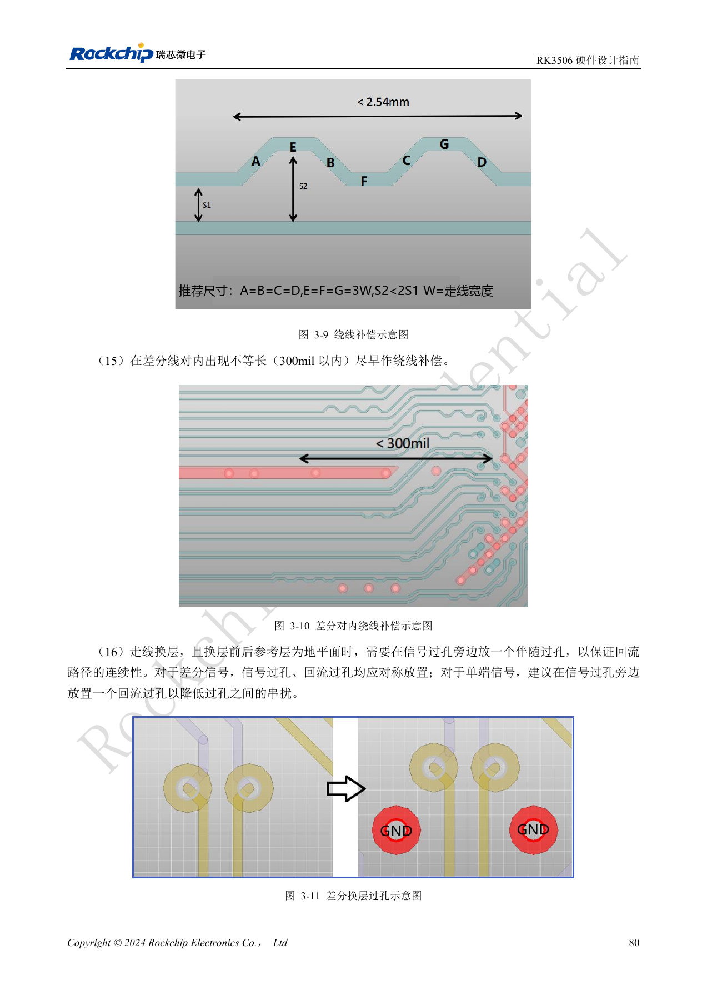
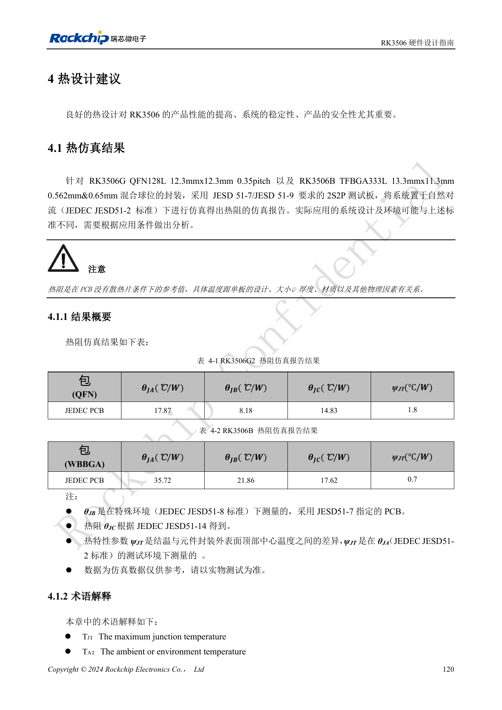
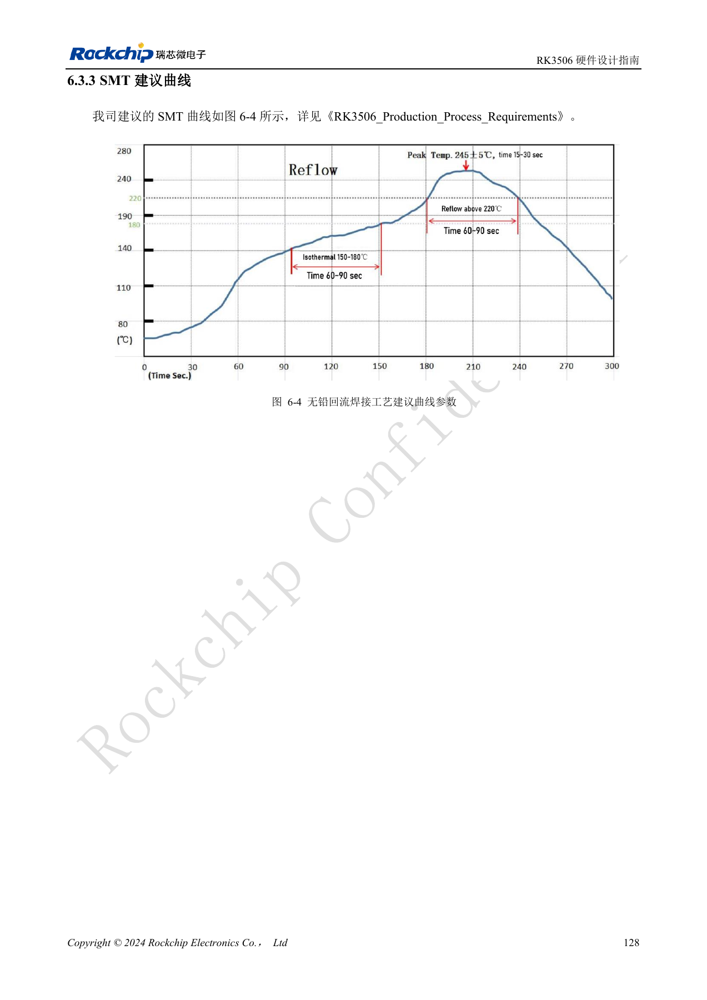
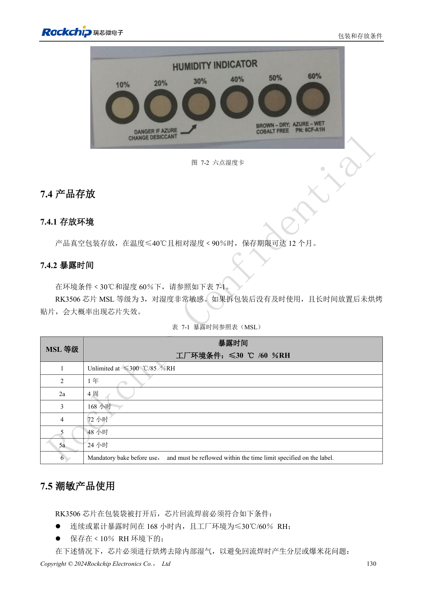
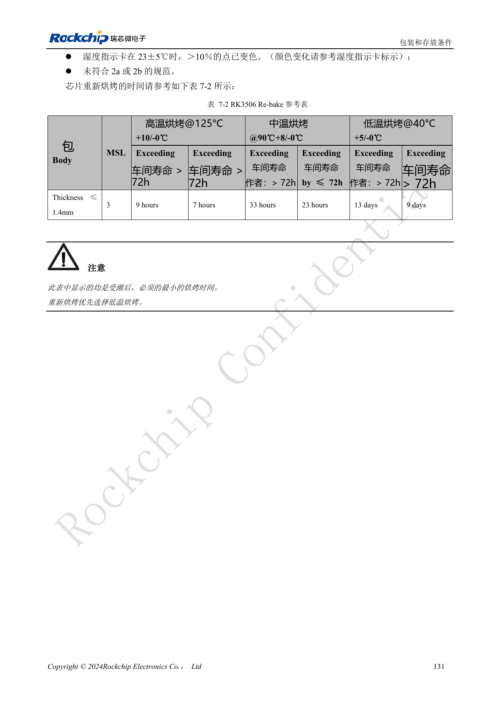

# RK3506 热设计、ESD 与生产存储检查

依据 RK3506 硬件设计指南 V1.0（2024-09）编写。本指南覆盖 G2 与 B/J，但芯片封装、内存、电源和引脚必须按型号核对。CM1、Forge1 的实际接口以板卡资料为准。本文为按工程问题拆分的技术文章，不是完整逐页译本；数值来自原稿，未经 ArmSoM 硬件实测。SDK/BSP、内核及固件版本需按实际产品验证。

**RK3506 Hardware Design Guide_V1.0_20240904_CN.pdf** · §3.1–3.2; §4–7

## 热阻数据有测试板边界

原稿热阻为指定封装、PCB 与环境下的仿真参考，不是 ArmSoM 板卡实测。板面积、铜厚、结构风道、邻近功率器件和散热器都会改变温度，不能只用一项 θJA 判断产品是否需要散热。设计审查应记录最大环境温度、机壳、实际负载、频率与温控策略，再同时测芯片温度和关键器件表面温度。软件降频、硬件过温关断和正常运行散热属于不同层级，不能互相替代。

## ESD 需要泄放路径，不只是一个器件

防护器件应靠近接口和静电进入点，回流到地的路径要短而完整，连接器与屏蔽罩应有可靠接地。敏感时钟、复位和音频应远离干扰源与板边。不要在整改 EMI 时随意增大滤波电容而破坏高速接口；每次更换保护器件、共模电感或连接器后，都应复查信号完整性。将接口热插拔、静电后恢复及持续负载测试纳入整机验收，并记录异常复位、音频噪声和通信错误。

## 潮敏控制要记录累计暴露

指南将芯片列为 MSL3，在 ≤30°C/60%RH 条件下拆包累计暴露限值为 168 小时；不是拆包后每次上线都重新计时。密封包装参考存储为 ≤40°C、<90%RH、12 个月。超过暴露条件或湿度卡异常时，按所用封装厚度、超时区间与烘烤温度选择重新烘烤条件。两份指南表中都出现 MSL1 “≤300°C”的疑似排版错误，不能据此设置存放环境。回流曲线要根据实际锡膏、板热容量与封装工艺确认，保存炉温实测与批次记录。

## 原稿重新烘烤参考表

| 温度 | 超过 Floor life >72h | 超过 Floor life ≤72h |
| --- | --- | --- |
| 125°C +10/-0°C | 9h | 7h |
| 90°C +8/-0°C | 33h | 23h |
| 40°C +5/-0°C | 13d | 9d |

仅适用于原表条件：MSL3、Package Body Thickness ≤1.4mm。时间是原稿给出的最小烘烤时间，优先低温；包装托盘和具体物料的允许温度仍需核对。不能用此表推断另一个封装或已组装板卡的烘烤方案。

## 参考图与核对页

本批只有中文原稿，四语使用相同中文原图。以下为保留图表上下文的原稿截图，图片未翻译；正文可复制。页码为 PDF 物理页码。

PDF 91

PDF 95

PDF 135

PDF 143

PDF 145

PDF 146

## ArmSoM 产品与文档

- [ArmSoM CM1](https://www.armsom.org/product-page/cm1) · [CM1 Docs](https://docs.armsom.org/armsom-cm1)
- [ArmSoM Forge1](https://www.armsom.org/armsom-forge1) · [Forge1 Docs](https://docs.armsom.org/armsom-forge1)

## 继续阅读

- [本系列目录](/zh/articles/rk3506-hardware-design-series/)
- [RK3506 最小系统：时钟、复位与恢复入口](/zh/articles/rk3506-clock-boot-reset-design/)
- [RK3506 电源域：G2、B/J 与载板供电边界](/zh/articles/rk3506-power-domains-design/)
- [RK3506 DDR、eMMC 与 FSPI：电路和布线约束](/zh/articles/rk3506-ddr-storage-hardware-design/)
- [RK3506 显示、USB 与 RM_IO：接口分配检查](/zh/articles/rk3506-display-usb-io-design/)
- [RK3506 音频设计：SAI、PDM、ASRC 与 DSM](/zh/articles/rk3506-audio-hardware-design/)
- [RK3506 工业接口：RMII、FlexBus、DSMC 与控制信号](/zh/articles/rk3506-industrial-bus-hardware-design/)
