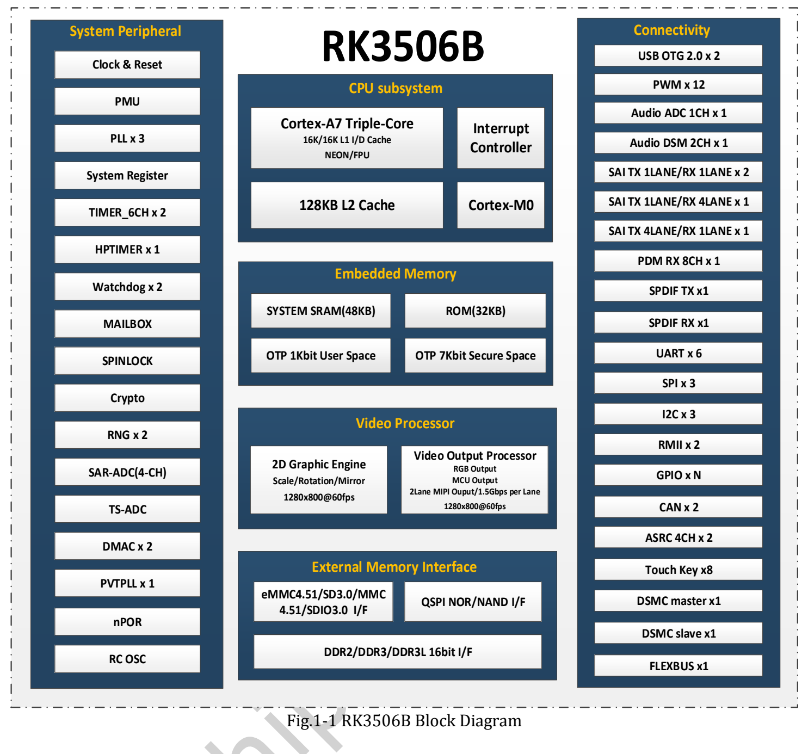
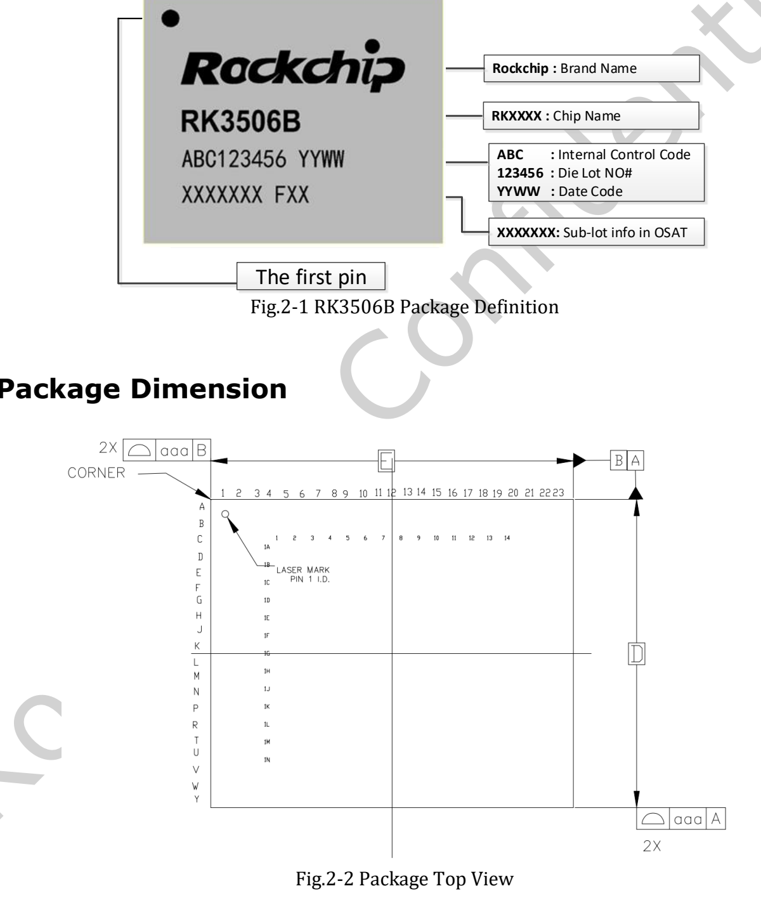
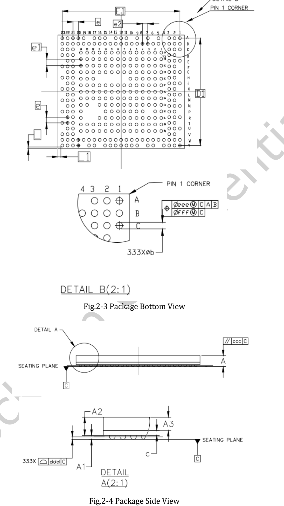

这篇文章提供用户上传的 **RK3506B Datasheet V1.0（2024-08-16，50 页）** 原文件下载，并按工程阅读顺序说明架构、封装、引脚、电气与热设计。它是配套导读，不是 50 页逐行译本；完整引脚复用和电气参数表请查原 PDF。

**型号区别：CM1、Forge1 使用 RK3506J。本附件属于 RK3506B，不能据此批准 J 型号的电压、温度、主频或引脚兼容性。**

## 原始文件与章节索引

[下载 RK3506B Datasheet V1.0 原始 PDF](/assets/rk3506/Rockchip-RK3506B-Datasheet-V1.0-20240816.pdf)

| 页码 | 内容 | 建议核对项目 |
|---|---|---|
| 7–14 | 架构与功能 | CPU、内存、显示、音频、外设 |
| 15–17 | 封装和标识 | FBGA333L、球位方向、尺寸、公差 |
| 17–26 | Pin Number List | 实际球位与复用名称 |
| 26–41 | 电源与功能 IO | 电源域、上下拉、接口复用 |
| 41–44 | Matrix IO、FLEXBUS | 引脚映射及 ADC/DAC/DVP/QSPI LCD 示例 |
| 45–49 | 电气规格 | 绝对值、推荐条件、接口电平 |
| 50 | 热管理 | 结温与尚未确定的热参数 |

## RK3506B 架构要点

三核 Cortex-A7 采用 Armv7-A，支持 NEON 和 VFPv4-D32；手册列出 16KB L1 指令缓存、16KB L1 数据缓存和 128KB L2。另有 Cortex-M0、Mailbox、Spinlock 与 DMA，软件如何分配任务需参考对应 SDK。

内存接口为 16-bit DDR2/DDR3/DDR3L，最大寻址 1024MB。存储支持 SPI NOR/NAND 与 SD/MMC，手册列出 eMMC 4.51、SD3.0、SDIO3.0 和 4-bit 数据总线；这不意味着某块板搭载所有介质。

显示部分列出最高 1280×1280@60fps、两通道 MIPI、每通道 1.5Gbps，以及 RGB/MCU、BT.656/BT.1120。2D 引擎支持缩放、旋转、镜像和 Alpha 混合。接口并发与引脚复用必须另查。

## 封装与板级设计

封装为 FBGA333L，MSL 为 3，球材料写为 SnAgCu。原图用于识别方向，PCB 封装库应按 PDF 尺寸表及最新封装文件建立，不能从网页图片量尺寸。

## 推荐条件不能与极限值混用

| 项目 | RK3506B V1.0 原文 |
|---|---|
| 推荐环境温度 Ta | −20 / 25 / 80°C（最小/典型/最大） |
| 存储温度 | −40～125°C |
| 最大结温 | 125°C；热章节要求低于该值 |
| CPU 电压 | 推荐最小 0.81V，典型 0.9V，最大 TBD |
| 热阻 θJA、θJB、θJC、ψJT | 均为 TBD |

TBD 不应改写成推测数值。最大结温不等于环境工作温度；存储温度也不是上电运行范围。CPU 电源最大值未定，不能用其他型号或常见经验代填。

## 阅读时需要保留的原文疑点

第49页 CODEC ADC 表的 Resolution 行将 24 的单位写为 °C，而功能章节写 24-bit ADC；这是原文单位疑点，不能作为温度指标使用。音频功能章节列出五个 SAI 组件，但包含内部连接，不能宣传成五组独立外部音频接口。

设计落地前请核对芯片型号、正式版本、BSP、电源时序、引脚复用、板级原理图与实际测量。本文章未进行 ArmSoM 硬件电气或热测试。

## 系列文章与官方资料

- [RK3506J 芯片详解：从三核处理器到工业 HMI 与设备联网](/zh/articles/rk3506j-chip-guide/)
- [ArmSoM CM1：用 RK3506J 核心板开发自己的工业终端](/zh/articles/cm1-rk3506j-industrial-module/)
- [ArmSoM Forge1：工业网关、HMI 与设备采集的开发起点](/zh/articles/forge1-industrial-hmi-gateway/)
- [Rockchip RK3506](https://www.rock-chips.com/a/cn/product/RK35xilie/2025/1208/2125.html)
- [ArmSoM CM1](https://docs.armsom.org/armsom-cm1)
- [ArmSoM Forge1](https://docs.armsom.org/armsom-forge1)
- [ArmSoM](https://www.armsom.org/)

<!-- datasheet-related-20261110 -->
## 其他芯片数据手册

以下用于跨平台查阅，各芯片的电气条件和引脚不可互换。

- [RK3576](/zh/articles/rk3576-datasheet-v10/)
- [RK3588](/zh/articles/rk3588-datasheet-v14/)
- [RK3528](/zh/articles/rk3528-datasheet-v10/)
- [RK3568](/zh/articles/rk3568-datasheet-v12/)
- [RK730](/zh/articles/rk730-audio-codec-design/)
