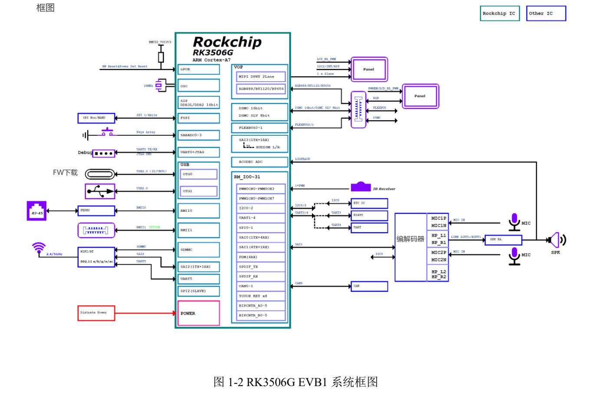
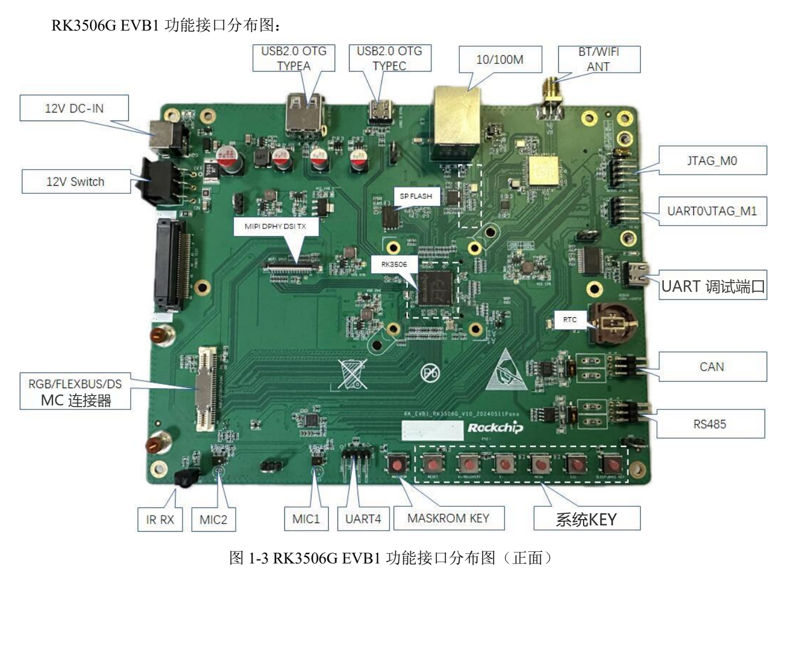

本文按选型和调试任务解读原稿，保留关键参数、边界和原图；不是逐页翻译或完整引脚／寄存器手册。原厂示例不是 ArmSoM 实测。应用前须核对具体板卡版本、原理图、SDK/BSP、内核及驱动；本文未新增硬件验证。

**主要资料：** `Rockchip_RK3506G_EVB1_User_Guide_V1.0_20240719_CN.pdf` · PDF 40 页.

## G 型参考板与 J 型产品先分开

本手册对应 `RK_EVB1_RK3506G_V10_20240511Pana.brd`。功能表写 128MB DDR3L、eMMC 为 Option；套件包含 12V/3A 电源和 1280×720 MIPI 屏。CM1、Forge1 官方资料使用 RK3506J，不能把这份 G 型 EVB 的内存、温度等级、供电及引脚直接移植过去。


[](/assets/localized/figures/zh/95e4112a34243ececb6a.png)

*RK3506G EVB1 系统框图 — 中文原图；本批未找到对应英文图. `Rockchip_RK3506G_EVB1_User_Guide_V1.0_20240719_CN.pdf`, PDF p. 12.*


## 参考板提供的几条开发路径

| 路径 | 原稿实现 | 接入前确认 |
| --- | --- | --- |
| HMI | 2-lane MIPI DSI；另有 RGB 扩展 | 屏幕时序、背光、触摸和排线 |
| 设备网络 | 1 路百兆 RJ45；第二路 FEPHY 经 60pin 预留 | 扩展 PHY、供电、信号复用及驱动 |
| 控制扩展 | RGB/FLEXBUS/DSMC 共用 60pin | 根据功能选择电阻配置和 pinmux |
| 现场通信 | CAN、RS485 | 收发器、终端匹配、布线和地参考 |
| 音频 | 1 个扬声器、2 个模拟 MIC，板载 Codec | 实际音频路由、时钟及 mixer |
| USB | OTG0 Type-C 用于下载；OTG1 Type-A | 角色、供电和驱动，不按外形猜功能 |


[](/assets/localized/figures/zh/403248eb99b7bf940fbb.png)

*RK3506G EVB1 接口布局 — 中文原图；本批未找到对应英文图. `Rockchip_RK3506G_EVB1_User_Guide_V1.0_20240719_CN.pdf`, PDF p. 14.*


## 下载与串口先建立稳定通道

原稿使用 v3.28 及以上下载工具。按 MASKROM 或 V+(RECOVERY) 进入对应模式，确认工具识别后再选择匹配的 Loader、Parameter、Uboot 等文件。Loader 条件为 `SARADC_IN1` 低电平。板卡电源与按键操作以相应手册为准，写入前备份数据。

Debug Type-C 是 USB-UART 通道，默认 `1500000`（1.5M）波特率。不要与 OTG0 下载端口混淆。记录从上电到用户空间的日志，先排查电源、线缆和端口，再分析内核错误。带 ADB 的镜像可以追加连接检查：

```sh
adb devices
adb shell
```

## eMMC 是可选装配，不是默认承诺

原稿第 27 页给出以下改配表，位号只适用于指定参考板：

| 网络名 | 原稿跳接方向 |
| --- | --- |
| eMMC_CLKOUT | `R1614→R1644` |
| eMMC_CMD | `R1615→R1639` |
| eMMC_D0 | `R1616→R1640` |
| eMMC_D1 | `R1617→R1641` |
| eMMC_D2 | `R1645→R1642` |
| eMMC_D3 | `R1146→R1143` |

最后一行的编号与前几行不同，本篇按原稿保留，不能擅自改成 R16xx。实际改配前要核对原理图、BOM、焊接工艺以及 Loader/分区配置。这不是让 CM1 或 Forge1 按同样位号改板。

## I2C、终端电阻和 JTAG 都有条件

I2C0 挂 HYM8563TS `0x51` 与 ES8388 `0x11`，均为 3.3V；I2C2 的触摸地址为 `0x28/0x29`、3.3V。这也说明本 EVB 音频资料不能自动当作 RK730 的接线说明。

RS485 预留 120Ω 终端拨码。是否开启应按整个总线拓扑决定，不能每个节点都无条件打开。CAN/RS485 接线和供电需在断电状态下按相应电路核对。

JTAG_M0 与 Wi-Fi SDIO 共用资源；原稿要求使用时调整对应拨码。两个 JTAG 排针的 TMS/TCK 位置并不相同：M0 为 GND、TMS、TCK、VCC，M1 为 GND、TCK、TMS、VCC。不要只靠同样的排针外形连接。

## 原稿疑点与产品迁移

功能表 Wi-Fi 写 `1T21`，概述写 1T1R；末页页眉残留 RK3576，UART 图注写 JTAG。本篇保留疑点并按实际章节内容解释，不把这些文字当作新的硬件能力。

Forge1 可用于 HMI、网关与接口验证，CM1 可进一步评估定制载板。迁移应重新填写内存、启动介质、输入电源、显示、总线和软件版本清单。先完成单接口与恢复测试，再组合 UI、网络、存储和现场总线负载，最后评估温度和长期稳定性。


## 产品与开发资料

- **CM1** — [产品页](https://www.armsom.org/cm1) · [官方文档](https://docs.armsom.org/armsom-cm1)
- **Forge1** — [产品页](https://www.armsom.org/forge1) · [官方文档](https://docs.armsom.org/armsom-forge1)


## 延伸阅读

- [Forge1 应用规划](/zh/articles/forge1-industrial-hmi-gateway/)
- [RK730 音频 Codec](/zh/articles/rk730-audio-codec-design/)
