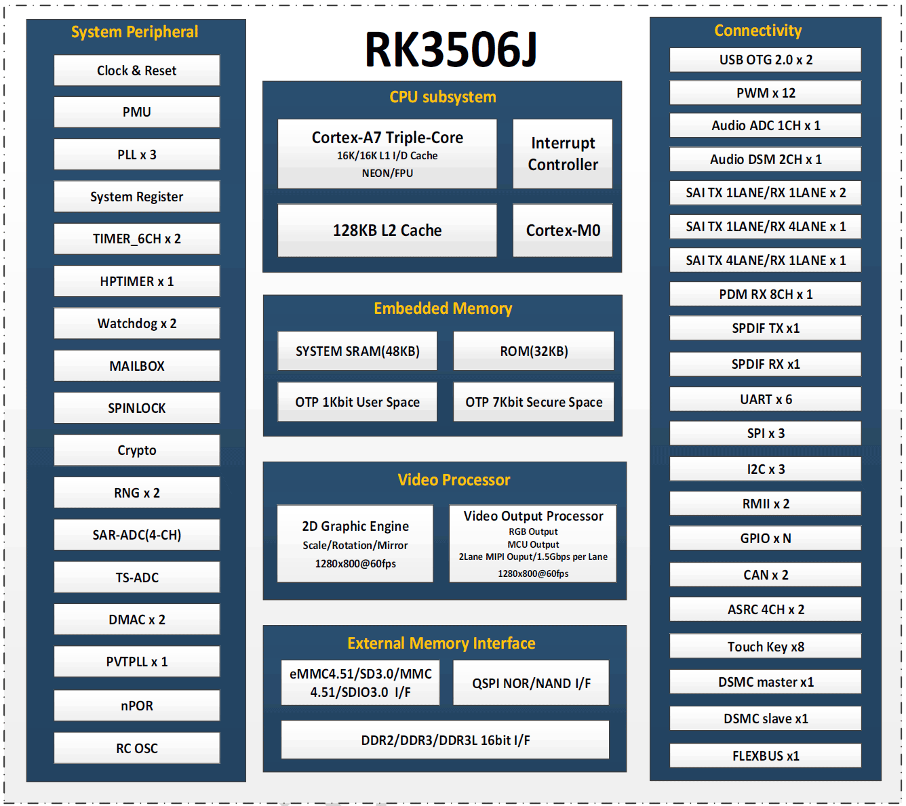

RK3506J 适合把显示、设备通信和控制软件放进紧凑的嵌入式终端。ArmSoM CM1 提供核心板路线，Forge1 提供完整开发板路线：前者面向定制产品，后者便于先验证屏幕、协议和应用。选择时应先列出数据流与接口需求，而不是只比较 CPU 主频。

## 处理器与外设怎样分工

| 模块 | 已核实的公开信息 | 应用意义 |
|---|---|---|
| CPU | 三核 Cortex-A7；ArmSoM 框图另列 Cortex-M0 | Linux 应用与系统管理；M0 的任务分配需 BSP 支持 |
| 图形 | 2D 图形引擎、显示输出处理器 | 界面合成、缩放、旋转等显示工作 |
| 内存接口 | RK3506B/J 支持 16-bit DDR2/DDR3/DDR3L | 板上容量由实际产品决定 |
| 网络 | 两路 RMII | 需要 PHY 和板级接口，不等于芯片自带两个网口 |
| 连接 | USB2.0 OTG、UART、SPI、I2C、CAN、PWM | 屏幕、传感器与现场设备连接 |
| 扩展 | DSMC、FLEXBUS、矩阵 IO | 需要核对复用、时序和驱动 |

RK3506J 的三核 Cortex-A7 与 Cortex-M0 不能简单称为四个同等 Linux 核心。图形引擎属于 2D 加速，不应宣传为通用 3D GPU；现有官方产品页也没有给出 NPU 算力，不将其作为大模型推理板推广。

## 五类值得开发的产品

### 1. 工业触控 HMI

让设备状态、参数设置、趋势曲线和报警集中到一个面板。先以 LVGL 等轻量界面验证触控响应，再接入实际设备协议。屏幕分辨率、刷新、字体与图片资源会影响内存和响应时间；动画效果应以真实负载测试，而不是仅看静态页面。

### 2. 设备协议网关

把串口或 CAN 设备的数据整理后上传到以太网服务。可按“采集—校验—缓存—上报”划分任务，并处理断网重连和重复数据。两路百兆以太网适合设备联网评估，但不能据此承诺满速转发、协议认证或硬实时性能。

### 3. 家电与楼宇控制面板

集中管理温度、照明、风机状态和本地交互。断网时保留必要的本地操作；配置写入要考虑 NAND 擦写与掉电恢复。继电器、模拟量采集与现场电压需要外部电路，不能直接接入普通 GPIO。

### 4. 生产设备数据采集终端

采集产量、运行状态与报警事件，进行本地显示和周期上传。优先定义采样频率、时间戳、离线保留时长和存储预算，再决定数据库或日志方案。这是应用设计建议，并非已经完成的 ArmSoM 客户案例。

### 5. 语音和音频交互终端

瑞芯微公开资料列出了音频 ADC、DSM、SAI 与 PDM。麦克风阵列、回声处理、语音算法和音频器件仍需软硬件配合；芯片接口存在不代表成品已具备离线语音识别功能。

## 从 Forge1 验证，到 CM1 定制

Forge1 适合先跑通接口、界面与通信。需要自定义外形、连接器和供电时，可选择 CM1 与定制载板。两者同属 RK3506J 平台不等于镜像可以直接互换，设备树、存储布局、屏幕和电源配置仍需核对。

## 主频与型号边界

网上不同板卡给出的主频存在差异，本系列不承诺 CM1 或 Forge1 固定运行在某个最高频率。以交付镜像的频率表、工作模式和温度条件为准。配套下载的 PDF 是 **RK3506B V1.0**，不能作为 RK3506J 的电气规格书。

## 系列文章与官方资料

- [ArmSoM CM1：用 RK3506J 核心板开发自己的工业终端](/zh/articles/cm1-rk3506j-industrial-module/)
- [ArmSoM Forge1：工业网关、HMI 与设备采集的开发起点](/zh/articles/forge1-industrial-hmi-gateway/)
- [RK3506B Datasheet V1.0：下载、架构、引脚与电气设计导读](/zh/articles/rk3506b-datasheet-v10/)
- [Rockchip RK3506](https://www.rock-chips.com/a/cn/product/RK35xilie/2025/1208/2125.html)
- [ArmSoM CM1](https://docs.armsom.org/armsom-cm1)
- [ArmSoM Forge1](https://docs.armsom.org/armsom-forge1)
- [ArmSoM](https://www.armsom.org/)
