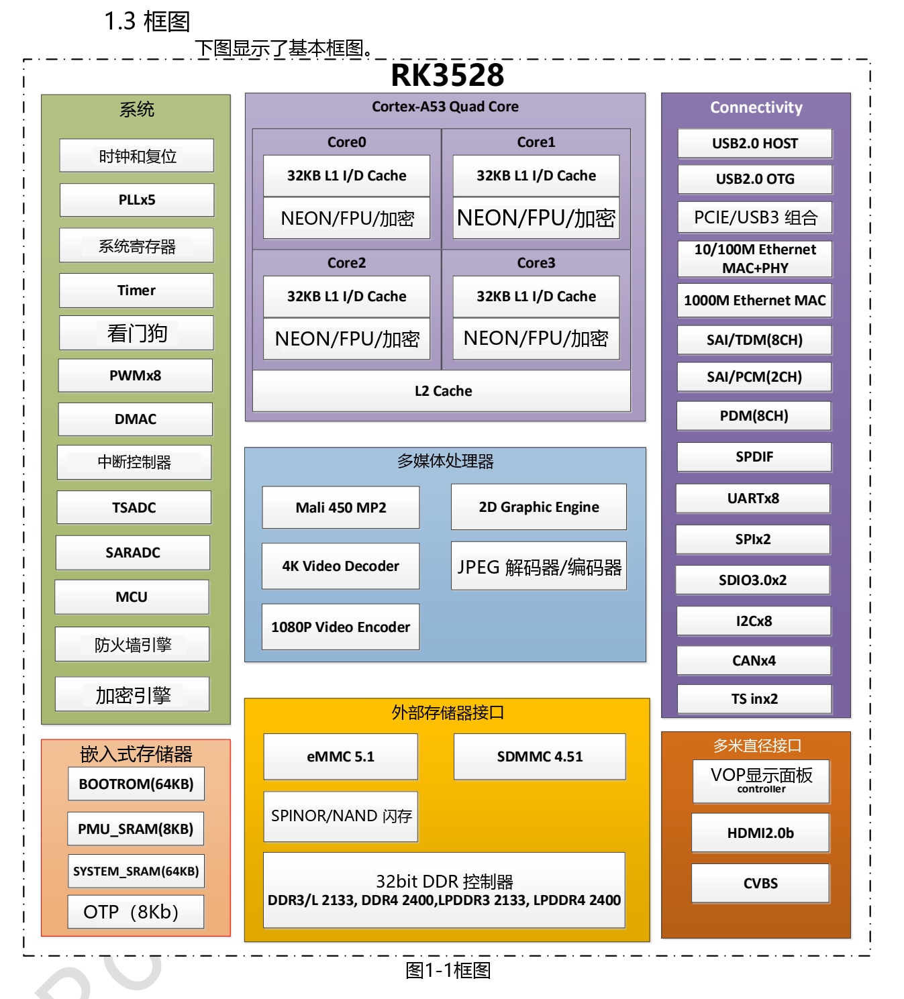

本文基于指定版本数据手册整理。表中数值是原厂规格，不是 ArmSoM 实测；未新增硬件验证。使用前核对实际芯片版本、板卡原理图、SDK/BSP、内核和驱动。专题解释与可编辑表格用于辅助阅读，完整规范及未展开的位定义请查阅原始 PDF。

**RK3528 · Rockchip RK3528 Datasheet V1.0-20230522.pdf · PDF 6–14.**

*英文原图，来源 PDF 第 14.*

## 计算与启动资源

RK3528 面向媒体处理和连接应用。本版没有列出专用 NPU，不能套用同系列其他芯片的 AI 规格。

| 项目 | 规格／原稿说明 |
|---|---|
| CPU | 4 × Cortex-A53 · Armv8-A · NEON/FPU · TrustZone |
| GPU | Mali-450 · OpenGL ES 1.1/2.0 · OpenVG 1.1 |
| SRAM | 64 KB + PMU 8 KB |
| MCU | Cortex-M0 · 8 KB TCM |
| 启动 | SPI / eMMC / SDMMC; USB download |
| 时钟 | 24 MHz reference · 5 PLL |
| 电压域 | ARM / GPU / LOGIC / PMU |
| DMA | 3 DMAC; 8 channels / 32 requests / 2 interrupt outputs each |
| 安全模块 | SHA-1/224/256, MD5, SM3, HMAC, AES-128/192/256, DES/TDES, SM4; PKA ≤4096 bit; 16 DDR regions |

## 内存与存储

32-bit、最高 4 GB 是控制器规格，不是每块 Sige1 的实装容量。DDR 类型是不同设计选择，不能同时相加。启动、总线电压和固件支持必须与板卡匹配。

| 项目 | 规格／原稿说明 |
|---|---|
| DDR | 32 bit · ≤4 GB · DDR3/DDR3L/LPDDR3/DDR4/LPDDR4/LPDDR4X |
| eMMC | 5.1 · HS400 · command queue · 1/4/8 bit |
| SDMMC | SD 3.0 / MMC 4.51 · 4 bit |
| FSPI | 1/2/4 bit |

## 视频、图形与显示

解码、编码和显示是不同指标。播放器必须同时核对码流格式、位深、帧率、内存带宽和输出链路；4K 解码不代表所有组合都能并发。

| 项目 | 规格／原稿说明 |
|---|---|
| 4K 解码 | H.264 BP/MP/HP L5.1 + MVC; H.265 Main/Main10 L5.1 High Tier; AVS2 · 4K×2K @60 |
| 其他解码 | MPEG-1/2/4, AVS/AVS+, VC-1 · 1080p60; H.263 · 576p60 |
| 视频编码 | H.264 HP L4.2 / H.265 Main L4.1 High Tier · 1080p60 |
| JPEG | 48×48–8176×8176 · 76 Mpixel/s · ROI · 400/420/422/440/411/444 |
| 2D | Input ≤8192×8192; output ≤4096×4096; rotation 0/90/180/270°, mirror, alpha |
| VDPP | YUV420/422 input; YUV444 output also listed; deinterlace width ≤1920; DMSR / ZME |
| HDMI | 2.0b · 4K 10-bit @60 · HDR10 / HLG / HDR Vivid |
| CVBS | 480i / 576i |
| 显示图层 | 1 cluster + 4 smart layers |

## 共享 PHY 与控制接口

原稿列出 USB 2.0 Host + USB 2.0 OTG + PCIe，或 USB 2.0 Host + USB 3 两种组合。不要把 USB 3 和 PCIe 跨组合叠加。PCIe 小节同时出现“2.1”和“Base Specification 3.0”，但明确速率只有 2.5/5.0 Gbit/s、单通道 RC；本文不宣传 Gen3 速率。

| 项目 | 规格／原稿说明 |
|---|---|
| Ethernet | 1 × 10/100/1000 MAC (RGMII/RMII) + 1 × 10/100 MAC/PHY |
| PCIe | x1 RC · 2.5 / 5.0 Gbit/s |
| UART | 8 · ≤4 Mbit/s |
| I2C | 8 · 100/400 kbit/s · 7/10-bit address |
| SPI | 2 |
| PWM | 8 × 32 bit; IR: PWM3/PWM7 |
| SARADC | 10 bit · 4 single-ended inputs · ≤1 MS/s |
| TS | 2 inputs; 2 PTI, each 96 PID / 32 PES-ES / 16 PCR / 96 section filters; 1 PVR |
| ISO7816 | T0 / T1 |

## 音频路由与原稿疑点

SAI0/1 使用 GPIO，SAI2 是内部 Codec 发送通路，SAI3 是 HDMI 发送通路；四个 SAI 不等于四个外部接口。框图 CAN×4 在功能正文中没有对应展开；HDMI 段“10.2bps”单位不完整。温度分辨率的两处描述也不同，详见电气专题。以上不自行修正为确定规格。

| 项目 | 规格／原稿说明 |
|---|---|
| SAI0/2 | 2 channels; SAI2 TX only |
| SAI1/3 | 8 channels; SAI3 TX only |
| SAI | 16–32 bit · ≤192 kHz |
| PDM | 8 channels · 16–24 bit · ≤192 kHz |
| SPDIF | HDMI / GPIO |
| DAC | 24 bit · 8/12/16/24/32/44.1/48/96 kHz |

## ArmSoM 产品与应用边界

Sige1 是 RK3528 产品入口；芯片支持的接口并不意味着板卡全部引出。具体连接器、电压、镜像与引脚定义以 Sige1 文档为准。

- [Sige1](https://www.armsom.org/sige1) · [Docs](https://docs.armsom.org/armsom-sige1)

## 数据手册专题与原始 PDF

- [RK3528 总览](/zh/articles/rk3528-datasheet-v10/)
- [RK3528 架构与接口详解：内存、4K 视频及共享 PHY](/zh/articles/rk3528-architecture-memory-media/)
- [RK3528 封装与引脚：401 球完整编号表](/zh/articles/rk3528-package-pin-reference/)
- [RK3528 电气与热设计：电源、I/O 和热阻](/zh/articles/rk3528-electrical-power-thermal/)
- [下载完整原始 PDF](/assets/datasheet-series-20261110/Rockchip-RK3528-Datasheet-V1.0-20230522.pdf)
