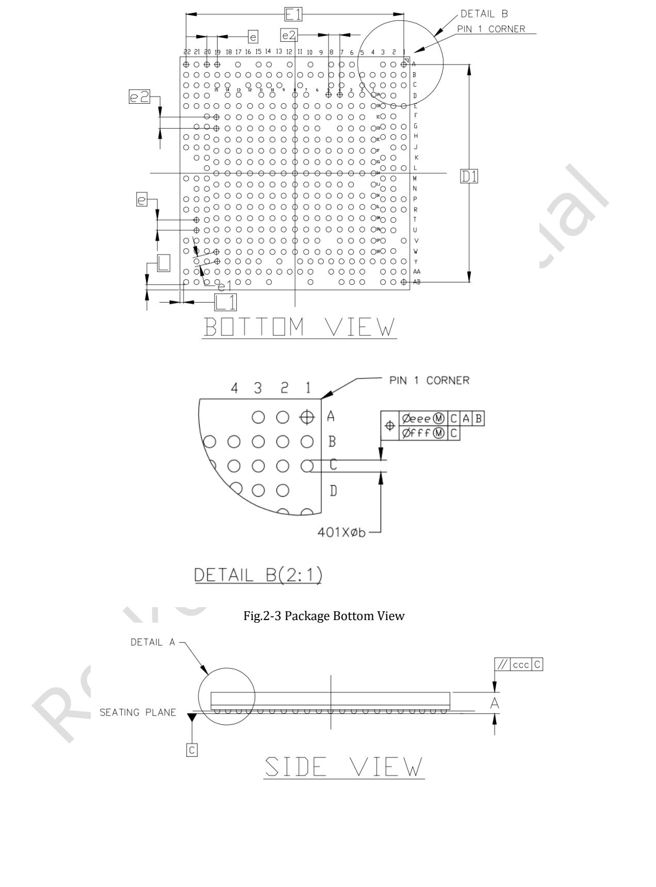
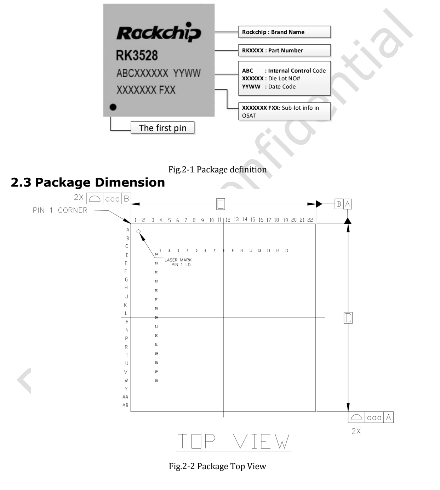
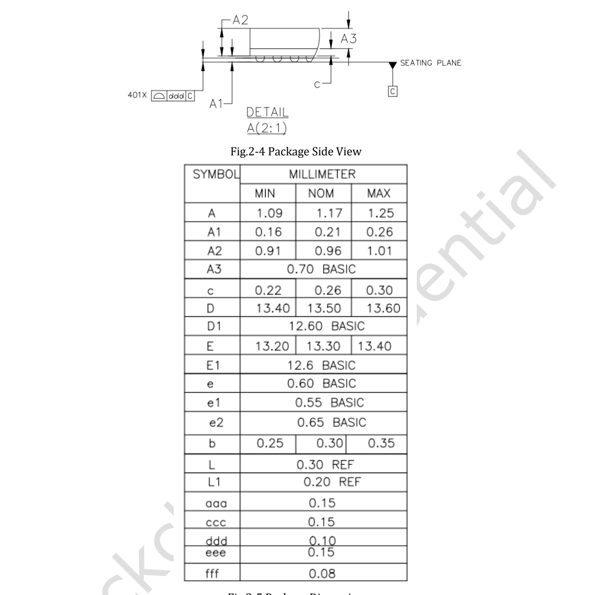

本文基于指定版本数据手册整理。表中数值是原厂规格，不是 ArmSoM 实测；未新增硬件验证。使用前核对实际芯片版本、板卡原理图、SDK/BSP、内核和驱动。专题解释与可编辑表格用于辅助阅读，完整规范及未展开的位定义请查阅原始 PDF。

**RK3528 · Rockchip RK3528 Datasheet V1.0-20230522.pdf · PDF 15–22.**

*英文原图，来源 PDF 第 16.*

## 封装先于布线冻结

这些是封装标称值，不是焊盘或钢网尺寸。顶视图、底视图和球位图方向必须分清，A1 标记须与 PCB 库和装配图一致，不能直接替用相近型号封装。

| 项目 | 规格／原稿说明 |
|---|---|
| 封装 | WBBGA401L |
| 本体 | 13.3 × 13.5 mm |
| 球径 | 0.30 mm |
| 球距 | 0.65 / 0.6 mm |

## 如何读复用名称

斜杠分隔的是同一球位的候选功能，不是可以同时连接的独立引脚。先选外设与复用组，再核对该组全部信号、I/O 供电域和上电状态。_M0、_u、_d 等后缀按原文保留。不同 DDR 类型的信号映射不可互换。

## 完整球位表

按 PDF 页码分组，只合并信号名中提取产生的断行，没有改名或推断缺失功能。可用浏览器查找，再回查封装原图。
### PDF 17

| 球位 | 信号与复用名称（原文） |
|---|---|
| `A1` | `VSS0` |
| `1B7` | `VSS38` |
| `A2` | `DDRPHY_A_DQS1N/DDR4_DQSU_N_A/LPDDR4_DQS1N_A/DDR3_DQS1N/LPDDR3_DQS2N` |
| `1B8` | `VSS39` |

### PDF 18

| 球位 | 信号与复用名称（原文） |
|---|---|
| `A3` | `VSS1` |
| `1B9` | `DDRPHY_A_DQ5/DDR4_DQL5_A/LPDDR4_DQ5_A/DDR3_D7/LPDDR3_D5` |
| `A6` | `DDRPHY_A_DQS0P/DDR4_DQSL_P_A/LPDDR4_DQS0P_A/DDR3_DQS0P/LPDDR3_DQS0P` |
| `1B10` | `DDRPHY_B_DQ7/DDR4_DQU2_B/LPDDR4_DQ7_B/DDR3_D25/LPDDR3_D11` |
| `A7` | `VSS2` |
| `1B11` | `DDRPHY_B_DQ5/DDR4_DQU3_B/LPDDR4_DQ5_B/DDR3_D24/LPDDR3_D15` |
| `A8` | `DDRPHY_A_DQ3/DDR4_DQL1_A/LPDDR4_DQ3_A/DDR3_D1/LPDDR3_D3` |
| `1B12` | `VSS40` |
| `A10` | `DDRPHY_B_DQ3/DDR4_DQU5_B/LPDDR4_DQ3_B/DDR3_D30/LPDDR3_D8` |
| `1B13` | `VSS41` |
| `A12` | `DDRPHY_B_DQS0N/DDR4_DQSU_N_B/LPDDR4_DQS0N_B/DDR3_DQS3N/LPDDR3_DQS1N` |
| `1B14` | `VCCIO2` |
| `A14` | `DDRPHY_B_DQ0/DDR4_DQU4_B/LPDDR4_DQ0_B/DDR3_D29/LPDDR3_D14` |
| `1B15` | `VSS42` |
| `A15` | `DDRPHY_B_DM0/DDR4_DMU_B/LPDDR4_DM0_B/DDR3_DM3/LPDDR3_DM1` |
| `1C2` | `DDRPHY_A7/DDR4_A7/LPDDR4_A4_A/DDR3_A6` |
| `A17` | `DDRPHY_B_DQS1N/DDR4_DQSL_N_B/LPDDR4_DQS1N_B/DDR3_DQS2N/LPDDR3_DQS3N` |
| `1C3` | `DDR_RZQ` |
| `A19` | `VSS3` |
| `1C4` | `DDR_PLL_AVSS` |
| `A20` | `DDRPHY_B_DQ11/DDR4_DQL6_B/LPDDR4_DQ11_B/DDR3_D22/LPDDR3_D31` |
| `1C5` | `VSS43` |
| `A21` | `SDMMC_D2/JTAG_CPU_TCK_M0/UART4_RX/HSM_CLK_OUT_M0/GPIO2_A2_u` |
| `1C6` | `DDR_VDDQ_3` |
| `A22` | `VSS4` |
| `1C7` | `DDR_VDDQ_4` |
| `AA1` | `PWM3_M0/UART1_RX_M1/I2C1_SDA_M1/GPIO4_C6_d` |
| `1C8` | `DDR_VDDQ_5` |
| `AA2` | `SDIO0_DETN/UART5_CTSN_M0/I2C2_SDA_M1/GPIO1_A6_d` |
| `1C9` | `VSS44` |
| `AA3` | `SDIO0_CLK/UART5_RTSN_M0/I2C2_SCL_M1/GPIO1_A5_d` |
| `1C10` | `VSS45` |
| `AA5` | `VSS27` |
| `1C11` | `VSS46` |
| `AA6` | `EMMC_CMD/UART5_RX_M1/I2C6_SCL_M1/GPIO1_D4_u` |
| `1C12` | `VSS47` |
| `AA7` | `EMMC_D4/FSPI_CSN0/GPIO1_D0_u` |
| `1C13` | `VSS48` |
| `AA8` | `EMMC_D1/FSPI_D1/GPIO1_C5_u` |
| `1C14` | `VSS49` |
| `AA10` | `SARADC_IN0` |
| `1C15` | `VSS50` |
| `AA11` | `USB30_OTG0_SSRXP/PCIE20_RXDP` |
| `1D1` | `VSS51` |
| `AA12` | `AVSS2_VSS1` |
| `1D2` | `VSS52` |
| `AA13` | `USB30_OTG0_SSTXN/PCIE20_TXDN` |
| `1D3` | `VSS53` |
| `AA14` | `PCIE20_REFCLKP` |
| `1D4` | `DDR_VDDQ_2` |
| `AA15` | `PWM6_M2/RGMII1_TXER/UART6_TX_M1/I2C3_SCL_M1/GPIO3_C1_d` |
| `1D6` | `DDR_VDDQL_2` |
| `AA16` | `I2S0_SDI_M0/RGMII1_MDIO/TSI0_D3/GPIO3_B7_d` |
| `1D7` | `DDR_VDDQL_3` |
| `AA17` | `I2S0_LRCK_M0/RGMII1_MDC/TSI0_D2/GPIO3_B6_d` |
| `1D8` | `DDR_VDDQL_4` |
| `AA18` | `UART2_CTSN_M0/RGMII1_RXD0/TSI0_D4/GPIO3_A3_d` |
| `1D9` | `VSS54` |
| `AA19` | `UART2_RX_M0/RGMII1_TXD1/TSI0_D7/GPIO3_A0_d` |
| `1D10` | `PMUPLL_AVSS1` |
| `AA20` | `SDIO1_D1/RGMII1_RXD2/TSI1_SYNC/UART6_RX_M0/PCIE_WAKEN_M0/GPIO3_A7_d` |
| `1D11` | `USB20_DVDD0V9` |
| `AA21` | `SDIO1_D3/RGMII1_TXD2/TSI0_D0/UART7_RTSN_M0/GPIO3_B1_d` |
| `1D12` | `USB20_AVDD1V8` |
| `AA22` | `SDIO1_CLK/RGMII1_TXCLK/TSI1_D0/UART6_CTSN/GPIO3_A4_d` |
| `1D13` | `USB20_AVDD3V3` |
| `AB1` | `VSS28` |
| `1D14` | `USB20_OTG0_VBUSDET` |
| `AB2` | `SDIO0_D0/I2C3_SCL_M0/SCR_DETN_M0/PCIE_CLKREQN_M1/GPIO1_A0_d` |
| `1D15` | `AVSS1_VSS4` |
| `AB3` | `SDIO0_CMD/PWM4_M1/HSM_CLK_OUT_M1/GPIO1_A4_d` |
| `1E1` | `DDRPHY_A0/DDR4_A0/LPDDR4_ODT1_B/DDR3_A9/LPDDR3_ODT2` |
| `AB5` | `EMMC_CLK/FSPI_CLK/GPIO1_D5_d` |
| `1E2` | `DDRPHY_ODT0/DDR4_ODT0/LPDDR4_ODT1_A/DDR3_WEN/LPDDR3_ODT0` |
| `AB6` | `EMMC_STRB/UART5_TX_M1/I2C6_SDA_M1/GPIO1_D7_d` |
| `1E3` | `VSS55` |
| `AB7` | `EMMC_D3/FSPI_D3/GPIO1_C7_u` |
| `1E4` | `DDR_VDDQ_1` |

### PDF 19

| 球位 | 信号与复用名称（原文） |
|---|---|
| `AB10` | `SARADC_IN1` |
| `1E5` | `DDR_VDDQL_1` |
| `AB14` | `PCIE20_REFCLKN` |
| `1E6` | `VSS56` |
| `AB16` | `I2S0_SDO_M0/RGMII1_TXEN/TSI0_FAIL/GPIO3_C0_d` |
| `1E7` | `VSS57` |
| `AB17` | `I2S0_SCLK_M0/ETH_CLK_25M_OUT/TSI0_D1/GPIO3_B5_d` |
| `1E8` | `VSS58` |
| `AB19` | `RGMII1_RXDV_CRS/GPIO3_C2_d` |
| `1E9` | `VSS59` |
| `AB20` | `PWM5_M1/SPDIF_TX_M2/CLK_32K_OUT_M0/UART6_RX_M1/I2C3_SDA_M1/REF_CLK_OUT_M1/GPIO3_C3_d` |
| `1E10` | `FEPHY_REXT` |
| `AB21` | `SDIO1_D0/RGMII1_RXD3/TSI1_VALID/UART6_TX_M0/PCIE_CLKREQN_M0/GPIO3_A6_d` |
| `1E11` | `FEPHY_AVDD0V9` |
| `AB22` | `VSS29` |
| `1E12` | `FEPHY_AVDD1V8` |
| `B1` | `DDRPHY_A_DM1/DDR4_DMU_A/LPDDR4_DM1_A/DDR3_DM1/LPDDR3_DM2` |
| `1E13` | `OTP_VCC1V8` |
| `B2` | `DDRPHY_A_DQS1P/DDR4_DQSU_P_A/LPDDR4_DQS1P_A/DDR3_DQS1P/LPDDR3_DQS2P` |
| `1E14` | `FEPHY_AVDD3V3` |
| `B3` | `DDRPHY_A_DQ13/DDR4_DQU3_A/LPDDR4_DQ13_A/DDR3_D8/LPDDR3_D23` |
| `1E15` | `AVSS1_VSS5` |
| `B4` | `VSS5` |
| `1F1` | `DDRPHY_A2/DDR4_A2/LPDDR4_ODT0_B/DDR3_A13/LPDDR3_ODT3` |
| `B5` | `DDRPHY_A_DQ1/DDR4_DQL2_A/LPDDR4_DQ1_A/DDR3_D0/LPDDR3_D1` |
| `1F2` | `VSS60` |
| `B6` | `DDRPHY_A_DQS0N/DDR4_DQSL_N_A/LPDDR4_DQS0N_A/DDR3_DQS0N/LPDDR3_DQS0N` |
| `1F3` | `VSS61` |
| `B7` | `VSS6` |
| `1F4` | `DDR_VDDQ_0` |
| `B8` | `DDRPHY_A_DQ2/DDR4_DQL0_A/LPDDR4_DQ2_A/DDR3_D2/LPDDR3_D2` |
| `1F5` | `DDR_VDDQL_0` |
| `B9` | `DDRPHY_A_DQ4/DDR4_DQL4_A/LPDDR4_DQ4_A/DDR3_D6/LPDDR3_D4` |
| `1F6` | `VSS62` |
| `B10` | `DDRPHY_B_DQ4/DDR4_DQU7_B/LPDDR4_DQ4_B/DDR3_D26/LPDDR3_D9` |
| `1F7` | `VSS63` |
| `B11` | `DDRPHY_B_DQ2/DDR4_DQU1_B/LPDDR4_DQ2_B/DDR3_D28/LPDDR3_D13` |
| `1F8` | `VSS64` |
| `B12` | `DDRPHY_B_DQS0P/DDR4_DQSU_P_B/LPDDR4_DQS0P_B/DDR3_DQS3P/LPDDR3_DQS1P` |
| `1F9` | `VSS65` |
| `B13` | `DDRPHY_B_DQ1/DDR4_DQU0_B/LPDDR4_DQ1_B/DDR3_D31/LPDDR3_D12` |
| `1F10` | `VSS66` |
| `B14` | `VSS7` |
| `1F11` | `AVSS1_VSS6` |
| `B15` | `DDRPHY_B_DQ6/DDR4_DQU6_B/LPDDR4_DQ6_B/DDR3_D27/LPDDR3_D10` |
| `1F12` | `AVSS1_VSS7` |
| `B16` | `DDRPHY_B_DQ13/DDR4_DQL2_B/LPDDR4_DQ13_B/DDR3_D20/LPDDR3_D24` |
| `1F13` | `AVSS1_VSS8` |
| `B17` | `DDRPHY_B_DQS1P/DDR4_DQSL_P_B/LPDDR4_DQS1P_B/DDR3_DQS2P/LPDDR3_DQS3P` |
| `1F14` | `AVSS1_VSS9` |
| `B18` | `DDRPHY_B_DQ8/DDR4_DQL1_B/LPDDR4_DQ8_B/DDR3_D17/LPDDR3_D27` |
| `1F15` | `AVSS1_VSS10` |
| `B19` | `DDRPHY_B_DQ12/DDR4_DQL0_B/LPDDR4_DQ12_B/DDR3_D16/LPDDR3_D28` |
| `1G1` | `DDRPHY_BA0/DDR4_BA0/LPDDR4_CKE0_B/DDR3_BA2/LPDDR3_CKE0` |
| `B20` | `DDRPHY_B_DQ10/DDR4_DQL4_B/LPDDR4_DQ10_B/DDR3_D18/LPDDR3_D30` |
| `1G2` | `DDRPHY_A6/DDR4_A6/LPDDR4_CSN1_B/DDR3_A3/LPDDR3_CSN2` |
| `B21` | `SDMMC_D3/JTAG_CPU_TMS_M0/UART4_TX/SCR_DATA_M1/GPIO2_A3_u` |
| `1G3` | `VSS67` |
| `B22` | `SDMMC_CLK/JTAG_MCU_TMS_M0/SCR_CLK_M1/I2C7_SCL/FEPHY_LED_SPD_M1/TEST_CLK_OUT/GPIO2_A5_d` |
| `1G4` | `VSS68` |
| `C1` | `DDRPHY_A_DQ8/DDR4_DQU1_A/LPDDR4_DQ8_A/DDR3_D12/LPDDR3_D19` |
| `1G5` | `VSS69` |
| `C2` | `DDRPHY_A_DQ9/DDR4_DQU5_A/LPDDR4_DQ9_A/DDR3_D14/LPDDR3_D16` |
| `1G6` | `VSS70` |
| `C3` | `DDRPHY_A_DM0/DDR4_DML_A/LPDDR4_DM0_A/DDR3_DM0/LPDDR3_DM0` |
| `1G7` | `VSS71` |
| `C4` | `DDRPHY_A_DQ0/DDR4_DQL6_A/LPDDR4_DQ0_A/DDR3_D4/LPDDR3_D0` |
| `1G8` | `VSS72` |
| `C5` | `DDRPHY_A5/DDR4_A5/LPDDR4_A1_A/DDR3_A4` |
| `1G9` | `VSS73` |
| `C7` | `VSS8` |
| `1G10` | `VSS74` |
| `C8` | `DDRPHY_A_DQ10/DDR4_DQU0_A/LPDDR4_DQ10_A/DDR3_D15/LPDDR3_D21` |
| `1G11` | `HDMI_REXT` |

### PDF 20

| 球位 | 信号与复用名称（原文） |
|---|---|
| `C11` | `DDRPHY_A_DQ15/DDR4_DQU6_A/LPDDR4_DQ15_A/DDR3_D11/LPDDR3_D18` |
| `1G12` | `HDMI_TX_DVDD0V9` |
| `C13` | `DDRPHY_A_DQ6/DDR4_DQL7_A/LPDDR4_DQ6_A/DDR3_D5/LPDDR3_D6` |
| `1G13` | `HDMI_TX_AVDD1V8` |
| `C14` | `VSS9` |
| `1G14` | `AVSS1_VSS11` |
| `C15` | `VSS10` |
| `1G15` | `AVSS1_VSS12` |
| `C16` | `DDRPHY_B_DQ15/DDR4_DQL5_B/LPDDR4_DQ15_B/DDR3_D23/LPDDR3_D29` |
| `1H1` | `DDRPHY_A14/DDR4_WEN/A14/LPDDR4_CSN0_B/DDR3_ODT0/LPDDR3_CSN3` |
| `C18` | `DDRPHY_B_DM1/DDR4_DML_B/LPDDR4_DM1_B/DDR3_DM2/LPDDR3_DM3` |
| `1H2` | `DDRPHY_CKE/DDR4_CKE/LPDDR4_CKE1_B/DDR3_RASN` |
| `C19` | `VSS11` |
| `1H3` | `VSS75` |
| `C20` | `SDMMC_CMD/JTAG_MCU_TCK_M0/PWM3_M1/SCR_RSTN_M1/FEPHY_LED_DPX_M1/GPIO2_A4_u` |
| `1H4` | `DDR_VREFOUT` |
| `C21` | `SDMMC_D0/UART0_RX_M1/UART4_RTSN/I2C4_SCL/GPIO2_A0_u` |
| `1H5` | `GPU_DVDD_0` |
| `C22` | `SDMMC_D1/UART0_TX_M1/UART4_CTSN/I2C4_SDA/GPIO2_A1_u` |
| `1H6` | `VSS76` |
| `D2` | `DDRPHY_A_DQ12/DDR4_DQU7_A/LPDDR4_DQ12_A/DDR3_D10/LPDDR3_D20` |
| `1H7` | `VSS77` |
| `D3` | `VSS12` |
| `1H8` | `LOGIC_DVDD_0` |
| `D20` | `USB20_OTG0_ID` |
| `1H9` | `LOGIC_DVDD_1` |
| `D21` | `SDMMC_DETN/SCR_DETN_M1/I2C7_SDA/FEPHY_LED_LINK_M1/GPIO2_A6_u` |
| `1H10` | `VSS78` |
| `D22` | `VSS13` |
| `1H11` | `TVSS` |
| `E1` | `DDRPHY_A12/DDR4_A12/LPDDR4_A2_A/DDR3_A10/LPDDR3_A4` |
| `1H12` | `PMU_LOGIC_DVDD` |
| `E2` | `DDRPHY_A15/DDR4_CASN/A15/LPDDR4_A3_A/DDR3_BA1/LPDDR3_A0` |
| `1H13` | `PMU_PLL_AVDD0V9` |
| `E3` | `VSS14` |
| `1H14` | `PMU_PLL_AVDD1V8` |
| `E20` | `USB20_HOST1_DP` |
| `1H15` | `VSS79` |
| `E21` | `USB20_OTG0_DP` |
| `1J1` | `VSS80` |
| `E22` | `USB20_OTG0_DM` |
| `1J3` | `VCCIO4` |
| `F2` | `DDRPHY_BA1/DDR4_BA1/LPDDR4_A5_A/DDR3_A12/LPDDR3_A1` |
| `1J4` | `VSS81` |
| `F3` | `DDRPHY_CSN0/DDR4_CSN0/LPDDR4_CSN1_A/DDR3_CASN/LPDDR3_CSN1` |
| `1J5` | `GPU_DVDD_1` |
| `F20` | `USB20_HOST1_DM` |
| `1J6` | `GPU_DVDD_2` |
| `G1` | `DDRPHY_A9/DDR4_A9/LPDDR4_CLKP_A/DDR3_A11/LPDDR3_A2` |
| `1J7` | `VSS82` |
| `G2` | `DDRPHY_A13/DDR4_A13/LPDDR4_CLKN_A/DDR3_A8/LPDDR3_A3` |
| `1J8` | `VSS83` |
| `G3` | `VSS15` |
| `1J9` | `LOGIC_DVDD_2` |
| `G20` | `FEPHY_TXP` |
| `1J10` | `LOGIC_DVDD_3` |
| `G21` | `FEPHY_TXN` |
| `1J11` | `PMUPLL_AVSS2` |
| `H1` | `DDRPHY_CLKP/DDR4_CLKP/LPDDR4_CLKP_B/DDR3_CLKP/LPDDR3_CLKP` |
| `1J12` | `NPOR` |
| `H2` | `DDRPHY_CLKN/DDR4_CLKN/LPDDR4_CLKN_B/DDR3_CLKN/LPDDR3_CLKN` |
| `1J13` | `PMUIO_VCC3V3` |
| `H3` | `VSS16` |
| `1J14` | `REF_CLK_OUT_M0/GPIO0_A1_d` |
| `H20` | `AVSS1_VSS0` |
| `1J15` | `VSS84` |
| `H21` | `FEPHY_RXP` |
| `1K1` | `VSS85` |
| `H22` | `FEPHY_RXN` |
| `1K2` | `DDR_PLL_AVDD1V8` |
| `J1` | `VSS17` |
| `1K3` | `VSS86` |
| `J2` | `DDRPHY_A1/DDR4_A1/LPDDR4_CKE1_A/DDR3_A14` |
| `1K4` | `VSS87` |
| `J20` | `AVSS1_VSS1` |
| `1K5` | `VSS88` |
| `J21` | `HDMI_TX_D2N` |
| `1K6` | `VSS89` |
| `J22` | `HDMI_TX_D2P` |
| `1K7` | `VSS90` |
| `K2` | `VSS18` |
| `1K8` | `VSS91` |
| `K3` | `DDRPHY_A3/DDR4_A3/LPDDR4_CKE0_A/DDR3_A1` |
| `1K9` | `LOGIC_DVDD_4` |

### PDF 21

| 球位 | 信号与复用名称（原文） |
|---|---|
| `K20` | `HDMI_TX_D1N` |
| `1K10` | `VSS92` |
| `K21` | `HDMI_TX_D1P` |
| `1K11` | `VDAC_AVSS` |
| `L1` | `DDRPHY_A4/DDR4_A4/LPDDR4_A0_B/DDR3_A2/LPDDR3_A5` |
| `1K12` | `VDAC_IREF` |
| `L2` | `VSS19` |
| `1K13` | `VDAC_AVDD1V8` |
| `L3` | `DDRPHY_A10/DDR4_A10/LPDDR4_A1_B/DDR3_A0` |
| `1K14` | `ACODEC_AVDD1V8` |
| `L20` | `HDMI_TX_D0P` |
| `1K15` | `VSS93` |
| `M2` | `DDRPHY_A8/DDR4_A8/LPDDR4_A4_B/DDR3_A5/LPDDR3_A6` |
| `1L1` | `PWR_CTRL1/SPI0_CSN0/GPIO4_B6_u` |
| `M3` | `DDRPHY_A11/DDR4_A11/LPDDR4_A5_B/DDR3_A7/LPDDR3_A7` |
| `1L2` | `VSS94` |
| `M20` | `HDMI_TX_D0N` |
| `1L3` | `VSS95` |
| `M21` | `AVSS1_VSS2` |
| `1L4` | `CPU_DVDD_0` |
| `M22` | `AVSS1_VSS3` |
| `1L5` | `CPU_DVDD_1` |
| `N2` | `DDRPHY_BG0/DDR4_BG0/LPDDR4_A3_B/DDR3_BA0/LPDDR3_A8` |
| `1L6` | `VSS96` |
| `N3` | `DDRPHY_ACTN/DDR4_ACTN/LPDDR4_A2_B/DDR3_CSN0/LPDDR3_A9` |
| `1L7` | `VSS97` |
| `N20` | `HDMI_TX_CLKP` |
| `1L8` | `VSS98` |
| `N21` | `HDMI_TX_CLKN` |
| `1L9` | `LOGIC_DVDD_5` |
| `P1` | `DDRPHY_RESETN/DDR4_RESETN/LPDDR4_RESETN/DDR3_RESETN` |
| `1L10` | `VSS99` |
| `P2` | `VSS20` |
| `1L11` | `VSS100` |
| `P3` | `PWM7_M0/PWR_CTRL0/GPIO4_C2_d` |
| `1L12` | `ACODEC_AVSS` |
| `P20` | `HDMI_TX_SDA_5V0_od` |
| `1L13` | `VSS101` |
| `P21` | `HDMI_TX_CEC_3V3_u` |
| `1L14` | `VSS102` |
| `P22` | `HDMI_TX_SCL_5V0_od` |
| `1L15` | `VSS103` |
| `R1` | `SDMMC0_PWREN/I2C0_SCL_M1/GPIO4_A1_d` |
| `1M1` | `I2S1_LRCK/UART1_TX_M0/GPIO4_A6_d` |
| `R2` | `I2S1_SDI0/SPI0_CLK/GPIO4_B4_d` |
| `1M2` | `I2S1_MCLK/UART1_CTSN/PDM_CLK1/GPIO4_A4_d` |
| `R3` | `SPDIF_TX_M0/I2C0_SDA_M1/PMU_DEBUG/GPIO4_A0_d` |
| `1M3` | `CPU_DVDD_2` |
| `R20` | `VSS21` |
| `1M4` | `CPU_DVDD_3` |
| `R21` | `GPIO0_A0_d` |
| `1M5` | `CPU_DVDD_4` |
| `R22` | `HDMI_TX_HPD_5V0_d` |
| `1M6` | `VSS104` |
| `T2` | `UART0_TX_M0/JTAG_CPU_TCK_M1/JTAG_MCU_TCK_M1/GPIO4_D0_d` |
| `1M7` | `VSS105` |
| `T3` | `UART0_RX_M0/JTAG_CPU_TMS_M1/JTAG_MCU_TMS_M1/GPIO4_C7_u` |
| `1M8` | `I2S0_SDO_M1/SPI1_MISO/GPIO1_C0_d` |
| `T20` | `OSC_SOC_XOUT` |
| `1M9` | `VSS106` |
| `T21` | `OSC_SOC_XIN` |
| `1M10` | `VSS107` |
| `U2` | `I2S1_SDI3/I2C1_SDA_M0/UART3_RTSN/GPIO4_A2_d` |
| `1M11` | `VSS108` |
| `U3` | `I2S1_SDI2/I2C1_SCL_M0/UART3_CTSN/GPIO4_A3_d` |
| `1M12` | `ACODEC_VCM` |
| `U20` | `VDAC_IOUTP` |
| `1M13` | `VCCIO3` |
| `U21` | `VSS22` |
| `1M14` | `VSS109` |
| `V1` | `PWM1_M0/I2C0_SCL_M0/ARM_AVS/GPIO4_C4_d` |
| `1M15` | `VSS110` |
| `V3` | `PWM4_M0/FEPHY_LED_SPD_M0/UART3_RX_M1/GPIO4_B7_d` |
| `1N1` | `PWM0_M0/I2C0_SDA_M0/GPU_AVS/GPIO4_C3_d` |
| `V20` | `VSS23` |
| `1N2` | `I2S1_SDO2/UART3_TX_M0/PDM_SDI1/GPIO4_B1_d` |
| `V21` | `VSS24` |
| `1N3` | `I2S1_SDO3/SPI0_MOSI/PDM_SDI0/GPIO4_B2_d` |
| `V22` | `ACODEC_LINEOUT_L` |
| `1N4` | `SPI1_CSN1/PWM7_M1/GPIO1_C2_d` |
| `W2` | `PWM6_M0/SPI0_CSN1/PDM_SDI3/GPIO4_C1_d` |
| `1N5` | `I2S0_MCLK_M1/GPIO1_B4_d` |
| `W3` | `I2S1_SDI1/SPI0_MISO/PDM_SDI2/GPIO4_B3_d` |
| `1N6` | `VCCIO0` |

### PDF 22

| 球位 | 信号与复用名称（原文） |
|---|---|
| `W20` | `VSS25` |
| `1N7` | `SPI1_CSN0/GPIO1_C1_u` |
| `W21` | `VSS26` |
| `1N8` | `I2S0_LRCK_M1/SPI1_CLK/GPIO1_B6_d` |
| `W22` | `ACODEC_LINEOUT_R` |
| `1N9` | `AVSS2_VSS2` |
| `Y1` | `FEPHY_LED_DPX_M0/PDM_CLK0/GPIO4_B5_d` |
| `1N10` | `AVSS2_VSS3` |
| `Y2` | `PWM5_M0/FEPHY_LED_LINK_M0/UART3_TX_M1/GPIO4_C0_d` |
| `1N11` | `SARADC_AVDD1V8` |
| `Y3` | `SDIO0_D1/I2C3_SDA_M0/SCR_DATA_M0/PCIE_WAKEN_M1/GPIO1_A1_d` |
| `1N12` | `VSS111` |
| `Y4` | `SDIO0_D2/UART5_RX_M0/SCR_CLK_M0/PCIE_PERSTN_M1/PWM0_M1/GPIO1_A2_d` |
| `1N13` | `VSS112` |
| `Y5` | `CLK_32K_OUT_M1/SPDIF_TX_M1/PWM6_M1/GPIO1_C3_d` |
| `1N14` | `VSS113` |
| `Y6` | `EMMC_D5/FSPI_CSN1/GPIO1_D1_u` |
| `1N15` | `VDAC_IOUTN` |
| `Y7` | `EMMC_D0/FSPI_D0/GPIO1_C4_u` |
| `1P1` | `PWM2_M0/UART1_TX_M1/I2C1_SCL_M1/GPIO4_C5_d` |
| `Y8` | `EMMC_D2/FSPI_D2/GPIO1_C6_u` |
| `1P2` | `I2S1_SCLK/UART1_RTSN/GPIO4_A5_d` |
| `Y9` | `EMMC_D6/UART5_RTSN_M1/I2C5_SCL_M1/GPIO1_D2_u` |
| `1P3` | `I2S1_SDO0/UART1_RX_M0/GPIO4_A7_d` |
| `Y10` | `I2S0_SDI_M1/SPI1_MOSI/GPIO1_B7_d` |
| `1P4` | `UART2_RTSN_M1/I2C5_SCL_M0/UART7_TX_M1/GPIO1_B2_d` |
| `Y11` | `USB30_OTG0_SSRXN/PCIE20_RXDN` |
| `1P6` | `UART2_CTSN_M1/I2C5_SDA_M0/UART7_RX_M1/GPIO1_B3_d` |
| `Y13` | `USB30_OTG0_SSTXP/PCIE20_TXDP` |
| `1P7` | `UART2_RX_M1/UART7_CTSN_M1/GPIO1_B0_d` |
| `Y15` | `AVSS2_VSS0` |
| `1P8` | `VCCIO1` |
| `Y16` | `I2S0_MCLK_M0/RGMII1_CLK/TSI0_SYNC/GPIO3_B4_d` |
| `1P9` | `SARADC_IN3` |
| `Y17` | `UART2_RTSN_M0/RGMII1_RXD1/TSI0_D5/GPIO3_A2_d` |
| `1P10` | `AVSS2_VSS4` |
| `Y18` | `UART2_TX_M0/RGMII1_TXD0/TSI0_D6/GPIO3_A1_d` |
| `1P11` | `PCIE20_USB30_AVDD0V9` |
| `Y19` | `SDIO1_D2/RGMII1_TXD3/UART7_CTSN_M0/PCIE_PERSTN_M0/GPIO3_B0_d` |
| `1P12` | `PCIE20_USB30_AVDD1V8` |
| `Y20` | `SDIO1_CMD/RGMII1_RXCLK/TSI1_CLKIN/UART6_RTSN/GPIO3_A5_d` |
| `1P13` | `VSS114` |
| `Y21` | `SDIO1_DETN/TSI0_VALID/UART7_RX_M0/I2C6_SDA_M0/GPIO3_B3_d` |
| `1P14` | `VSS115` |
| `1A1` | `VSS30` |
| `1P15` | `VSS116` |
| `1A2` | `DDRPHY_CSN1/DDR4_CSN1/LPDDR4_CSN0_A/DDR3_CSN1/LPDDR3_CSN0` |
| `1R1` | `SDIO0_D3/UART5_TX_M0/SCR_RSTN_M0/PWM1_M1/GPIO1_A3_d` |
| `1A3` | `DDRPHY_A16/DDR4_RASN/A16/LPDDR4_A0_A/DDR3_CKE0` |
| `1R2` | `I2S1_SDO1/UART3_RX_M0/GPIO4_B0_d` |
| `1A4` | `VSS31` |
| `1R3` | `VSS117` |
| `1A5` | `DDRPHY_A_DQ11/DDR4_DQU2_A/LPDDR4_DQ11_A/DDR3_D9/LPDDR3_D17` |
| `1R4` | `VSS118` |
| `1A7` | `DDRPHY_A_DQ14/DDR4_DQU4_A/LPDDR4_DQ14_A/DDR3_D13/LPDDR3_D22` |
| `1R5` | `EMMC_D7/UART5_CTSN_M1/I2C5_SDA_M1/GPIO1_D3_u` |
| `1A8` | `DDRPHY_A_DQ7/DDR4_DQL3_A/LPDDR4_DQ7_A/DDR3_D3/LPDDR3_D7` |
| `1R6` | `UART2_TX_M1/UART7_RTSN_M1/GPIO1_B1_d` |
| `1A10` | `VSS32` |
| `1R7` | `SDIO0_PWREN/PWM2_M1/GPIO1_A7_d` |
| `1A11` | `DDRPHY_B_DQ14/DDR4_DQL7_B/LPDDR4_DQ14_B/DDR3_D21/LPDDR3_D25` |
| `1R8` | `I2S0_SCLK_M1/GPIO1_B5_d` |
| `1A13` | `DDRPHY_B_DQ9/DDR4_DQL3_B/LPDDR4_DQ9_B/DDR3_D19/LPDDR3_D26` |
| `1R9` | `SARADC_IN2` |
| `1A14` | `VSS33` |
| `1R10` | `AVSS2_VSS5` |
| `1B1` | `VSS34` |
| `1R11` | `AVSS2_VSS6` |
| `1B2` | `DDRPHY_ODT1/DDR4_ODT1/LPDDR4_ODT0_A/DDR3_ODT1/LPDDR3_ODT1` |
| `1R12` | `AVSS2_VSS7` |
| `1B3` | `DDRPHY_BG1/DDR4_BG1/DDR3_A15` |
| `1R13` | `VSS119` |
| `1B4` | `VSS35` |
| `1R14` | `VSS120` |
| `1B5` | `VSS36` |
| `1R15` | `SDIO1_PWREN/TSI0_CLKIN/UART7_TX_M0/I2C6_SCL_M0/GPIO3_B2_d` |
| `1B6` | `VSS37` |

## 原理图与封装评审

1. 逐一比对器件库球位，包括 VSS、模拟地和全部供电脚。
2. 核对电源组、I/O 电平、上下拉、复位与启动信号。
3. 按硬件设计指南检查 DDR、差分线的扇出、返回路径和去耦。
4. NC 与保留脚按当前原厂规范处理，不自行接地。
5. 本表不展开全部 I/O 电气描述和复用选择寄存器，签核前仍须核对原始 PDF 与当前 TRM。

## 原稿补充图示

*英文原图，来源 PDF 第 15.*

*英文原图，来源 PDF 第 17.*

## ArmSoM 产品与应用边界

Sige1 是 RK3528 产品入口；芯片支持的接口并不意味着板卡全部引出。具体连接器、电压、镜像与引脚定义以 Sige1 文档为准。

- [Sige1](https://www.armsom.org/sige1) · [Docs](https://docs.armsom.org/armsom-sige1)

## 数据手册专题与原始 PDF

- [RK3528 总览](/zh/articles/rk3528-datasheet-v10/)
- [RK3528 架构与接口详解：内存、4K 视频及共享 PHY](/zh/articles/rk3528-architecture-memory-media/)
- [RK3528 封装与引脚：401 球完整编号表](/zh/articles/rk3528-package-pin-reference/)
- [RK3528 电气与热设计：电源、I/O 和热阻](/zh/articles/rk3528-electrical-power-thermal/)
- [下载完整原始 PDF](/assets/datasheet-series-20261110/Rockchip-RK3528-Datasheet-V1.0-20230522.pdf)
