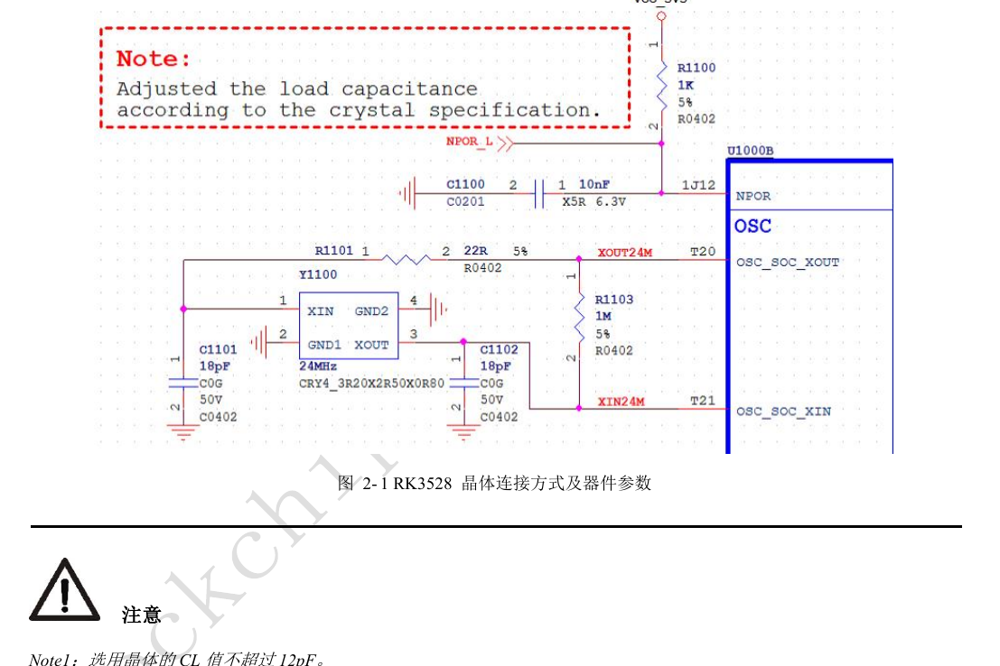
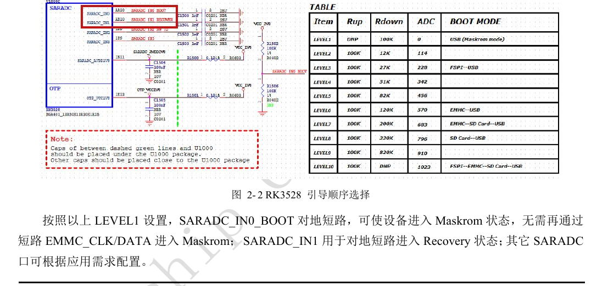
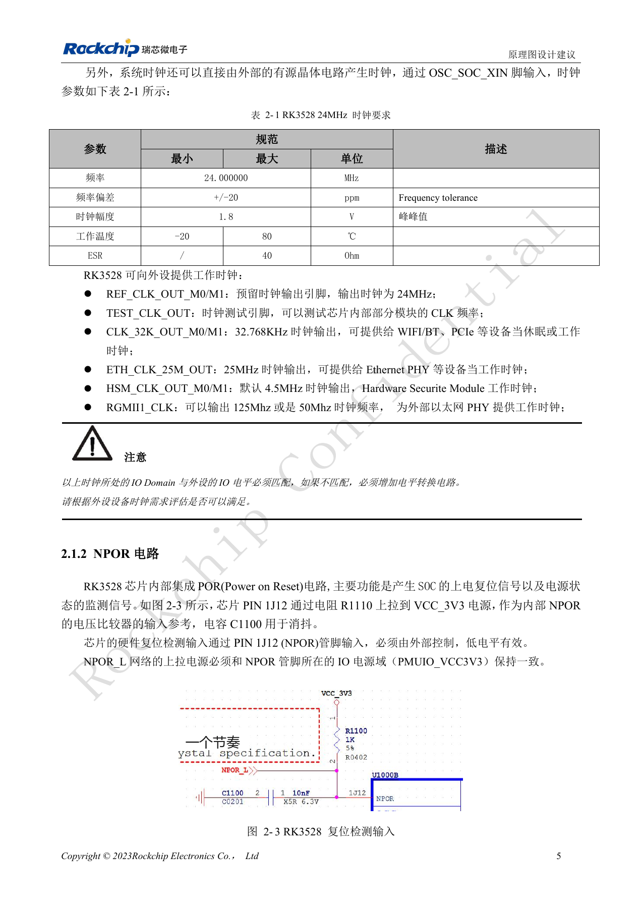
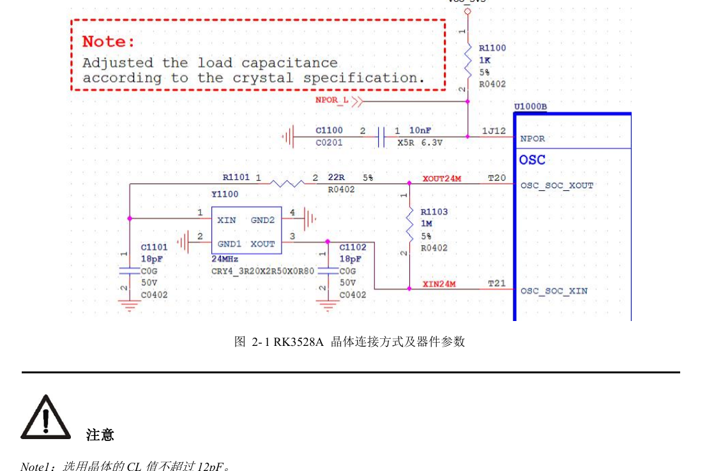
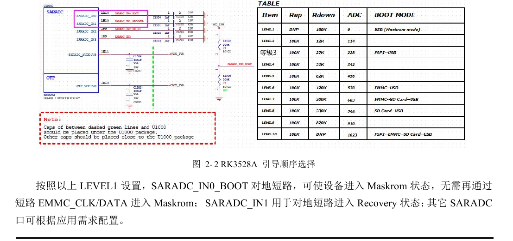
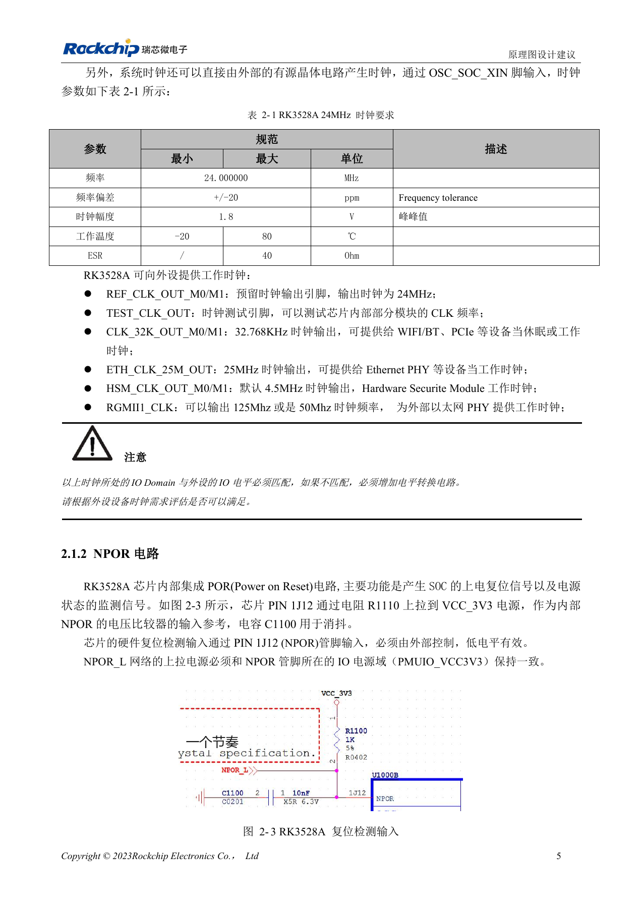

# RK3528 / RK3528A 启动与调试：时钟、复位、Maskrom 和串口

本文是依据 RK3528 V1.0（2023-05-25）与 RK3528A V1.0（2023-07-12）中文硬件指南整理的工程专题，不是两本 PDF 的逐字全文翻译。两稿在所述章节高度相近，但并不据此保证芯片可直接替换。ArmSoM [Sige1](https://www.armsom.org/sige1) 的官方[板卡文档](https://docs.armsom.org/armsom-sige1)确认其采用 RK3528，可用于评估 RK3528 系列相关应用；这不表示 Sige1 使用 RK3528A，也不能据此将两款芯片的封装或电气设计直接互换。本文的芯片参考电路不等同于 Sige1 的实际原理图；引脚、封装、BSP/SDK、内核与板卡版本必须按实际产品核对。数值为原稿参考，未经 ArmSoM 硬件实测。

**§2.1.1–2.1.5; §2.3.2; PDF 18–23, 54–55**

## 24MHz 不能只检查是否起振

XOUT24M 必须串接 22Ω 限流电阻，XOUT24M 与 XIN24M 间的 1MΩ 电阻不要随意修改。晶体负载 CL 不超过 12pF；图中的 18pF 电容只适用于原参考晶体，应结合选用晶体和布线寄生重新计算。原稿建议 C0G/NP0 电容与四脚晶体，两只地脚充分接地。系统上电后既要测频率，也要检查启动过程、幅度与温度变化；探头负载本身可能改变结果。

## 把启动配置保留到量产

NPOR 为低有效输入，外部上拉电源要与 PMUIO_VCC3V3 一致。启动介质包括 FSPI、eMMC 与 SDMMC；没有有效启动代码时使用 USB2 OTG 下载。SARADC_IN0 专用于启动顺序，不可分配给其他功能。原稿 LEVEL1 将它拉低进入 Maskrom，SARADC_IN1 则用于 Recovery；IN1 的 10kΩ 上拉到 1.8V 必须保留。将这些信号及 USB OTG、VBUSDET 留为装壳后可访问的恢复路径，不能只在样机上用短接存储信号救板。

## SD 卡检测与调试口相互影响

复位结束时，SDMMC_DETN 为低选择 SDMMC，为高选择 CPU JTAG；必须在上电前稳定。系统运行后可以改由寄存器控制 IOMUX。默认调试串口为 UART0_RX_M0 / UART0_TX_M0，1500000bps；两线需同属 M0，不能拼接不同复用组。原稿建议串 100Ω 并预留 2.54mm 插针，无法放插针时预留大于 0.7mm 测试点。MCU JTAG 在该版本指南中未向外开放。

## 参考参数

| 项目 | 原稿值 |
| --- | --- |
| 晶体负载上限 | 12pF |
| 24MHz 容差 | ±20ppm |
| SARADC 输入范围 | 0–1.8V; 10bit; 1MS/s |
| 调试串口 | UART0_M0; 1500000bps |

## 原稿图示与位置

未提供对应英文原稿，四语均使用下列中文 PDF 原图，分别标注芯片和物理页码；不把 RK3528 原图冒充 RK3528A 图。

RK3528 · CN · PDF 18

RK3528 · CN · PDF 20

RK3528 · CN · PDF 19

RK3528A · CN · PDF 18

RK3528A · CN · PDF 20

RK3528A · CN · PDF 19

## 继续开发与资料入口

ArmSoM 产品选型应以产品文档为准；本系列不表示 ArmSoM 已提供 RK3528/RK3528A 板卡。已有 ArmSoM 板卡上的接口设计与软件经验可作为方法参考，不能直接套用本系列电压、引脚或 PCB 规则。

- [ArmSoM](https://www.armsom.org/) · [ArmSoM Docs](https://docs.armsom.org/)
- [RK3528 / RK3528A 硬件设计系列：9 个工程专题](/zh/articles/rk3528-rk3528a-hardware-design-series/)
- [RK3528 / RK3528A 电源设计：分立电源、时序与负载验证](/zh/articles/rk3528-rk3528a-power-sequencing/)
