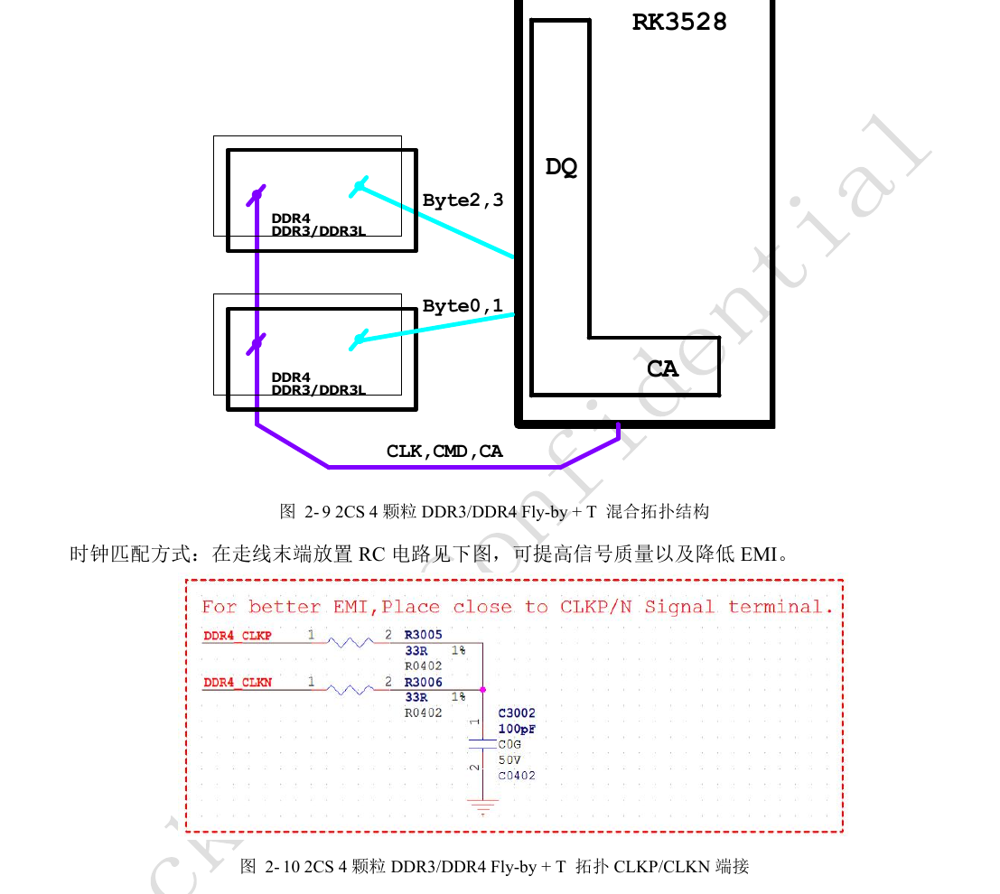
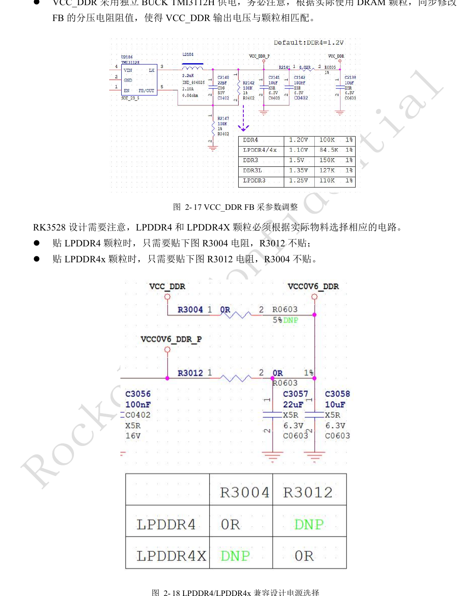
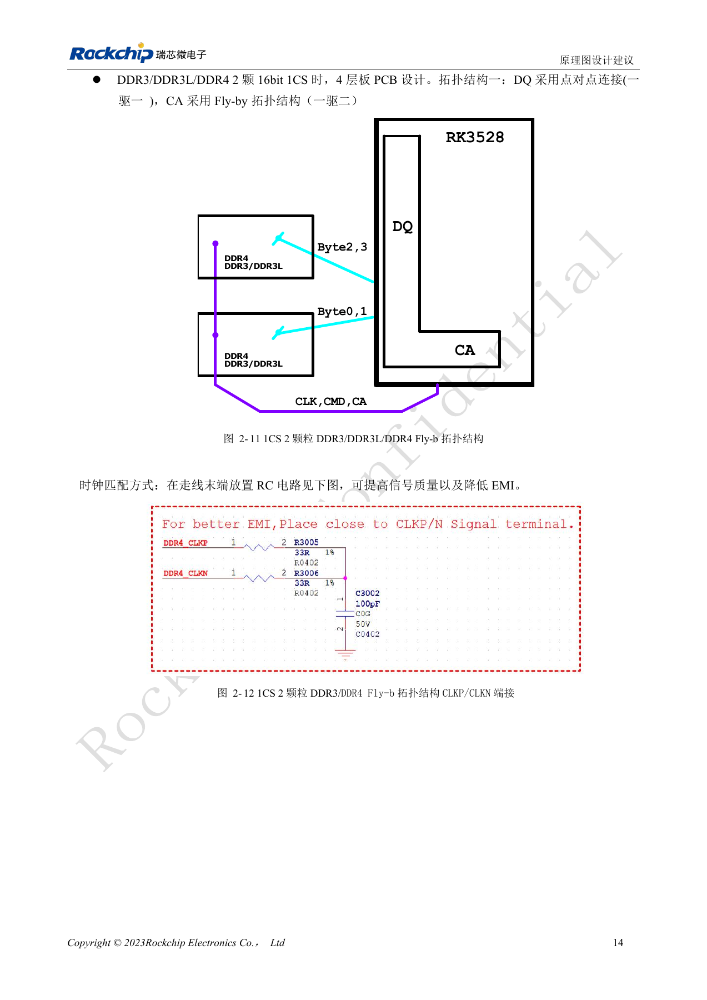
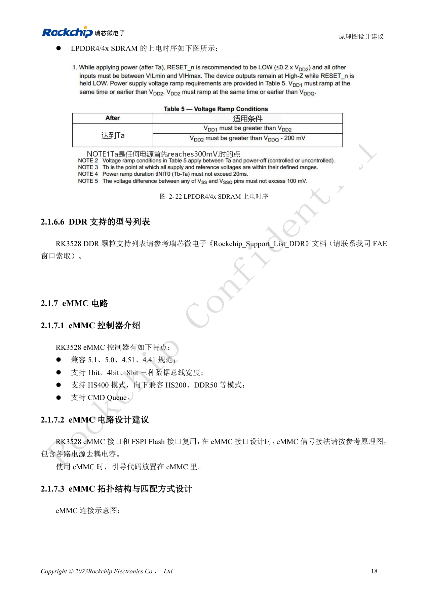
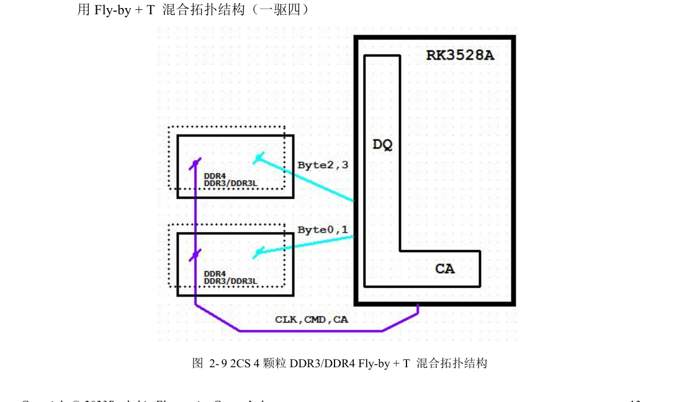
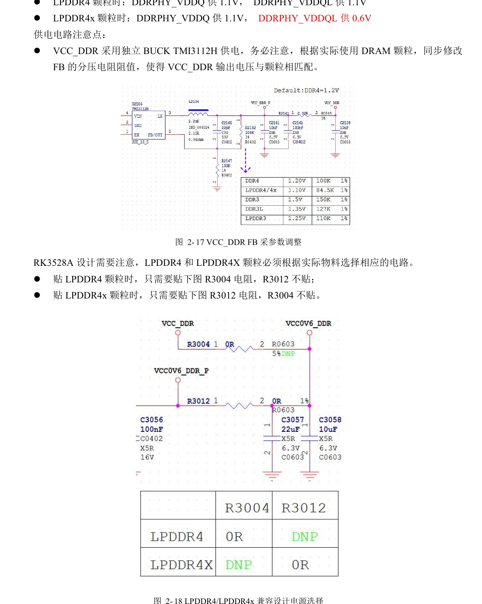
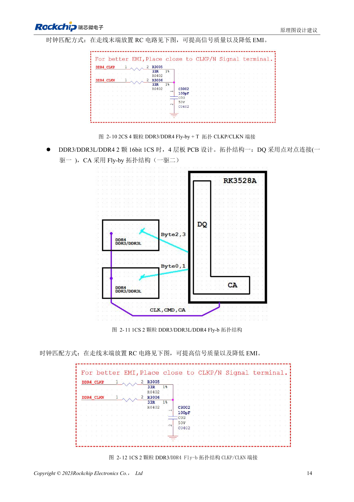
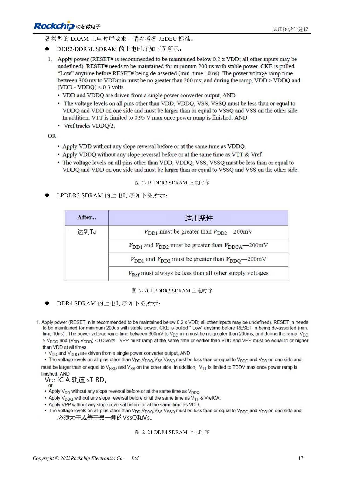
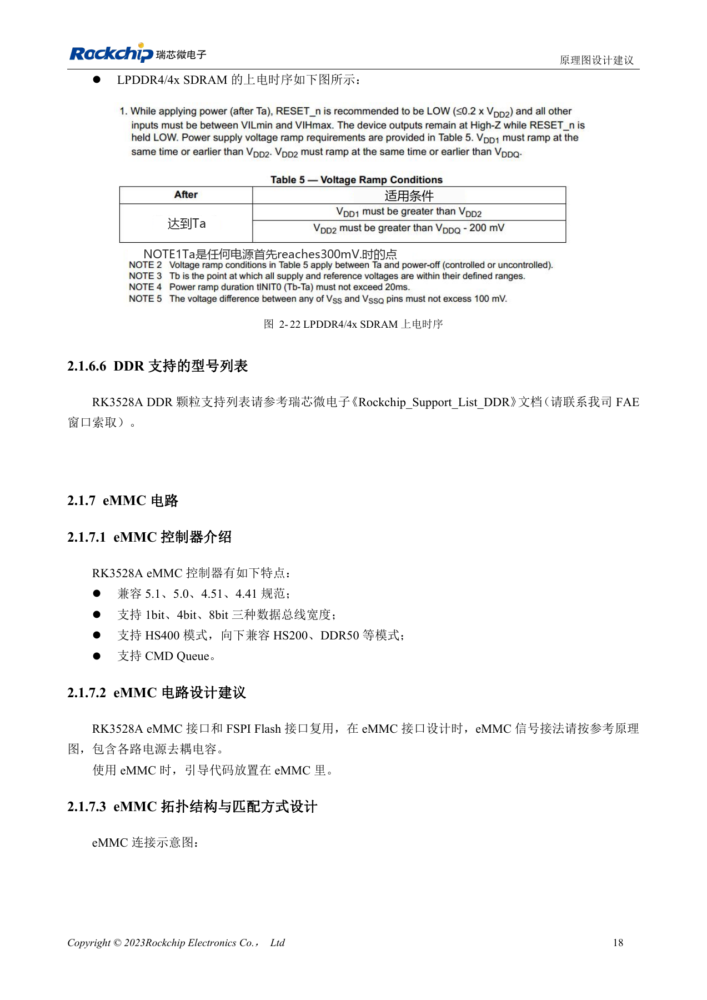

# RK3528 / RK3528A DDR：拓扑、供电、交换限制与 PCB

本文是依据 RK3528 V1.0（2023-05-25）与 RK3528A V1.0（2023-07-12）中文硬件指南整理的工程专题，不是两本 PDF 的逐字全文翻译。两稿在所述章节高度相近，但并不据此保证芯片可直接替换。ArmSoM [Sige1](https://www.armsom.org/sige1) 的官方[板卡文档](https://docs.armsom.org/armsom-sige1)确认其采用 RK3528，可用于评估 RK3528 系列相关应用；这不表示 Sige1 使用 RK3528A，也不能据此将两款芯片的封装或电气设计直接互换。本文的芯片参考电路不等同于 Sige1 的实际原理图；引脚、封装、BSP/SDK、内核与板卡版本必须按实际产品核对。数值为原稿参考，未经 ArmSoM 硬件实测。

**§2.1.6; §3.3.3; PDF 23–32, 127–141**

## 选内存先固定拓扑

控制器支持 DDR3/DDR3L/LPDDR3/DDR4/LPDDR4/LPDDR4X，32bit 总位宽、2 ranks，最大总寻址 4GB。两个 16bit 组成一个 32bit 通道，原稿提到 1GB+2GB 非对称组合。四颗 DDR3/DDR4 使用 DQ 的 T 拓扑和 CA 的 Fly-by+T 混合拓扑；两颗 16bit 的 DQ 点对点、CA Fly-by；单颗 LPDDR 使用对应点对点模板。容量和芯片数量变化会同时改变拓扑、阻抗匹配与训练参数，不能只换 BOM。

## 交换规则与 ZQ 不能套用其他芯片

DDR3/DDR3L/DDR4 允许 Byte 整组交换、Byte 内 DQ 交换，CA 不可换；16bit 或 16/32bit 兼容设计须用原厂模板。LPDDR3 的 D0–D7 及关联 DQS/DM 必须保持对应，其他 Byte 可按原稿规则交换。LPDDR4/4X 的 DQ、CA 均不允许交换。SoC 的 DDR_RZQ 为 120Ω、1%；DDR3/3L/4/LPDDR3 接地，LPDDR4/4X 接 DDRPHY_VDDQ。颗粒 ZQ 是 240Ω、1%，分别按颗粒类型接地、VCC_DDR 或 VCC0V6_DDR，不要把两种电阻混淆。

## 电源和等长按内存类型分开

LPDDR4 的 DDRPHY_VDDQ/VDDQL 均为 1.1V；LPDDR4X 分别为 1.1V/0.6V。参考图 R3004 与 R3012 为互斥选贴，不能同时装。DDR3/DDR3L 为 1.5V/1.35V，DDR4 为 1.2V；LPDDR3 原稿额定写 1.2V，同时注明实际供 1.25V 提高兼容性，实施时需核对实际颗粒允许范围。PCB 的 LPDDR4X 表给出 50Ω 单端、100Ω 差分（均 ±10%），同 Byte 的 DQ/DM 对 DQS ≤600mil，DQS 对内及 CLK 对内 ≤12mil，DQS 对 CLK ≤1700mil。其他 DDR 类型使用各自表格，不能套这组数值。

## 参考参数

| 项目 | 原稿值 |
| --- | --- |
| 总位宽 / 寻址 | 32bit / 4GB |
| SoC RZQ | 120Ω ±1% |
| 颗粒 ZQ | 240Ω ±1% |
| LPDDR4X VDDQ / VDDQL | 1.1V / 0.6V |

## DDR PHY 完整信号映射

原稿 PDF 24–26，74 行，两稿提取结果逐行一致。保留标识符与原稿的 `DDR33_A15`、`DDR33_ODT1` 写法；这两处疑似笔误需要按 PinOut/TRM 核对，不能据此创建新网名。`------` 表示原稿未列映射。表格不授权修改前文明确禁止的信号交换。

| DDRPHY | DDR4 | LPDDR4 / LPDDR4X | DDR3 | LPDDR3 |
| --- | --- | --- | --- | --- |
| DDRPHY_A_DQ0 | DDR4_DQL6_A | LPDDR4_DQ0_A | DDR3_D4 | LPDDR3_D0 |
| DDRPHY_A_DQ1 | DDR4_DQL2_A | LPDDR4_DQ1_A | DDR3_D0 | LPDDR3_D1 |
| DDRPHY_A_DQ2 | DDR4_DQL0_A | LPDDR4_DQ2_A | DDR3_D2 | LPDDR3_D2 |
| DDRPHY_A_DQ3 | DDR4_DQL1_A | LPDDR4_DQ3_A | DDR3_D1 | LPDDR3_D3 |
| DDRPHY_A_DQ4 | DDR4_DQL4_A | LPDDR4_DQ4_A | DDR3_D6 | LPDDR3_D4 |
| DDRPHY_A_DQ5 | DDR4_DQL5_A | LPDDR4_DQ5_A | DDR3_D7 | LPDDR3_D5 |
| DDRPHY_A_DQ6 | DDR4_DQL7_A | LPDDR4_DQ6_A | DDR3_D5 | LPDDR3_D6 |
| DDRPHY_A_DQ7 | DDR4_DQL3_A | LPDDR4_DQ7_A | DDR3_D3 | LPDDR3_D7 |
| DDRPHY_A_DM0 | DDR4_DML_A | LPDDR4_DM0_A | DDR3_DM0 | LPDDR3_DM0 |
| DDRPHY_A_DQS0 | DDR4_DQSL_P_A | LPDDR4_DQS0P_A | DDR3_DQS0P | LPDDR3_DQS0P |
| DDRPHY_A_DQSB0 | DDR4_DQSL_N_A | LPDDR4_DQS0N_A | DDR3_DQS0N | LPDDR3_DQS0N |
| DDRPHY_A_DQ8 | DDR4_DQU1_A | LPDDR4_DQ8_A | DDR3_D12 | LPDDR3_D19 |
| DDRPHY_A_DQ9 | DDR4_DQU5_A | LPDDR4_DQ9_A | DDR3_D14 | LPDDR3_D16 |
| DDRPHY_A_DQ10 | DDR4_DQU0_A | LPDDR4_DQ10_A | DDR3_D15 | LPDDR3_D21 |
| DDRPHY_A_DQ11 | DDR4_DQU2_A | LPDDR4_DQ11_A | DDR3_D9 | LPDDR3_D17 |
| DDRPHY_A_DQ12 | DDR4_DQU7_A | LPDDR4_DQ12_A | DDR3_D10 | LPDDR3_D20 |
| DDRPHY_A_DQ13 | DDR4_DQU3_A | LPDDR4_DQ13_A | DDR3_D8 | LPDDR3_D23 |
| DDRPHY_A_DQ14 | DDR4_DQU4_A | LPDDR4_DQ14_A | DDR3_D13 | LPDDR3_D22 |
| DDRPHY_A_DQ15 | DDR4_DQU6_A | LPDDR4_DQ15_A | DDR3_D11 | LPDDR3_D18 |
| DDRPHY_A_DM1 | DDR4_DMU_A | LPDDR4_DM1_A | DDR3_DM1 | LPDDR3_DM2 |
| DDRPHY_A_DQS1 | DDR4_DQSU_P_A | LPDDR4_DQS1P_A | DDR3_DQS1P | LPDDR3_DQS2P |
| DDRPHY_A_DQSB1 | DDR4_DQSU_N_A | LPDDR4_DQS1N_A | DDR3_DQS1N | LPDDR3_DQS2N |
| DDRPHY_B_DQ0 | DDR4_DQU4_B | LPDDR4_DQ0_B | DDR3_D29 | LPDDR3_D14 |
| DDRPHY_B_DQ1 | DDR4_DQU0_B | LPDDR4_DQ1_B | DDR3_D31 | LPDDR3_D12 |
| DDRPHY_B_DQ2 | DDR4_DQU1_B | LPDDR4_DQ2_B | DDR3_D28 | LPDDR3_D13 |
| DDRPHY_B_DQ3 | DDR4_DQU5_B | LPDDR4_DQ3_B | DDR3_D30 | LPDDR3_D8 |
| DDRPHY_B_DQ4 | DDR4_DQU7_B | LPDDR4_DQ4_B | DDR3_D26 | LPDDR3_D9 |
| DDRPHY_B_DQ5 | DDR4_DQU3_B | LPDDR4_DQ5_B | DDR3_D24 | LPDDR3_D15 |
| DDRPHY_B_DQ6 | DDR4_DQU6_B | LPDDR4_DQ6_B | DDR3_D27 | LPDDR3_D10 |
| DDRPHY_B_DQ7 | DDR4_DQU2_B | LPDDR4_DQ7_B | DDR3_D25 | LPDDR3_D11 |
| DDRPHY_B_DM0 | DDR4_DMU_B | LPDDR4_DM0_B | DDR3_DM3 | LPDDR3_DM1 |
| DDRPHY_B_DQS0 | DDR4_DQSU_P_B | LPDDR4_DQS0P_B | DDR3_DQS3P | LPDDR3_DQS1P |
| DDRPHY_B_DQSB0 | DDR4_DQSU_N_B | LPDDR4_DQS0N_B | DDR3_DQS3N | LPDDR3_DQS1N |
| DDRPHY_B_DQ8 | DDR4_DQL1_B | LPDDR4_DQ8_B | DDR3_D17 | LPDDR3_D27 |
| DDRPHY_B_DQ9 | DDR4_DQL3_B | LPDDR4_DQ9_B | DDR3_D19 | LPDDR3_D26 |
| DDRPHY_B_DQ10 | DDR4_DQL4_B | LPDDR4_DQ10_B | DDR3_D18 | LPDDR3_D30 |
| DDRPHY_B_DQ11 | DDR4_DQL6_B | LPDDR4_DQ11_B | DDR3_D22 | LPDDR3_D31 |
| DDRPHY_B_DQ12 | DDR4_DQL0_B | LPDDR4_DQ12_B | DDR3_D16 | LPDDR3_D28 |
| DDRPHY_B_DQ13 | DDR4_DQL2_B | LPDDR4_DQ13_B | DDR3_D20 | LPDDR3_D24 |
| DDRPHY_B_DQ14 | DDR4_DQL7_B | LPDDR4_DQ14_B | DDR3_D21 | LPDDR3_D25 |
| DDRPHY_B_DQ15 | DDR4_DQL5_B | LPDDR4_DQ15_B | DDR3_D23 | LPDDR3_D29 |
| DDRPHY_B_DM1 | DDR4_DML_B | LPDDR4_DM1_B | DDR3_DM2 | LPDDR3_DM3 |
| DDRPHY_B_DQS1 | DDR4_DQSL_P_B | LPDDR4_DQS1P_B | DDR3_DQS2P | LPDDR3_DQS3P |
| DDRPHY_B_DQSB1 | DDR4_DQSL_N_B | LPDDR4_DQS1N_B | DDR3_DQS2N | LPDDR3_DQS3N |
| DDRPHY_A0 | DDR4_A0 | LPDDR4_ODT1_CA_B | DDR3_A9 | LPDDR3_ODT2 |
| DDRPHY_A1 | DDR4_A1 | LPDDR4_CKE1_A | DDR3_A14 | ------ |
| DDRPHY_A2 | DDR4_A2 | LPDDR4_ODT0_CA_B | DDR3_A13 | LPDDR3_ODT3 |
| DDRPHY_A3 | DDR4_A3 | LPDDR4_CKE0_A | DDR3_A1 | ------ |
| DDRPHY_A4 | DDR4_A4 | LPDDR4_A0_B | DDR3_A2 | LPDDR3_A5 |
| DDRPHY_A5 | DDR4_A5 | LPDDR4_A1_A | DDR3_A4 | ------ |
| DDRPHY_A6 | DDR4_A6 | LPDDR4_CS1N_B | DDR3_A3 | LPDDR3_CSN2 |
| DDRPHY_A7 | DDR4_A7 | LPDDR4_A4_A | DDR3_A6 | ------ |
| DDRPHY_A8 | DDR4_A8 | LPDDR4_A4_B | DDR3_A5 | LPDDR3_A6 |
| DDRPHY_A9 | DDR4_A9 | LPDDR4_CLKP_A | DDR3_A11 | LPDDR3_A2 |
| DDRPHY_A10 | DDR4_A10 | LPDDR4_A1_B | DDR3_A0 | ------ |
| DDRPHY_A11 | DDR4_A11 | LPDDR4_A5_B | DDR3_A7 | LPDDR3_A7 |
| DDRPHY_A12 | DDR4_A12 | LPDDR4_A2_A | DDR3_A10 | LPDDR3_A4 |
| DDRPHY_A13 | DDR4_A13 | LPDDR4_CLKN_A | DDR3_A8 | LPDDR3_A3 |
| DDRPHY_A14 | DDR4_WEN/A14 | LPDDR4_CS0N_B | DDR3_ODT0 | LPDDR3_CSN3 |
| DDRPHY_A15 | DDR4_CASN/A15 | LPDDR4_A3_A | DDR3_BA1 | LPDDR3_A0 |
| DDRPHY_A16 | DDR4_RASN/A16 | LPDDR4_A0_A | DDR3_CKE0 | ------ |
| DDRPHY_ACTN | DDR4_ACTN | LPDDR4_A2_B | DDR3_CSN0 | LPDDR3_A9 |
| DDRPHY_BA0 | DDR4_BA0 | LPDDR4_CKE0_B | DDR3_BA2 | LPDDR3_CKE0 |
| DDRPHY_BA1 | DDR4_BA1 | LPDDR4_A5_A | DDR3_A12 | LPDDR3_A1 |
| DDRPHY_BG0 | DDR4_BG0 | LPDDR4_A3_B | DDR3_BA0 | LPDDR3_A8 |
| DDRPHY_BG1 | DDR4_BG1 | ------ | DDR33_A15 | ------ |
| DDRPHY_CKE | DDR4_CKE | LPDDR4_CKE1_B | DDR3_RASN | ------ |
| DDRPHY_CK | DDR4_CLKP | LPDDR4_CLKP_B | DDR3_CLKP | LPDDR3_CLKP |
| DDRPHY_CKB | DDR4_CLKN | LPDDR4_CLKN_B | DDR3_CLKN | LPDDR3_CLKN |
| DDRPHY_CSB0 | DDR4_CSN0 | LPDDR4_CS1N_A | DDR3_CASN | LPDDR3_CSN1 |
| DDRPHY_CSB1 | DDR4_CSN1 | LPDDR4_CS0N_A | DDR3_CSN1 | LPDDR3_CSN0 |
| DDRPHY_ODT0 | DDR4_ODT0 | LPDDR4_ODT1_CA_A | DDR3_WEN | LPDDR3_ODT0 |
| DDRPHY_ODT1 | DDR4_ODT1 | LPDDR4_ODT0_CA_A | DDR33_ODT1 | LPDDR3_ODT1 |
| DDRPHY_RESETN | DDR4_RESETN | LPDDR4_RESETN | DDR3_RESETN | ------ |

## 原稿图示与位置

未提供对应英文原稿，四语均使用下列中文 PDF 原图，分别标注芯片和物理页码；不把 RK3528 原图冒充 RK3528A 图。

RK3528 · CN · PDF 27

RK3528 · CN · PDF 30

RK3528 · CN · PDF 28

RK3528 · CN · PDF 31

RK3528 · CN · PDF 32

RK3528A · CN · PDF 27

RK3528A · CN · PDF 30

RK3528A · CN · PDF 28

RK3528A · CN · PDF 31

RK3528A · CN · PDF 32

## 继续开发与资料入口

ArmSoM 产品选型应以产品文档为准；本系列不表示 ArmSoM 已提供 RK3528/RK3528A 板卡。已有 ArmSoM 板卡上的接口设计与软件经验可作为方法参考，不能直接套用本系列电压、引脚或 PCB 规则。

- [ArmSoM](https://www.armsom.org/) · [ArmSoM Docs](https://docs.armsom.org/)
- [RK3528 / RK3528A 硬件设计系列：9 个工程专题](/zh/articles/rk3528-rk3528a-hardware-design-series/)
- [RK3528 / RK3528A 电源设计：分立电源、时序与负载验证](/zh/articles/rk3528-rk3528a-power-sequencing/)
- [RK3528 / RK3528A 存储与无线接口：eMMC、FSPI、SDMMC、SDIO](/zh/articles/rk3528-rk3528a-storage-sdio-design/)
