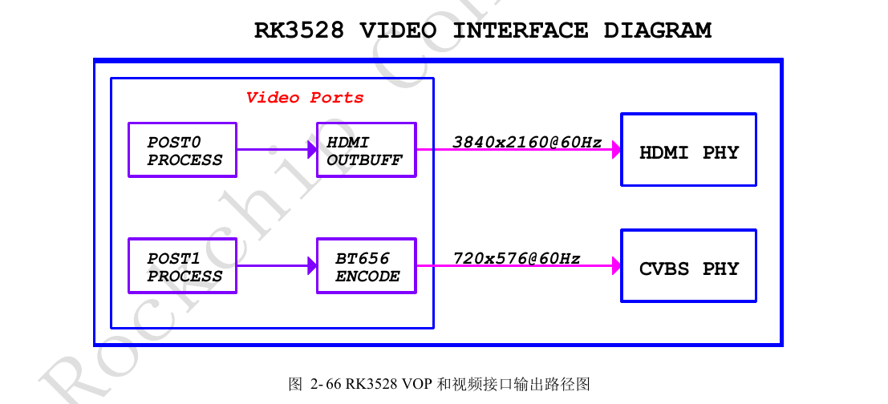
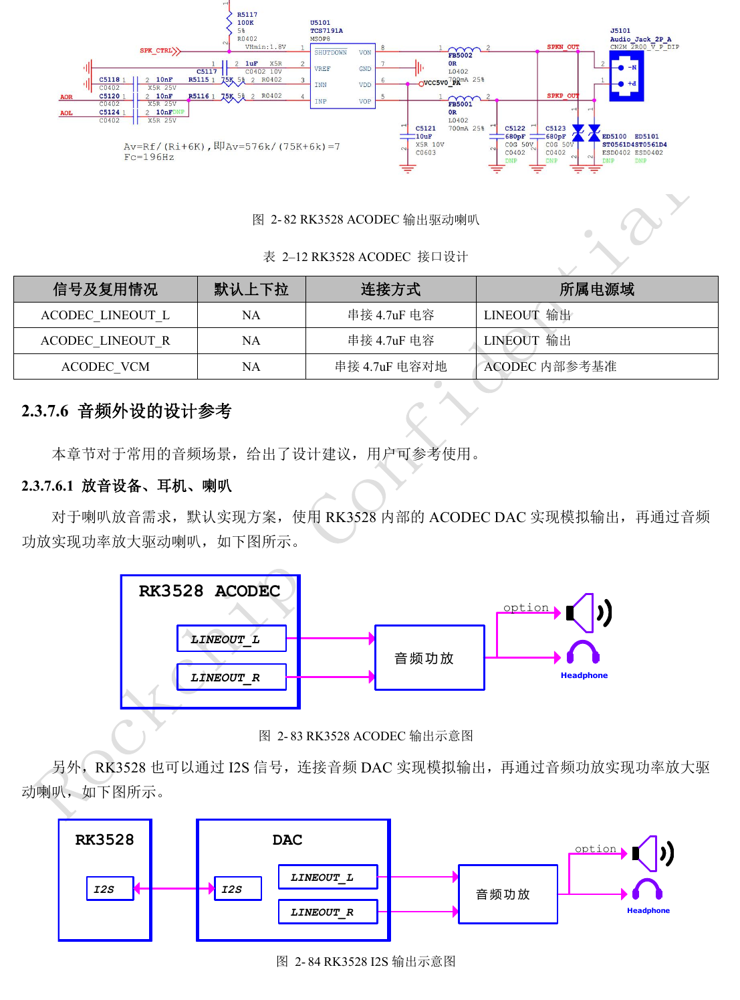
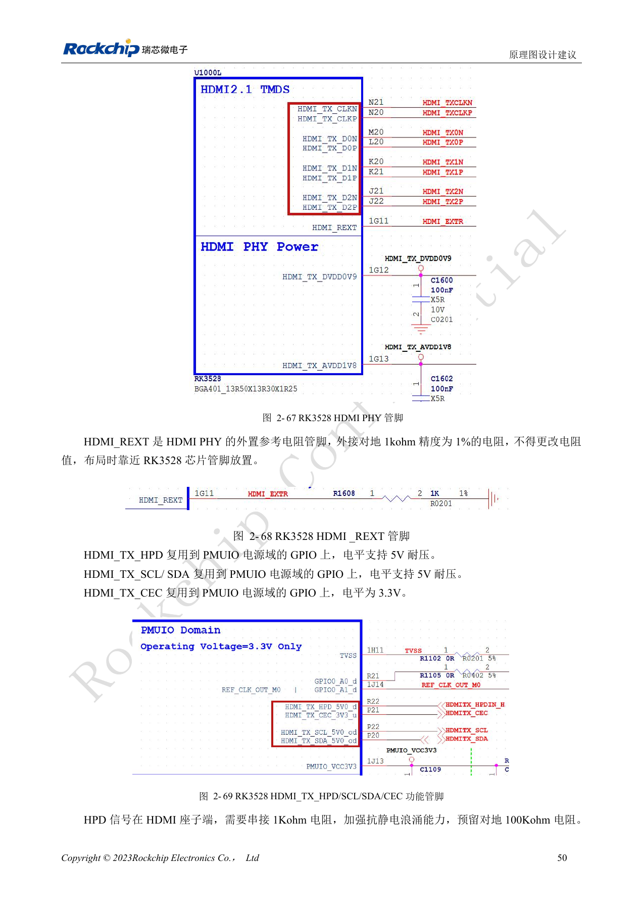
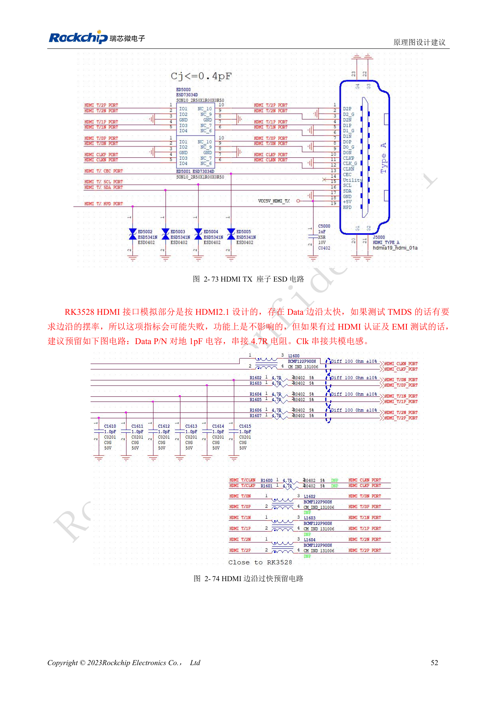
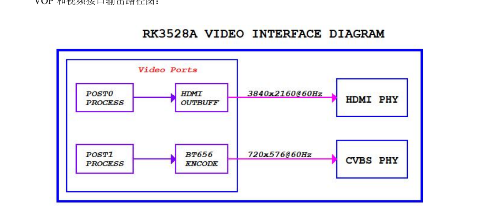
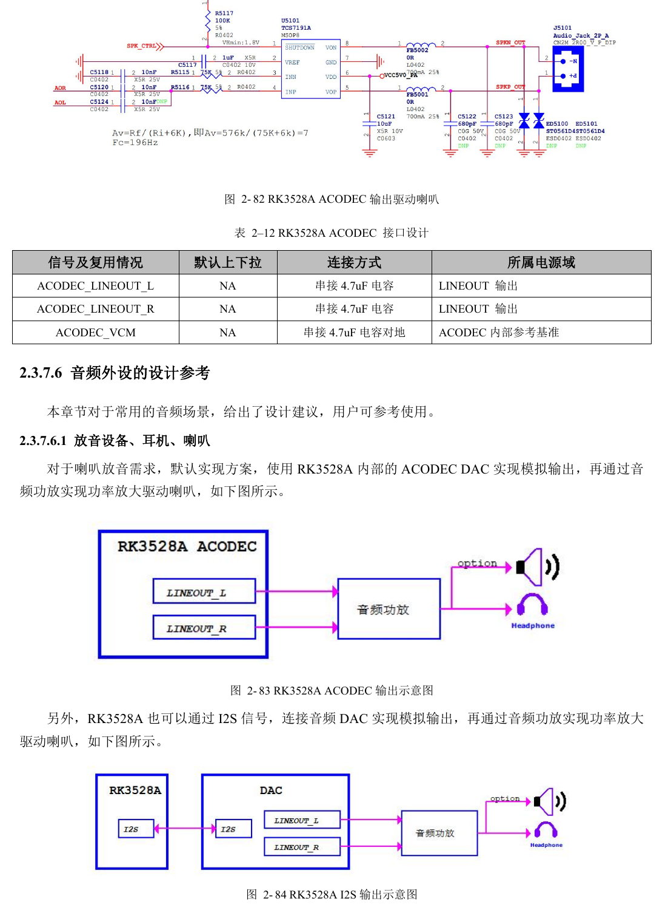
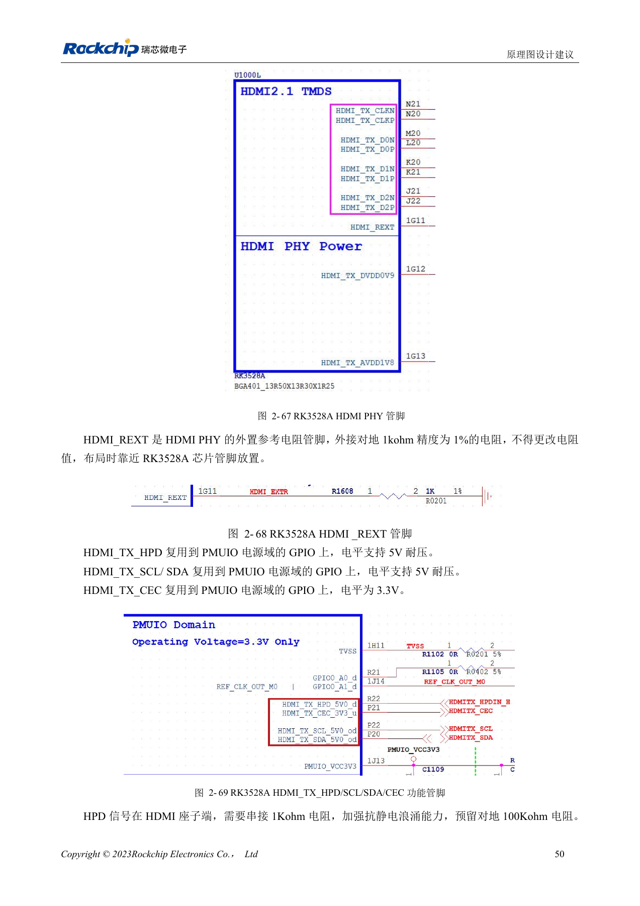
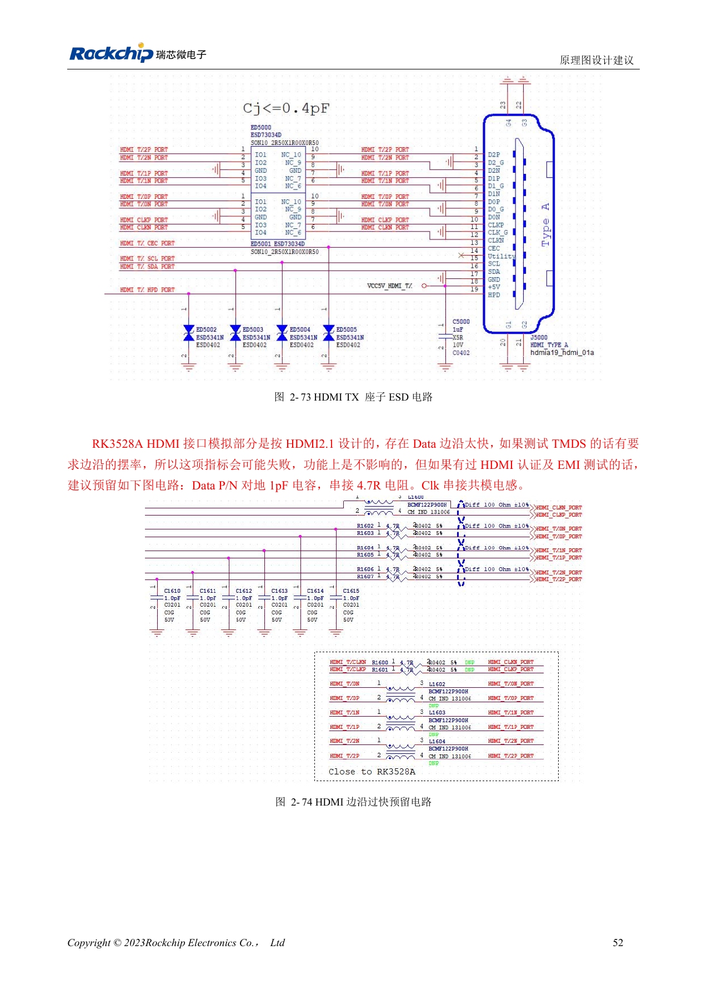

# RK3528 / RK3528A 显示与音频：HDMI、CVBS、TSI 和模拟布局

本文是依据 RK3528 V1.0（2023-05-25）与 RK3528A V1.0（2023-07-12）中文硬件指南整理的工程专题，不是两本 PDF 的逐字全文翻译。两稿在所述章节高度相近，但并不据此保证芯片可直接替换。ArmSoM [Sige1](https://www.armsom.org/sige1) 的官方[板卡文档](https://docs.armsom.org/armsom-sige1)确认其采用 RK3528，可用于评估 RK3528 系列相关应用；这不表示 Sige1 使用 RK3528A，也不能据此将两款芯片的封装或电气设计直接互换。本文的芯片参考电路不等同于 Sige1 的实际原理图；引脚、封装、BSP/SDK、内核与板卡版本必须按实际产品核对。数值为原稿参考，未经 ArmSoM 硬件实测。

**§2.3.5–2.3.7; §3.3 HDMI/ACODEC/audio; PDF 62–75, 143, 148–149**

## HDMI 能力与外围电路一起看

VOP 有两个输出 Port，指南列 HDMI 与 CVBS 路径；HDMI2.0 TX 最高 4K@60Hz，支持 RGB/YCbCr444/YCbCr420、最高 10bit。HDMI_REXT 为对地 1kΩ、1%，必须靠近芯片，不可擅自改值。HPD 与 DDC 的引脚描述支持 5V 耐压，CEC 则为 3.3V，不能据此将所有相关 IO 接 5V。HPD 在连接器端串 1kΩ 并预留 100kΩ 下拉；配合 5V 供电和热插拔验证。

## 认证问题需要预留调整空间

原稿说 HDMI 模拟部分按 HDMI2.1 设计，但对外功能仍按 HDMI2.0 描述，不能据此宣传 HDMI2.1 功能。对 TMDS 过快边沿，建议预留 Data P/N 对地 1pF、串 4.7Ω、CLK 共模电感，再按眼图与 EMI 实测选贴。PCB 表要求差分 100Ω±10%、对内差 <6mil、对间差 <480mil、长度 <5in、ESD 电容 ≤0.2pF、建议最多两个过孔。TSI 输入是传输流接口，不要把标题中误写的 CIF 当作摄像头接口能力。

## 模拟音频与数字音频分区审查

ACODEC 的模拟输出需经功放驱动喇叭，录音可使用 PDM 麦克风或外部 I2S/PDM ADC，也可选独立 Codec。模拟 ACODEC/CVBS 建议线宽 >12mil、相邻层为完整地，避开 DDR、开关电感和 RF。CVBS 的 75Ω 靠近芯片，滤波靠近 AV 座；音频左右通道独立包地。数字音频 CLK 建议在源端串 22Ω，多设备 CLK 按菊花链组织；PDM 有足够 GPIO 时可利用同组两个 CLK 减少分支。先测各通道，再测显示、无线与音频并发噪声。

## 参考参数

| 项目 | 原稿值 |
| --- | --- |
| HDMI_REXT | 1kΩ ±1% |
| HDMI 差分阻抗 | 100Ω ±10% |
| HDMI 长度 | <5in |
| CVBS 端接 | 75Ω |

## 原稿图示与位置

未提供对应英文原稿，四语均使用下列中文 PDF 原图，分别标注芯片和物理页码；不把 RK3528 原图冒充 RK3528A 图。

RK3528 · CN · PDF 63

RK3528 · CN · PDF 74

RK3528 · CN · PDF 64

RK3528 · CN · PDF 66

RK3528A · CN · PDF 63

RK3528A · CN · PDF 74

RK3528A · CN · PDF 64

RK3528A · CN · PDF 66

## 继续开发与资料入口

ArmSoM 产品选型应以产品文档为准；本系列不表示 ArmSoM 已提供 RK3528/RK3528A 板卡。已有 ArmSoM 板卡上的接口设计与软件经验可作为方法参考，不能直接套用本系列电压、引脚或 PCB 规则。

- [ArmSoM](https://www.armsom.org/) · [ArmSoM Docs](https://docs.armsom.org/)
- [RK3528 / RK3528A 硬件设计系列：9 个工程专题](/zh/articles/rk3528-rk3528a-hardware-design-series/)
- [RK3528 / RK3528A USB 与 PCIe：共享 PHY 和高速通道审查](/zh/articles/rk3528-rk3528a-usb-pcie-design/)
- [RK3528 / RK3528A 网络与控制：RGMII 时序、PHY、UART、I2C 和 PWM](/zh/articles/rk3528-rk3528a-ethernet-control-interfaces/)
