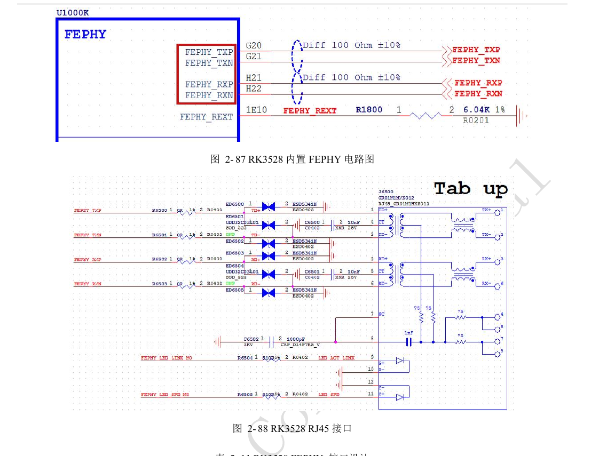
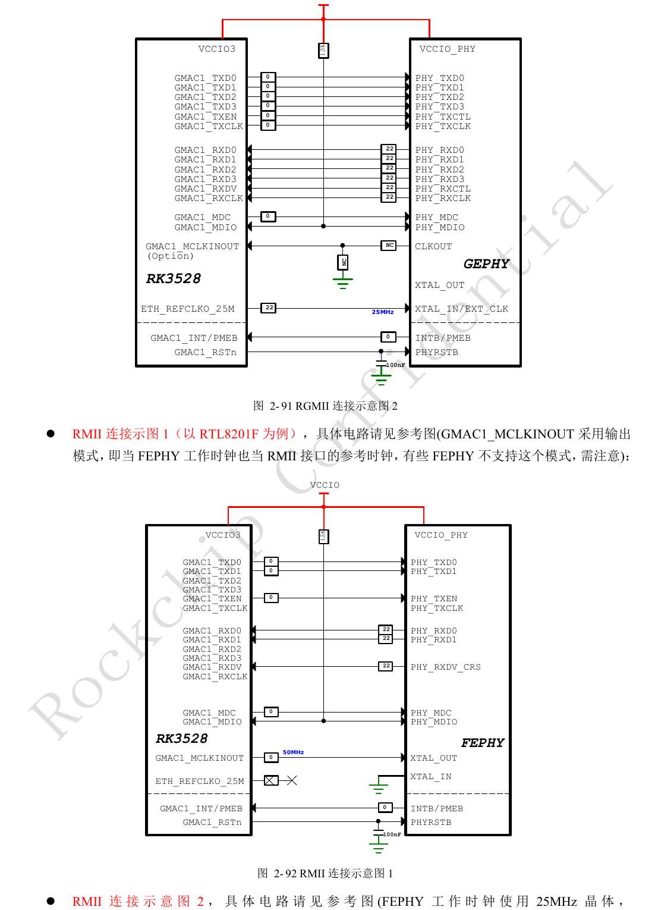
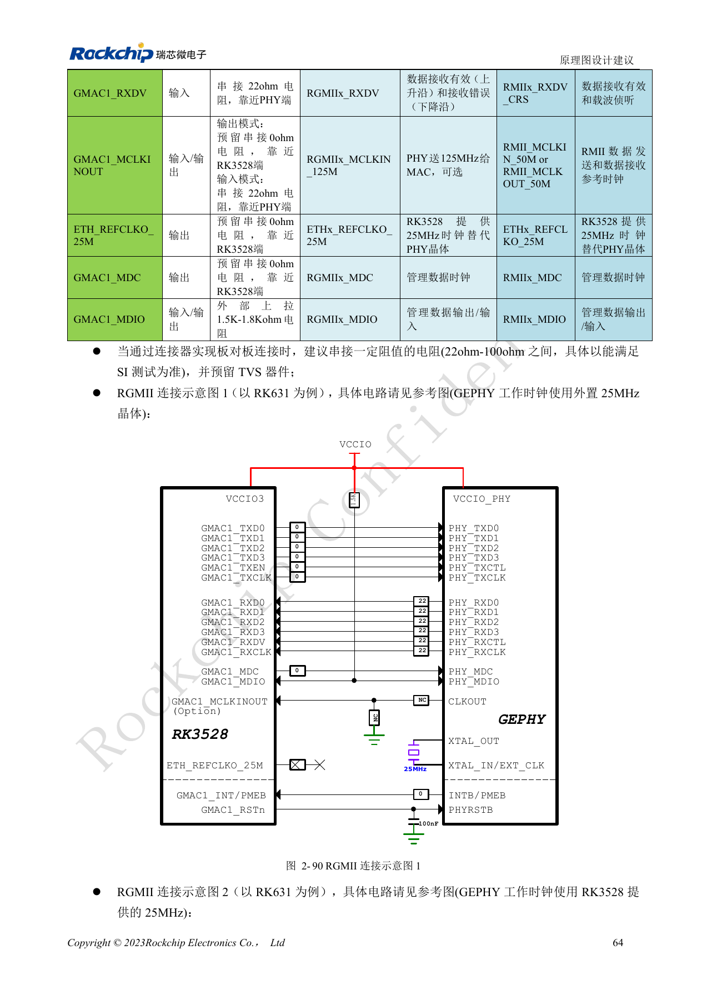
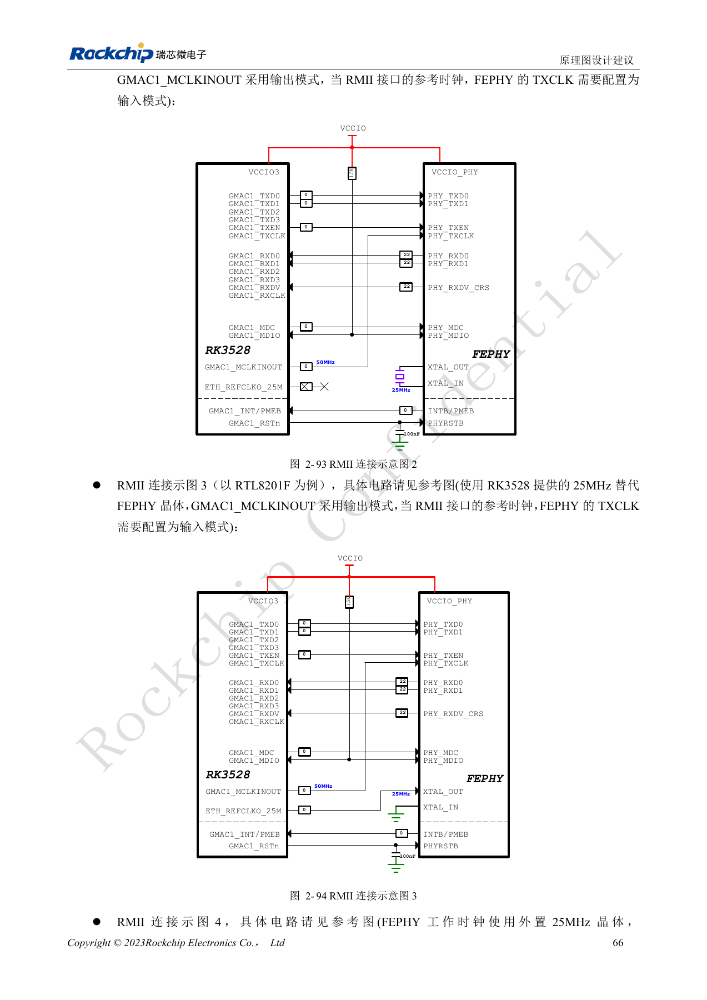
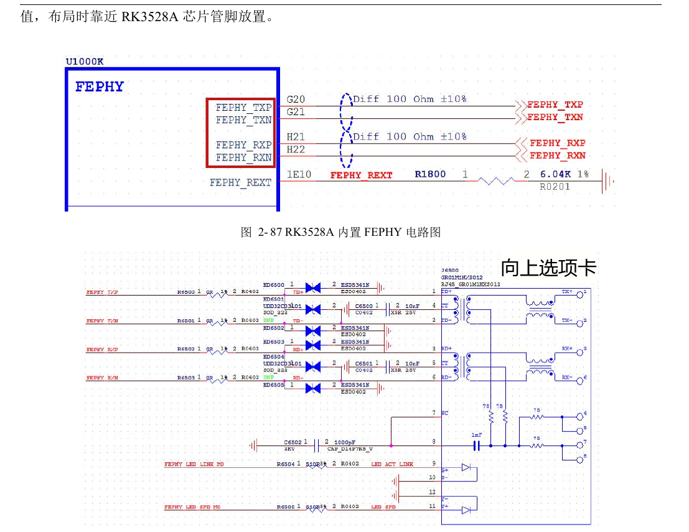
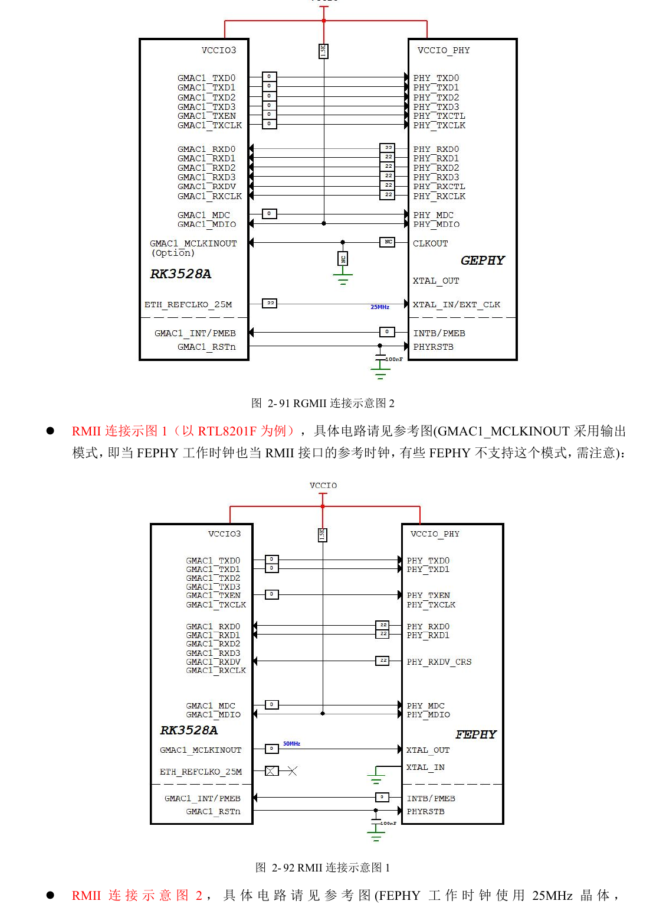
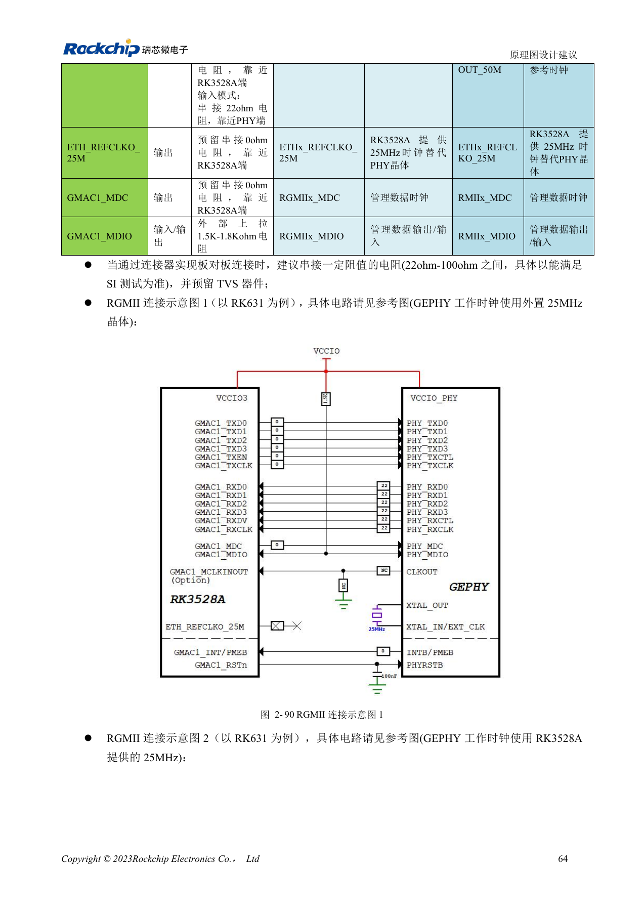
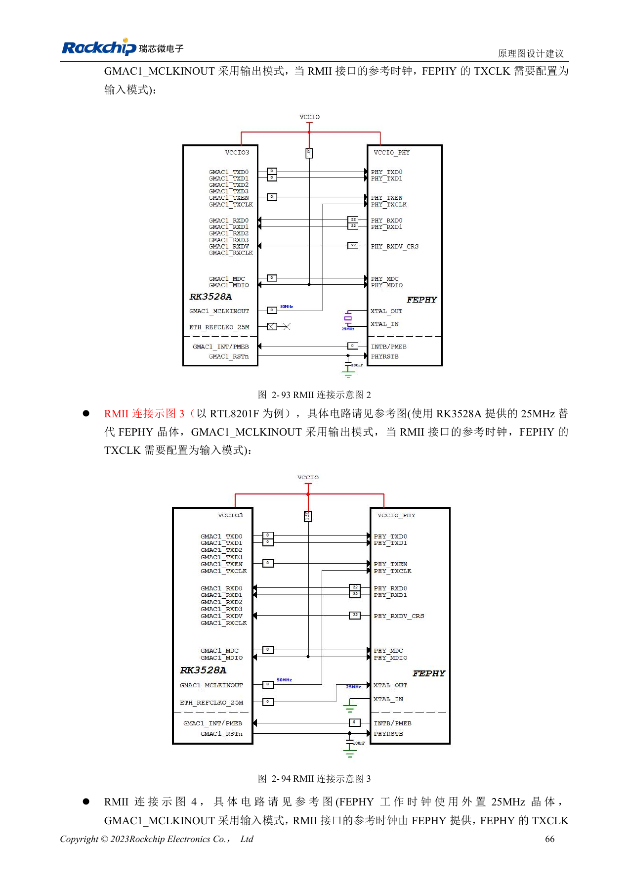

# RK3528 / RK3528A 网络与控制：RGMII 时序、PHY、UART、I2C 和 PWM

本文是依据 RK3528 V1.0（2023-05-25）与 RK3528A V1.0（2023-07-12）中文硬件指南整理的工程专题，不是两本 PDF 的逐字全文翻译。两稿在所述章节高度相近，但并不据此保证芯片可直接替换。ArmSoM [Sige1](https://www.armsom.org/sige1) 的官方[板卡文档](https://docs.armsom.org/armsom-sige1)确认其采用 RK3528，可用于评估 RK3528 系列相关应用；这不表示 Sige1 使用 RK3528A，也不能据此将两款芯片的封装或电气设计直接互换。本文的芯片参考电路不等同于 Sige1 的实际原理图；引脚、封装、BSP/SDK、内核与板卡版本必须按实际产品核对。数值为原稿参考，未经 ArmSoM 硬件实测。

**§2.3.8–2.3.13; PDF 75–87, 147–148**

## 集成百兆 PHY 与外置 PHY 是两条路径

指南列一个 GMAC、一个 EMAC 和集成 FEPHY。集成 FEPHY 通过 MDI 接变压器与 RJ45，REXT 为 6.04kΩ、1%，靠近芯片放置，差分线上预留的 0Ω 不省略。GMAC 的 RGMII 支持 10/100/1000Mbps，RMII 支持 10/100Mbps，位于 VCCIO3。选择外置 PHY 时应核对其 IO 电平、复位、启动配置和变压器中心抽头，不能沿用另一厂商接法。RJ45 的 Tab-up/Tab-down 会改变引脚顺序，必须同时检查符号与封装。

## 时钟方向与延时必须成对配置

参考设计由 MAC 控制 TXCLK 对数据的延时，由 PHY 控制 RXCLK 对数据的延时；RK631 的例子默认打开 RX 2ns delay。替换 PHY 时要避免 MAC 和 PHY 重复插入延时。RMII 有多种 50MHz 输入/输出方案，25MHz PHY 工作时钟与 50MHz 总线时钟不能混淆。MDIO 外部上拉建议 1.5–1.8kΩ，接对应 IO 电源；PHY 复位端增加 100nF。RGMII PCB 为单端 50Ω±10%，TX 与 RX 各组数据对自己的时钟 <120mil，长度 <6in。

## 控制总线按 IO 域和复用组分配

8 个 UART、8 个 I2C、2 个通用 SPI 和最多 8 个 PWM 并不保证同时引出。UART TX/RX 必须同组 Mx；UART7 的表中“复用情况 M1/M2”与电源域栏“M0/M1”不一致，实施前按 PinOut 核对，不能猜改。SPI0 在 VCCIO4，SPI1 在 VCCIO0；I2C 支持最高 400Kbit/s，外部上拉参考 2.2kΩ，并按电容负载校核。PWM3/PWM7 可接红外，原稿默认 38kHz；IR 接收器远离天线和 LED 直射，输入电平须匹配。

## 参考参数

| 项目 | 原稿值 |
| --- | --- |
| 集成 PHY REXT | 6.04kΩ ±1% |
| MDIO 上拉 | 1.5–1.8kΩ |
| I2C 速率参考 | ≤400Kbit/s |
| I2C 上拉参考 | 2.2kΩ |

## 控制接口复用与电源域表

原稿表 2-24、2-25、2-27、2-29、2-31，PDF 82–86。保留全部接口行；星号为 UART7 原稿矛盾。标识符不翻译，HDMI_TX_I2C 的 PMUIO0 为原表写法，不自行改名。

### UART

| 接口 | 复用组：电源域 |
| --- | --- |
| UART0 | M0: VCCIO0; M1: VCCIO1 |
| UART1 | M0: VCCIO4; M1: VCCIO4 |
| UART2 | M0: VCCIO3; M1: VCCIO0 |
| UART3 | M0: VCCIO4; M1: VCCIO4 |
| UART4 | VCCIO2 |
| UART5 | M0: VCCIO0; M1: VCCIO1 |
| UART6 | M0: VCCIO3; M1: VCCIO3 |
| UART7 | M1/M2 ↔ M0: VCCIO3; M1: VCCIO0 * |

### UART RTSN / CTSN

| 接口 | 复用组：电源域 |
| --- | --- |
| UART0_RTSN / UART0_CTSN | -- |
| UART1_RTSN / UART1_CTSN | VCCIO4 |
| UART2_RTSN / UART2_CTSN | M0: VCCIO3; M1: VCCIO0 |
| UART3_RTSN / UART3_CTSN | VCCIO4 |
| UART4_RTSN / UART4_CTSN | VCCIO2 |
| UART5_RTSN / UART5_CTSN | M0: VCCIO0; M1: VCCIO1 |
| UART6_RTSN / UART6_CTSN | VCCIO3 |
| UART7_RTSN / UART7_CTSN | M0: VCCIO3; M1: VCCIO0 |

### SPI

| 接口 | 复用组：电源域 |
| --- | --- |
| SPI0 | VCCIO4 |
| SPI1 | VCCIO0 |

### I2C

| 接口 | 复用组：电源域 |
| --- | --- |
| I2C0 | M0: VCCIO4; M1: VCCIO4 |
| I2C1 | M0: VCCIO4; M1: VCCIO4 |
| I2C2 | M1: VCCIO0 |
| I2C3 | M0: VCCIO0; M1: VCCIO3 |
| I2C4 | VCCIO2 |
| I2C5 | M0: VCCIO0; M1: VCCIO1 |
| I2C6 | M0: VCCIO3; M1: VCCIO1 |
| I2C7 | VCCIO2 |
| HDMI_TX_I2C | PMUIO0 |

### PWM

| 接口 | 复用组：电源域 |
| --- | --- |
| PWM0 | M0: VCCIO4; M1: VCCIO0 |
| PWM1 | M0: VCCIO4; M1: VCCIO0 |
| PWM2 | M0: VCCIO4; M1: VCCIO0 |
| PWM3 | M0: VCCIO4; M1: VCCIO2 |
| PWM4 | M0: VCCIO4; M1: VCCIO0 |
| PWM5 | M0: VCCIO4; M1: VCCIO3 |
| PWM6 | M0: VCCIO4; M1: VCCIO0; M2: VCCIO3 |
| PWM7 | M0: VCCIO4; M1: VCCIO0 |

## 原稿图示与位置

未提供对应英文原稿，四语均使用下列中文 PDF 原图，分别标注芯片和物理页码；不把 RK3528 原图冒充 RK3528A 图。

RK3528 · CN · PDF 76

RK3528 · CN · PDF 79

RK3528 · CN · PDF 78

RK3528 · CN · PDF 80

RK3528A · CN · PDF 76

RK3528A · CN · PDF 79

RK3528A · CN · PDF 78

RK3528A · CN · PDF 80

## 继续开发与资料入口

ArmSoM 产品选型应以产品文档为准；本系列不表示 ArmSoM 已提供 RK3528/RK3528A 板卡。已有 ArmSoM 板卡上的接口设计与软件经验可作为方法参考，不能直接套用本系列电压、引脚或 PCB 规则。

- [ArmSoM](https://www.armsom.org/) · [ArmSoM Docs](https://docs.armsom.org/)
- [RK3528 / RK3528A 硬件设计系列：9 个工程专题](/zh/articles/rk3528-rk3528a-hardware-design-series/)
- [RK3528 / RK3528A 显示与音频：HDMI、CVBS、TSI 和模拟布局](/zh/articles/rk3528-rk3528a-display-audio-design/)
- [RK3528 / RK3528A PCB 审查：叠层、扇出、回流与保护布局](/zh/articles/rk3528-rk3528a-pcb-stackup-signal-integrity/)
