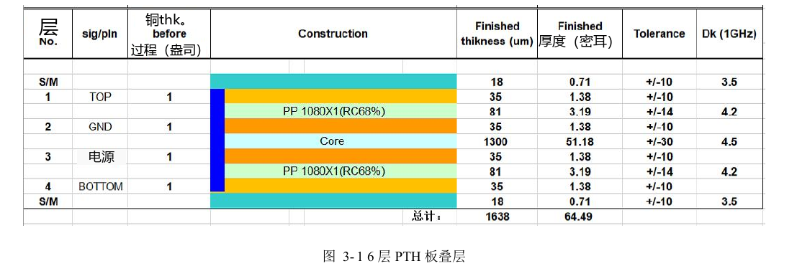
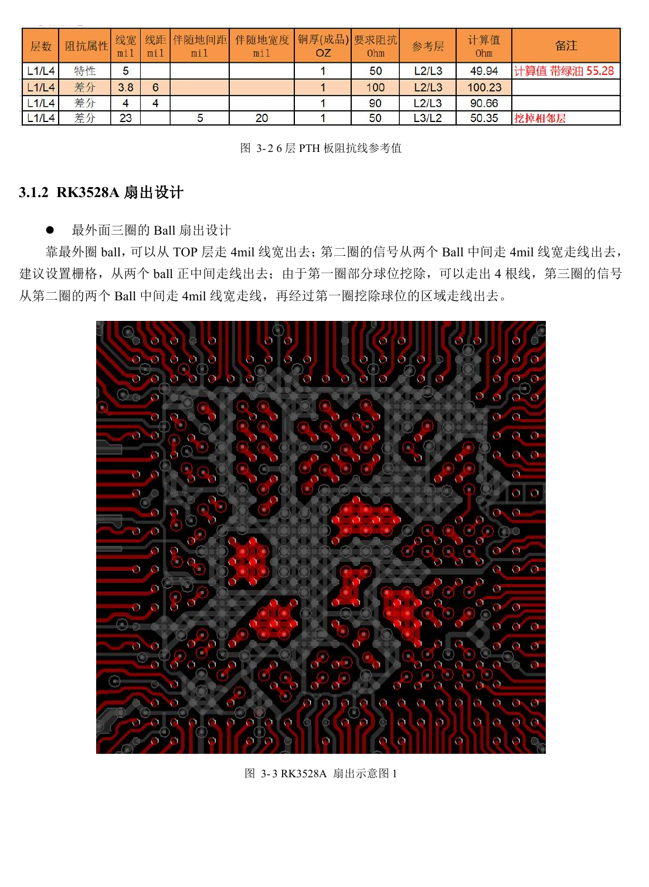

# RK3528 / RK3528A PCB 审查：叠层、扇出、回流与保护布局

本文是依据 RK3528 V1.0（2023-05-25）与 RK3528A V1.0（2023-07-12）中文硬件指南整理的工程专题，不是两本 PDF 的逐字全文翻译。两稿在所述章节高度相近，但并不据此保证芯片可直接替换。ArmSoM [Sige1](https://www.armsom.org/sige1) 的官方[板卡文档](https://docs.armsom.org/armsom-sige1)确认其采用 RK3528，可用于评估 RK3528 系列相关应用；这不表示 Sige1 使用 RK3528A，也不能据此将两款芯片的封装或电气设计直接互换。本文的芯片参考电路不等同于 Sige1 的实际原理图；引脚、封装、BSP/SDK、内核与板卡版本必须按实际产品核对。数值为原稿参考，未经 ArmSoM 硬件实测。

**§3.1–3.3.2; §5; PDF 88–126, 156–158**

## 先和板厂确定叠层

原稿正文明确采用 4 层 PTH，参考 TOP–GND–POWER–BOTTOM、1.6mm 板厚、1oz 铜；同页图 3-1 与下页图 3-2 却写“6 层”。这是原稿图题矛盾，不能用标题断定实际六层。改变介质或层数时，必须让板厂按实际材料重新算单端和差分阻抗。主芯片相邻层为地，信号层尽量邻地，电源与地相邻，层叠和铜分布保持对称。

## 扇出不能破坏回流

原稿最外三圈 BGA 示例使用 4mil 扇出线宽，并利用外圈空球区域逃线。这是与封装、焊盘和工艺关联的模板，不能将 4mil 当作全板通用线宽。高速信号跨参考平面分割、换层和过孔都会改变回流路径。对电源先审 DC 压降、载流与电容回路，再看局部线宽；对差分线先保留完整地，再处理等长和间距。连接器、滤波和 ESD 焊盘也必须纳入阻抗通道。

## ESD 和 EMI 不是最后加一个器件

接口防护靠近连接器，静电路径先经过 TVS，再到芯片；地焊盘缩短回路并补足过孔。Reset、时钟、中断等敏感信号距板边至少 5mm。时钟串阻靠源端，原稿要求芯片到串阻 <400mil；电源覆铜边沿建议按 20H 内缩，H 为电源与地间距。注意通用 ESD 章给板间串阻 2.2–10Ω，而具体接口章节有 22–100Ω：不能统一批量改值，应按接口波形、浪涌及误码结果选定。屏蔽罩与散热片也可能成为辐射结构，接地方案需要整机验证。

## 参考参数

| 项目 | 原稿值 |
| --- | --- |
| 参考叠层正文 | 4-layer PTH; 1.6mm; 1oz |
| 外圈扇出示例 | 4mil |
| 敏感线距板边 | ≥5mm |
| 时钟串阻源端距离 | <400mil |

## 原稿图示与位置

未提供对应英文原稿，四语均使用下列中文 PDF 原图，分别标注芯片和物理页码；不把 RK3528 原图冒充 RK3528A 图。

RK3528 · CN · PDF 88

RK3528 · CN · PDF 89

RK3528A · CN · PDF 88

RK3528A · CN · PDF 89

## 继续开发与资料入口

ArmSoM 产品选型应以产品文档为准；本系列不表示 ArmSoM 已提供 RK3528/RK3528A 板卡。已有 ArmSoM 板卡上的接口设计与软件经验可作为方法参考，不能直接套用本系列电压、引脚或 PCB 规则。

- [ArmSoM](https://www.armsom.org/) · [ArmSoM Docs](https://docs.armsom.org/)
- [RK3528 / RK3528A 硬件设计系列：9 个工程专题](/zh/articles/rk3528-rk3528a-hardware-design-series/)
- [RK3528 / RK3528A 网络与控制：RGMII 时序、PHY、UART、I2C 和 PWM](/zh/articles/rk3528-rk3528a-ethernet-control-interfaces/)
- [RK3528 / RK3528A 从热设计到量产：散热、回流焊与潮敏管理](/zh/articles/rk3528-rk3528a-thermal-assembly-storage/)
