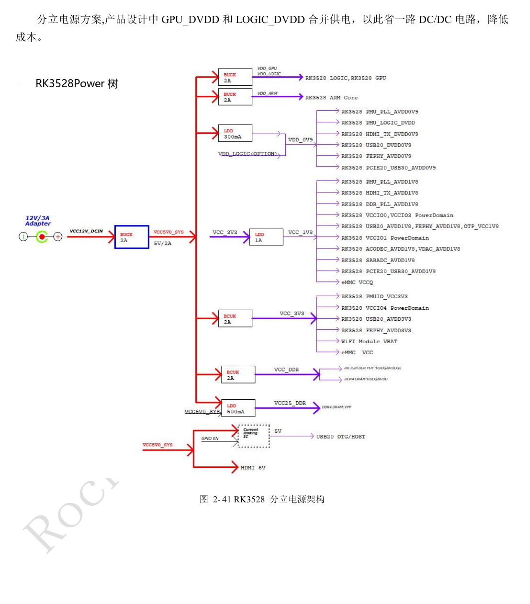
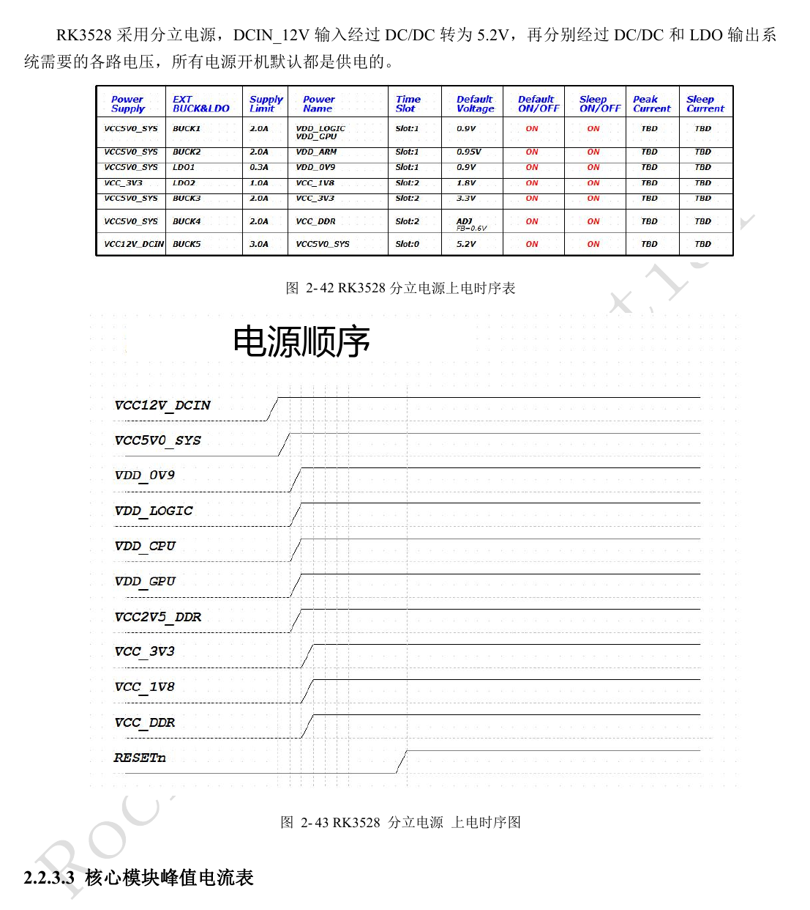
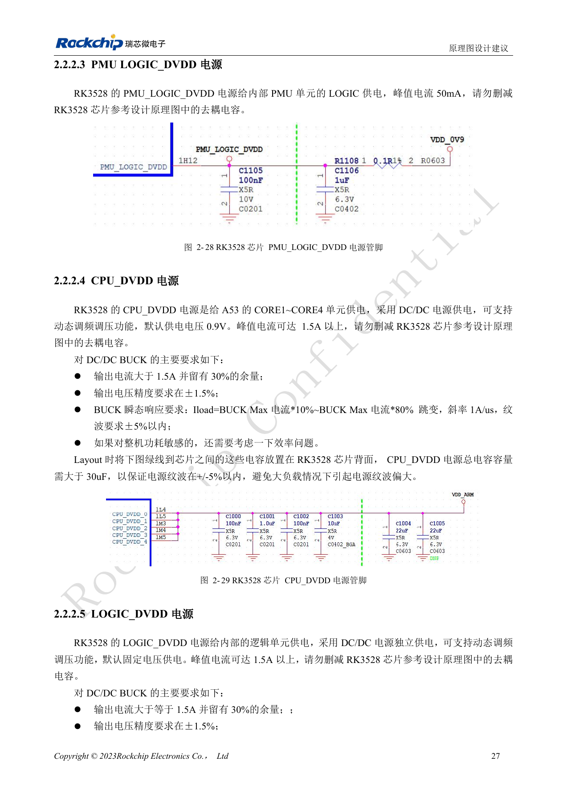
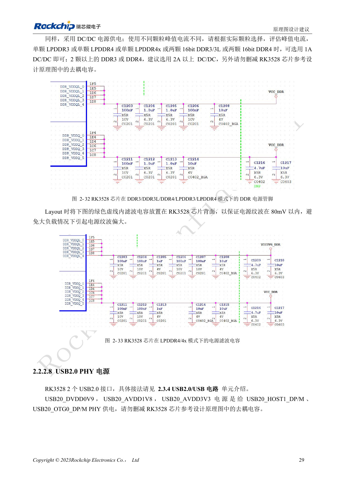
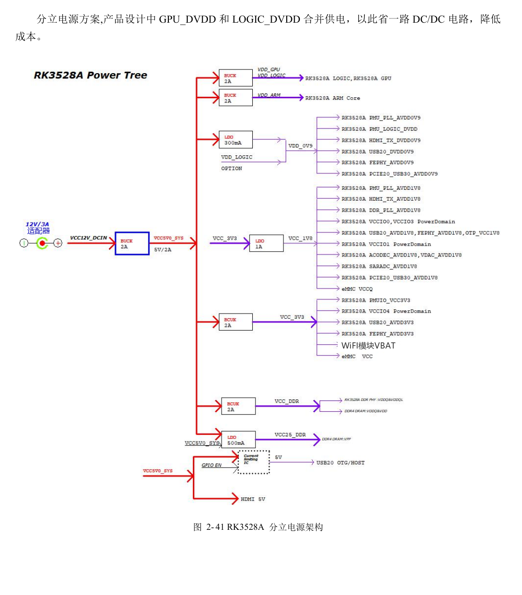
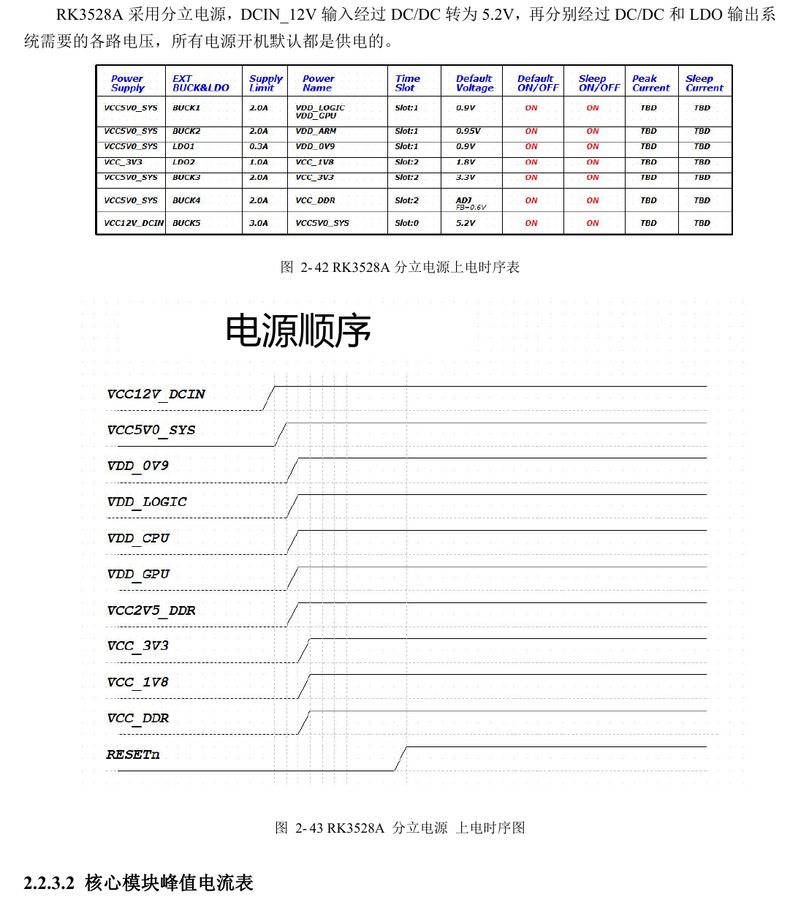
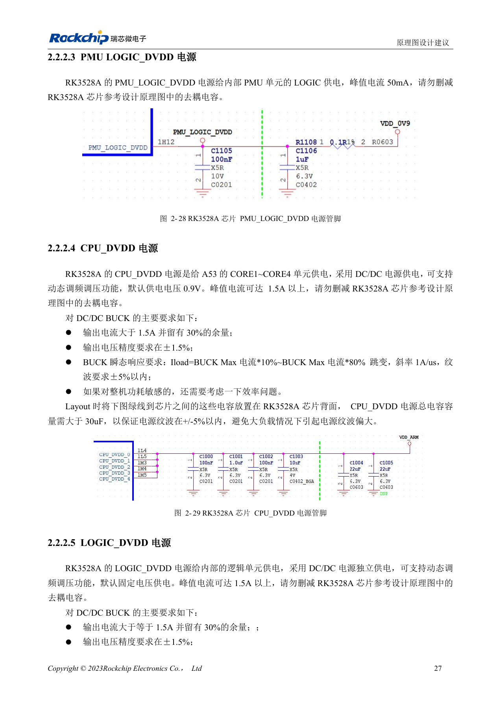

# RK3528 / RK3528A 电源设计：分立电源、时序与负载验证

本文是依据 RK3528 V1.0（2023-05-25）与 RK3528A V1.0（2023-07-12）中文硬件指南整理的工程专题，不是两本 PDF 的逐字全文翻译。两稿在所述章节高度相近，但并不据此保证芯片可直接替换。ArmSoM [Sige1](https://www.armsom.org/sige1) 的官方[板卡文档](https://docs.armsom.org/armsom-sige1)确认其采用 RK3528，可用于评估 RK3528 系列相关应用；这不表示 Sige1 使用 RK3528A，也不能据此将两款芯片的封装或电气设计直接互换。本文的芯片参考电路不等同于 Sige1 的实际原理图；引脚、封装、BSP/SDK、内核与板卡版本必须按实际产品核对。数值为原稿参考，未经 ArmSoM 硬件实测。

**§2.2; PDF 37–49; §3.3.2**

## 先做电源域清单

指南把 PLL、逻辑、CPU、GPU、DDR、IO 与模拟 PHY 分开说明。VCCIO0–4 可使用 1.8V 或 3.3V，硬件电压可自动识别；PMUIO 是固定电平域。这个能力不允许同一 IO 域内混接不同电平外设。先列出每个外设的供电、上拉、复位和掉电状态，避免外围器件先上电时经信号脚反向供电。

## 先稳定供电，再释放复位

同一模块先低压后高压，同电压一起上电。最后一路电压稳定后，RESETn 至少保持 10ms 才释放；下电时先拉低 RESETn，再撤销各路电源。原稿典型顺序包括 0.9V 组、1.8V 组、3.3V 组、DDR 与复位，实际分立电源的依赖关系须按图 2-41 至 2-43 检查。不能把“某域第一次上电可以不供电”理解为其外部引脚可以任意加电。

## 分立电源不能只看额定电流

参考方案合并 GPU_DVDD 与 LOGIC_DVDD 以减少一路 DC/DC；修改时需同时检查动态负载、压降和软件 DVFS。CPU 默认参考 0.9V，峰值电流可超过 1.5A。原稿要求 CPU 和 LOGIC 的总去耦各大于 30µF，电容靠近芯片并保留原有回路。PCIe2.0/USB3 Combo PHY 即使不用接口也必须供电，因为有内部 PLL 依赖。实验时测芯片端负载阶跃与上下电，而不只测电源模块输出端。

## 参考参数

| 项目 | 原稿值 |
| --- | --- |
| 复位保持 | ≥10ms |
| CPU 参考默认电压 | 0.9V |
| CPU / LOGIC 总去耦 | >30µF each |
| DDR 电源纹波参考 | <80mV |

## 首次上电电源表

原稿表 2-9，PDF 39。这里的“可以不供电”仅对应首次上电条件，不代表该模块工作时无需供电；休眠和掉电另行核对。

| 模块 | 电源管脚 | 首次上电要求 |
| --- | --- | --- |
| PLL | PMU_PLL_AVDD0V9, PMU_PLL_AVDD1V8 | 必须供电 |
| PMU_DVDD | PMU_LOGIC_DVDD | 必须供电 |
| DDR PLL | DDR_PLL_AVDD1V8 | 必须供电 |
| DDR VDDQ | DDR VDDQ | 必须供电 |
| DDR VDDQL | DDR VDDQL | 必须供电 |
| CPU | CPU_DVDD | 首次上电可不供电 |
| GPU | GPU_DVDD | 首次上电可不供电 |
| LOGIC | LOGIC_DVDD | 必须供电 |
| IO | VCCIO0_VCC, VCCIO2_VCC, VCCIO3_VCC, VCCIO4_VCC | 首次上电可不供电 |
| PMUIO | PMUIO_VCC3V3 | 必须供电 |
| EMMCIO | VCCIO1_VCC | 必须供电 |
| USB2.0 PHY | USB20_DVDD0V9, USB20_AVDD1V8, USB20_AVDD3V3 | 必须供电 |
| PCIe2.0 / USB3 Combo PHY | PCIE20_USB30_AVDD0V9, PCIE20_USB30_AVDD1V8 | 必须供电 |
| SARADC | SARADC_AVDD1V8 | 必须供电 |
| OTP | OTP_VCC1V8 | 必须供电 |
| HDMI TX PHY | HDMI_TX_DVDD0V9, HDMI_TX0_AVDD1V8 | 首次上电可不供电 |
| ACODEC PHY | ACODEC_AVDD1V8 | 首次上电可不供电 |
| VDAC PHY | VDAC_AVDD1V8 | 首次上电可不供电 |
| FEPHY | FEPHY_AVDD0V9, FEPHY_AVDD1V8, FEPHY_AVDD3V3 | 首次上电可不供电 |

### PLL

| 电源 | 峰值电流参考 | AC 参考要求 |
| --- | --- | --- |
| PMU_PLL_AVDD0V9 | 10mA | <20mV |
| PMU_PLL_AVDD1V8 | 10mA | <50mV |
| DDR_PLL_AVDD1V8 | 5mA | <50mV |

## 原稿图示与位置

未提供对应英文原稿，四语均使用下列中文 PDF 原图，分别标注芯片和物理页码；不把 RK3528 原图冒充 RK3528A 图。

RK3528 · CN · PDF 48

RK3528 · CN · PDF 49

RK3528 · CN · PDF 41

RK3528 · CN · PDF 43

RK3528A · CN · PDF 48

RK3528A · CN · PDF 49

RK3528A · CN · PDF 41

RK3528A · CN · PDF 43

## 继续开发与资料入口

ArmSoM 产品选型应以产品文档为准；本系列不表示 ArmSoM 已提供 RK3528/RK3528A 板卡。已有 ArmSoM 板卡上的接口设计与软件经验可作为方法参考，不能直接套用本系列电压、引脚或 PCB 规则。

- [ArmSoM](https://www.armsom.org/) · [ArmSoM Docs](https://docs.armsom.org/)
- [RK3528 / RK3528A 硬件设计系列：9 个工程专题](/zh/articles/rk3528-rk3528a-hardware-design-series/)
- [RK3528 / RK3528A 启动与调试：时钟、复位、Maskrom 和串口](/zh/articles/rk3528-rk3528a-boot-clock-debug/)
- [RK3528 / RK3528A DDR：拓扑、供电、交换限制与 PCB](/zh/articles/rk3528-rk3528a-ddr-circuit-routing/)
