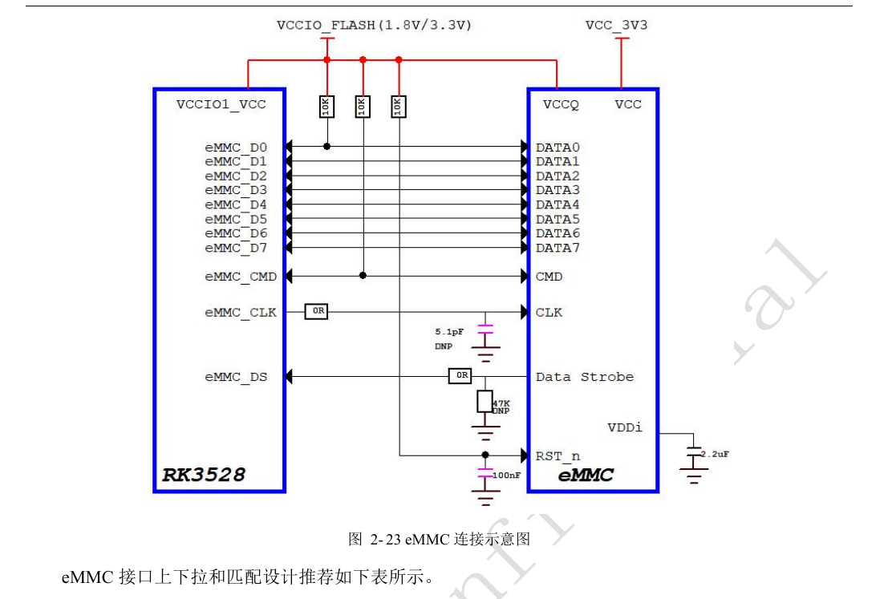
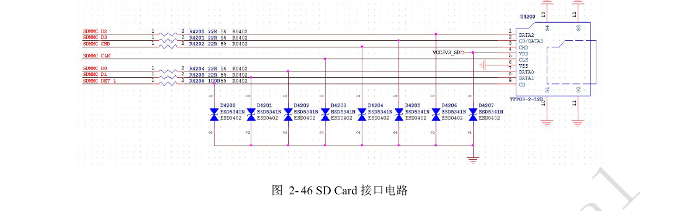
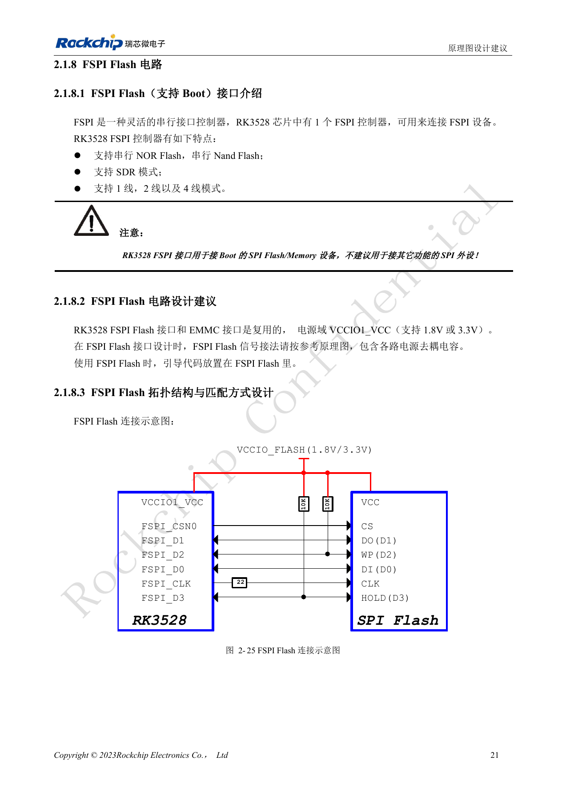
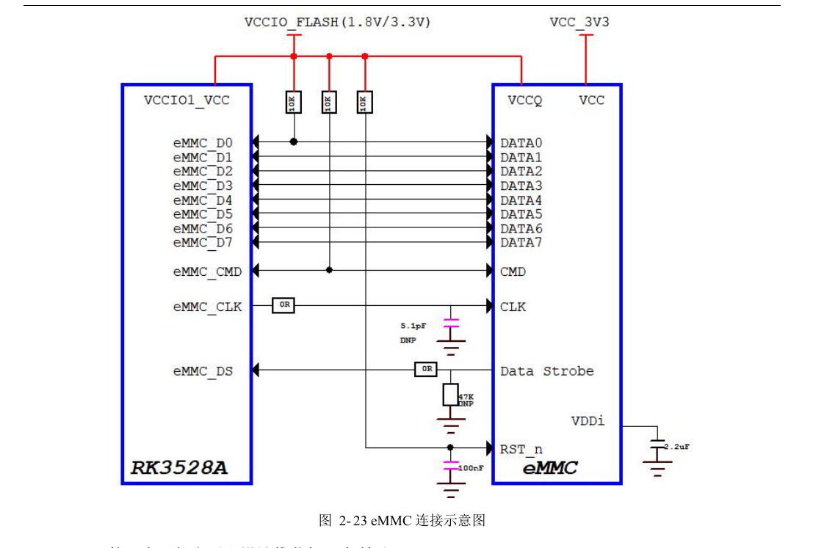
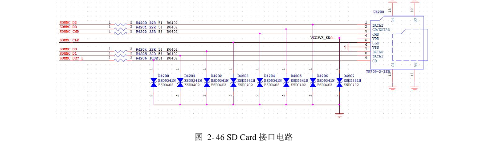
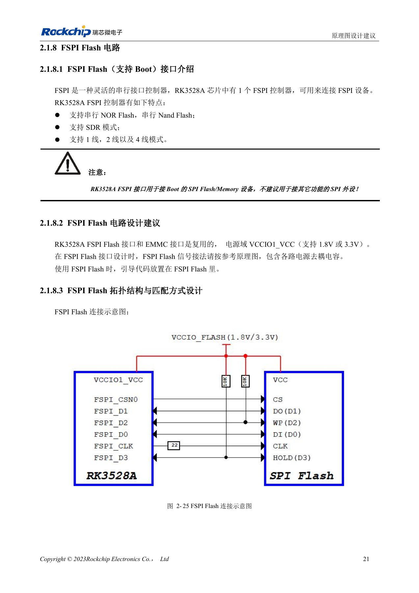

# RK3528 / RK3528A 存储与无线接口：eMMC、FSPI、SDMMC、SDIO

本文是依据 RK3528 V1.0（2023-05-25）与 RK3528A V1.0（2023-07-12）中文硬件指南整理的工程专题，不是两本 PDF 的逐字全文翻译。两稿在所述章节高度相近，但并不据此保证芯片可直接替换。ArmSoM [Sige1](https://www.armsom.org/sige1) 的官方[板卡文档](https://docs.armsom.org/armsom-sige1)确认其采用 RK3528，可用于评估 RK3528 系列相关应用；这不表示 Sige1 使用 RK3528A，也不能据此将两款芯片的封装或电气设计直接互换。本文的芯片参考电路不等同于 Sige1 的实际原理图；引脚、封装、BSP/SDK、内核与板卡版本必须按实际产品核对。数值为原稿参考，未经 ArmSoM 硬件实测。

**§2.1.7–2.1.8; §2.3.1; PDF 32–36, 50–54, 145–147**

## eMMC 与 FSPI 先做二选一规划

eMMC 与 FSPI 复用，属于 VCCIO1_VCC（1.8V/3.3V），不能当成两套无条件同时可用的接口。eMMC 支持 5.1、1/4/8bit 和 HS400，保留 CMD 与 D0 的外部 10kΩ 上拉，CLK 在 SoC 端串 22Ω，Strobe 在 eMMC 端串 0Ω 并预留 47kΩ 下拉。芯片 IO 供电只有一组，不等于 eMMC 颗粒的 VCC/VCCQ 没有时序要求。更换颗粒时还要核对支持列表和启动固件。

## FSPI 用于启动存储

FSPI 支持串行 NOR/NAND、SDR 和 1/2/4 线模式，指南不建议用它连接普通 SPI 外设。Flash 电源必须与对应 IO 域一致；D2、D3 预留外部 10kΩ 上拉，CLK 在 SoC 端串 22Ω。eMMC 走线参考为 50Ω±10%、CLK/STRB 对数据差 <120mil、长度 <3in、建议不超过两次过孔；FSPI 为 50Ω±10%、CLK 对数据差 <200mil、长度 <4in。将这些限制落实到总通道，包含连接器和子板。

## SDMMC 启动与 SDIO 无线分开

SDIO0/1 分属 VCCIO0/VCCIO3，不支持 System Boot；SDMMC 则还受 SDMMC_DET 的启动采样影响。SDMMC 数据、命令与时钟串 22Ω，DET 串 100Ω。SDIO 的 CLK 保留 22Ω，数据/命令的串阻可按短线信号质量决定。SDMMC/SDIO 布线为 50Ω±10%、时钟对数据 <120mil；50MHz<CLK≤200MHz 时长度 <4in，CLK≤50MHz 时 <6in。无线模组还要核对 UART/PCM 方向、32.768kHz 幅度和天线匹配；天线区域不能随意覆铜或走线。

## eMMC 原图与表格的串阻差异

PDF 第 33 页图 2-23 的 CLK 串阻写 0Ω，而同页表 2-5 推荐 22Ω。正文保留表格推荐值，图片保留原样；实际选贴须结合所用颗粒、BSP 与示波器波形验证，不能静默将原图改成一致。

## 参考参数

| 项目 | 原稿值 |
| --- | --- |
| eMMC 长度 | <3in |
| FSPI 长度 | <4in |
| eMMC CMD / D0 上拉 | 10kΩ |
| SDIO 启动 | 不支持 |

## 原稿图示与位置

未提供对应英文原稿，四语均使用下列中文 PDF 原图，分别标注芯片和物理页码；不把 RK3528 原图冒充 RK3528A 图。

RK3528 · CN · PDF 33

RK3528 · CN · PDF 52

RK3528 · CN · PDF 35

RK3528A · CN · PDF 33

RK3528A · CN · PDF 52

RK3528A · CN · PDF 35

## 继续开发与资料入口

ArmSoM 产品选型应以产品文档为准；本系列不表示 ArmSoM 已提供 RK3528/RK3528A 板卡。已有 ArmSoM 板卡上的接口设计与软件经验可作为方法参考，不能直接套用本系列电压、引脚或 PCB 规则。

- [ArmSoM](https://www.armsom.org/) · [ArmSoM Docs](https://docs.armsom.org/)
- [RK3528 / RK3528A 硬件设计系列：9 个工程专题](/zh/articles/rk3528-rk3528a-hardware-design-series/)
- [RK3528 / RK3528A DDR：拓扑、供电、交换限制与 PCB](/zh/articles/rk3528-rk3528a-ddr-circuit-routing/)
- [RK3528 / RK3528A USB 与 PCIe：共享 PHY 和高速通道审查](/zh/articles/rk3528-rk3528a-usb-pcie-design/)
