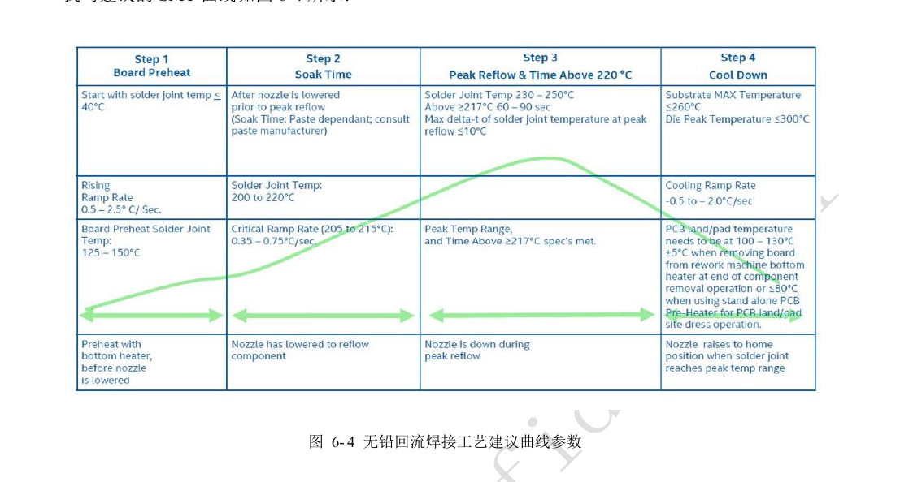
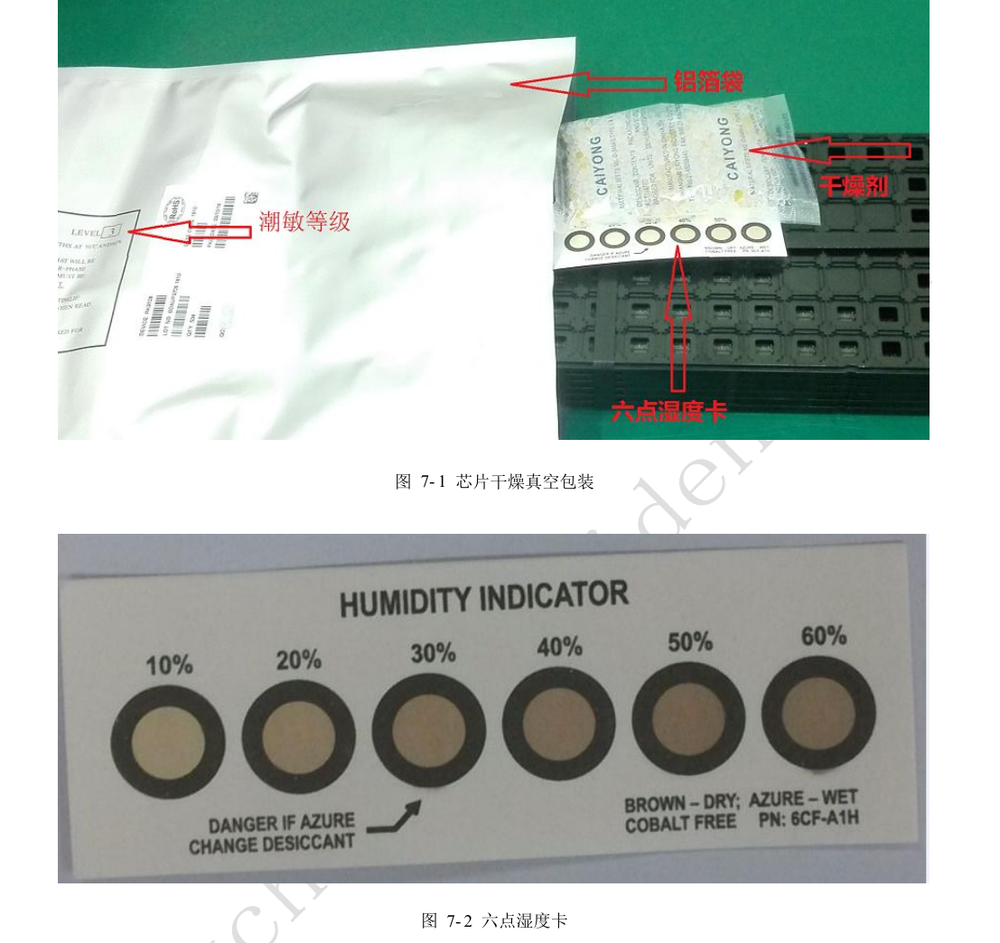
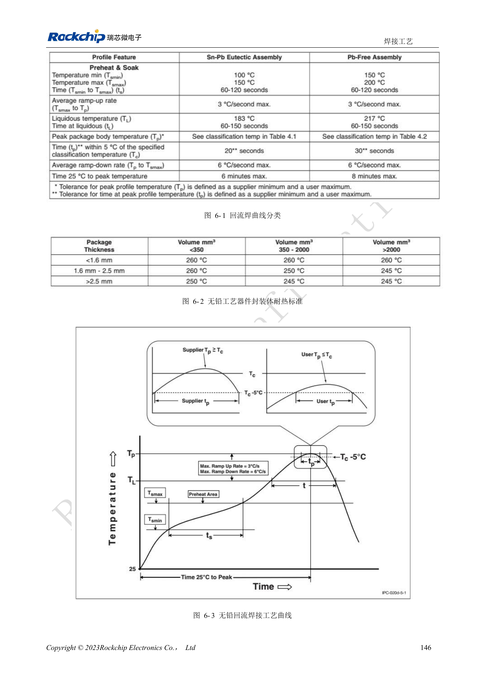

# RK3528 / RK3528A 从热设计到量产：散热、回流焊与潮敏管理

本文是依据 RK3528 V1.0（2023-05-25）与 RK3528A V1.0（2023-07-12）中文硬件指南整理的工程专题，不是两本 PDF 的逐字全文翻译。两稿在所述章节高度相近，但并不据此保证芯片可直接替换。ArmSoM [Sige1](https://www.armsom.org/sige1) 的官方[板卡文档](https://docs.armsom.org/armsom-sige1)确认其采用 RK3528，可用于评估 RK3528 系列相关应用；这不表示 Sige1 使用 RK3528A，也不能据此将两款芯片的封装或电气设计直接互换。本文的芯片参考电路不等同于 Sige1 的实际原理图；引脚、封装、BSP/SDK、内核与板卡版本必须按实际产品核对。数值为原稿参考，未经 ArmSoM 硬件实测。

**§4, §6–7; PDF 152–164**

## 热阻仿真不是 ArmSoM 实测

原稿以 140×180mm、1.6mm、4 层 JEDEC PCB 进行无散热片 FEM 仿真。实际机壳、铜面积、空气流动与工作负载都不同，不能将仿真热阻直接变成实际结温或宣称持续性能。Linux 温控章节列 Power allocator、Step wise、Fair share、Userspace，默认采用 Power_allocator。温控阈值、降频与恢复应按实际 BSP 配置确认，并记录满载频率、环境温度和热点，不只记录一次温度截图。

## 布局与工艺同时影响可靠性

指南建议 SoC 与 DC/DC 相隔约 20–50mm，避免局部集中发热；大电流电源走线和铜皮满足载流，地球位尽量各有地过孔，最低参考为每 1.5 个 ball 对应一个过孔。回流焊曲线是原厂工艺参考，需按实物热容量、炉温和焊膏调整。锡膏原稿要求冷藏 2–10℃、使用前回温 3–4h；手工搅拌 3–5min 或机械 3min。不能把这些参考值当作所有锡膏品牌的通用放行条件，生产记录应对应实际材料与工艺卡。

## MSL3 以累计暴露时间管理

两稿均将芯片列为 MSL3。拆袋到回流焊的累计暴露时间为 168h，环境 ≤30℃/60%RH；原稿还给出 <10%RH 的干燥保存条件。真空包装参考保存环境 ≤40℃、<90%RH，期限 12 个月。超期或湿度卡异常时按原稿 re-bake 表及包装标签处理。表中 MSL1 出现“≤300℃”明显异常，此处保留在审校记录，不把它用于存储指引。下表是原稿厚度 ≤1.4mm、MSL3 的最小烘烤参考，不适用于任意整板或电池组件。

## 参考参数

| 项目 | 原稿值 |
| --- | --- |
| 烘烤 125℃ +10/−0℃：超期 >72h / ≤72h | 9h / 7h |
| 烘烤 90℃ +8/−0℃：超期 >72h / ≤72h | 33h / 23h |
| 烘烤 40℃ +5/−0℃：超期 >72h / ≤72h | 13 天 / 9 天 |

## 原稿图示与位置

未提供对应英文原稿，四语均使用下列中文 PDF 原图，分别标注芯片和物理页码；不把 RK3528 原图冒充 RK3528A 图。

RK3528 · CN · PDF 161

RK3528 · CN · PDF 163

RK3528 · CN · PDF 160

RK3528A · CN · PDF 161

RK3528A · CN · PDF 163

RK3528A · CN · PDF 160

## 继续开发与资料入口

ArmSoM 产品选型应以产品文档为准；本系列不表示 ArmSoM 已提供 RK3528/RK3528A 板卡。已有 ArmSoM 板卡上的接口设计与软件经验可作为方法参考，不能直接套用本系列电压、引脚或 PCB 规则。

- [ArmSoM](https://www.armsom.org/) · [ArmSoM Docs](https://docs.armsom.org/)
- [RK3528 / RK3528A 硬件设计系列：9 个工程专题](/zh/articles/rk3528-rk3528a-hardware-design-series/)
- [RK3528 / RK3528A PCB 审查：叠层、扇出、回流与保护布局](/zh/articles/rk3528-rk3528a-pcb-stackup-signal-integrity/)
