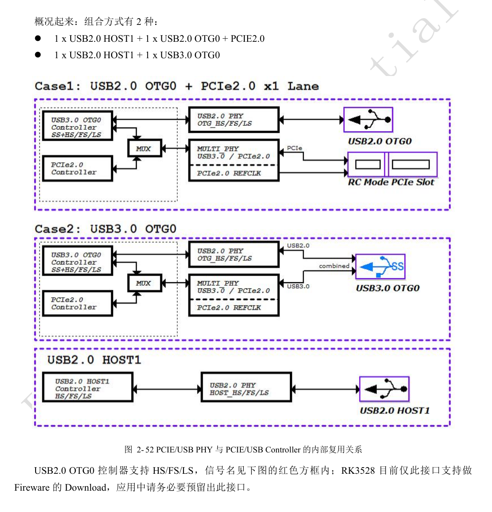
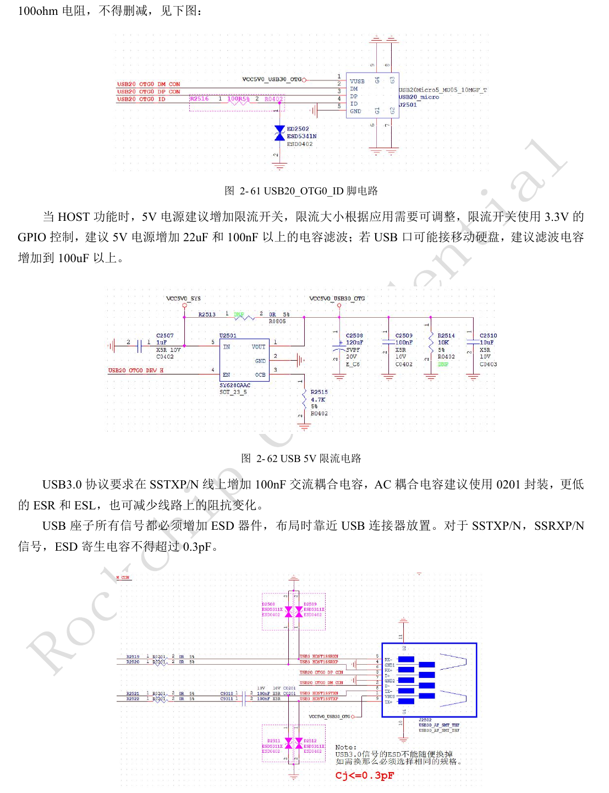
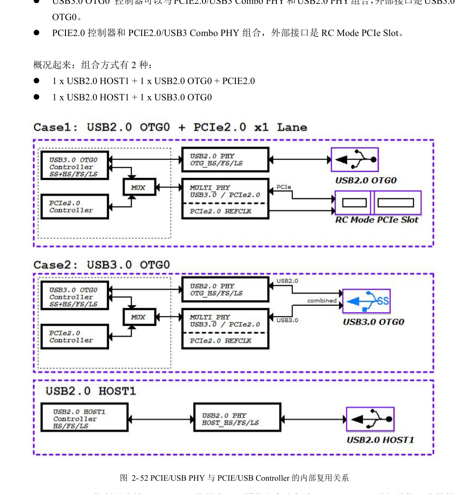
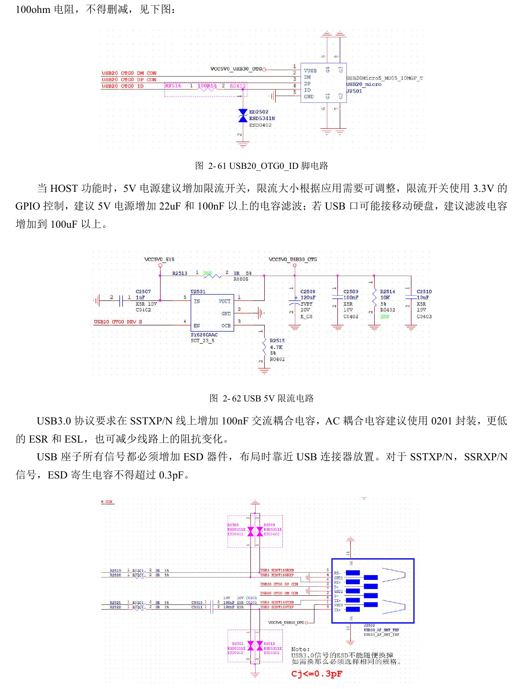
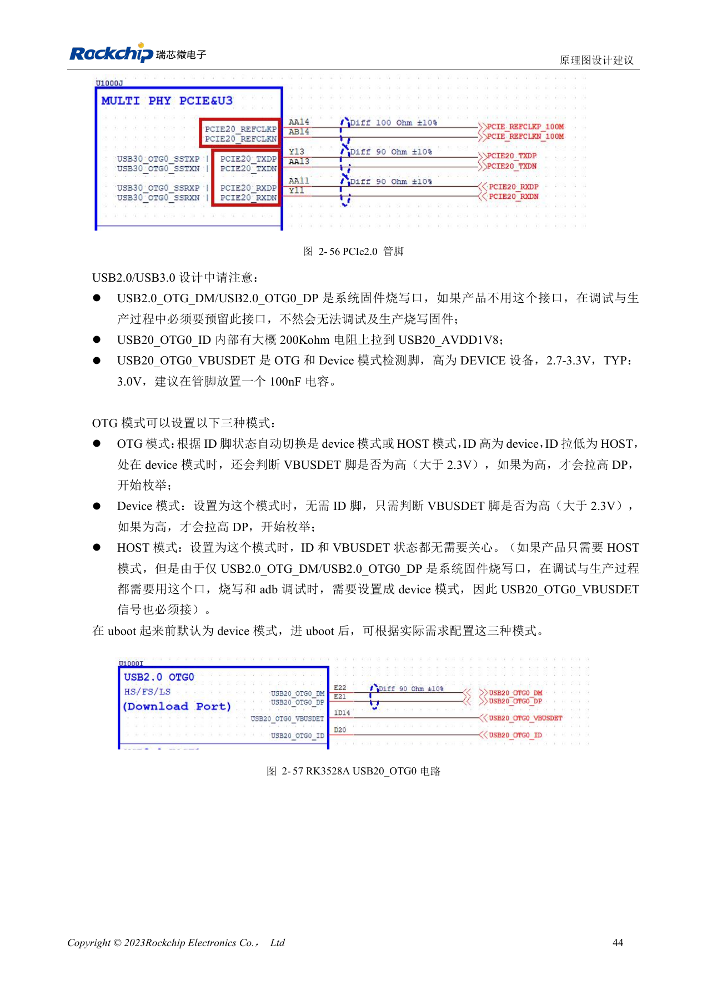

# RK3528 / RK3528A USB 与 PCIe：共享 PHY 和高速通道审查

本文是依据 RK3528 V1.0（2023-05-25）与 RK3528A V1.0（2023-07-12）中文硬件指南整理的工程专题，不是两本 PDF 的逐字全文翻译。两稿在所述章节高度相近，但并不据此保证芯片可直接替换。ArmSoM [Sige1](https://www.armsom.org/sige1) 的官方[板卡文档](https://docs.armsom.org/armsom-sige1)确认其采用 RK3528，可用于评估 RK3528 系列相关应用；这不表示 Sige1 使用 RK3528A，也不能据此将两款芯片的封装或电气设计直接互换。本文的芯片参考电路不等同于 Sige1 的实际原理图；引脚、封装、BSP/SDK、内核与板卡版本必须按实际产品核对。数值为原稿参考，未经 ArmSoM 硬件实测。

**§2.3.4; PDF 55–61, 141–145**

## 先确定组合，再画连接器

两个 USB2 PHY 与一个 PCIe2.0/USB3 Combo PHY 不等于所有接口可同时工作。指南列两种组合：USB2 HOST1 + USB2 OTG0 + PCIe2.0，或 USB2 HOST1 + USB3 OTG0。PCIe 为 RC 模式。USB2 OTG0 是固件下载通道，即使产品不用 USB，也必须给生产与调试保留 D+/D− 和 VBUSDET。固件、设备树与硬件选路应使用同一资源表。

## 供电、终端和防护共同检查

USB HOST 5V 建议限流开关，并配置至少 22µF 与 100nF 滤波；可能接移动硬盘时，指南建议大于 100µF，再按实际浪涌和开关能力验证。USB2 数据串 2.2Ω；USB3 TX 串 100nF、推荐 0201，RX 预留 0Ω。OTG ID 使用时串 100Ω 并加 ESD，不能只保留 D+/D−。USB3 的 ESD 电容在电路章写 ≤0.3pF，而 PCB 表写 ≤0.2pF：这里并列保留，审查按较严格预算并做实测，不把任何器件直接写成已合格。

## 把 PCB 数值转换成约束

PCIe 数据为差分 90Ω±10%，对内差 <6mil，长度 <6in，REFCLK 为 100Ω±10%、对内差 <12mil，建议过孔不超过两个。USB3 为 90Ω±10%、对内差 <6mil，HOST <6in，Device/OTG <5in，建议最多两个过孔；USB2 为 90Ω±10%、对内差 <20mil、长度 <6in，建议最多四个过孔且不得超过六个。PCIe 表把“对间等长”写成 <6in，缺少有效匹配解释，不能当作精确时序容差。包地每 ≤300mil 设地过孔，并保持完整参考地。

## 参考参数

| 项目 | 原稿值 |
| --- | --- |
| USB3 / PCIe 数据阻抗 | 90Ω ±10% |
| PCIe REFCLK 阻抗 | 100Ω ±10% |
| USB3 ESD：两处原值 | ≤0.3pF / ≤0.2pF |

## 原稿图示与位置

未提供对应英文原稿，四语均使用下列中文 PDF 原图，分别标注芯片和物理页码；不把 RK3528 原图冒充 RK3528A 图。

RK3528 · CN · PDF 56

RK3528 · CN · PDF 60

RK3528 · CN · PDF 58

RK3528A · CN · PDF 56

RK3528A · CN · PDF 60

RK3528A · CN · PDF 58

## 继续开发与资料入口

ArmSoM 产品选型应以产品文档为准；本系列不表示 ArmSoM 已提供 RK3528/RK3528A 板卡。已有 ArmSoM 板卡上的接口设计与软件经验可作为方法参考，不能直接套用本系列电压、引脚或 PCB 规则。

- [ArmSoM](https://www.armsom.org/) · [ArmSoM Docs](https://docs.armsom.org/)
- [RK3528 / RK3528A 硬件设计系列：9 个工程专题](/zh/articles/rk3528-rk3528a-hardware-design-series/)
- [RK3528 / RK3528A 存储与无线接口：eMMC、FSPI、SDMMC、SDIO](/zh/articles/rk3528-rk3528a-storage-sdio-design/)
- [RK3528 / RK3528A 显示与音频：HDMI、CVBS、TSI 和模拟布局](/zh/articles/rk3528-rk3528a-display-audio-design/)
