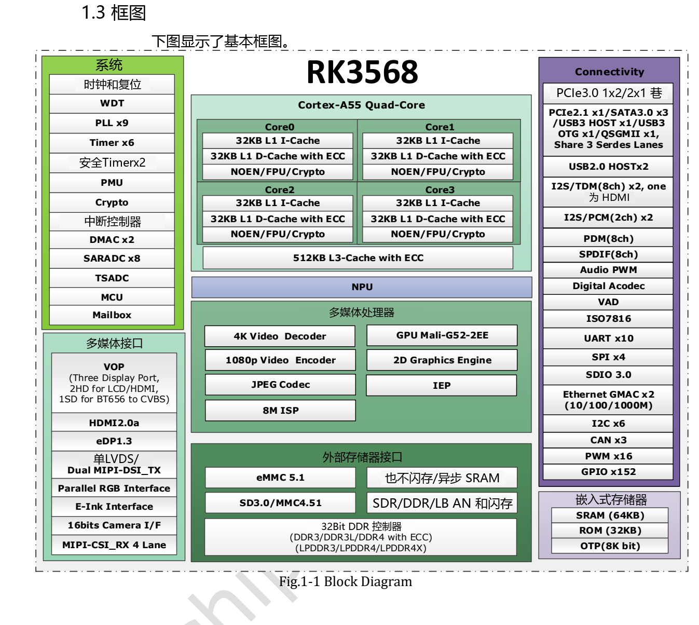

本文基于指定版本数据手册整理。表中数值是原厂规格，不是 ArmSoM 实测；未新增硬件验证。使用前核对实际芯片版本、板卡原理图、SDK/BSP、内核和驱动。专题解释与可编辑表格用于辅助阅读，完整规范及未展开的位定义请查阅原始 PDF。

**RK3568 · Rockchip RK3568 Datasheet V1.2-20210601.pdf · PDF 7–19.**

*英文原图，来源 PDF 第 19.*

## 计算、内存与启动

CPU、GPU、NPU 是不同资源。NPU 规格不能直接换算为模型帧率；Sige3 部署仍需要模型转换、驱动及带宽验证。最大 DDR 容量不代表板卡实装配置。

| 项目 | 规格／原稿说明 |
|---|---|
| CPU | 4 × Cortex-A55 · Armv8-A · NEON |
| GPU | Mali-G52 · 1 core / 2 execution engines |
| NPU | 1 TOPS · INT8/INT16/FP16/BFP16 |
| DDR | 32 bit · ≤8 GB |
| DDR3/DDR3L/LPDDR3 | ≤2133 Mbit/s |
| DDR4/LPDDR4/LPDDR4X | ≤3200 Mbit/s |
| Ranks | DDR3/DDR3L/DDR4: 2; LPDDR3/LPDDR4/LPDDR4X: 4 |
| ECC | 8 bit · DDR3/DDR3L/DDR4 |
| eMMC | 5.1 · HS200 · command queue · 1/4/8 bit |
| NAND | 8 bit · 4 banks · ECC 70 bit / 1 KB · DDR clock ≤75 MHz |
| FSPI | 1/2/4 bit SDR · serial NOR/NAND/pSRAM/SRAM |
| SRAM | 64 KB + PMU 8 KB |

## 编解码与图像链路

| 项目 | 规格／原稿说明 |
|---|---|
| 解码 | H.265 Main10 YUV420 / H.264 Main10 YUV400/420/422 / VP9 Profile 0/2: 4096×2304 @60 |
| 其他解码 | VP8/VC-1/MPEG-4/2/1: 1920×1088 @60; H.263: 720×576 @60 |
| 编码 | H.264 BP/MP/HP L4.2: 1920×1080 @60; H.265 MP L4.1: 1920×1080 @60 or 4096×4096 @10 (tile) |
| JPEG | Decode ≤8176×8176 / 76 Mpixel/s; encode ≤8192×8192 / 90 Mpixel/s |
| RGA | Input ≤8192×8192; output ≤4096×4096; scaling 1/16–16; rotation/mirror |
| MIPI CSI | 1 × 4 lanes or 2 × 2 lanes · ≤2.5 Gbit/s per lane |
| DVP | 8/10/12/16 bit · ≤150 MHz |
| ISP | ≤4096×2304; two-frame HDR |
| VICAP | 4 IDs; crop; NV16/NV12 |

## 三路显示的组合边界

三个输出有不同上限，不能都按最高一路计算。启用双 MIPI 时 LVDS 不可用，必须一并核对 VOP 路由、像素时钟、引脚复用和软件支持。

| 项目 | 规格／原稿说明 |
|---|---|
| VOP | 2 cluster + 2 esmart + 2 smart; 4096×2304 / 2048×1536 / 1920×1080 @60 |
| HDMI | 1080p120 or 4096×2304 @60 · ≤10 bit · HDCP 1.4/2.2 |
| eDP | 1.3 · 4 lanes × 2.7 Gbit/s · 2560×1600 @60 · PSR |
| MIPI DSI | 2 × 4 lanes · ≤2.5 Gbit/s per lane; single 1080p60 / dual 2560×1440 @60 |
| RGB/BT.1120 | 1920×1080 @60 · ≤150 MHz |
| EBC | ≤2200×1650 · 16 bit · 16 gray levels · ≤256 frames per scan |

## 共享 PHY 与独立 PCIe 3.0

每个共享 PHY 选择一项功能。独立 PCIe 3.0 两条 lane 可作为一组 x2 或两组 x1，不能再相加。板卡未布线的芯片资源不能靠软件变成连接器。

| 项目 | 规格／原稿说明 |
|---|---|
| Multi-PHY0 | USB 3.0 OTG / SATA0 |
| Multi-PHY1 | USB 3.0 Host / SATA1 / QSGMII-SGMII |
| Multi-PHY2 | PCIe 2.1 / SATA2 / QSGMII-SGMII |
| PCIe 3.0 | 2 lanes · 2.5/5/8 Gbit/s; x2: RC/EP; x1 controller: RC |
| SATA | 3 controllers · 1.5/3/6 Gbit/s · AHCI 1.3.1 |
| QSGMII | 1 PCS; only 2 GMII controllers |
| Ethernet | 2 MAC · RGMII 10/100/1000 or RMII 10/100 |
| USB 2.0 Host | 2 · 480/12/1.5 Mbit/s |

## 控制、音频与采样

| 项目 | 规格／原稿说明 |
|---|---|
| SPI | 4 controllers |
| I2C | 6 · 7/10-bit address · 100/400 kbit/s / 1 Mbit/s |
| UART | 10 · TX/RX FIFO 64 bytes · ≤4 Mbit/s; flow control UART0/1/3/4/5 |
| PWM | 16 × 32 bit; IR PWM3/7/11/15 |
| SARADC | 10 bit · 8 inputs · ≤1 MS/s |
| TSADC | 2 channels · ≤50 kS/s · −20…120 °C |
| OTP | 8 Kbit; 7 Kbit secure |
| I2S0/1 | 8 channels; I2S0 HDMI / I2S1 external |
| I2S2/3 | 2 channels |
| I2S | 16–32 bit · ≤192 kHz |
| PDM | 8 channels · 16–24 bit · ≤192 kHz |
| VAD | I2S/PDM input; amplitude detection; multi-mic storage |

## 原稿疑点与项目检查

先分配内存与 PHY，再检查连接器，最后验证实际负载。原稿内存标题提及 LPDDR2，但后续支持列表未列出，因此不作为确认支持。PCIe 2.1 段的 Base Specification 3.0 引用不代表该 x1 PHY 支持 8 Gbit/s。CPU/GPU 最大频率在电气表仍为 TBD，应按实际 SKU 和 BSP 核实。

## ArmSoM 产品与应用边界

Sige3 采用 RK3568B2。本文对应 RK3568 V1.2 通用数据手册，不能代替 B2 订货型号、板卡版本及实际接口检查。

- [Sige3](https://www.armsom.org/sige3) · [Docs](https://docs.armsom.org/armsom-sige3)

## 数据手册专题与原始 PDF

- [RK3568 总览](/zh/articles/rk3568-datasheet-v12/)
- [RK3568 封装与引脚：636 球完整编号表](/zh/articles/rk3568-package-pin-reference/)
- [RK3568 架构与接口规划：DDR、三屏和 PCIe/SATA/USB 复用](/zh/articles/rk3568-architecture-phy-resource-planning/)
- [RK3568 电气与热设计：电源、I/O 和热阻](/zh/articles/rk3568-electrical-power-thermal/)
- [下载完整原始 PDF](/assets/datasheet-series-20261110/Rockchip-RK3568-Datasheet-V1.2-20210601.pdf)
