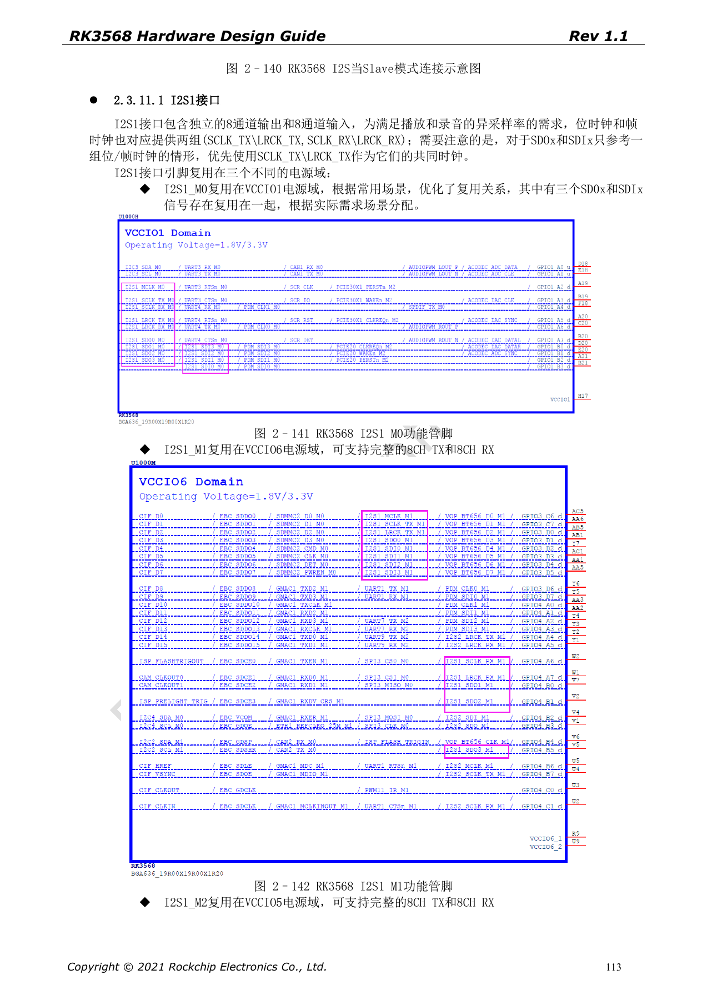
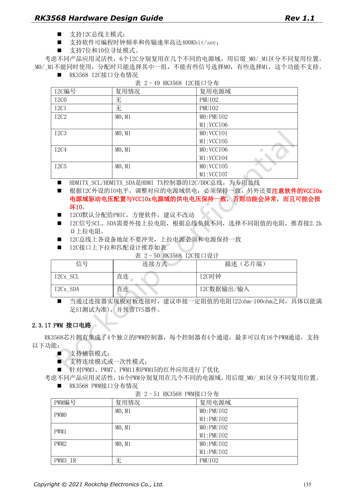

# RK3568 音频与控制接口：I2S、UART、SPI、CAN 和 I2C

本系列依据 RK3568 Hardware Design Guide V1.1（中文，2021-06-08）及独立的 High Speed PCB Design Guide V1.0.0（英文，2021-04-12），围绕具体工程问题重组。ArmSoM [Sige3](https://www.armsom.org/sige3) 采用 RK3568B2，可结合其[板卡文档](https://docs.armsom.org/armsom-sige3)学习与评估本系列设计问题。芯片级参考电路不等同于 Sige3 的实际原理图或全部引出接口；SDK/BSP、内核、硅版本、固件与外设组合须逐项核对。数值是原稿参考，未经 ArmSoM 硬件验证。

**CN V1.1 §2.3.11; §2.3.13–2.3.17 · PDF 111–125,132–137**

## 内部音频不能当外部针脚使用

四个 I2S 控制器中，I2S0 在芯片内部连接 HDMI2.0 TX PHY，没有复用到外部 IO。I2S1 是 8 TX + 8 RX，支持 I2S/PCM/TDM；I2S2、I2S3 各为 2 TX + 2 RX，支持 I2S/PCM。原稿列 16–32-bit、最高 192kHz 和 master/slave，但同一控制器的这些协议模式不能同时使用。Codec 的主从关系、MCLK/BCLK/LRCK、模拟供电和电平必须一并确定。

## 复用组必须整体选择

UART、SPI、CAN 等信号的 M0/M1/M2 是同一功能的不同位置，不能把 TX_M0 与 RX_M1 拼成接口。原稿列 10 UART、4 通用 SPI、3 CAN、6 I2C 和最多 16 PWM；这些是控制器能力，不代表某款板卡引出了全部端口。GPIO 后缀 _u/_d/_z 分别指默认上拉/下拉/高阻，复位状态和外设上电状态也必须审查。

## I2C、SPI 与跨板连接

I2C0 默认留给 PMIC；SCL/SDA 推荐 2.2kΩ 上拉，但实际阻值需根据总线负载核对，上拉电源匹配 IO 域。各器件地址不得冲突，HDMI DDC 为专用总线。通用 SPI 的 CLK 参考串 22Ω，支持 4/8/16-bit、主从与全/半双工。板间连接需把串阻、TVS、接地与线缆一起验证，不能直接拿芯片 IO 接工业现场电平。

## CAN 速率表述需要核对

第 134 页同时写 CAN 2.0B 与 1Mbps、8Mbps，未明确区分协议模式和速率阶段。本篇不据此宣称经典 CAN 以 8Mbps 运行，也不自动补写已验证 CAN FD。实际使用需按芯片 TRM、控制器驱动、收发器能力及总线配置核对。PWM 红外应用还要检查待机时所选 IO 域能否保持供电与唤醒。

## 原稿参数与约束

| 项目 | 原稿参考 |
| --- | --- |
| I2S0 | internal HDMI |
| I2S1 | 8 TX + 8 RX |
| I2S2 / I2S3 | 2 TX + 2 RX each |
| I2C | ≤400Kbit/sec; 7-bit / 10-bit |
| SPI | 4 / 8 / 16-bit; CLK 22Ω |

## 原稿配图

下列为原稿页面截图，供核对电路、图例与上下文，正文及参数表保留为可编辑文字。中文主指南没有对应英文整稿，因此其截图在四语中均保留中文；独立英文 PCB 稿的截图明确标为英文来源。PDF 页码均为物理页码。

中文硬件设计指南 · PDF 113

中文硬件设计指南 · PDF 135

## 继续阅读与开发资料

- [RK3568 硬件设计系列：10 个电路、PCB 与量产主题](/zh/articles/rk3568-hardware-design-series/)
- [RK3568 显示与摄像头：VOP、MIPI、HDMI 与供电](/zh/articles/rk3568-display-camera-hardware/)
- [RK3568 PCB 设计：叠层、扇出、回流与接口约束](/zh/articles/rk3568-pcb-stackup-return-path-design/)
- [ArmSoM Docs](https://docs.armsom.org/)
- [ArmSoM](https://www.armsom.org/)
