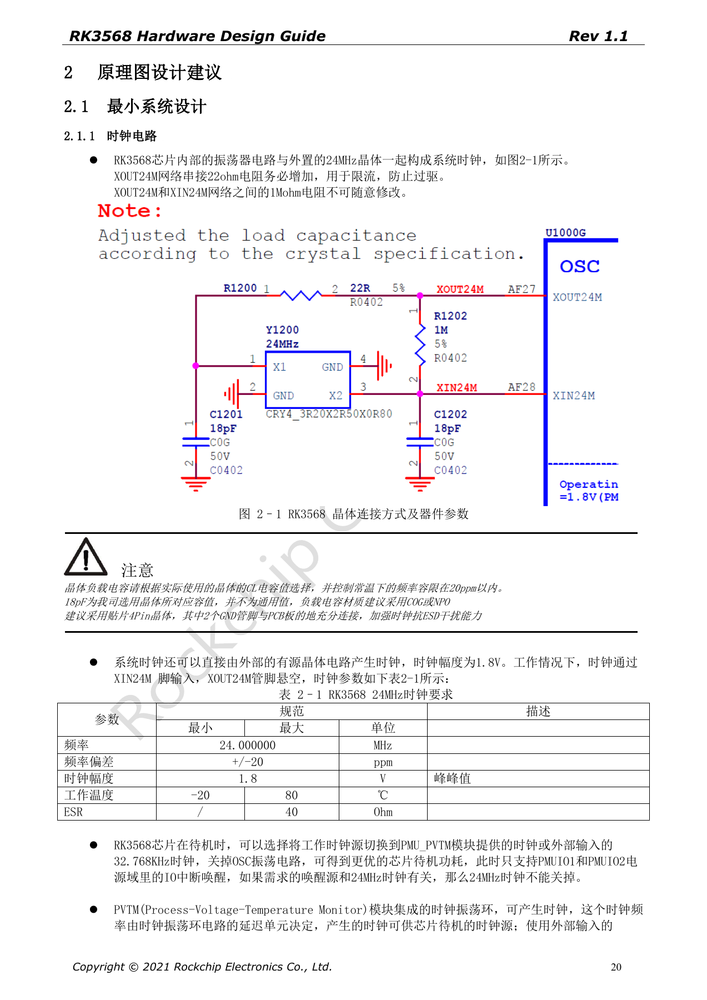
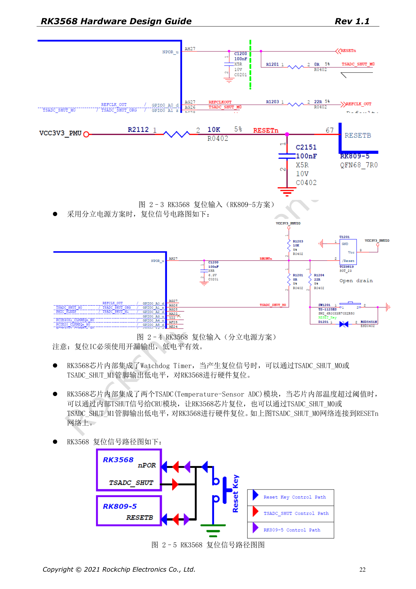

# RK3568 最小系统：时钟、复位、启动与调试

本系列依据 RK3568 Hardware Design Guide V1.1（中文，2021-06-08）及独立的 High Speed PCB Design Guide V1.0.0（英文，2021-04-12），围绕具体工程问题重组。ArmSoM [Sige3](https://www.armsom.org/sige3) 采用 RK3568B2，可结合其[板卡文档](https://docs.armsom.org/armsom-sige3)学习与评估本系列设计问题。芯片级参考电路不等同于 Sige3 的实际原理图或全部引出接口；SDK/BSP、内核、硅版本、固件与外设组合须逐项核对。数值是原稿参考，未经 ArmSoM 硬件验证。

**CN V1.1 §2.1.1–2.1.6; §2.3.2; §3.2.1 · PDF 20–25, 72, 141–142**

## 先建立可恢复的最小系统

把 24MHz、复位、电源、启动存储、下载 USB 和调试串口作为一条链路审查。原稿的自动启动顺序为 Serial NOR（FSPI）、Serial NAND（FSPI）、NAND、eMMC、SDMMC0。都没有有效引导代码时，可通过 USB3_OTG0_DP/DM 下载；必须同时保留 VBUSDET。产品不用 USB 数据口，也应为生产与恢复保留该路径。

## 晶体负载不能照抄

XOUT24M 串联 22Ω 用于限流，XOUT24M/XIN24M 之间为 1MΩ。原图的 18pF 是参考晶体配套值，需根据实际 CL 和寄生选择，建议 C0G/NP0。外部有源时钟为 1.8V，经 XIN24M 输入，XOUT24M 悬空。晶体尽量与 SoC 同面靠近，邻层地连续，禁止其他信号穿越晶体与时钟线投影区域；包地过孔间隔参考 200–300mil。

## 复位与配置脚要在启动前稳定

NPOR 位于 AH27，低有效，靠近引脚保留 100nF；复位上拉必须匹配 PMUIO1，外部复位 IC 用开漏输出。原稿写“100 个 24MHz 周期，即至少 4µs”，100/24MHz 实为约 4.17µs；设计应满足周期要求，不能向下取整。VCCIO2=1.8V 时 FLASH_VOL_SEL=1，3.3V 时为 0。SDMMC0_DET=0 选择 SDMMC0，=1 选择 ARM JTAG。

## 保留调试与低功耗边界

UART2_RX_M0/TX_M0 的 100Ω 串阻与 TVS 不应删减。第 25 页把波特率写成“1500000M”，本篇保留为原文疑点，不将其作为串口配置值；以实际 loader/U-Boot 配置核对。关闭 24MHz 前需确认唤醒源不依赖它。SARADC_VIN0 的 10kΩ 上拉到 1.8V 必须保留，恢复键低电平进入 Loader 的条件还包括板上已存在相应固件，不能与 Maskrom 混同。

## 原稿参数与约束

| 项目 | 原稿参考 |
| --- | --- |
| 24MHz | ±20ppm; 1.8V; ESR ≤40Ω |
| 32.768kHz | ±30ppm; 50%; 0.65×VDD … VDD+0.3V (PMUIO2) |
| NPOR | 100 × (1/24MHz) ≈4.17µs; 100nF |
| FLASH_VOL_SEL | 1 → 1.8V; 0 → 3.3V |

## 原稿配图

下列为原稿页面截图，供核对电路、图例与上下文，正文及参数表保留为可编辑文字。中文主指南没有对应英文整稿，因此其截图在四语中均保留中文；独立英文 PCB 稿的截图明确标为英文来源。PDF 页码均为物理页码。

中文硬件设计指南 · PDF 20

中文硬件设计指南 · PDF 22

## 继续阅读与开发资料

- [RK3568 硬件设计系列：10 个电路、PCB 与量产主题](/zh/articles/rk3568-hardware-design-series/)
- [RK3568 电源与 IO 域：RK809-5、分立方案和待机](/zh/articles/rk3568-power-io-domain-hardware/)
- [ArmSoM Docs](https://docs.armsom.org/)
- [ArmSoM](https://www.armsom.org/)
