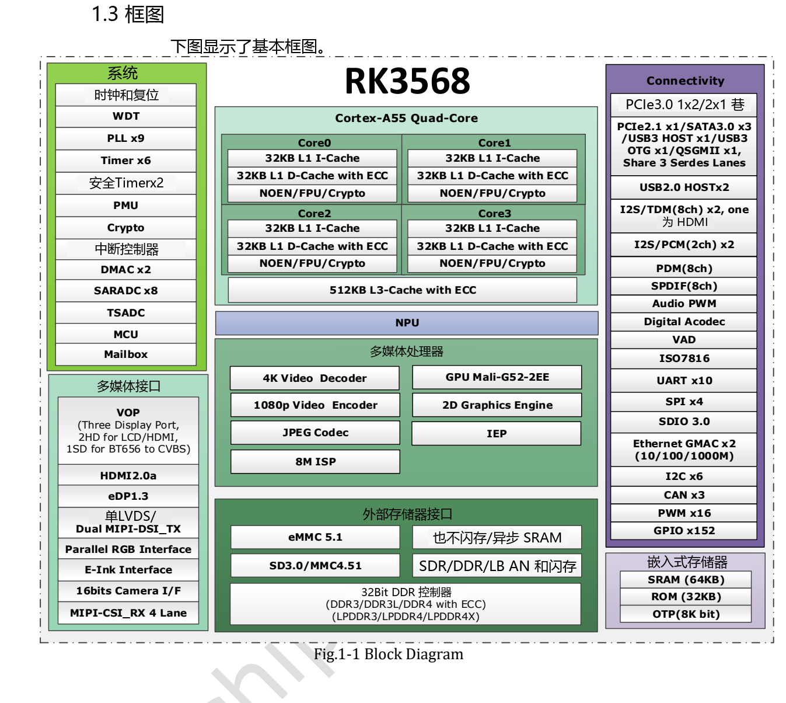

本文按选型和调试任务解读原稿，保留关键参数、边界和原图；不是逐页翻译或完整引脚／寄存器手册。原厂示例不是 ArmSoM 实测。应用前须核对具体板卡版本、原理图、SDK/BSP、内核及驱动；本文未新增硬件验证。

**主要资料：** `Rockchip RK3568 Datasheet V1.2-20210601.pdf` · PDF 62 页.

## 从芯片能力到项目需求

RK3568 的优势在于四核 Cortex-A55、专用多媒体单元与多种工业常用接口的组合。它适合先确定网络、显示、存储和推理任务，再分配硬件资源。ArmSoM Sige3 官方资料明确使用 RK3568B2；本篇较早的 RK3568 V1.2 数据手册用于架构参考，具体 B2 修订、板载内存和引出接口仍按 Sige3 资料核对。

*RK3568 原厂功能框图 — 英文原图. `Rockchip RK3568 Datasheet V1.2-20210601.pdf`, PDF p. 19.*

## 先读懂这些规格

| 模块 | 原稿规格 | 对项目的意义 |
| --- | --- | --- |
| CPU | 4× Cortex-A55；ARMv8；Neon、TrustZone | Linux 应用、通信和媒体调度分别预算 |
| NPU | 最高 1 TOPS；INT8/INT16/FP16/BFP16 | 模型需检查算子、量化精度和工具链支持，不能用 TOPS 推算帧率 |
| GPU | Mali-G52 1-Core-2EE；OpenGL ES 1.1/2.0/3.2、OpenCL 2.0、Vulkan 1.1 | 图形 API 能否使用还取决于镜像和驱动 |
| 内存 | 32-bit；DDR3/DDR3L/DDR4/LPDDR3/LPDDR4/LPDDR4X；最高寻址 8GB | 类型互斥，最高寻址不是板卡默认容量 |
| 视频 | H.264/H.265 最高 4096×2304@60fps 解码；1920×1080@60fps 编码 | 编解码规格与多路并发吞吐分开评估 |
| 相机 | MIPI CSI 可选 1×4-lane 或 2×2-lane；每 lane 最高 2.5Gbps | 传感器、连接器、时钟、电源和驱动均需匹配 |
| 以太网 | 2 个 MAC；RGMII 千兆或 RMII 百兆 | MAC 不等于完整网口，仍需 PHY、磁性器件和布线 |

原稿第 56 页的 CPU/GPU 最高频率仍为 `TBD`，不能拿其他产品页的频率回填为这份数据手册的结论。数据手册某些功能也受实际产品配置和第三方许可条件影响。

## SATA、USB 和 PCIe 不能简单相加

第 16–17 页明确列出三个 Multi-PHY 的选项。选型时先画出同时使用的路径，再选板卡或设计载板。

| 资源 | 可选功能，单个资源内互斥 |
| --- | --- |
| Multi-PHY0 | USB3.0 OTG / SATA0 |
| Multi-PHY1 | USB3.0 Host / SATA1 / QSGMII/SGMII |
| Multi-PHY2 | PCIe2.1 / SATA2 / QSGMII/SGMII |
| 独立 PCIe3.0 PHY | 2 lanes；可按 1×x2 或 2×x1 控制器方式组织 |

例如同时需要高速 USB、SATA 数据盘和 PCIe 扩展时，要核对每条链路实际接到了哪里，以及设备树启用了哪个 PHY 模式。接口在芯片上存在，不代表 Sige3 把所有组合都引出。

## 三类值得开发的应用

**设备网关与轻量服务。** 将设备采集、协议转换、缓存和管理界面分开设计。先验证网络丢包、存储掉电恢复和持续写入，再测试多个服务同时运行时的内存与温度。总线收发器和隔离电路按现场条件选择。

**信息屏与操作终端。** HDMI、MIPI DSI、LVDS、eDP、RGB 和 EBC 提供多种显示方向。原稿支持三路同时显示，但双 MIPI 模式不能使用 LVDS。面板分辨率只是起点，还要核对时序、触摸、旋转、图层和应用渲染后端。

**轻量边缘视觉。** 把采集、缩放、颜色转换、NPU 推理和结果上传作为一条流水线测试。模型在 PC 上导出成功并不等于板端全算子加速；记录端到端延迟、CPU 回退和帧丢失，比只展示推理单步时间更有价值。

## 电气和散热资料怎么用

第 56 页要求 GPIO 配置与实际供电匹配。1.8V 和 3.3V 信号不能凭接口外形直接连接。原稿列出环境温度 0–80℃，热管理章节要求结温低于 125℃；环境温度与结温不能互换，也不能据此给整机工业温度承诺。

热阻数据来自指定参考 PCB 的仿真／参考条件。Sige3 加上外壳、扩展板和热垫后，应重新测量最热负载下的温度及降频。电源预算同样要包含 USB 外设、存储和屏幕，而不只是 SoC。

## 用 Sige3 建立可复用的验证记录

记录板卡修订、镜像校验值、内核、设备树、驱动和应用版本。依次完成冷启动、各接口单测、组合负载、温度稳定后的持续运行以及异常掉电恢复。Sige3 是 RK3568B2 的开发入口，不能用它的验证结果自动覆盖另一块 RK3568 自研板。

## 产品与开发资料

- **Sige3** — [产品页](https://www.armsom.org/sige3) · [官方文档](https://docs.armsom.org/armsom-sige3)

## 延伸阅读

<!-- datasheet-series-20261110 -->

## 数据手册专题与原始 PDF

- [RK3568 总览](/zh/articles/rk3568-datasheet-v12/)
- [RK3568 封装与引脚：636 球完整编号表](/zh/articles/rk3568-package-pin-reference/)
- [RK3568 架构与接口规划：DDR、三屏和 PCIe/SATA/USB 复用](/zh/articles/rk3568-architecture-phy-resource-planning/)
- [RK3568 电气与热设计：电源、I/O 和热阻](/zh/articles/rk3568-electrical-power-thermal/)
- [下载完整原始 PDF](/assets/datasheet-series-20261110/Rockchip-RK3568-Datasheet-V1.2-20210601.pdf)

<!-- datasheet-related-20261110 -->
## 其他芯片数据手册

以下用于跨平台查阅，各芯片的电气条件和引脚不可互换。

- [RK3506B](/zh/articles/rk3506b-datasheet-v10/)
- [RK3576](/zh/articles/rk3576-datasheet-v10/)
- [RK3588](/zh/articles/rk3588-datasheet-v14/)
- [RK3528](/zh/articles/rk3528-datasheet-v10/)
- [RK730](/zh/articles/rk730-audio-codec-design/)
