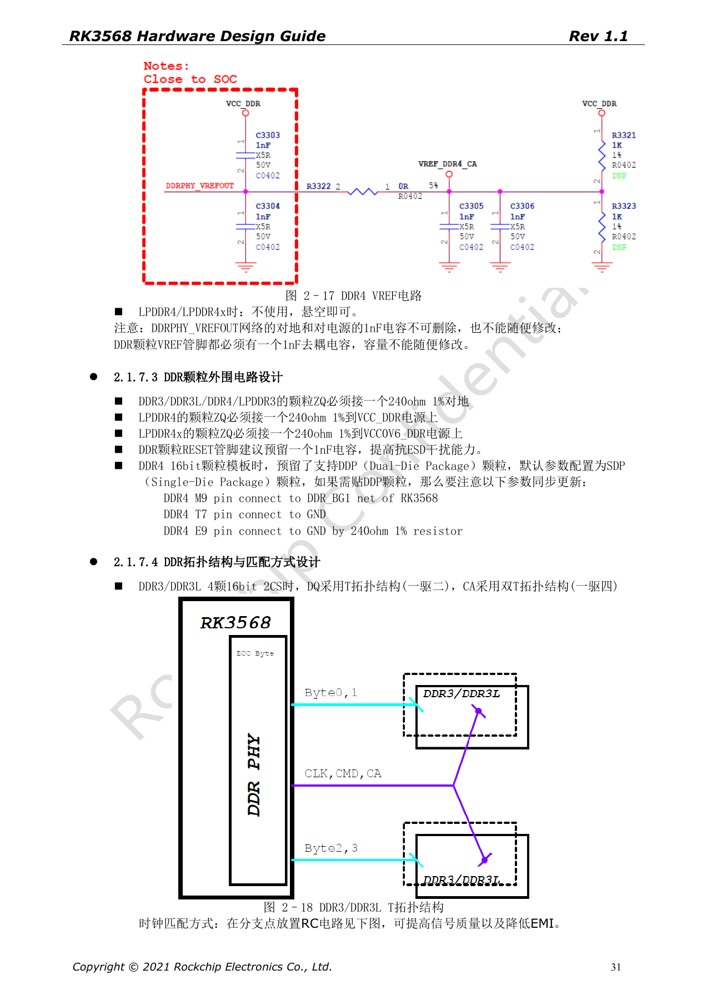
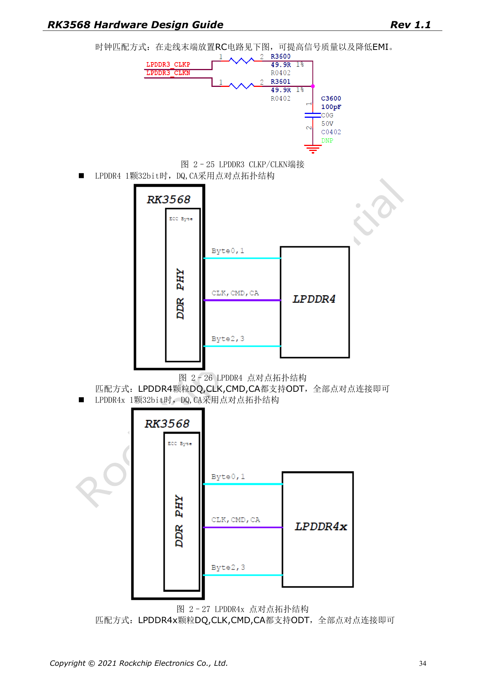
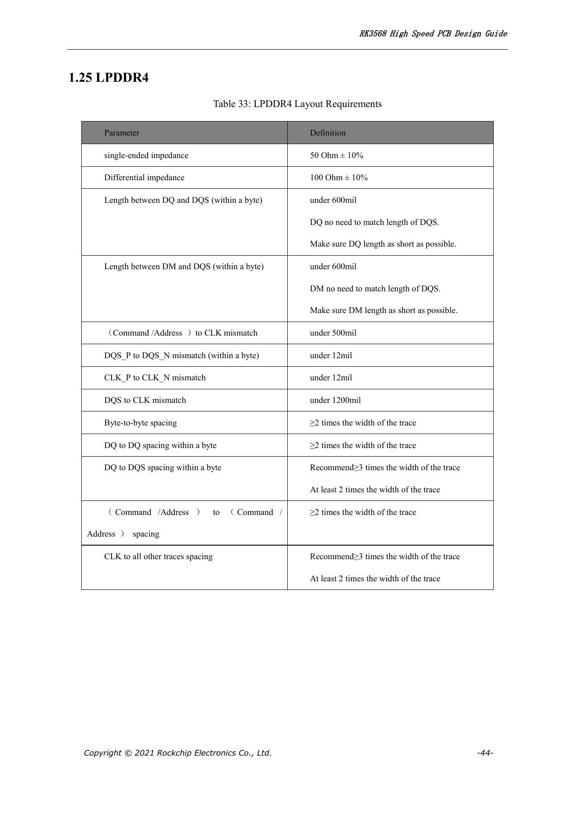
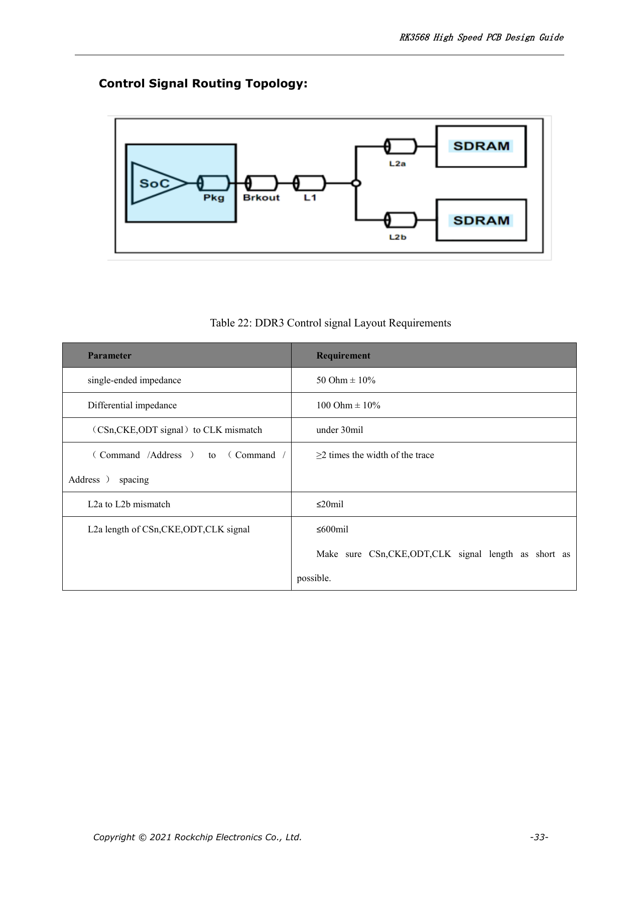
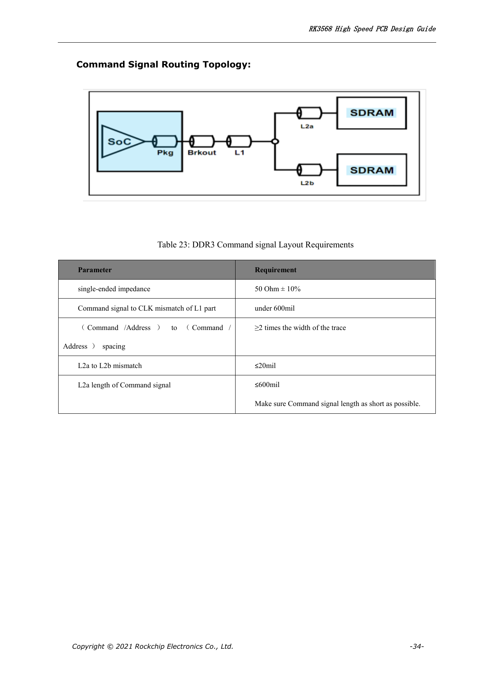
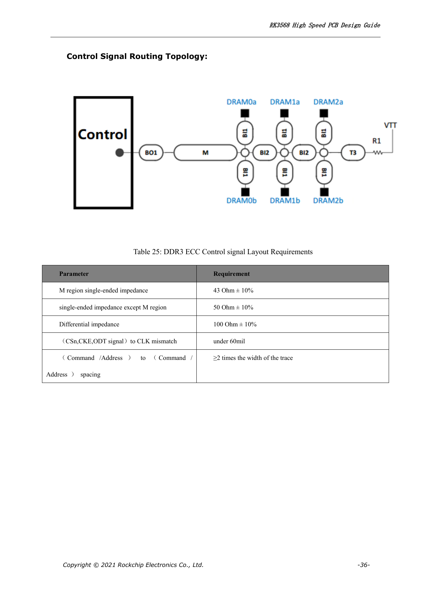
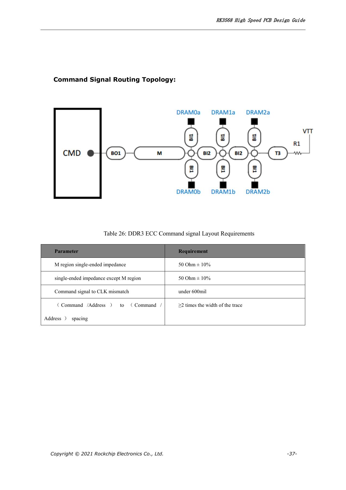

# RK3568 DDR 设计：颗粒、拓扑、ECC 与布线约束

本系列依据 RK3568 Hardware Design Guide V1.1（中文，2021-06-08）及独立的 High Speed PCB Design Guide V1.0.0（英文，2021-04-12），围绕具体工程问题重组。ArmSoM [Sige3](https://www.armsom.org/sige3) 采用 RK3568B2，可结合其[板卡文档](https://docs.armsom.org/armsom-sige3)学习与评估本系列设计问题。芯片级参考电路不等同于 Sige3 的实际原理图或全部引出接口；SDK/BSP、内核、硅版本、固件与外设组合须逐项核对。数值是原稿参考，未经 ArmSoM 硬件验证。

**CN V1.1 §2.1.7; §3.2.2 · EN PCB V1.0.0 §1.20–1.26**

## 先确定内存类型与映射

指南列出 DDR3/DDR3L/LPDDR3/DDR4/LPDDR4/LPDDR4X，32-bit 数据总线、2 ranks 和最大 8GB 寻址。8-bit ECC 仅在所列 DDR3/DDR3L/DDR4 模式中支持，不能推广到全部类型。PDF 26–28 的 PHY 映射表按内存类型改变，不能把一份 DDR4 网络名表直接套给 LPDDR4；原理图、训练参数、PCB 拓扑与颗粒支持清单必须一致。

## 拓扑不能只按布线方便选择

中文稿分别给出 DDR3/DDR3L、DDR4 的 T 和 Fly-by 拓扑，以及 LPDDR3/4/4X 的点对点连接。应同时核对参考终端、VREF、RZQ、电源去耦与上电时序。LPDDR4/4X 兼容设计尤其需要检查 DDRPHY_VDDQ/VDDQL 和颗粒电源，不能只切换软件型号。容量和温度等级、rank 数、颗粒布局变化都应纳入训练与压力测试。

## 正确理解 LPDDR 等长表

英文高速 PCB 稿的 LPDDR3/4/4X 表写 DQ、DM 与同字节 DQS 的长度差 <600mil，并明确“不必把 DQ/DM 拉到与 DQS 等长，应尽量短”。LPDDR3 的 CA–CLK <30mil、DQS–CLK <1500mil；LPDDR4/4X 分别为 <500mil、<1200mil。DQS 与 CLK 差分对内均 <12mil。不要把这些规则套到 DDR3/DDR4 的 T/Fly-by 分段约束上。

## 从 PCB 规则到可重复验证

单端参考阻抗为 50Ω±10%，差分 100Ω±10%。字节间、同字节 DQ 间、CA 间至少 2W；DQ 到 DQS、CLK 到其他线推荐 3W，至少 2W。审核应输出每种网络组的约束报告，记录拓扑、层叠和过孔；再做冷启动、反复掉电、温度边界与目标频率负载验证。本文没有 ArmSoM 实测带宽或误码率数据。

## 引脚交换与 RZQ 的限制

DDR3/DDR3L 与 DDR4 支持整字节换组及字节内 DQ 交换，但 CA 不可交换。ECC 字节不能与普通字节交换；DDR4 ECC 字节内的 DQ 也不能交换。LPDDR3 必须保持第一个 D0–D7 字节及对应 DQS/DM，一般字节才可按原稿规则换组。LPDDR4/4X 的 DQ 与 CA 均不可对调。DDR_RZQ（H7）的 120Ω、1% 电阻在 DDR3/DDR3L/DDR4/LPDDR3 时接地，在 LPDDR4/4X 时接 DDRPHY_VDDQ。不要只因阻值相同而忽略连接方向。

## 原稿 ECC 接线疑点

中文第 28 页把 DDR3/DDR3L 的 DQSU 同时写为接电源和接地，文字重复了网名。本篇不据此生成接线指令；需结合该页图 2–12 和所选颗粒数据手册核对正负脚。下表完整保留表 2–5 的 85 行 PHY 标识符，便于逐网审查，但不是可直接用于任意颗粒的原理图。

| PHY | DDR4 | LPDDR4/LPDDR4x | DDR3 | LPDDR3 |
| --- | --- | --- | --- | --- |
| DDR_DQ0_A | DDR4_DQL0_A | LPDDR4_DQ0_A | DDR3_DQ0 | LPDDR3_D15 |
| DDR_DQ1_A | DDR4_DQL2_A | LPDDR4_DQ1_A | DDR3_DQ1 | LPDDR3_D14 |
| DDR_DQ2_A | DDR4_DQL4_A | LPDDR4_DQ2_A | DDR3_DQ2 | LPDDR3_D10 |
| DDR_DQ3_A | DDR4_DQL6_A | LPDDR4_DQ3_A | DDR3_DQ3 | LPDDR3_D9 |
| DDR_DQ4_A | DDR4_DQL7_A | LPDDR4_DQ4_A | DDR3_DQ4 | LPDDR3_D13 |
| DDR_DQ5_A | DDR4_DQL5_A | LPDDR4_DQ5_A | DDR3_DQ5 | LPDDR3_D12 |
| DDR_DQ6_A | DDR4_DQL3_A | LPDDR4_DQ6_A | DDR3_DQ6 | LPDDR3_D8 |
| DDR_DQ7_A | DDR4_DQL1_A | LPDDR4_DQ7_A | DDR3_DQ7 | LPDDR3_D11 |
| DDR_DM0_A | DDR4_DML_A | LPDDR4_DM0_A | DDR3_DM0 | LPDDR3_DM1 |
| DDR_DQS0P_A | DDR4_DQSL_P_A | LPDDR4_DQS0P_A | DDR3_DQS0P | LPDDR3_DQS1P |
| DDR_DQS0N_A | DDR4_DQSL_N_A | LPDDR4_DQS0N_A | DDR3_DQS0N | LPDDR3_DQS1N |
| DDR_DQ8_A | DDR4_DQU3_A | LPDDR4_DQ8_A | DDR3_DQ8 | LPDDR3_D25 |
| DDR_DQ9_A | DDR4_DQU1_A | LPDDR4_DQ9_A | DDR3_DQ9 | LPDDR3_D24 |
| DDR_DQ10_A | DDR4_DQU7_A | LPDDR4_DQ10_A | DDR3_DQ10 | LPDDR3_D28 |
| DDR_DQ11_A | DDR4_DQU5_A | LPDDR4_DQ11_A | DDR3_DQ11 | LPDDR3_D29 |
| DDR_DQ12_A | DDR4_DQU2_A | LPDDR4_DQ12_A | DDR3_DQ12 | LPDDR3_D26 |
| DDR_DQ13_A | DDR4_DQU4_A | LPDDR4_DQ13_A | DDR3_DQ13 | LPDDR3_D31 |
| DDR_DQ14_A | DDR4_DQU6_A | LPDDR4_DQ14_A | DDR3_DQ14 | LPDDR3_D30 |
| DDR_DQ15_A | DDR4_DQU0_A | LPDDR4_DQ15_A | DDR3_DQ15 | LPDDR3_D27 |
| DDR_DM1_A | DDR4_DMU_A | LPDDR4_DM1_A | DDR3_DM1 | LPDDR3_DM3 |
| DDR_DQS1P_A | DDR4_DQSU_P_A | LPDDR4_DQS1P_A | DDR3_DQS1P | LPDDR3_DQS3P |
| DDR_DQS1N_A | DDR4_DQSU_N_A | LPDDR4_DQS1N_A | DDR3_DQS1N | LPDDR3_DQS3N |
| DDR_DQ0_B | DDR4_DQU7_B | LPDDR4_DQ0_B | DDR3_DQ16 | LPDDR3_D1 |
| DDR_DQ1_B | DDR4_DQU5_B | LPDDR4_DQ1_B | DDR3_DQ17 | LPDDR3_D5 |
| DDR_DQ2_B | DDR4_DQU3_B | LPDDR4_DQ2_B | DDR3_DQ18 | LPDDR3_D6 |
| DDR_DQ3_B | DDR4_DQU1_B | LPDDR4_DQ3_B | DDR3_DQ19 | LPDDR3_D4 |
| DDR_DQ4_B | DDR4_DQU0_B | LPDDR4_DQ4_B | DDR3_DQ20 | LPDDR3_D2 |
| DDR_DQ5_B | DDR4_DQU6_B | LPDDR4_DQ5_B | DDR3_DQ21 | LPDDR3_D3 |
| DDR_DQ6_B | DDR4_DQU4_B | LPDDR4_DQ6_B | DDR3_DQ22 | LPDDR3_D7 |
| DDR_DQ7_B | DDR4_DQU2_B | LPDDR4_DQ7_B | DDR3_DQ23 | LPDDR3_D0 |
| DDR_DM0_B | DDR4_DMU_B | LPDDR4_DM0_B | DDR3_DM2 | LPDDR3_DM0 |
| DDR_DQS0P_B | DDR4_DQSU_P_B | LPDDR4_DQS0P_B | DDR3_DQS2P | LPDDR3_DQS0P |
| DDR_DQS0N_B | DDR4_DQSU_N_B | LPDDR4_DQS0N_B | DDR3_DQS2N | LPDDR3_DQS0N |
| DDR_DQ8_B | DDR4_DQL0_B | LPDDR4_DQ8_B | DDR3_DQ24 | LPDDR3_D18 |
| DDR_DQ9_B | DDR4_DQL2_B | LPDDR4_DQ9_B | DDR3_DQ25 | LPDDR3_D19 |
| DDR_DQ10_B | DDR4_DQL4_B | LPDDR4_DQ10_B | DDR3_DQ26 | LPDDR3_D22 |
| DDR_DQ11_B | DDR4_DQL6_B | LPDDR4_DQ11_B | DDR3_DQ27 | LPDDR3_D23 |
| DDR_DQ12_B | DDR4_DQL7_B | LPDDR4_DQ12_B | DDR3_DQ28 | LPDDR3_D16 |
| DDR_DQ13_B | DDR4_DQL5_B | LPDDR4_DQ13_B | DDR3_DQ29 | LPDDR3_D17 |
| DDR_DQ14_B | DDR4_DQL1_B | LPDDR4_DQ14_B | DDR3_DQ30 | LPDDR3_D20 |
| DDR_DQ15_B | DDR4_DQL3_B | LPDDR4_DQ15_B | DDR3_DQ31 | LPDDR3_D21 |
| DDR_DM1_B | DDR4_DML_B | LPDDR4_DM1_B | DDR3_DM3 | LPDDR3_DM2 |
| DDR_DQS1P_B | DDR4_DQSL_P_B | LPDDR4_DQS1P_B | DDR3_DQS3P | LPDDR3_DQS2P |
| DDR_DQS1N_B | DDR4_DQSL_N_B | LPDDR4_DQS1N_B | DDR3_DQS3N | LPDDR3_DQS2N |
| DDR_ECC_DQ0 | DDR4_ECC_DQ7 | - | DDR3_ECC_DQ0 | - |
| DDR_ECC_DQ1 | DDR4_ECC_DQ0 | - | DDR3_ECC_DQ1 | - |
| DDR_ECC_DQ2 | DDR4_ECC_DQ2 | - | DDR3_ECC_DQ2 | - |
| DDR_ECC_DQ3 | DDR4_ECC_DQ1 | - | DDR3_ECC_DQ3 | - |
| DDR_ECC_DQ4 | DDR4_ECC_DQ6 | - | DDR3_ECC_DQ4 | - |
| DDR_ECC_DQ5 | DDR4_ECC_DQ4 | - | DDR3_ECC_DQ5 | - |
| DDR_ECC_DQ6 | DDR4_ECC_DQ3 | - | DDR3_ECC_DQ6 | - |
| DDR_ECC_DQ7 | DDR4_ECC_DQ5 | - | DDR3_ECC_DQ7 | - |
| DDR_ECC_DM | DDR4_ECC_DM | - | DDR3_ECC_DM | - |
| DDR_ECC_DQSP | DDR4_ECC_DQSP | - | DDR3_ECC_DQSP | - |
| DDR_ECC_DQSN | DDR4_ECC_DQSN | - | DDR3_ECC_DQSN | - |
| AC0 | DDR4_A0 | LPDDR4_CLKP_B | DDR3_A9 | - |
| AC1 | DDR4_A1 | - | DDR3_A2 | - |
| AC2 | DDR4_A2 | LPDDR4_A1_A | DDR3_A4 | LPDDR3_A6 |
| AC3 | DDR4_A3 | LPDDR4_CKE1_A | DDR3_A3 | - |
| AC4 | DDR4_A4 | LPDDR4_A3_B | DDR3_BA1 | LPDDR3_A3 |
| AC5 | DDR4_A5 | LPDDR4_A5_B | DDR3_A11 | LPDDR3_A2 |
| AC6 | DDR4_A6 | LPDDR4_A1_B | DDR3_A13 | LPDDR3_A1 |
| AC7 | DDR4_A7 | LPDDR4_ODT0_CA_B | DDR3_A8 | - |
| AC8 | DDR4_A8 | LPDDR4_ODT0_CA_A | DDR3_A6 | LPDDR3_A9 |
| AC9 | DDR4_A9 | LPDDR4_CLKN_B | DDR3_A5 | - |
| AC10 | DDR4_A10 | LPDDR4_CKE0_B | DDR3_A10 | - |
| AC11 | DDR4_A11 | LPDDR4_A0_A | DDR3_A7 | LPDDR3_A8 |
| AC12 | DDR4_A12 | LPDDR4_A3_A | DDR3_BA2 | - |
| AC13 | DDR4_A13 | LPDDR4_A0_B | DDR3_A14 | LPDDR3_A0 |
| AC14 | DDR4_A14_WEN | LPDDR4_A4_A | DDR3_A15 | LPDDR3_A5 |
| AC15 | DDR4_A15_CASN | LPDDR4_A2_A | DDR3_A0 | - |
| AC16 | DDR4_A16_RASN | LPDDR4_A5_A | DDR3_RASN | LPDDR3_A7 |
| AC17 | DDR4_ACTN | LPDDR4_CKE1_B | DDR3_CASN | - |
| AC18 | DDR4_BA0 | LPDDR4_A2_B | DDR3_A1 | - |
| AC19 | DDR4_BA1 | LPDDR4_A4_B | DDR3_A12 | LPDDR3_A4 |
| AC20 | DDR4_BG0 | LPDDR4_ODT1_CA_B | DDR3_WEN | - |
| AC21 | DDR4_BG1 | LPDDR4_ODT1_CA_A | DDR3_BA0 | - |
| AC22 | DDR4_CKE | LPDDR4_CKE0_A | DDR3_CKE | LPDDR3_CKE |
| AC23 | DDR4_CLKP | LPDDR4_CLKP_A | DDR3_CLKP | LPDDR3_CLKP |
| AC24 | DDR4_CLKN | LPDDR4_CLKN_A | DDR3_CLKN | LPDDR3_CLKN |
| AC25 | DDR4_CS0N | LPDDR4_CS0N_A | DDR3_ODT1 | LPDDR3_ODT0 |
| AC26 | DDR4_CS1N | LPDDR4_CS1N_A | DDR3_CS1N | LPDDR3_ODT1 |
| AC27 | DDR4_ODT0 | LPDDR4_CS1N_B | DDR3_ODT0 | LPDDR3_CS1N |
| AC28 | DDR4_ODT1 | LPDDR4_CS0N_B | DDR3_CS0N | LPDDR3_CS0N |
| AC29 | DDR4_RESETN | LPDDR4_RESETN | DDR3_RESETN | - |

## DDR3/DDR4 与 ECC 的分段布线表

英文 PCB 稿第 32–43 页将数据、控制、命令三类分开。DDR3/DDR4 及其 ECC 数据表共用下列数据规则，但 ECC 控制拓扑的 M 区为 43Ω±10%，不是普通 50Ω。M、L1、L2a、L2b 必须按对应原图理解；不能把长度边界施加到错误的分支。原稿要求控制与命令线尽可能短，CA 间距 ≥2W。

| 模式 | 阻抗 | 原稿长度约束 |
| --- | --- | --- |
| DDR3 / DDR3 ECC / DDR4 / DDR4 ECC: data | 50Ω±10% / 100Ω±10% | DQ–DQS <600mil; DM–DQS <600mil; DQS–CLK <1500mil; P/N <12mil |
| DDR3 control | 50Ω±10% / 100Ω±10% | CSn/CKE/ODT–CLK <30mil; L2a–L2b ≤20mil; L2a(CSn/CKE/ODT/CLK) ≤600mil |
| DDR4 control | 50Ω±10% / 100Ω±10% | CSn/CKE/ODT–CLK <30mil; L2a–L2b ≤20mil; L2a(CSn/CKE/ODT) ≤600mil |
| DDR3 / DDR4 command | 50Ω±10% | L1(command–CLK) <600mil; L2a–L2b ≤20mil; L2a(command) ≤600mil |
| DDR3 ECC / DDR4 ECC control | M:43Ω±10%; outside M:50Ω±10%; differential:100Ω±10% | CSn/CKE/ODT–CLK <60mil |
| DDR3 ECC / DDR4 ECC command | M:50Ω±10%; outside M:50Ω±10% | command–CLK <600mil |

## 原稿参数与约束

| 项目 | 原稿参考 |
| --- | --- |
| LPDDR3 CA–CLK / DQS–CLK | <30mil / <1500mil |
| LPDDR4/4X CA–CLK / DQS–CLK | <500mil / <1200mil |
| DQ/DM–DQS | <600mil |
| DQS P/N; CLK P/N | <12mil |

## 原稿配图

下列为原稿页面截图，供核对电路、图例与上下文，正文及参数表保留为可编辑文字。中文主指南没有对应英文整稿，因此其截图在四语中均保留中文；独立英文 PCB 稿的截图明确标为英文来源。PDF 页码均为物理页码。

中文硬件设计指南 · PDF 31

中文硬件设计指南 · PDF 34

英文高速 PCB 指南 · PDF 44

英文高速 PCB 指南 · PDF 33

英文高速 PCB 指南 · PDF 34

英文高速 PCB 指南 · PDF 36

英文高速 PCB 指南 · PDF 37

## 继续阅读与开发资料

- [RK3568 硬件设计系列：10 个电路、PCB 与量产主题](/zh/articles/rk3568-hardware-design-series/)
- [RK3568 电源与 IO 域：RK809-5、分立方案和待机](/zh/articles/rk3568-power-io-domain-hardware/)
- [RK3568 启动存储：eMMC、FSPI、NAND 与 SDMMC 电路](/zh/articles/rk3568-storage-emmc-fspi-sdmmc-hardware/)
- [ArmSoM Docs](https://docs.armsom.org/)
- [ArmSoM](https://www.armsom.org/)
