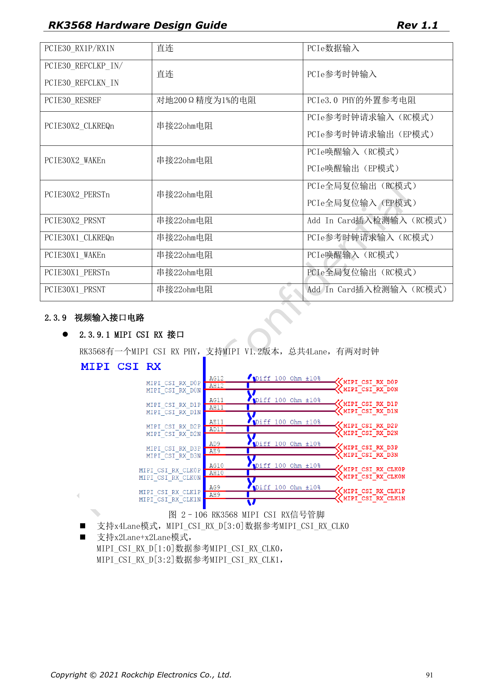
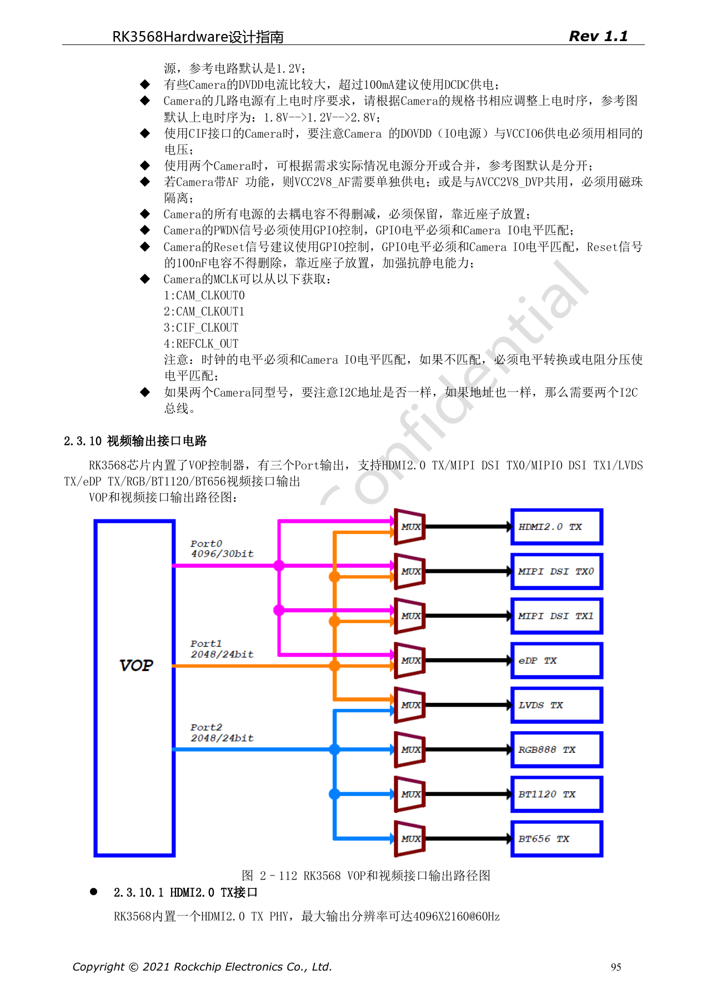
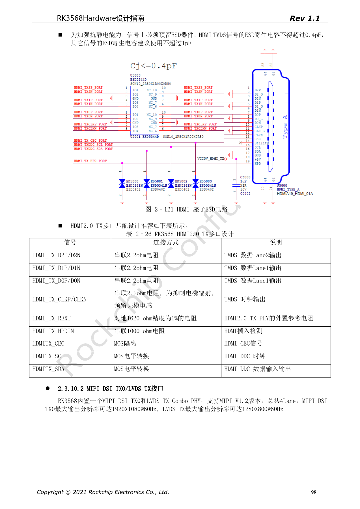

# RK3568 显示与摄像头：VOP、MIPI、HDMI 与供电

本系列依据 RK3568 Hardware Design Guide V1.1（中文，2021-06-08）及独立的 High Speed PCB Design Guide V1.0.0（英文，2021-04-12），围绕具体工程问题重组。ArmSoM [Sige3](https://www.armsom.org/sige3) 采用 RK3568B2，可结合其[板卡文档](https://docs.armsom.org/armsom-sige3)学习与评估本系列设计问题。芯片级参考电路不等同于 Sige3 的实际原理图或全部引出接口；SDK/BSP、内核、硅版本、固件与外设组合须逐项核对。数值是原稿参考，未经 ArmSoM 硬件验证。

**CN V1.1 §2.3.9–2.3.10; §3.2.25–3.2.26 · EN PCB §1.4, §1.7, §1.9–1.10, §1.16–1.18**

## 显示控制器不等于连接器数量

原稿 VOP 有三个输出 Port，可连接 HDMI2.0、MIPI DSI、LVDS、eDP、RGB、BT1120/656 等输出路径，但这些资源有复用限制。HDMI2.0 最大参考规格为 4096×2160@60Hz；DSI TX0 为 1920×1080@60Hz，与 LVDS TX 共用 Combo PHY，后者参考为 1280×800@60Hz。实际同时输出组合应核对 VOP 路由和 BSP，不能把每种接口相加。

## 摄像头数据、时钟与供电成套核对

CSI RX 的 4 Lane PHY 可为 1×4 Lane 或 2×2 Lane，分拆时 D[1:0] 对 CLK0、D[3:2] 对 CLK1。摄像头的 AVDD/DOVDD/DVDD、PWDN、Reset、I2C 和 MCLK 必须按具体传感器数据手册。原图 1.8V→1.2V→2.8V 是参考时序，不是所有传感器通用时序。两颗相同 I2C 地址的传感器需要处理总线冲突；指南建议使用两条 I2C 总线。

## 接口保护与高速约束

HDMI TMDS ESD 寄生电容 ≤0.4pF，其他信号原稿建议 ≤1pF；REXT 为 1620Ω、1%。HDMI PCB 对内差 <12mil、时钟与数据对差 <480mil，MIPI 对内 <12mil、数据与时钟差 <36mil。高速差分跨连接器时相邻对用地脚隔离，测试点靠近座子且残桩短。屏幕背光、触摸和传感器供电不能在只验证视频信号时遗漏。

## VGA 需要转换芯片

RK3568 不直接提供 VGA 输出，原稿使用外部 RTD2166 等转换方案。不能从显示功能列表推导一个原生 VGA 接口。转换器供电、复位、HPD、5V 同步电平、75Ω 视频终端和连接器 TVS 应按实际芯片参考设计；例如 RTD2166 Pin32 的 100kΩ 下拉不能在迁移原理图时随意删除。

## 原稿参数与约束

| 项目 | 原稿参考 |
| --- | --- |
| HDMI | 100Ω±10%; intra <12mil; CLK/data <480mil |
| MIPI | 100Ω±10%; intra <12mil; data/CLK <36mil |
| LVDS | 100Ω±10%; intra <20mil; data/CLK 60mil |
| eDP | 100Ω±10%; intra <12mil; 100nF±20% |

## 原稿配图

下列为原稿页面截图，供核对电路、图例与上下文，正文及参数表保留为可编辑文字。中文主指南没有对应英文整稿，因此其截图在四语中均保留中文；独立英文 PCB 稿的截图明确标为英文来源。PDF 页码均为物理页码。

中文硬件设计指南 · PDF 91

中文硬件设计指南 · PDF 95

中文硬件设计指南 · PDF 98

## 继续阅读与开发资料

- [RK3568 硬件设计系列：10 个电路、PCB 与量产主题](/zh/articles/rk3568-hardware-design-series/)
- [RK3568 以太网硬件：双 GMAC、RGMII 与 QSGMII](/zh/articles/rk3568-ethernet-rgmii-qsgmii-hardware/)
- [RK3568 音频与控制接口：I2S、UART、SPI、CAN 和 I2C](/zh/articles/rk3568-audio-control-interfaces-hardware/)
- [ArmSoM Docs](https://docs.armsom.org/)
- [ArmSoM](https://www.armsom.org/)
