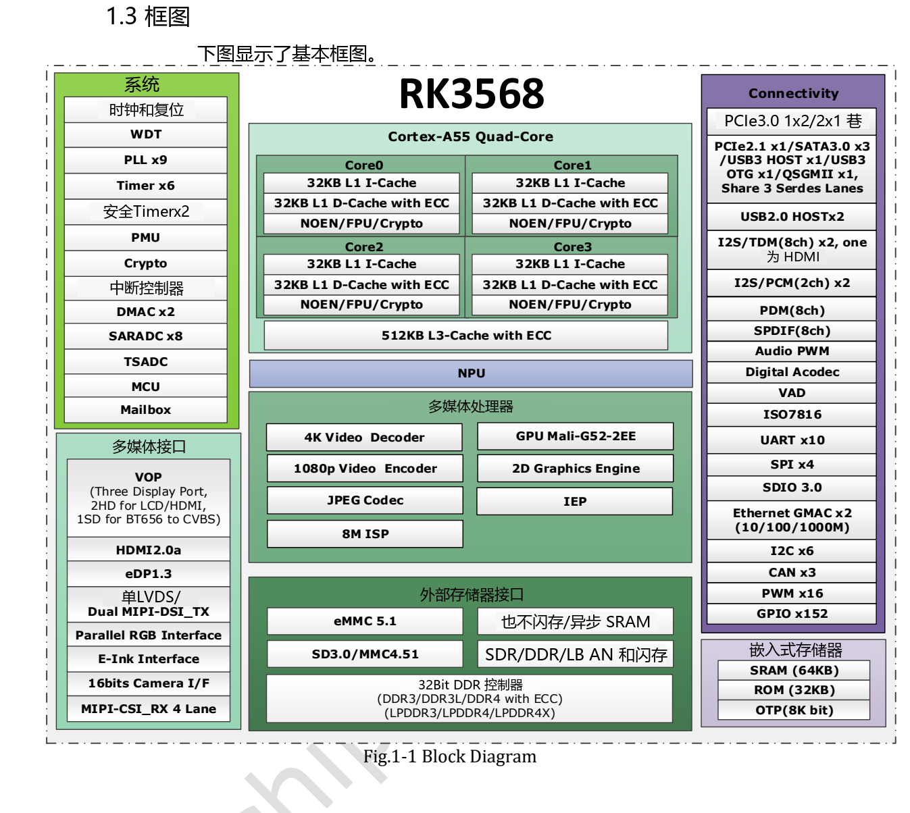

本文基于指定版本数据手册整理。表中数值是原厂规格，不是 ArmSoM 实测；未新增硬件验证。使用前核对实际芯片版本、板卡原理图、SDK/BSP、内核和驱动。专题解释与可编辑表格用于辅助阅读，完整规范及未展开的位定义请查阅原始 PDF。

**RK3568 · Rockchip RK3568 Datasheet V1.2-20210601.pdf · PDF 54–62.**

*英文原图，来源 PDF 第 19.*

## 额定边界与工作点

绝对最大值不是稳压器正常设定值。推荐 Min/Typ/Max 也不能替代上电顺序、动态压降和芯片频率电压表。应在芯片供电点测量启动、空闲和负载切换，而不只看稳压模块输出。

## 推荐供电与时钟

### PDF 55

| 电源／时钟 | Min | Typ | Max | 单位 |
|---|---|---|---|---|
| VDD_CPU | 0.8 | 0.9 | 1.2 | V |
| VDD_GPU | 0.8 | 0.9 | 1.1 | V |
| VDD_NPU | 0.8 | 0.9 | 1.1 | V |
| VDD_LOGIC | 0.81 | 0.9 | 0.99 | V |
| PMU_VDD_LOGIC_0V9 | 0.81 | 0.9 | 0.99 | V |
| PMUIO1 | 2.97 | 3.3 | 3.63 | V |
| VCCIO1,VCCIO2, VCCIO3, VCCIO4VCCIO5, VCCIO6, VCCIO7, PMUIO2 | 2.97 1.62 | 3.3 1.8 | 3.63 1.98 | V |
| DDR3 / DDRPHY_VDDQ/DDRPHY_VDDQL | 1.425 | 1.5 | 1.575 | V |
| DDR3L / DDRPHY_VDDQ/DDRPHY_VDDQL | 1.283 | 1.35 | 1.417 | V |
| LPDDR3 / DDRPHY_VDDQ/DDRPHY_VDDQL | 0.994 | 1.2 | 1.3 | V |
| DDR4 / DDRPHY_VDDQ/DDRPHY_VDDQL | 0.994 | 1.2 | 1.3 | V |
| LPDDR4 / DDRPHY_VDDQ/DDRPHY_VDDQL | 1.0 | 1.1 | 1.21 | V |
| LPDDR4X / DDRPHY_VDDQ | 1.0 | 1.1 | 1.21 | V |
| LPDDR4X / DDRPHY_VDDQL | 0.54 | 0.6 | 0.66 | V |
| PMUPLL_AVDD_0V9 | 0.81 | 0.9 | 0.99 | V |
| PMUPLL_AVDD_1V8 | 1.62 | 1.8 | 1.98 | V |
| SYSPLL_AVDD_0V9 | 0.81 | 0.9 | 0.99 | V |
| SYSPLL_AVDD_1V8 | 1.62 | 1.8 | 1.98 | V |
| USB2_AVDD_0V9 | 0.81 | 0.9 | 0.99 | V |
| USB2_AVDD_1V8 | 1.62 | 1.8 | 1.98 | V |
| USB2_AVDD_3V3 | 2.97 | 3.3 | 3.63 | V |
| USB3_AVDD_0V9 | 0.81 | 0.9 | 0.99 | V |
| USB3_AVDD_1V8 | 1.62 | 1.8 | 1.98 | V |
| USB3_AVDD_3V3 | 2.97 | 3.3 | 3.63 | V |
| MULTI_PHY_AVDD_0V9 | 0.81 | 0.9 | 0.99 | V |
| MULTI_PHY_AVDD_1V8 | 1.62 | 1.8 | 1.98 | V |
| PCIE30_AVDD_0V9 | 0.81 | 0.9 | 0.99 | V |
| PCIE30_AVDD_1V8 | 1.62 | 1.8 | 1.98 | V |
| MIPI_CSI_RX_AVDD_0V9 | 0.81 | 0.9 | 0.99 | V |
| MIPI_CSI_RX_AVDD_1V8 | 1.62 | 1.8 | 1.98 | V |
| MIPI_DSI_TX0/LVDS_TX0_AVDD_0V9 | 0.81 | 0.9 | 0.99 | V |
| MIPI_DSI_TX0/LVDS_TX0_AVDD_1V8 | 1.62 | 1.8 | 1.98 | V |
| MIPI_DSI_TX1_AVDD_0V9 | 0.81 | 0.9 | 0.99 | V |
| MIPI_DSI_TX1_AVDD_1V8 | 1.62 | 1.8 | 1.98 | V |
| EDP/DP_TX_AVDD_0V9 | 0.81 | 0.9 | 0.99 | V |
| EDP/DP_TX_AVDD_1V8 | 1.62 | 1.8 | 1.98 | V |
| HDMI_TX_AVDD_0V9 | 0.81 | 0.9 | 0.99 | V |
| HDMI_TX_AVDD_1V8 | 1.62 | 1.8 | 1.98 | V |
| SARADC_AVDD_1V8 | 1.62 | 1.8 | 1.98 | V |

### PDF 56

| 电源／时钟 | Min | Typ | Max | 单位 |
|---|---|---|---|---|
| OTP_VCC_1V8 | 1.62 | 1.8 | 1.98 | V |
| OSC | NA | 24 | NA | MHz |
| CPU | NA | NA | TBD | GHz |
| GPU | NA | NA | TBD | MHz |
| NPU | NA | NA | 1.0 | GHz |
| TA | 0 | NA | 80 | ℃ |

## GPIO 电平与内部电阻

| 项目 | 规格／原稿说明 |
|---|---|
| 3.3 V I/O: VIL | −0.3…0.8 V |
| 3.3 V I/O: VIH | 2.0…VDDO+0.3 V |
| 3.3 V I/O: VOL | −0.3…0.4 V |
| 3.3 V I/O: VOH | 2.4…VDDO+0.3 V |
| 1.8 V I/O: VIL max | 0.35 × VDDO |
| 1.8 V I/O: VIH min | 0.65 × VDDO |
| 1.8 V I/O: VOH min | 1.4 V |
| 内部上拉／下拉 | 16 / NA / 43 kΩ (Min/Typ/Max) |

## PLL 与 USB 参数

| 项目 | 规格／原稿说明 |
|---|---|
| PLL integer: Fin / Fvco / Fout | 10–800 / 475–1900 / 9–1900 MHz |
| PLL integer: lock | 1000 typ / 1500 max input-clock cycles |
| PLL fractional: Fin / Fvco / Fout | 1–1200 / 950–3800 / 19–3800 MHz |
| PLL fractional: lock | 250 typ / 500 max input-clock cycles |
| USB output resistance | 40.5 / 45 / 49.5 Ω |
| USB HS high | 360 / 400 / 440 mV |
| USB HS low | −40 / 0 / 40 mV |
| USB disconnect | 570 / 590 / 625 mV |
| USB squelch | 100 / 112 / 150 mV |

## 温度与散热边界

热阻是指定 PCB 模型的原厂仿真，不是 ArmSoM 板卡实测。外壳、铜面积、气流、散热器和功耗分布都会影响温升。传感器测量范围也不能代替环境工作温度。

| 项目 | 规格／原稿说明 |
|---|---|
| θJA / θJB / θJC | 15.925 / 10.813 / 0.487 °C/W |
| 热模型 | 4-layer PCB · 114.3 × 101.6 mm · 1.6 mm · ambient 25 °C |
| Tj | 原稿要求低于 125 °C |
| Ta | 0…80 °C |
| SARADC | 10 bit · ≤1 MS/s |
| TSADC | −20…120 °C; electrical table: ±5 °C resolution |

## 保留原文疑点

RK3568 的绝对／推荐上限不同：CPU 为 1.25/1.2 V，GPU/NPU 为 1.2/1.1 V。CPU/GPU 最大频率仍是 TBD，NPU 列出最高 1 GHz。LPDDR3/DDR4 推荐最小值原文为 0.994 V，本文保留，不擅自改成 1.14 V。Multi-PHY 表中 80–120 Ω 项的文字却描述去加重，名称与单位需回查 PHY 规范。

USB 断开与静噪门限不能照抄 RK3528。DDR 泄漏电流附带 125 °C 测试条件，不能直接用于常温功耗预算。

## ArmSoM 产品与应用边界

Sige3 采用 RK3568B2。本文对应 RK3568 V1.2 通用数据手册，不能代替 B2 订货型号、板卡版本及实际接口检查。

- [Sige3](https://www.armsom.org/sige3) · [Docs](https://docs.armsom.org/armsom-sige3)

## 数据手册专题与原始 PDF

- [RK3568 总览](/zh/articles/rk3568-datasheet-v12/)
- [RK3568 封装与引脚：636 球完整编号表](/zh/articles/rk3568-package-pin-reference/)
- [RK3568 架构与接口规划：DDR、三屏和 PCIe/SATA/USB 复用](/zh/articles/rk3568-architecture-phy-resource-planning/)
- [RK3568 电气与热设计：电源、I/O 和热阻](/zh/articles/rk3568-electrical-power-thermal/)
- [下载完整原始 PDF](/assets/datasheet-series-20261110/Rockchip-RK3568-Datasheet-V1.2-20210601.pdf)
