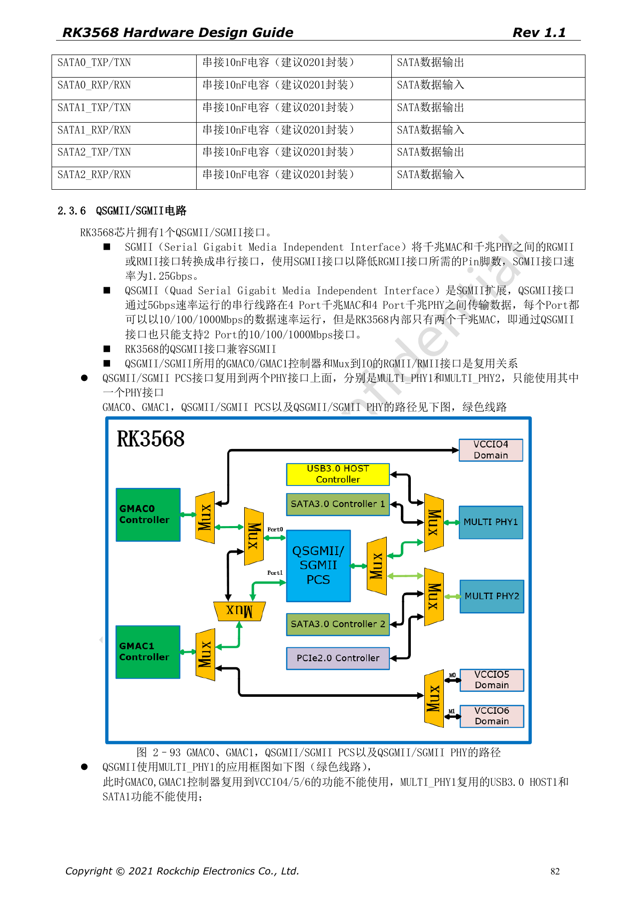
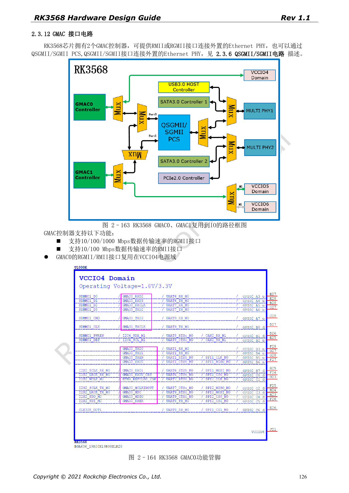
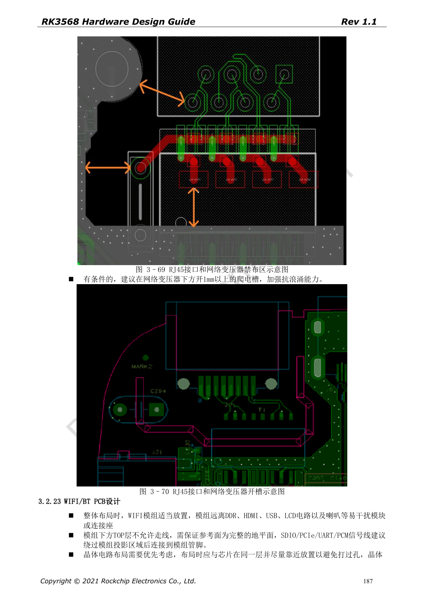

# RK3568 以太网硬件：双 GMAC、RGMII 与 QSGMII

本系列依据 RK3568 Hardware Design Guide V1.1（中文，2021-06-08）及独立的 High Speed PCB Design Guide V1.0.0（英文，2021-04-12），围绕具体工程问题重组。ArmSoM [Sige3](https://www.armsom.org/sige3) 采用 RK3568B2，可结合其[板卡文档](https://docs.armsom.org/armsom-sige3)学习与评估本系列设计问题。芯片级参考电路不等同于 Sige3 的实际原理图或全部引出接口；SDK/BSP、内核、硅版本、固件与外设组合须逐项核对。数值是原稿参考，未经 ArmSoM 硬件验证。

**CN V1.1 §2.3.6; §2.3.12; §3.2.22 · EN PCB §1.8; §1.19**

## 控制器、PHY 与接口是不同层次

RK3568 有两个 GMAC，RGMII 对应 10/100/1000Mbps，RMII 对应 10/100Mbps。QSGMII 规范可运送四端口数据，但此芯片只有两个 MAC，所以原稿明确只能提供两个以太网端口，不能宣传成四网口控制器。QSGMII/SGMII 与 IO 上的 RGMII/RMII 复用；串行 PCS 只能从 MULTI_PHY1 或 MULTI_PHY2 中选择一个。

## RTL8211F 示例不能替代所有 PHY 资料

原稿 RTL8211F/FI 的复位只支持 3.3V，复位附近保留 100nF；RSET 为 2.49kΩ、1%，MDIO 推荐外部 1.5–1.8kΩ 上拉。更换 PHY 时，要重新核对复位、电源、硬件 strap、参考时钟、内部延时以及变压器中心抽头。RJ45 的 Tab up/down 引脚方向也需和封装一致，不能只检查连接器外形。

## 时序约束与隔离保护一起检查

RGMII 的 TX 数据/使能相对 TXCLK、RX 数据/有效相对 RXCLK 分别匹配，英文 PCB 要求差 <120mil，总长 <5in、单端 50Ω±10%。TX/RX 不是一个共同等长组。QSGMII/SGMII 为 100Ω±10%、对内 <12mil、总长 <6in，参考交流耦合 100nF±20%。连接器与变压器区域还要检查禁布、隔离间隙和浪涌回流；指南中的防护示例不是整机认证结果。

## 原稿参数与约束

| 项目 | 原稿参考 |
| --- | --- |
| GMAC | 2 |
| QSGMII / SGMII | 5Gbps / 1.25Gbps |
| RGMII | 50Ω±10%; <120mil; <5in |
| RTL8211F/FI RSET | 2.49kΩ ±1% |
| MDIO | 1.5–1.8kΩ pull-up |

## 原稿配图

下列为原稿页面截图，供核对电路、图例与上下文，正文及参数表保留为可编辑文字。中文主指南没有对应英文整稿，因此其截图在四语中均保留中文；独立英文 PCB 稿的截图明确标为英文来源。PDF 页码均为物理页码。

中文硬件设计指南 · PDF 82

中文硬件设计指南 · PDF 126

中文硬件设计指南 · PDF 187

## 继续阅读与开发资料

- [RK3568 硬件设计系列：10 个电路、PCB 与量产主题](/zh/articles/rk3568-hardware-design-series/)
- [RK3568 高速扩展：USB、SATA、PCIe 复用与时钟](/zh/articles/rk3568-usb-sata-pcie-hardware/)
- [RK3568 显示与摄像头：VOP、MIPI、HDMI 与供电](/zh/articles/rk3568-display-camera-hardware/)
- [ArmSoM Docs](https://docs.armsom.org/)
- [ArmSoM](https://www.armsom.org/)
