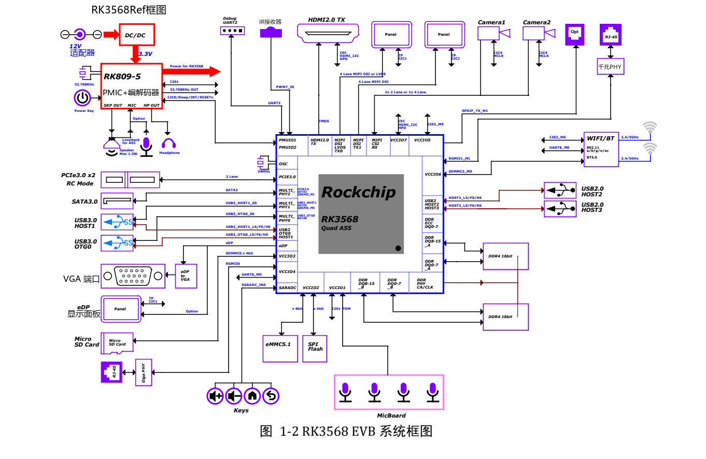
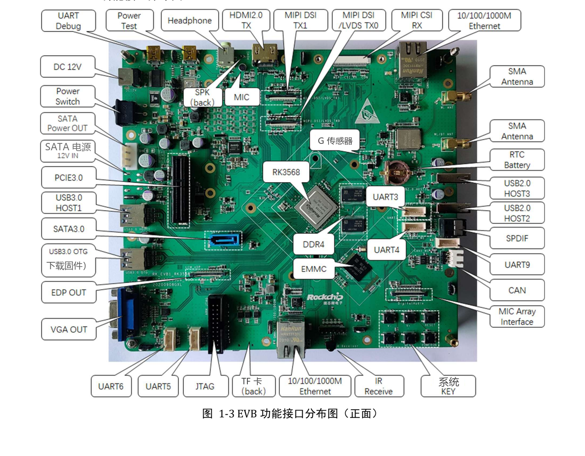

本文按选型和调试任务解读原稿，保留关键参数、边界和原图；不是逐页翻译或完整引脚／寄存器手册。原厂示例不是 ArmSoM 实测。应用前须核对具体板卡版本、原理图、SDK/BSP、内核及驱动；本文未新增硬件验证。

**主要资料：** `Rockchip_RK3568_EVB_User_Guide_V1.0_CN.pdf` · PDF 43 页.

## 参考板配置先与 Sige3 分开

手册对应 `RK_EVB1_RK3568_DDR4P216SD6_V10_20200908`：RK809-5 电源方案、2GB DDR4、32GB eMMC、12V/2A 套件适配器。Sige3 官方资料为 RK3568B2，板上内存、电源入口、连接器与固件均按其产品文档确认，不从 EVB 推定。


[](/assets/localized/figures/zh/b027c13300e4219be049.png)

*RK3568 EVB 系统连接框图 — 中文原图；本批未找到对应英文图. `Rockchip_RK3568_EVB_User_Guide_V1.0_CN.pdf`, PDF p. 11.*


## 第一次调试要准备的记录

先拍摄板卡版本与连接状态，记录电源、镜像和下载工具。将 USB Debug 接 PC，查 COM 号；原稿默认 UART2 经 FT232RL 转 USB，速率 `1500000`（1.5M），RTS/CTS 不勾选。乱码时先排查速率、端口、连接和电平，再判断启动是否失败。


[](/assets/localized/figures/zh/70fa2ecb3fbe69f084c6.png)

*RK3568 EVB 正面接口布局 — 中文原图；本批未找到对应英文图. `Rockchip_RK3568_EVB_User_Guide_V1.0_CN.pdf`, PDF p. 13.*


## Loader 与 Maskrom 的差别

Loader 流程是在连接 USB3.0 OTG 后按住 RECOVER，上电或复位，工具检测到 Loader 后释放。原文将进入条件描述为 `SARADC_VIN0` 低电平。Maskrom 则由参考板 MASKROM 按键使 eMMC 引导失败；手册描述了 `eMMC_D0` 对地条件，但实际操作应使用相应版本规定的按键方式，不能随意短接别的板卡。

识别模式后选择匹配的 Loader、Parameter、Uboot 等镜像，先备份再写入。工具升级例程位于 `SDK\RKTools\windows\Release_DriverAssitant`，原稿文件名 `Rcovery` 的拼写保留为源文疑点，不据此猜测实际固件文件。

若镜像启用 ADB，系统启动后可做连接检查：

```sh
adb devices
adb shell
```

串口提供启动早期信息，ADB 依赖系统与服务正常，两个通道不能相互替代。

## 接口互选要同时看电路和软件

| 功能 | 原稿说明 | 检查重点 |
| --- | --- | --- |
| 相机 | 1×4-lane 或 2×2-lane MIPI CSI | 传感器驱动、时钟、供电、reset 与连接器 |
| 显示 | MIPI DSI/LVDS、第二路 MIPI、HDMI、eDP/VGA | eDP/VGA 选择和相关跳接，不能只数接口 |
| 扩展 | CIF/EBC/RGMII/BT656 共用扩展资源 | 按手册 §3.19 核对电阻和 pinmux |
| PCIe | PCIe3.0，2 lanes，RC 模式 | 卡、参考时钟、复位、电源与链路协商 |
| SATA | 独立信号与供电连接 | 默认 12V 路径未导通，见下文 |

第 41 页指出 SATA 12V 需要另外供电；系统 12V 到硬盘的预留路径默认未导通，原稿以 FB8301 为改配位置。这是该 EVB 的装配选项，不是 Sige3 的改板指令。不要把 SATA 数据线接通当成硬盘供电也已准备好。

## 音频无声时检查信号路由

第 36 页中，S7000 的 1-8、2-7 为 ON 且 3-6、4-5 为 OFF 时连接普通 MIC；反向设置用于 SPK 回采。I2S1 的 S1900/S1901 也有路径选择。这些开关改变模拟／数字路径，软件音量不是唯一原因。

把录音、播放和回采分别验证，再验证全双工。将原理图、开关状态与 mixer 设置一同保存。上述位置编号只对该 EVB 有效，不适用于 Sige3。

## I2C 不只是地址表

第 21 页中，I2C0 的 RK809-5 为 `0X20`、TCS4525 为 `0X1C`，均为 3.3V；相机 I2C4 为 1.8V、地址待定。扩展接口中多个地址为 `TBD`。先确认电源域和上拉再增加设备，避免只比较地址却忽略电平。

## 如何把经验用于 Sige3

沿用“电源→串口→下载→存储→单接口→并发”的排查顺序，重新填写 Sige3 的实际引脚、存储、设备树和镜像版本。增加温度稳定后的持续负载、掉电恢复和休眠唤醒测试。EVB 原稿第 17–18 页残留 RK3399 页眉，属于文档模板问题，不改变本篇 RK3568 对象。


## 产品与开发资料

- **Sige3** — [产品页](https://www.armsom.org/sige3) · [官方文档](https://docs.armsom.org/armsom-sige3)


## 延伸阅读

- [RK3568 芯片资源与选型](/zh/articles/rk3568-datasheet-v12/)
