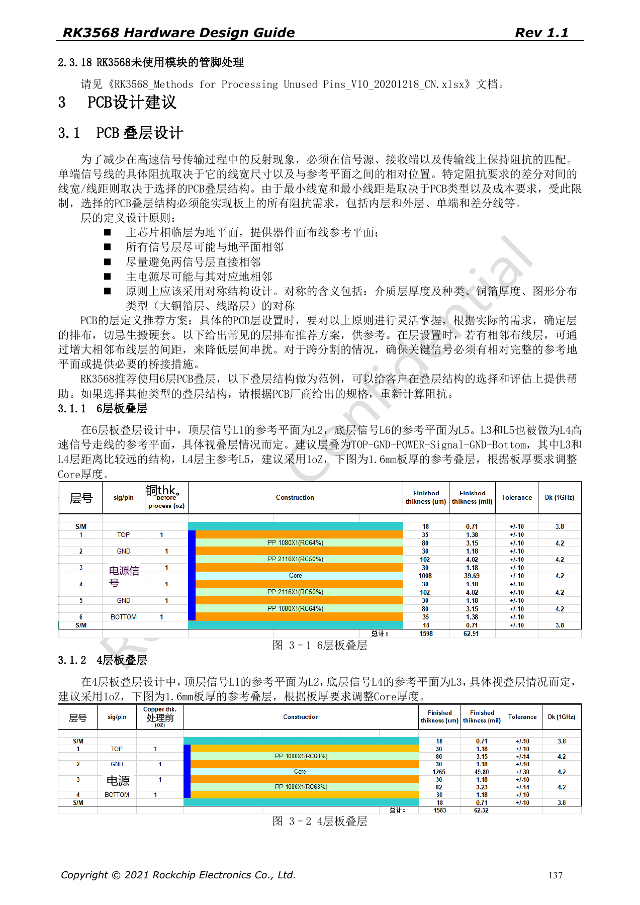
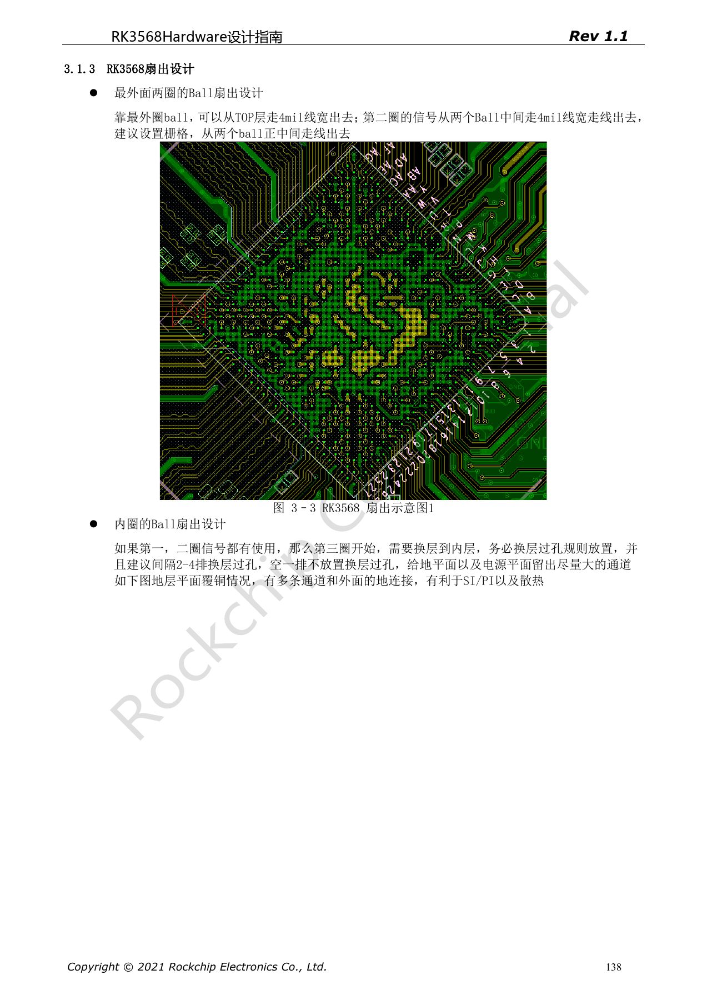
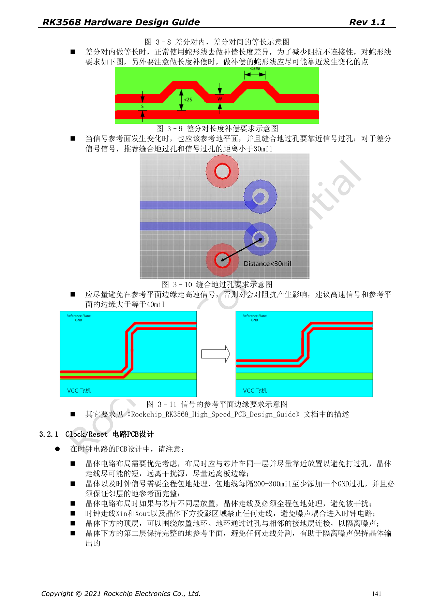

# RK3568 PCB 设计：叠层、扇出、回流与接口约束

本系列依据 RK3568 Hardware Design Guide V1.1（中文，2021-06-08）及独立的 High Speed PCB Design Guide V1.0.0（英文，2021-04-12），围绕具体工程问题重组。ArmSoM [Sige3](https://www.armsom.org/sige3) 采用 RK3568B2，可结合其[板卡文档](https://docs.armsom.org/armsom-sige3)学习与评估本系列设计问题。芯片级参考电路不等同于 Sige3 的实际原理图或全部引出接口；SDK/BSP、内核、硅版本、固件与外设组合须逐项核对。数值是原稿参考，未经 ArmSoM 硬件验证。

**CN V1.1 §3.1–3.2 · EN PCB V1.0.0 §1.1–1.26**

## 参考叠层不是板厂生产指令

中文稿给 4 层与 6 层参考，6 层示例为 TOP–GND–POWER–Signal–GND–Bottom，1.6mm 板厚及 1oz 铜是示例条件。介质、铜厚和压合会改变阻抗，须向板厂提交目标阻抗与容差后重新计算线宽/线距。4 层示例存在不代表任何外设组合都能用 4 层达到信号与热要求。

## 扇出时给电源和地留通道

外两圈 ball 参考可用 4mil 扇出，内圈换层过孔应规则排列，原稿建议每 2–4 排过孔留一排通道，以免把地平面切碎。高速信号换参考面时，伴随地过孔要靠近信号孔；差分参考距离 <30mil。高速信号距参考面边缘建议 ≥40mil，长度补偿放在产生差异的位置附近。

## 把英文高速表作为独立约束来源

英文 45 页文件补充 USB、SATA、PCIe、显示、存储、RGMII 和各类 DDR 的布线规则，不是 199 页中文稿的逐页译本。单位、严格小于与不大于、推荐值与最低值均需保留。DDR 的命令、数据、控制和 ECC 表按拓扑分开，不能用一个“全总线等长”规则代替。签核应输出约束规则、例外清单和仿真记录。

## 连接器之外还要审查电源布局

去耦电容接地路径、PMIC 开关回路、SoC 反馈与大电流铜皮同样影响稳定性。Wi-Fi 模组避开 DDR/HDMI/USB/屏线干扰，天线馈线参考 50Ω、尽量短且无分支；VBAT 参考线宽 >40mil。最终应以实际 PCB 叠层、制造能力、线缆和外壳完成 SI/PI 与无线验证，不能把原稿线宽当所有板材的通用阻抗。

## 原稿参数与约束

| 项目 | 原稿参考 |
| --- | --- |
| 6 层参考 | TOP–GND–POWER–Signal–GND–Bottom |
| 外圈扇出 | 4mil reference |
| 信号过孔 → 地过孔 | <30mil reference |
| 信号 → 参考面边缘 | ≥40mil reference |

## 原稿配图

下列为原稿页面截图，供核对电路、图例与上下文，正文及参数表保留为可编辑文字。中文主指南没有对应英文整稿，因此其截图在四语中均保留中文；独立英文 PCB 稿的截图明确标为英文来源。PDF 页码均为物理页码。

中文硬件设计指南 · PDF 137

中文硬件设计指南 · PDF 138

中文硬件设计指南 · PDF 141

## 继续阅读与开发资料

- [RK3568 硬件设计系列：10 个电路、PCB 与量产主题](/zh/articles/rk3568-hardware-design-series/)
- [RK3568 音频与控制接口：I2S、UART、SPI、CAN 和 I2C](/zh/articles/rk3568-audio-control-interfaces-hardware/)
- [RK3568 量产硬件检查：热设计、ESD、焊接与存储](/zh/articles/rk3568-thermal-esd-assembly-hardware/)
- [ArmSoM Docs](https://docs.armsom.org/)
- [ArmSoM](https://www.armsom.org/)
