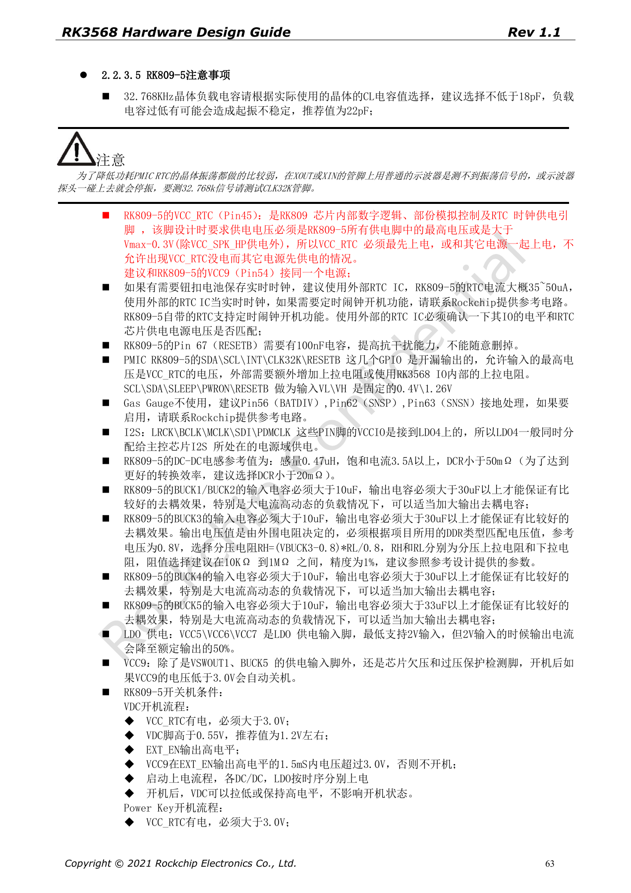
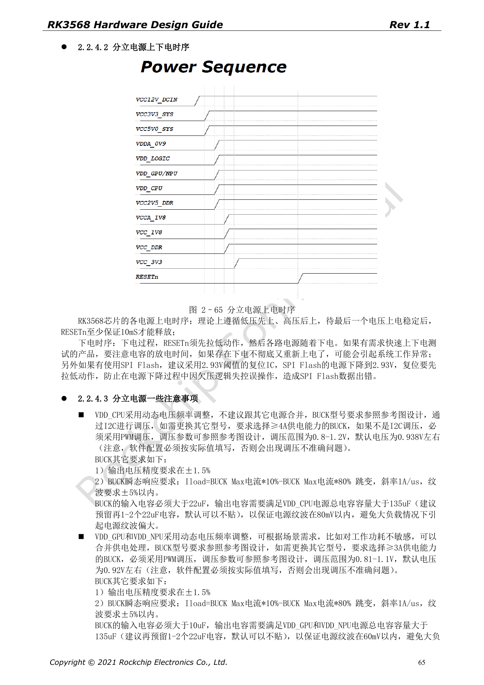

# RK3568 电源与 IO 域：RK809-5、分立方案和待机

本系列依据 RK3568 Hardware Design Guide V1.1（中文，2021-06-08）及独立的 High Speed PCB Design Guide V1.0.0（英文，2021-04-12），围绕具体工程问题重组。ArmSoM [Sige3](https://www.armsom.org/sige3) 采用 RK3568B2，可结合其[板卡文档](https://docs.armsom.org/armsom-sige3)学习与评估本系列设计问题。芯片级参考电路不等同于 Sige3 的实际原理图或全部引出接口；SDK/BSP、内核、硅版本、固件与外设组合须逐项核对。数值是原稿参考，未经 ArmSoM 硬件验证。

**CN V1.1 §2.1.11; §2.2 · PDF 44–67**

## 先把电源域与软件配置对齐

PMUIO0 固定 1.8V，PMUIO1 固定 3.3V；PMUIO2 与 VCCIO1–7 可配置 1.8V/3.3V，但 VCCIO2 由 FLASH_VOL_SEL 硬件选择。其余可配域的 DTS 电压必须与实际供电一致。外设电平、上拉电源与该域也要一致。对全部未用 IO 域的省电处理，须同时查首次上电的必须供电表，不能只依据“未使用”一句删除电源。

## 峰值不是整机功耗

原稿 CPU BUCK 要求 ≥4A，GPU/NPU/LOGIC 通用要求 ≥2A；CPU 总去耦 >135µF，GPU/NPU/LOGIC 通用段落为 >90µF。VDD_CPU_COM 接到供电 BUCK 的反馈端，减少 PCB 压降影响。第 67 页的电流为各模块参考峰值，不能直接相加当作 SoC 峰值，也不能据此计算散热。实际稳态、启动、DVFS 和负载跳变都需测量。

## 上下电与待机要一起审查

分立方案要求最终电源稳定后 RESETn 再保持至少 10ms，下电先拉低 RESETn。快速断电重启必须考虑电容放电。RK809-5 的 PMIC_SLEEP 正常为低、待机为高、唤醒恢复为低；低功耗设计还须保留 DDR 自刷新、PMU 和对应唤醒 IO 的供电。USB HID 唤醒需要 USB PHY 保持供电，不能套用最深待机断电表。未供电模块的 DTS 节点需禁用，防止初始化卡住。

## 原稿差异保留待核对

第 53 页 LOGIC BUCK 写 ≥2A，第 66 页分立方案写 ≥1.5A；通用段落负载跳变纹波为 ±3%，分立段落为 ±5%；LOGIC 去耦总量还有 >90µF 与 >99µF 的不同口径。这些不是本文自行统一的规格。选型前按当前芯片勘误、参考设计和电源厂商瞬态模型确认，并将 PCB、温度与实际负载纳入验证。

## 原稿完整电源峰值表

表 2–14，PDF 第 67 页。TBD 保留为待定；这些值不能简单求和当 SoC 功耗。

| PowerName | V | mA |
| --- | --- | --- |
| PMUPLL_AVDD_0V9 | 0.9 | 10 |
| PMUPLL_AVDD_1V8 | 1.8 | 9 |
| SYSPLL_AVDD_0V9 | 0.9 | 30 |
| SYSPLL_AVDD_1V8 | 1.8 | 18 |
| PMU_VDD_LOGIC_0V9 | 0.9 | 50 |
| VDD_CPU | DVFS | 3000 |
| VDD_GPU | DVFS | 1200 |
| VDD_NPU | DVFS | 1000 |
| VDD_LOGIC | 0.9 | 1200 |
| DDRPHY_VDDQ | 1.1/1.2/1.35/1.5 | TBD |
| DDRPHY_VDDQL | 0.6/1.1/1.2/1.35/1.5 | TBD |
| USB3_AVDD_0V9 | 0.9 | 5 |
| USB3_AVDD_1V8 | 1.8 | 30 |
| USB3_AVDD_3V3 | 3.3 | 10 |
| USB2_AVDD_0V9 | 0.9 | 5 |
| USB2_AVDD_1V8 | 1.8 | 30 |
| USB2_AVDD_3V3 | 3.3 | 10 |
| MULTI_PHY_AVDD_0V9 | 0.9 | 150 |
| MULTI_PHY_AVDD_1V8 | 1.8 | 21 |
| PCIE30_AVDD_0V9 | 0.9 | 160 |
| PCIE30_AVDD_1V8 | 1.8 | 60 |
| MIPI_CSI_RX_AVDD_0V9 | 0.9 | 10 |
| MIPI_CSI_RX_AVDD_1V8 | 1.8 | 2.5 |
| MIPI_DSI_TX0/LVDS_TX0_AVDD_0V9 | 0.9 | 50 |
| MIPI_DSI_TX0/LVDS_TX0_AVDD_1V8 | 1.8 | 15 |
| MIPI_DSI_TX1_AVDD_0V9 | 0.9 | 50 |
| MIPI_DSI_TX1_AVDD_1V8 | 1.8 | 15 |
| eDP_TX_AVDD_0V9 | 0.9 | 150 |
| eDP_TX_AVDD_1V8 | 1.8 | 100 |
| HDMI_TX_AVDD_0V9 | 0.9 | 25 |
| HDMI_TX_AVDD_1V8 | 1.8 | 16 |
| SARADC_AVDD_1V8 | 1.8 | 1.5 |
| OTP_VCC18 | 1.8 | 59 |
| PMUIO0 | 1.8 | TBD |
| PMUIO1 | 3.3 | TBD |
| PMUIO2/VCCIO1/2/3/4/5/6/7/ | 1.8/3.3 | TBD |


## 原稿参数与约束

| 项目 | 原稿参考 |
| --- | --- |
| VDD_CPU | BUCK ≥4A; C >135µF |
| VDD_GPU / VDD_NPU | BUCK ≥2A; C >90µF |
| VDD_LOGIC | p53 ≥2A / p66 ≥1.5A |
| RESETn | ≥10ms after final rail stable |
| PMIC_SLEEP | RUN=0; SLEEP=1 |

原稿 DTS 示例：当 VCCIO4 实际供电为 3.3V 时，对应供电引用必须同步修改。下面是该条件下的原稿配置；不要直接覆盖其他板卡。

```dts
&pmu_io_domains {
    status = "okay";
    pmuio2-supply = <&vcc_3v3>;
    vccio1-supply = <&vcc_3v3>;
    vccio3-supply = <&vcc_3v3>;
    vccio4-supply = <&vcc_3v3>;
    vccio5-supply = <&vcc_3v3>;
    vccio6-supply = <&vcc_3v3>;
    vccio7-supply = <&vcc_3v3>;
};
```

## 原稿配图

下列为原稿页面截图，供核对电路、图例与上下文，正文及参数表保留为可编辑文字。中文主指南没有对应英文整稿，因此其截图在四语中均保留中文；独立英文 PCB 稿的截图明确标为英文来源。PDF 页码均为物理页码。

[](/assets/rk3568-hardware-series/rk3568-cn-p63.png)

中文硬件设计指南 · PDF 63

[](/assets/rk3568-hardware-series/rk3568-cn-p65.png)

中文硬件设计指南 · PDF 65

## 继续阅读与开发资料

- [RK3568 硬件设计系列：10 个电路、PCB 与量产主题](/zh/articles/rk3568-hardware-design-series/)
- [RK3568 最小系统：时钟、复位、启动与调试](/zh/articles/rk3568-boot-clock-reset-hardware/)
- [RK3568 DDR 设计：颗粒、拓扑、ECC 与布线约束](/zh/articles/rk3568-ddr-topology-routing/)
- [ArmSoM Docs](https://docs.armsom.org/)
- [ArmSoM](https://www.armsom.org/)
