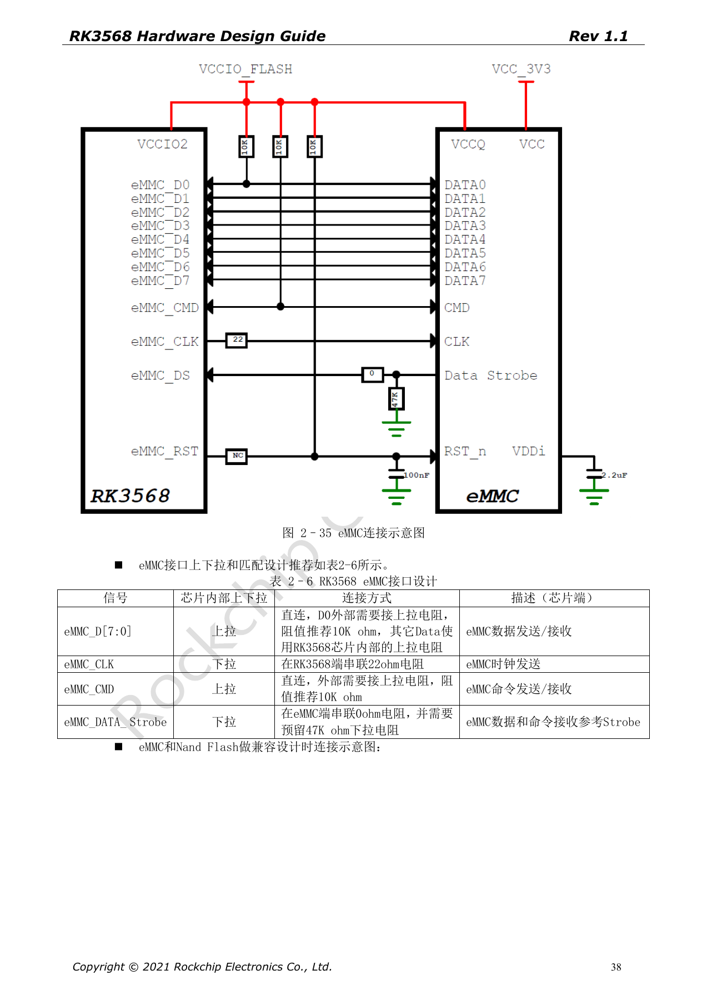
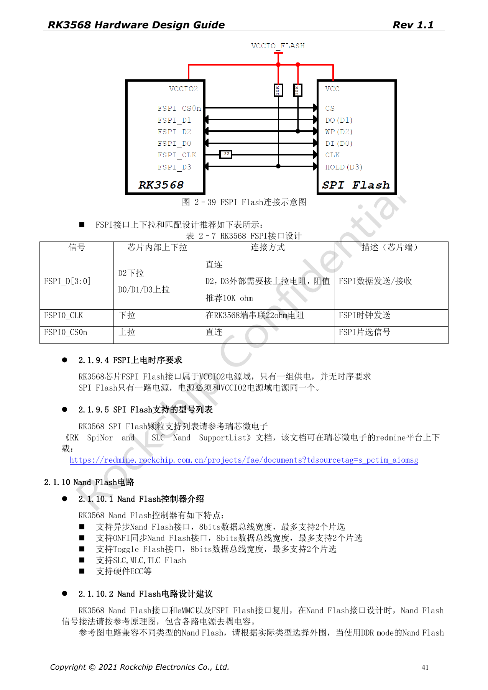
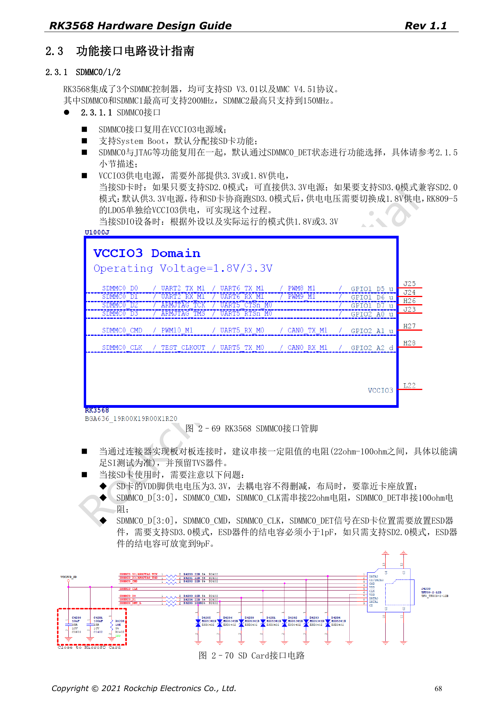

# RK3568 启动存储：eMMC、FSPI、NAND 与 SDMMC 电路

本系列依据 RK3568 Hardware Design Guide V1.1（中文，2021-06-08）及独立的 High Speed PCB Design Guide V1.0.0（英文，2021-04-12），围绕具体工程问题重组。ArmSoM [Sige3](https://www.armsom.org/sige3) 采用 RK3568B2，可结合其[板卡文档](https://docs.armsom.org/armsom-sige3)学习与评估本系列设计问题。芯片级参考电路不等同于 Sige3 的实际原理图或全部引出接口；SDK/BSP、内核、硅版本、固件与外设组合须逐项核对。数值是原稿参考，未经 ArmSoM 硬件验证。

**CN V1.1 §2.1.8–2.1.10; §2.3.1 · EN PCB §1.11–1.15**

## 共享管脚决定启动方案

eMMC、NAND 与 FSPI 共享接口资源。VCCIO2 的电压与 FLASH_VOL_SEL 必须在上电前匹配，不能依赖系统启动后修正。指南列 eMMC 4.41/4.51/5.0/5.1、1/4/8-bit 和 HS200；应按实际颗粒、loader 和 BSP 的支持清单选择模式。兼容多种存储焊盘时，应复核分支与未装器件残桩，而不只确认逻辑网名。

## 电阻、上拉与恢复路径

eMMC 的 D0、CMD 外接 10kΩ 上拉，CLK 在 SoC 端串 22Ω；Data Strobe 在 eMMC 端串 0Ω，并预留 47kΩ 下拉。FSPI D2/D3 外接 10kΩ 上拉、CLK 串 22Ω，Flash 电源与 VCCIO2 同源。原稿还提供通过测试点阻止存储启动进入 Maskrom 的维修方法，并强调识别后释放短接、正常更新不宜使用，错误操作可能损坏 IO。工程上应先保留正常 Loader 下载入口。

## SD 卡供电与信号电平不同

SDMMC0 支持启动，位于 VCCIO3；SDMMC1 默认 SDIO Wi-Fi，位于 VCCIO4，不支持系统启动。SDMMC0/1 最高 200MHz，SDMMC2 最高 150MHz 是原稿控制器口径。SD 卡 VDD 保持 3.3V；需要 SD3.0 模式时，协商后 IO 域从 3.3V 切到 1.8V。SD3.0 的 ESD 结电容 <1pF，SD2.0 可放宽到 9pF。不要把 IO 切换误作卡电源切换。

## 把速度要求落入 PCB 约束

英文高速 PCB 表要求这些单端总线 50Ω±10%。eMMC 数据到时钟差 <120mil、总长 <4in；FSPI 差 <200mil、总长 <4in。SDIO/SDMMC 差 <120mil，数据率 ≤50Mbps 时 <6in，>50Mbps 时 <4in。这里保留原稿 Mbps 单位，不擅自改成 MHz。测试应覆盖目标速度、不同卡或颗粒、掉电恢复和长时间读写。

## 原稿参数与约束

| 项目 | 原稿参考 |
| --- | --- |
| eMMC CLK / D0 / CMD | 22Ω / 10kΩ pull-up / 10kΩ pull-up |
| FSPI CLK / D2 / D3 | 22Ω / 10kΩ pull-up / 10kΩ pull-up |
| eMMC / FSPI length | <4in / <4in |
| SDMMC0/1 / SDMMC2 | ≤200MHz / ≤150MHz |

## 原稿配图

下列为原稿页面截图，供核对电路、图例与上下文，正文及参数表保留为可编辑文字。中文主指南没有对应英文整稿，因此其截图在四语中均保留中文；独立英文 PCB 稿的截图明确标为英文来源。PDF 页码均为物理页码。

中文硬件设计指南 · PDF 38

中文硬件设计指南 · PDF 41

中文硬件设计指南 · PDF 68

## 继续阅读与开发资料

- [RK3568 硬件设计系列：10 个电路、PCB 与量产主题](/zh/articles/rk3568-hardware-design-series/)
- [RK3568 DDR 设计：颗粒、拓扑、ECC 与布线约束](/zh/articles/rk3568-ddr-topology-routing/)
- [RK3568 高速扩展：USB、SATA、PCIe 复用与时钟](/zh/articles/rk3568-usb-sata-pcie-hardware/)
- [ArmSoM Docs](https://docs.armsom.org/)
- [ArmSoM](https://www.armsom.org/)
